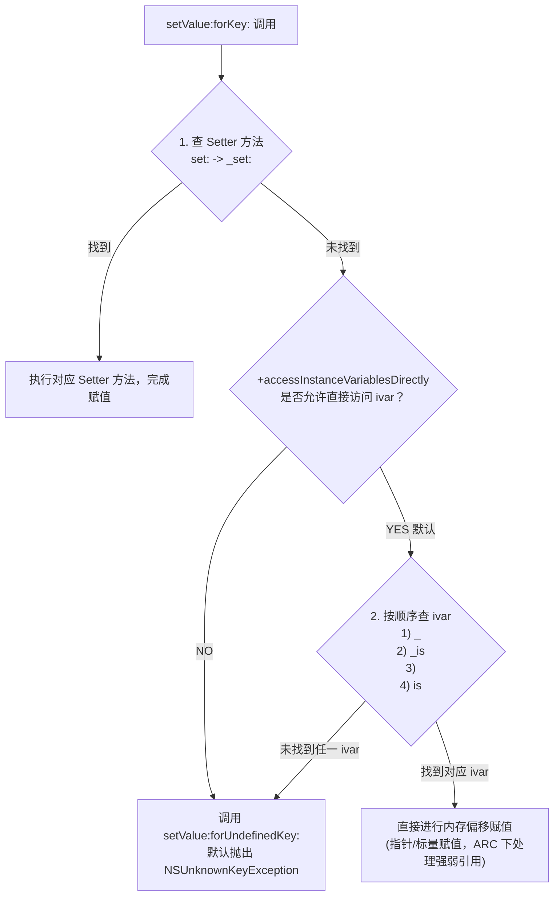
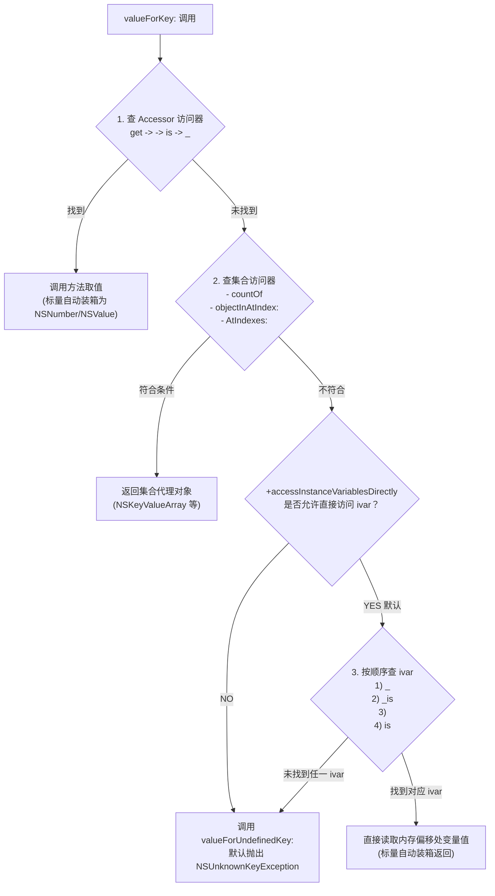

# Objective-C KVC 知识点总结

> 根据 Objective-C 进阶学习整理 · 2026
>
> 核心主线：**字符串间接访问 → 动态查找规则（Getter/Setter） → 自动装箱拆箱 → 集合操作符与代理 → 异常防护机制**

---

[toc]

---

## 一、一句话理解 KVC

> **KVC（Key-Value Coding，键值编码）是基于 Objective-C 动态特性的非形式化协议（Informal Protocol），允许客户端通过字符串名称（Key）间接访问对象的属性或成员变量，无需在编译时显式调用 Accessor 方法或访问实例变量。**

它回答的核心问题：

| 问题 | 对应的机制 / API |
| --- | --- |
| 如何通过字符串读写属性？ | `valueForKey:`、`setValue:forKey:`、`valueForKeyPath:`、`setValue:forKeyPath:` |
| 查找一个 Key 的底层顺序是什么？ | Accessor 命名匹配 → 集合访问器 → `accessInstanceVariablesDirectly` 开关 → 实例变量匹配 |
| Key 找不到或赋值为 nil 时怎么办？ | `valueForUndefinedKey:`、`setValue:forUndefinedKey:`、`setNilValueForKey:` |
| 基本数据类型和结构体如何传递？ | NSNumber、NSValue 自动装箱（Boxing）与拆箱（Unboxing） |
| 如何高效聚合计算或批量访问？ | 集合操作符（`@avg`、`@sum`、`@distinctUnionOfObjects` 等）、集合代理对象 |

---

## 二、知识地图：四层体系

```
第一层  基础 API 与概念    Key、KeyPath、批量读写、自动装箱与拆箱
   │
第二层  底层查找搜索链      Getter 搜索流程 / Setter 搜索流程 / 实例变量查找开关
   │
第三层  高级特性与集合      集合操作符（聚合/数组/嵌套） / 集合代理对象 / 属性验证
   │
第四层  工程实践与安全      字典转模型 / 私有成员访问 / 异常防御重写 / 性能与陷阱
```

---

## 三、核心 API 速查表

### 3.1 基础读写 API

| API | 功能说明 | 失败/异常行为 |
| --- | --- | --- |
| `- valueForKey:` | 查找与指定 Key 匹配的属性或 ivar 值 | 找不到触发 `valueForUndefinedKey:` |
| `- setValue:forKey:` | 将指定值写入与 Key 匹配的属性或 ivar | 找不到触发 `setValue:forUndefinedKey:`；基本类型传 nil 触发 `setNilValueForKey:` |
| `- valueForKeyPath:` | 跨层级多级路径访问（以 `.` 分隔，如 `author.address.city`） | 任意一级找不到抛出异常 |
| `- setValue:forKeyPath:` | 跨层级多级路径赋值 | 任意中间层为 nil 会抛异常或赋值失败 |

### 3.2 批量与集合代理 API

| API | 功能说明 | 核心价值 |
| --- | --- | --- |
| `- dictionaryWithValuesForKeys:` | 传入 Keys 数组，批量拉取属性生成 NSDictionary | 快速转字典、数据导出 |
| `- setValuesForKeysWithDictionary:` | 传入字典批量给对象属性赋值 | 简易字典转模型底层基础 |
| `- mutableArrayValueForKey:` | 返回对应 Key 的可变数组代理对象（`NSKeyValueArray`） | 修改此代理能触发 KVO |
| `- mutableSetValueForKey:` | 返回对应 Key 的可变集合代理对象（`NSKeyValueSet`） | 修改此代理能触发 KVO |
| `- mutableOrderedSetValueForKey:` | 返回对应 Key 的可变有序集合代理对象 | 修改此代理能触发 KVO |

### 3.3 容错与验证 API

| API | 默认行为 | 推荐重写策略 |
| --- | --- | --- |
| `- valueForUndefinedKey:` | 抛出 `NSUnknownKeyException` | 记录日志、返回 nil、防御崩溃 |
| `- setValue:forUndefinedKey:` | 抛出 `NSUnknownKeyException` | 记录日志、处理新旧字段兼容、防御崩溃 |
| `- setNilValueForKey:` | 抛出 `NSInvalidArgumentException`（基本标量类型赋 nil） | 设置默认值（如 `0`、`NO` 等） |
| `- validateValue:forKey:error:` | 默认调用 `validate<Key>:error:` 验证合法性 | 数据校验、修正输入参数 |

---

## 四、底层搜索流程（重中之重）

### 4.1 Setter 赋值搜索流程图



### 4.2 Getter 取值搜索流程图



---

## 五、自动装箱与拆箱（Autoboxing）

KVC 抹平了 Objective-C 对象与 C 基本数据类型/结构体的鸿沟：

| 数据类型 | 写入（setValue） | 读取（valueForKey） | 特殊异常 |
| --- | --- | --- | --- |
| `int`, `float`, `double`, `BOOL`, `NSInteger` 等 | 传入 `NSNumber` 对象，内部自动拆箱调用原始标量方法/写 ivar | 读取标量后自动装箱为 `NSNumber *` 返回 | 赋 `nil` 触发 `setNilValueForKey:` |
| `CGPoint`, `CGSize`, `CGRect`, `NSRange` 等 | 传入 `[NSValue valueWithBytes:&val objCType:...]` | 读取结构体后自动包装为 `NSValue *` 返回 | 结构体类型不匹配引发异常 |

> **极度重要防御点**：
> 若对基本标量属性（如 `NSInteger age`）执行 `[obj setValue:nil forKey:@"age"]`，系统不会静默忽略，而是直接抛出 `NSInvalidArgumentException`。重写 `-setNilValueForKey:` 是防止生产环境闪退的必备手段。

---

## 六、集合操作符速查（Collection Operators）

语法格式：`keyPath.operator.property`

```
  books.@avg.price
   │      │     │
集合属性  操作符  目标属性
```

### 6.1 三大类操作符

| 分类 | 操作符 | 功能作用 | 示例 |
| --- | --- | --- | --- |
| **聚合操作符**<br/>(返回单个值) | `@avg` | 求平均值（返回 NSNumber） | `[employees valueForKeyPath:@"@avg.salary"]` |
| | `@count` | 元素总个数（右侧属性可不填） | `[employees valueForKeyPath:@"@count"]` |
| | `@max` | 求最大值（支持数值、日期、比较对象） | `[employees valueForKeyPath:@"@max.age"]` |
| | `@min` | 求最小值 | `[employees valueForKeyPath:@"@min.age"]` |
| | `@sum` | 求总和（返回 NSNumber） | `[orders valueForKeyPath:@"@sum.price"]` |
| **数组操作符**<br/>(返回 NSArray) | `@distinctUnionOfObjects` | 提取所有属性值，**去重**返回数组 | `[users valueForKeyPath:@"@distinctUnionOfObjects.city"]` |
| | `@unionOfObjects` | 提取所有属性值，**不去重**返回数组 | `[users valueForKeyPath:@"@unionOfObjects.city"]` |
| **嵌套集合操作符**<br/>(操作包含数组的数组) | `@distinctUnionOfArrays` | 扁平化展开所有嵌套数组属性，**去重** | `[teams valueForKeyPath:@"@distinctUnionOfArrays.members"]` |
| | `@unionOfArrays` | 扁平化展开所有嵌套数组属性，**不去重** | `[teams valueForKeyPath:@"@unionOfArrays.members"]` |
| | `@distinctUnionOfSets` | 扁平化展开嵌套 NSSet，去重返回 NSSet | `[sets valueForKeyPath:@"@distinctUnionOfSets.tags"]` |

---

## 七、集合代理对象（Mutable Collection Proxies）

当一个类拥有一个数组属性 `NSArray *items` 时：
- 直接调用 `[model.items addObject:...]` 会报无法识别选择子（因为不可变）。
- 如果属性是 `NSMutableArray *items`，直接 `[model.items addObject:...]` **不能触发 KVO**！
- **KVC 解决方案**：使用 `mutableArrayValueForKey:@"items"` 获取代理对象。

```objc
// 获取内部封装的 NSKeyValueFastMutableArray / NSKeyValueNotifyingMutableArray 代理
NSMutableArray *proxyArray = [model mutableArrayValueForKey:@"items"];
[proxyArray addObject:@"New Item"]; // 底层会自动发出 KVO 变化通知，并更新真实集合
```

---

## 八、核心面试高频考点

| 面试题目 | 核心考察要点与一句话答案 |
| --- | --- |
| 1. KVC 的底层查找顺序是什么？ | Setter：`set<Key>:` → `_set<Key>:` → 判断开关 → `_<key>` → `_is<Key>` → `<key>` → `is<Key>`；Getter 类似多了集合访问器和 `is<Key>` 前置。 |
| 2. KVC 可以访问私有成员变量吗？ | 可以。即使没有公开声明 property，只要存在符合命名约定的 ivar 且 `+accessInstanceVariablesDirectly` 为 YES，就能直接穿透读写。 |
| 3. KVC 会破坏面向对象的封装性吗？ | 会。KVC 可以绕过编译期类型检查和访问权限控制，强制读写 private ivar，因此需谨慎用于外部库未暴露接口的修改。 |
| 4. `+accessInstanceVariablesDirectly` 默认返回什么？设为 NO 会怎样？ | 默认返回 YES。设为 NO 则当没有 setter/getter 方法时，直接跳过 ivar 查找，直奔 `undefinedKey:` 异常处理。 |
| 5. 基本数据类型传入 nil 会发生什么？ | 抛出 `NSInvalidArgumentException`，触发 `setNilValueForKey:`；可重写此方法赋默认值 0/NO。 |
| 6. KVC 字典转模型的原理与缺点？ | 原理是 `setValuesForKeysWithDictionary:` 遍历字典调用 `setValue:forKey:`。缺点：字段类型不匹配时不安全、遇到字典嵌套无法自动递归转换、模型多字段少字段易崩。 |
| 7. KVC 访问属性与直接点语法访问的性能差异？ | 点语法是编译期生成的直接方法调用（走 `objc_msgSend` 和缓存）；KVC 需要运行时解析字符串、动态查找匹配、反射及装箱拆箱，耗时通常慢一个数量级。 |
