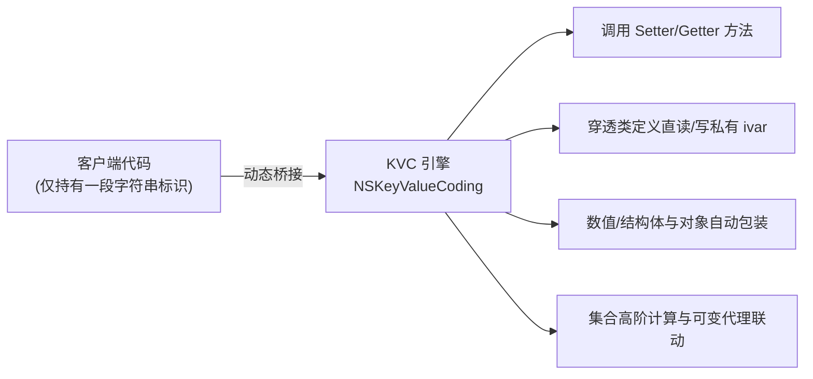
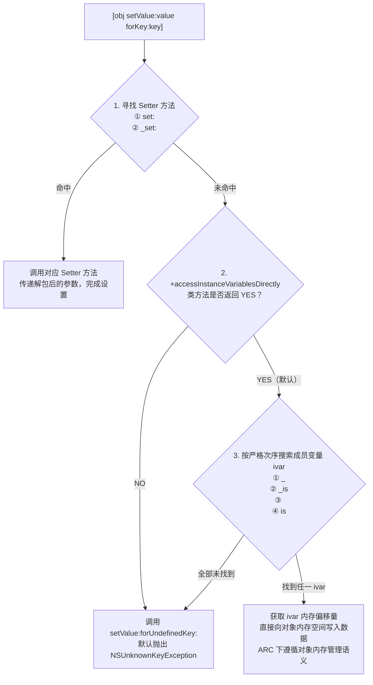
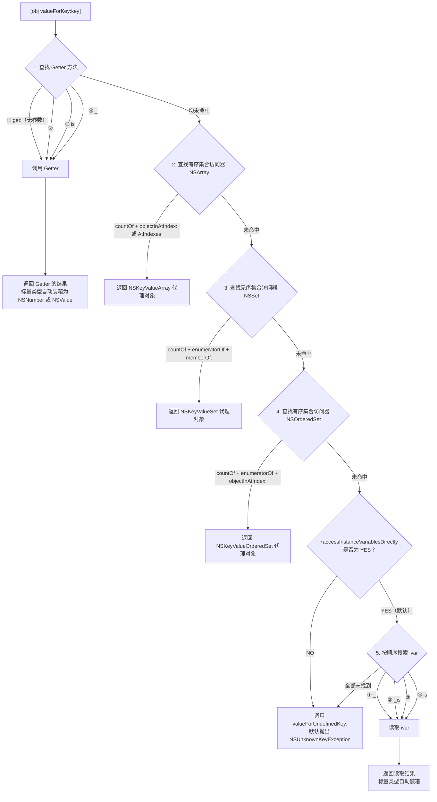

# Objective-C KVC 知识详解

> 全面剖析 Objective-C 中的键值编码（Key-Value Coding）体系：从非形式化协议、底层搜索机制、标量装箱拆箱、集合操作符与代理对象，到工程实战、防御式编程与高频面试题。
>
> 核心主线：**以字符串标识为入口 → 运行时动态匹配访问器与内存变量 → 自动抹平对象与标量鸿沟 → 集合抽象与观察者联动**

---

## 目录

- [第 0 章 KVC 核心心智模型](#第-0-章-kvc-核心心智模型)
- [第 1 章 KVC 基础 API 与常规使用](#第-1-章-kvc-基础-api-与常规使用)
- [第 2 章 Setter 底层查找流程剖析](#第-2-章-setter-底层查找流程剖析)
- [第 3 章 Getter 底层查找流程剖析](#第-3-章-getter-底层查找流程剖析)
- [第 4 章 标量装箱与拆箱机制（Autoboxing）](#第-4-章-标量装箱与拆箱机制autoboxing)
- [第 5 章 集合操作符全解（Collection Operators）](#第-5-章-集合操作符全解collection-operators)
- [第 6 章 集合代理对象与 KVO 桥接](#第-6-章-集合代理对象与-kvo-桥接)
- [第 7 章 KVC 属性验证机制（Validation）](#第-7-章-kvc-属性验证机制validation)
- [第 8 章 常见工程实践与防御性重写](#第-8-章-常见工程实践与防御性重写)
- [第 9 章 性能深度分析与底层开销](#第-9-章-性能深度分析与底层开销)
- [第 10 章 易错陷阱与深度面试题全解](#第-10-章-易错陷阱与深度面试题全解)

---

# 第 0 章 KVC 核心心智模型

## 0.1 什么是 KVC？

**Key-Value Coding（键值编码）** 是 Cocoa 提供的一种通过**字符串间接访问对象属性**的机制。在传统 Objective-C 编程中，访问对象的属性通常依赖编译期已知的访问器方法（Accessor Methods）或直接的指针解引用（如 `person.name` 或 `[person name]`）。

KVC 建立在 `NSKeyValueCoding` 协议之上。`NSObject` 通过分类（Category）默认实现了这个非形式化协议（Informal Protocol），因此在 iOS/macOS 环境下，几乎所有的对象天生具备 KVC 能力。

```objc
// 直接访问（编译期绑定选择子）
NSString *name = person.name;
[person setName:@"Tom"];

// 间接访问（KVC 运行时动态解析字符串）
NSString *name = [person valueForKey:@"name"];
[person setValue:@"Tom" forKey:@"name"];
```

## 0.2 KVC 的核心解决问题



1. **解耦与动态性**：调用方无需显式依赖宿主类的头文件和属性声明，只要知晓字符串名即可读取和修改内部状态。
2. **多级路径导航（KeyPath）**：用简单的点语法字符串（如 `department.manager.name`）串联起复杂的对象图谱访问。
3. **消除类型边界**：无论是 C 语言原生标量（`int`、`double`、`BOOL`）还是结构体（`CGRect`、`CGPoint`），KVC 统一以 `id` 视之，内部自动完成转换。
4. **支持声明式绑定与 KVO**：KVC 是 KVO（Key-Value Observing）与 Cocoa Bindings 的基础设施。

---

# 第 1 章 KVC 基础 API 与常规使用

## 1.1 单级 Key 与多级 KeyPath

- **Key**：单个属性名称，必须符合 ASCII 编码规范，通常以小写字母开头，不包含空格与特殊标点（如 `"name"`、`"age"`）。
- **KeyPath**：由多个 Key 通过英文句点 `.` 连接构成的深层访问路径（如 `"company.ceo.name"`）。

```objc
@interface Address : NSObject
@property (nonatomic, copy) NSString *city;
@end

@interface Person : NSObject
@property (nonatomic, copy) NSString *name;
@property (nonatomic, strong) Address *address;
@end

// 使用 Key
Person *p = [[Person alloc] init];
[p setValue:@"Alice" forKey:@"name"];
NSString *name = [p valueForKey:@"name"];

// 使用 KeyPath
Address *addr = [[Address alloc] init];
p.address = addr;
[p setValue:@"Beijing" forKeyPath:@"address.city"];
NSString *city = [p valueForKeyPath:@"address.city"]; // "Beijing"
```

> **注意**：如果 `p.address` 为 `nil`：
>
> - `[p valueForKeyPath:@"address.city"]` 返回 `nil`，不会崩溃。
> - 但 `[p setValue:@"Shanghai" forKeyPath:@"address.city"]` 内部试图对 `nil` 调用 `setValue:forKey:`，会导致执行逻辑断链（在特定深层嵌套结构或自定义对象处理中容易产生静默失败或异常）。

## 1.2 批量读取与写入

### 1.2.1 `dictionaryWithValuesForKeys:`
传入一个属性键名数组，返回包含所有对应键值对的 `NSDictionary`：

```objc
Person *p = [[Person alloc] init];
p.name = @"Bob";
[p setValue:@(28) forKey:@"age"];

NSDictionary *dict = [p dictionaryWithValuesForKeys:@[@"name", @"age"]];
// dict => @{@"name": @"Bob", @"age": @28}
```
*如果某个属性值为 `nil`，KVC 会将其转为 `[NSNull null]` 填充进返回的字典中，避免字典无法存 `nil` 的问题。*

### 1.2.2 `setValuesForKeysWithDictionary:`
根据字典中的键值对，依次调用 `setValue:forKey:` 给对象赋值：

```objc
NSDictionary *dict = @{@"name": @"Charlie", @"age": @30};
Person *p = [[Person alloc] init];
[p setValuesForKeysWithDictionary:dict];
```
*这套方法在早期 iOS 开发中常用于编写简单的字典转模型库。*

---

# 第 2 章 Setter 底层查找流程剖析

当执行 `[obj setValue:@"Tom" forKey:@"name"]` 时，系统底层是如何顺藤摸瓜找到对应成员并修改的？

## 2.1 完整 Setter 查找时序与决策树



## 2.2 详细步骤拆解

### 第一步：查找 Setter 访问器方法

系统会先根据 CamelCase 命名规则将 Key 的首字母大写（假设 Key 为 `"name"`，首字母大写为 `"Name"`）：
1. 寻找 `-setName:` 方法；
2. 若无，寻找 `-_setName:` 方法。

只要找到其中任意一个，KVC 就会通过类似 `objc_msgSend` 的机制直接调用该方法，将 value 传入。

### 第二步：检查成员变量直接访问开关

若方法均未找到，KVC 会调用当前类的类方法：
```objc
+ (BOOL)accessInstanceVariablesDirectly;
```
- `NSObject` 默认实现返回 **`YES`**。
- 若子类重写并返回 **`NO`**，表示“禁止通过 KVC 直接穿透修改底层实例变量”，查找中断，直接跳入第四步异常处理。

### 第三步：按既定顺序搜索底层成员变量（ivar）
当开关为 `YES` 时，Runtime 会利用元数据检查类及其继承链中的成员变量，按以下**严格顺序**进行匹配：
1. `_<key>` （例如 `_name`）
2. `_is<Key>` （例如 `_isName`）
3. `<key>` （例如 `name`）
4. `is<Key>` （例如 `isName`）

一旦匹配到任何一个变量，KVC 通过 `object_getInstanceVariable` 或 `class_getInstanceVariable` 取得该变量在对象实例内存布局中的基地址偏移（Offset），然后直接把值写入该块内存中！

> **ARC 环境下的细节**：
> 如果该 ivar 是一个 Object 类型（`id` 或 `NSString *` 等），直接写内存会遵循 ARC 所有权规则（`objc_storeStrong`），保证正确进行引用计数的加减，不会导致内存泄漏或野指针。

### 第四步：异常处理

如果经过上述搜索后依然一无所获，系统调用：
```objc
- (void)setValue:(id)value forUndefinedKey:(NSString *)key;
```
该方法在 `NSObject` 中的默认行为是抛出一个名为 `NSUnknownKeyException` 的致命异常：
```
*** Terminating app due to uncaught exception 'NSUnknownKeyException', 
reason: '[<Person 0x600000004> setValue:forUndefinedKey:]: this class is not key value coding-compliant for the key xxx.'
```

---

# 第 3 章 Getter 底层查找流程剖析

当执行 `id val = [obj valueForKey:@"name"]` 时，查找过程不仅比 Setter 复杂，还包含了**集合代理对象**的嗅探。

## 3.1 完整 Getter 查找流程图



## 3.2 深入理解集合访问器（Collection Accessor）

很多开发者误以为找不到 Getter 就直接去找 ivar，实际上苹果在中间预留了**集合访问模式**。
如果一个类没有声明 `NSArray *books` 属性，但它实现了：

```objc
- (NSUInteger)countOfBooks;
- (id)objectInBooksAtIndex:(NSUInteger)index;
```
此时调用 `[obj valueForKey:@"books"]`：
- KVC **不会**走 undefinedKey 报错！
- 它会自动在堆上构造一个继承自 `NSArray` 的代理对象（通常是私有类 `NSKeyValueArray`）返回给你。
- 当你对这个代理数组调用 `[array count]` 或 `array[0]` 时，代理内部会回调你对象的 `countOfBooks` 和 `objectInBooksAtIndex:`。

---

# 第 4 章 标量装箱与拆箱机制（Autoboxing）

由于 Objective-C 的方法签名中既有指针类型（`id`），也有 C 原生类型（`int`, `float`, `BOOL`, `struct`），而 KVC 的 API 参数和返回值全都是 `id`，KVC 内部必须承担起“类型桥接”的工作。

## 4.1 自动装箱（Boxing）—— 取值阶段

当调用 `valueForKey:` 时：
- 若目标属性或成员变量是原生数据类型（如 `int`, `float`, `BOOL`, `NSInteger`），KVC 会自动将它们包装成 `NSNumber`。
- 若目标属性是 C 结构体（如 `CGRect`, `CGPoint`, `CGSize`, `NSRange`），KVC 会自动包装为 `NSValue`。

```objc
struct MyCustomPoint {
    float x;
    float y;
};

// 即使是自定义结构体，只要遵循 @encode 编码，KVC 也能自动将其转为 NSValue
```

## 4.2 自动拆箱（Unboxing）—— 赋值阶段

当调用 `setValue:forKey:` 时：
- 如果目标方法参数或 ivar 是 `int`，而你传入了 `[NSNumber numberWithInt:18]`，KVC 内部会自动调用 `[number intValue]` 提取标量，传给底层。
- 如果目标接收结构体，传入对应的 `NSValue`，KVC 会通过 `[value getValue:&structVal]` 提取内存数据。

## 4.3 赋 nil 给标量时的 Crash 陷阱与重写

这是初中级开发者在工程中最常踩到的雷区：

```objc
@interface Student : NSObject
@property (nonatomic, assign) NSInteger age;
@end

Student *s = [Student new];
[s setValue:nil forKey:@"age"]; // Crash!!
```

运行直接抛出：
```
*** Terminating app due to uncaught exception 'NSInvalidArgumentException', 
reason: '[<Student 0x600000001> setNilValueForKey]: could not set nil as the value for the key age.'
```

### 为什么会 Crash？
因为 Objective-C 无法将 `nil`（一个空对象指针）转换为 C 语言的原生标量（如 `NSInteger` 必须有一个具体的整数值）。

### 解决方案：重写 `setNilValueForKey:`
```objc
- (void)setNilValueForKey:(NSString *)key {
    if ([key isEqualToString:@"age"]) {
        self.age = 0; // 设置容错默认值
    } else {
        [super setNilValueForKey:key];
    }
}
```

---

# 第 5 章 集合操作符全解（Collection Operators）

集合操作符是 KVC 最强大的能力之一。只要一个对象持有一个集合（`NSArray` 或 `NSSet`），就可以在 `valueForKeyPath:` 中嵌入操作符，对集合中的元素执行聚合、提取与去重。

语法结构：
```
[collection valueForKeyPath:@"@操作符.属性路径"]
```
*其中左侧如果本身就是集合对象，则直接以 `@操作符.属性` 开始。*

```objc
@interface Product : NSObject
@property (nonatomic, copy) NSString *name;
@property (nonatomic, assign) double price;
@end
```

## 5.1 聚合操作符（Aggregation Operators）
返回单一的值（通常是 `NSNumber` 或对象自身）。

| 操作符 | 含义与功能 | 示例 | 返回类型 |
| --- | --- | --- | --- |
| `@count` | 计算集合元素总数（右侧无需属性） | `[products valueForKeyPath:@"@count"]` | `NSNumber` |
| `@avg` | 计算某属性的算术平均值 | `[products valueForKeyPath:@"@avg.price"]` | `NSNumber` (double) |
| `@sum` | 计算某属性值的总和 | `[products valueForKeyPath:@"@sum.price"]` | `NSNumber` |
| `@max` | 找出该属性的最大值（按 `compare:` 对比） | `[products valueForKeyPath:@"@max.price"]` | 对应属性对象/标量包装 |
| `@min` | 找出该属性的最小值 | `[products valueForKeyPath:@"@min.price"]` | 对应属性对象/标量包装 |

> **边界场景提示**：
> - 如果数组为空 `[NSArray array]`，调用 `@avg.price` 返回的是 `0`（`@0`），不会除以零崩溃。
> - `@max` 和 `@min` 会调用元素的 `compare:` 方法，因此除了数值，还适用于 `NSDate` 或实现了比较的自定义类。

## 5.2 数组操作符（Array Operators）
作用于元素对象，提取特定属性组成新的 `NSArray`。

| 操作符 | 功能 | 特性 |
| --- | --- | --- |
| `@unionOfObjects` | 提取所有元素指定属性的值，放入数组 | **保留重复项** |
| `@distinctUnionOfObjects` | 提取所有元素指定属性的值，放入数组 | **去重**（内部使用 Hash 对比） |

```objc
// 假设 products 列表中有 3 个商品，名字分别为 "Apple", "Banana", "Apple"
NSArray *allNames = [products valueForKeyPath:@"@unionOfObjects.name"];
// ["Apple", "Banana", "Apple"]

NSArray *uniqueNames = [products valueForKeyPath:@"@distinctUnionOfObjects.name"];
// ["Apple", "Banana"]
```

## 5.3 嵌套集合操作符（Nesting Operators）
专门用于处理“数组套数组”或“集合套集合”的场景（例如二维数组展开）：

| 操作符 | 针对数据源 | 作用与去重性 |
| --- | --- | --- |
| `@unionOfArrays` | `NSArray<NSArray *>` | 扁平化展开所有子数组中的属性值，**不去重** |
| `@distinctUnionOfArrays` | `NSArray<NSArray *>` | 扁平化展开所有子数组中的属性值，**去重** |
| `@distinctUnionOfSets` | `NSSet<NSSet *>` | 扁平化展开所有子 Set 中的属性值，去重并返回 `NSSet` |

```objc
NSArray *classA = @[p1, p2];
NSArray *classB = @[p3, p4];
NSArray *school = @[classA, classB];

// 一键提取所有班级所有学生的名字并去重
NSArray *allStudentNames = [school valueForKeyPath:@"@distinctUnionOfArrays.name"];
```

---

# 第 6 章 集合代理对象与 KVO 桥接

在实际项目中，经常遇到这种诉求：“我希望监听一个数组的变化，比如每当有元素被 `addObject:` 时，收到 KVO 通知。”

## 6.1 为什么直接操作属性不能触发 KVO？

```objc
@interface Store : NSObject
@property (nonatomic, strong) NSMutableArray *goodsList;
@end

// 外部监听
[store addObserver:self forKeyPath:@"goodsList" options:NSKeyValueObservingOptionNew context:nil];

// 业务操作
[store.goodsList addObject:@"New Good"]; // ❌ 完全不会触发 KVO 回调！
```

**原因分析**：
KVO 监听的是 `store` 的 `goodsList` 属性的 **Setter 方法**（即 `setGoodsList:`）。`[store.goodsList addObject:]` 获取到的是底层的 `NSMutableArray` 实例，直接调用的是可变数组的成员方法，并未触发 `store` 自身的 `setGoodsList:`，因此观察者毫无感知。

## 6.2 救星：`mutableArrayValueForKey:`

KVC 提供了以下三个方法，用于获取集合属性的“代理对象”：  
- `- (NSMutableArray *)mutableArrayValueForKey:(NSString *)key;`
- `- (NSMutableSet *)mutableSetValueForKey:(NSString *)key;`
- `- (NSMutableOrderedSet *)mutableOrderedSetValueForKey:(NSString *)key;`

```objc
// 正确做法：
NSMutableArray *proxy = [store mutableArrayValueForKey:@"goodsList"];
[proxy addObject:@"New Good"]; // ✅ 成功触发 KVO！
```

### 底层原理分析
`mutableArrayValueForKey:` 返回的并不是原来的 `NSMutableArray`，而是一个内部派生类对象（如 `NSKeyValueNotifyingMutableArray` 或 `NSKeyValueFastMutableArray`）。

当对这个代理对象调用 `addObject:`、`removeObjectAtIndex:` 时：
1. 代理对象内部会自动调用宿主对象的 `willChange:valuesAtIndexes:forKey:`；
2. 将数据修改同步到底层真实的集合变量中；
3. 代理对象调用宿主对象的 `didChange:valuesAtIndexes:forKey:`；
4. 触发挂载在宿主对象上的 KVO 回调，`change` 字典中的 `NSKeyValueChangeKindKey` 会精准标注为 `NSKeyValueChangeInsertion` 等类型。

---

# 第 7 章 KVC 属性验证机制（Validation）

KVC 规范中包含一套属性值验证机制：

```objc
- (BOOL)validateValue:(inout id *)ioValue forKey:(NSString *)inKey error:(out NSError **)outError;
```

## 7.1 工作方式

当你调用 `validateValue:forKey:error:` 时，KVC 按照命名约定去当前类查找以下方法：
```objc
- (BOOL)validate<Key>:(id *)ioValue error:(NSError **)outError;
```

```objc
@interface User : NSObject
@property (nonatomic, copy) NSString *name;
@property (nonatomic, assign) NSInteger age;
@end

@implementation User

- (BOOL)validateAge:(id *)ioValue error:(NSError **)outError {
    NSInteger val = [(*ioValue) integerValue];
    if (val < 0 || val > 150) {
        if (outError) {
            *outError = [NSError errorWithDomain:@"UserDomain" code:1001 userInfo:@{NSLocalizedDescriptionKey: @"年龄非法"}];
        }
        return NO;
    }
    return YES;
}

@end
```

## 7.2 误区澄清

> **极重要事实**：
> 调用 `[user setValue:@(200) forKey:@"age"]` 时，**系统不会自动执行验证方法**！
> KVC 规范明确说明：验证逻辑必须由调用者**手动显式调用**，唯一的例外是 **Core Data** 会在 `save:` 时根据数据模型自动触发验证。在日常开发中，KVC 赋值默认是放行的。

---

# 第 8 章 常见工程实践与防御性重写

## 8.1 安全防御：避免 Crash 的标配重写

在任何使用 KVC、尤其是做字典解析或动态取值的基类中，必须重写以下两个方法以构建“防弹铠甲”：

```objc
@implementation SafeBaseModel

// 1. 防止读取未定义 key 导致崩溃
- (id)valueForUndefinedKey:(NSString *)key {
    NSLog(@"[KVC Warning] Reading undefined key: %@ in class: %@", key, NSStringFromClass([self class]));
    return nil; // 优雅降级返回 nil
}

// 2. 防止写入未定义 key 导致崩溃（兼容服务端多推字段）
- (void)setValue:(id)value forUndefinedKey:(NSString *)key {
    NSLog(@"[KVC Warning] Writing undefined key: %@ in class: %@", key, NSStringFromClass([self class]));
    // 可在此处处理字段映射，如服务端下发 id，而本地属性叫 userId
    if ([key isEqualToString:@"id"]) {
        [self setValue:value forKey:@"userId"];
    }
}

// 3. 防止将 nil 赋给基本数据类型标量
- (void)setNilValueForKey:(NSString *)key {
    NSLog(@"[KVC Warning] Attempt to set nil value for key: %@", key);
    // 对基础类型设为默认值 0
    [self setValue:@(0) forKey:key];
}

@end
```

## 8.2 访问私有属性与私有变量

在系统类没有公开提供某个 getter 或 setter 时，KVC 常被用来“黑魔法”式地读取或配置私有组件。

```objc
// 例如在早期 iOS 中，修改 UITextField 的 placeholder 颜色
UILabel *placeholderLabel = [textField valueForKey:@"_placeholderLabel"];
placeholderLabel.textColor = [UIColor redColor];
```
> **警示**：苹果在 iOS 13+ 对大量 UIKit 控件的私有 ivar 进行了运行时强校验，直接通过 KVC 访问特定下划线变量（如 `_placeholderLabel`）会直接在运行时抛异常崩溃。工业级开发中应避免使用 KVC 访问系统的私有成员，谨防审核被拒或系统升级闪退。

## 8.3 简易字典转模型的实现雏形

```objc
- (instancetype)initWithDictionary:(NSDictionary *)dict {
    if (self = [super init]) {
        [self setValuesForKeysWithDictionary:dict];
    }
    return self;
}
```
**局限性**：
1. 遇到嵌套字典，无法递归转换为子模型（仍然是 NSDictionary）。
2. 类型不强校验，若服务端下发字符串类型的 `"123"`，而本地是数值，可能引发后续类型异常。
3. 性能较低（纯反射匹配）。成熟工程中推荐使用 YYModel、MJExtension 等利用 Runtime 缓存方法列表的高性能框架。

---

# 第 9 章 性能深度分析与底层开销

KVC 带来了极大灵活性，但其性能开销不可忽视。

## 9.1 性能损耗到底来自哪里？

| 步骤 | 直接点语法 / 方法调用 | KVC 调用（`valueForKey:`） |
| --- | --- | --- |
| **选择子/符号** | 编译期确定 `SEL` | 运行时解析 `NSString`（首字母大写转换、拼接字符串） |
| **查找方式** | 直接查 Cache 散列表 → `objc_msgSend` | 循环拼接选择子尝试查找 → 查集合方法 → 查 ivar 元数据 |
| **内存访问** | 直接 CPU 寄存器 / 偏移量取值 | 运行时调用 `ivar_getOffset` 计算偏移后指针解引用 |
| **数据交互** | 原始标量直接进寄存器 | 原生类型必须 `malloc` 创建 `NSNumber`/`NSValue` 装箱，后续还需释放 |

## 9.2 性能对比测试数据（参考级）

以在循环中对同一个属性进行 1,000,000 次读写为例：
1. **直接访问 ivar**（`self->_name`）：基准 ~1x
2. **点语法 / Setter 调用**（`self.name = @"xxx"`）：~2.5x（由于 ARC 及 objc_msgSend 开销）
3. **KVC 赋值**（`[self setValue:@"xxx" forKey:@"name"]`）：~**15x - 30x**

> **架构建议**：在高性能循环（如音视频数据帧处理、几十万次循环的数据清洗）中，严禁使用 KVC，应尽可能使用直接访问器或局部变量缓存。

---

# 第 10 章 易错陷阱与深度面试题全解

## 10.1 核心易错点汇总

1. **基本数据类型赋 `nil` 崩溃**：未重写 `setNilValueForKey:`。
2. **多级路径中途为 `nil` 赋值**：`[p setValue:@"val" forKeyPath:@"a.b.c"]`，如果 `a` 或 `b` 为 `nil`，容易引发非预期逻辑或错误。
3. **可变集合修改未走代理**：直接调用 `[model.array addObject:]` 导致 KVO 失效，必须使用 `mutableArrayValueForKey:`。
4. **覆盖 `accessInstanceVariablesDirectly` 为 NO 后找不到 ivar 崩溃**。

---

## 10.2 高频面试题 20 问 20 答

### Q1：什么是 KVC？它的本质是什么？
**答**：KVC（Key-Value Coding）是 Objective-C 的非形式化协议，基于 Runtime 机制。其本质是通过字符串作为标识符，在运行时动态查找并调用对象的访问器方法或直接读写实例变量，从而实现属性的间接存取。

### Q2：`[obj setValue:value forKey:@"name"]` 的完整底层搜索顺序是怎样的？
**答**：
1. 优先查找 Setter 方法：`setName:` → `_setName:`；
2. 找不到方法时，判断 `+accessInstanceVariablesDirectly` 开关（默认 `YES`）；
3. 若为 `YES`，按顺序查找实例变量：`_name` → `_isName` → `name` → `isName`；
4. 若开关为 `NO` 或上述 ivar 均不存在，触发 `-setValue:forUndefinedKey:`，默认抛出 `NSUnknownKeyException`。

### Q3：`[obj valueForKey:@"name"]` 的完整底层搜索顺序是怎样的？
**答**：
1. 优先查找 Getter 访问器：`getName` → `name` → `isName` → `_name`；
2. 若未找到，查找符合规范的数组集合方法（`countOfName` + `objectInNameAtIndex:` 或 `nameAtIndexes:`）；
3. 若仍无，查找集合 Set 方法（`countOfName` + `enumeratorOfName` + `memberOfName:`）；
4. 若都不是，判断 `+accessInstanceVariablesDirectly` 开关；若为 `YES`，按 `_name` → `_isName` → `name` → `isName` 寻找 ivar 并读取；
5. 均失败则触发 `-valueForUndefinedKey:` 抛出异常。

### Q4：KVC 中的 `key` 和 `keyPath` 有什么区别？
**答**：`key` 是一个单一属性名称，无法跨层级；`keyPath` 是由 `.` 分隔的多层路径（如 `person.address.street`），KVC 内部会将其拆解为多个 key，顺着对象图递归调用 `valueForKey:`。

### Q5：`+accessInstanceVariablesDirectly` 默认返回什么？重写返回 NO 会发生什么？
**答**：默认返回 `YES`，允许在未找到访问器方法时直接读写底层 ivar。若重写返回 `NO`，则在缺少 setter/getter 时，KVC 将被阻止访问底层 ivar，直接触发 `undefinedKey` 异常。

### Q6：给基本数据类型（如 int）的属性通过 KVC 赋 nil，会发生什么？怎么解决？
**答**：会触发 `-setNilValueForKey:`，其默认实现会抛出 `NSInvalidArgumentException` 导致崩溃。解决办法是重写该类的 `-setNilValueForKey:`，在方法内根据 key 赋默认值（如 `@0`）。

### Q7：KVC 为什么能支持结构体和基础标量类型？
**答**：KVC 内部实现了自动装箱与拆箱机制。读取时将标量封装为 `NSNumber`、结构体封装为 `NSValue`；写入时检测目标参数类型，自动调用 `intValue`、`getValue:` 等方法提取数据。

### Q8：直接修改对象的可变数组属性（如 `[obj.array addObject:item]`）能否触发 KVO？为什么？如何解决？
**答**：不能。因为直接调用数组方法并未触发 `obj` 的 `setArray:` 方法。解决方案是使用 `[obj mutableArrayValueForKey:@"array"]` 获取可变数组代理对象，通过代理对象进行增删改，代理内部会自动向宿主对象触发 KVO 通知。

### Q9：KVC 的集合操作符有哪些分类？请列举几个常见的。
**答**：
1. 聚合操作符：`@avg`, `@count`, `@max`, `@min`, `@sum`；
2. 数组操作符：`@distinctUnionOfObjects`（去重）、`@unionOfObjects`（不去重）；
3. 嵌套集合操作符：`@distinctUnionOfArrays`、`@unionOfArrays`、`@distinctUnionOfSets`。

### Q10：KVC 访问私有成员变量会破坏面向对象的封装性吗？
**答**：会。KVC 可以绕过编译器权限检查（如 `@private`），甚至在未暴露属性声明的情况下直接读写对象的私有 ivar。这破坏了类的封装性，若私有变量在系统升级中被移除或更名，会导致运行时异常。

### Q11：`setValuesForKeysWithDictionary:` 在使用时有哪些潜在风险？
**答**：
1. 字典中存在模型未定义的 key 时，若未重写 `setValue:forUndefinedKey:` 会直接 Crash；
2. 遇到嵌套字典不会自动转成二级模型；
3. 如果模型中有标量类型而字典下发了 `NSNull`，会导致 `setNilValueForKey:` 崩溃。

### Q12：KVC 的属性验证方法 `-validateValue:forKey:error:` 是在 `setValue:forKey:` 时自动调用的吗？
**答**：不是。业务代码中调用 `setValue:forKey:` 时不会自动触发验证，必须由开发者显式调用。只有 Core Data 在执行托管对象保存时会自动进行 KVC 属性验证。

### Q13：KVC 在性能上比直接调用 getter/setter 慢，为什么？
**答**：
1. 字符串解析与动态拼接（如大写转换）；
2. 运行时反射查询方法列表和成员变量元数据；
3. 内存偏移量计算；
4. 标量类型的装箱与拆箱开销（在堆上分配 `NSNumber`/`NSValue` 带来额外内存管理压力）。

### Q14：如果一个类既有 `_name` 又有 `name` 成员变量，KVC setter 会给哪一个赋值？
**答**：在没有 Setter 方法的情况下，按既定查找顺序（`_name` → `_isName` → `name` → `isName`），会优先匹配并赋值给 `_name`。

### Q15：KVC 内部直接写入 ivar 时，ARC 是如何管理内存生命周期的？
**答**：在 ARC 环境下，Runtime 获取到 ivar 后，会读取其所有权修饰符（strong/weak 等），写入时底层会调用对应的引用计数维护函数（例如 `objc_storeStrong`、`objc_storeWeak`），确保正确 retain 新值、release 旧值，不会造成内存泄漏。

### Q16：如何在不使用属性的情况下，仅靠方法让 KVC 识别并返回一个数组？
**答**：实现一对集合访问器方法即可：`-countOf<Key>` 和 `-objectIn<Key>AtIndex:`。调用 `[obj valueForKey:@"key"]` 时，KVC 会自动生成并返回一个 `NSKeyValueArray` 代理对象。

### Q17：如果属性名首字母是缩写（如 `URL` 或 `id`），Setter 查找顺序会受到影响吗？
**答**：KVC 会严格执行“首字母大写拼接”。例如 Key 为 `url`，优先找 `setUrl:`；如果 Key 写作 `URL`，大写首字母依然是 `U`，因此查找 `setURL:`。为避免大小写匹配混乱，应严格遵循 CamelCase 命名规范。

### Q18：`valueForKey:` 返回 nil 与抛出异常的界限是什么？
**答**：如果 Key 存在于对象中且当前变量存储的值就是 `nil`，则正常返回 `nil`；如果对象在方法链和成员变量链中遍历穷尽后仍未找到该 Key，才会调用 `valueForUndefinedKey:` 抛出异常。

### Q19：如何利用 KVC 快速求出模型数组中某属性的最大值？
**答**：
```objc
NSNumber *maxPrice = [products valueForKeyPath:@"@max.price"];
```

### Q20：请简述使用 KVC 的黄金守则（Best Practices）。
**答**：
1. **防范未然**：基类必须重写 `valueForUndefinedKey:`、`setValue:forUndefinedKey:` 和 `setNilValueForKey:`；
2. **警惕高频**：避免在循环、帧渲染等高性能代码路径中使用 KVC；
3. **拥抱类型安全**：业务逻辑优先采用编译器类型检查的点语法，仅在动态配置、解析、跨组件通信等必要场景使用 KVC；
4. **远离系统私有变量**：避免通过 KVC 窥探和修改系统库未公开私有成员。
