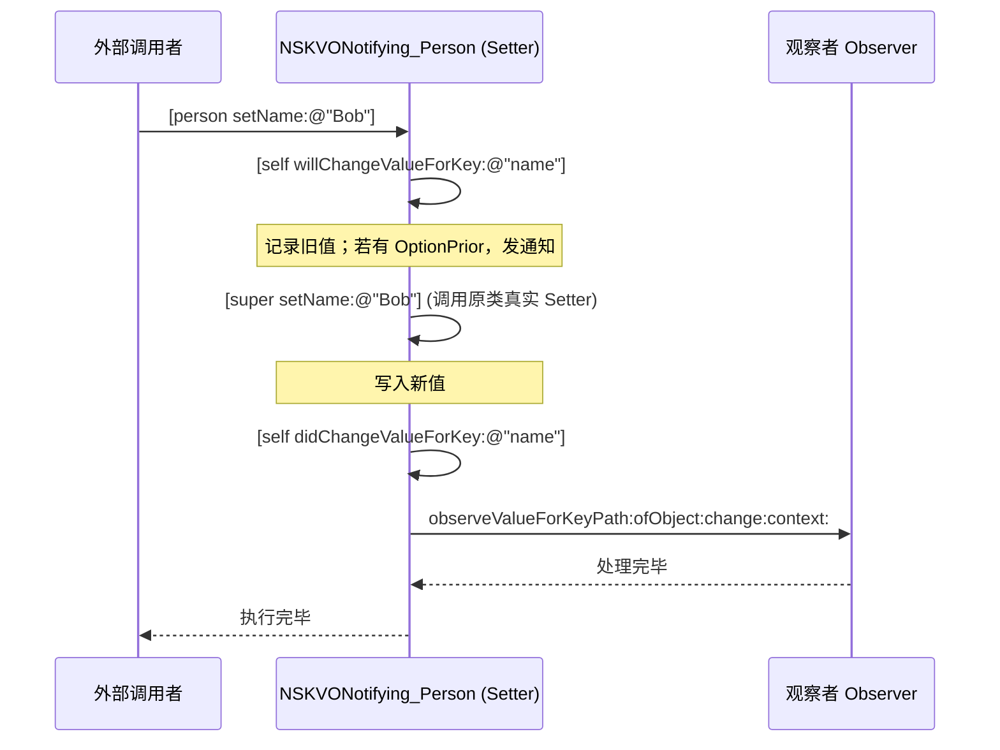

# Objective-C KVO 知识点总结

> 根据 Objective-C 进阶学习整理 · 2026
>
> 核心主线：**观察者注册 → isa-swizzling 动态派生子类 → Setter 拦截与通知派发 → 集合与键依赖 → 崩溃陷阱与安全防御**

---

[toc]

---

## 一、一句话理解 KVO

> **KVO（Key-Value Observing，键值监听）是 Cocoa 提供的一种允许对象在另一个对象的特定属性被修改时获得通知的观察者模式实现；其底层基于 Runtime 的 `isa-swizzling` 机制，在运行时动态派生中间子类 `NSKVONotifying_XXX` 并重写 Setter 方法以拦截赋值。**

它回答的核心问题：

| 问题 | 对应的机制 / API |
| --- | --- |
| 如何监听一个对象的属性改变？ | `addObserver:forKeyPath:options:context:` 与 `observeValueForKeyPath:ofObject:change:context:` |
| 底层是如何在不修改原类代码的前提下截获赋值的？ | `isa-swizzling` 动态派生 `NSKVONotifying_原类名`，替换对象 `isa` 指针，重写 setter、`class`、`dealloc`、`_isKVOA` |
| 为什么调 `[obj class]` 看不出子类？ | 动态子类重写了 `-class` 方法，刻意返回原类对象，欺骗调用者隐藏内部细节；需用 `object_getClass(obj)` 识破 |
| 如何控制自动/手动触发通知？ | `+automaticallyNotifiesObserversForKey:` + 成对调用 `willChangeValueForKey:` 与 `didChangeValueForKey:` |
| 属性之间存在依赖关系怎么通知？ | `+keyPathsForValuesAffectingValueForKey:` 关联多属性联动 |
| KVO 最容易发生的崩溃有哪些？ | 重复移除、未注册移除、释放时未移除、跨线程回调 UI 崩溃 |

---

## 二、知识地图：四层体系

```
第一层  基础 API 与流程    addObserver / observeValue / removeObserver / options / context
   │
第二层  底层核心机制      isa-swizzling / 动态子类 NSKVONotifying_ / Setter 重写拦截 / class 欺骗
   │
第三层  高级特性联动      手动触发控制 / 键依赖机制 / 集合属性变化监听 (mutableArrayValueForKey)
   │
第四层  工程实践与安全    崩溃场景归纳 / 跨线程问题 / Block 包装 / KVOController 架构
```

---

## 三、核心 API 速查表

### 3.1 监听全生命周期三部曲

| 阶段 | 方法签名 | 核心注意事项 |
| --- | --- | --- |
| **注册** | `addObserver:forKeyPath:options:context:` | `context` 强烈推荐使用唯一静态指针；`options` 按需配置 |
| **响应** | `observeValueForKeyPath:ofObject:change:context:` | 根据 `context` 判定事件；未处理的 context 必须传递给 `[super observeValueForKeyPath:...]` |
| **注销** | `removeObserver:forKeyPath:context:` | 必须成对移除！优先使用带 `context` 的精准移除版本 |

### 3.2 Options 选项配置

| 选项常量 | 含义 | change 字典中的表现 |
| --- | --- | --- |
| `NSKeyValueObservingOptionNew` | 接收改变后的**新值** | 字典包含 `NSKeyValueChangeNewKey` |
| `NSKeyValueObservingOptionOld` | 接收改变前的**旧值** | 字典包含 `NSKeyValueChangeOldKey` |
| `NSKeyValueObservingOptionInitial` | 在添加监听时**立即同步触发一次**回调 | 在 `addObserver:` 当前行同步触发，携带初始值 |
| `NSKeyValueObservingOptionPrior` | 在属性改变**前后各触发一次**通知 | 改变前通知包含 `NSKeyValueChangeNotificationIsPriorKey = @YES` |

### 3.3 Context 的最佳实践

> **绝对规范**：永远不要传递 `context: nil`！
> 使用类私有的静态上下文指针可彻底规避父类、子类监听同一 keyPath 时的混淆与冲突。

```objc
static void *PersonContext = &PersonContext;

// 注册
[person addObserver:self forKeyPath:@"name" options:NSKeyValueObservingOptionNew context:PersonContext];

// 回调
- (void)observeValueForKeyPath:(NSString *)keyPath ofObject:(id)object change:(NSDictionary *)change context:(void *)context {
    if (context == PersonContext) {
        // 安全处理属于当前类的业务逻辑
    } else {
        [super observeValueForKeyPath:keyPath ofObject:object change:change context:context];
    }
}
```

---

## 四、底层机制：isa-swizzling 核心速查

### 4.1 动态子类变化

```
未监听前：
  person 实例 ──isa──▶ Person 类对象 (方法列表包含 setName:)

调用 addObserver 后：
  person 实例 ──isa──▶ NSKVONotifying_Person (动态派生子类)
                            │
                            ├── superclass ──▶ Person 类对象
                            │
                            ├── 重写 setName:  (指向 _NSSetObjectValueAndNotify)
                            ├── 重写 class      (返回 Person 类，隐藏自身)
                            ├── 重写 dealloc    (收尾清理工作)
                            └── 重写 _isKVOA    (标记为 KVO 类，返回 YES)
```

### 4.2 两个核心判别 API 的差异

| 检查方式 | 执行结果（监听后） | 原理说明 |
| --- | --- | --- |
| `[person class]` | `Person` | 动态子类重写了 `-class`，返回 `[Person class]`，对外隐藏实现 |
| `object_getClass(person)` | `NSKVONotifying_Person` | 直接读取对象内存头部的真实 `isa` 指针，返回真实的动态子类 |

### 4.3 重写的 Setter 内部时序



---

## 五、手动触发控制与键依赖

### 5.1 手动触发控制
重写 `automaticallyNotifiesObserversForKey:` 关闭自动通知，并在修改时成对调用 `willChangeValueForKey:` 与 `didChangeValueForKey:`：

```objc
+ (BOOL)automaticallyNotifiesObserversForKey:(NSString *)key {
    if ([key isEqualToString:@"balance"]) {
        return NO; // 关闭 balance 的自动通知
    }
    return [super automaticallyNotifiesObserversForKey:key];
}

- (void)setBalance:(double)balance {
    if (_balance != balance) {
        [self willChangeValueForKey:@"balance"]; // 必须先调用
        _balance = balance;
        [self didChangeValueForKey:@"balance"];  // 必须后调用，内部触发回调
    }
}
```

### 5.2 键依赖（Dependent Keys）
当一个复合属性的值由其他多个属性计算而成时：

```objc
// 当 firstName 或 lastName 发生改变时，自动触发 fullName 的 KVO 回调
+ (NSSet<NSString *> *)keyPathsForValuesAffectingFullName {
    return [NSSet setWithObjects:@"firstName", @"lastName", nil];
}
```

---

## 六、KVO 致命崩溃陷阱与安全规范

| 崩溃根源 | 崩溃报错类型 | 预防手段 |
| --- | --- | --- |
| **重复移除** | `NSRangeException: Cannot remove an observer...` | 使用 `@try-@catch` 防护（不推荐作为常态），或使用统一安全管理者记录状态 |
| **未注册即移除** | `NSRangeException: because it is not registered` | 保证注册与注销严格一一对应，推荐带 `context` 移除 |
| **被观察者释放时仍有未移除的观察者** | 潜存野指针 Crash、状态错乱 | 在 `dealloc` 中确保 `removeObserver` 彻底执行 |
| **跨线程派发** | UI 刷新报主线程冲突或异步时序 Crash | KVO 回调线程完全**跟随 Setter 执行的线程**；若在子线程改属性，回调中必须 `dispatch_async` 回主线程刷 UI |
| **直接修改成员变量** | 监听完全失效（无 Crash，但不触发） | 必须调用 Setter 或 KVC，或手动包裹 `willChange`/`didChange` |

---

## 七、核心面试高频考点

| 面试题目 | 核心考点与一句话精髓 |
| --- | --- |
| 1. KVO 的底层实现原理是什么？ | 基于 Runtime 的 `isa-swizzling` 动态派生 `NSKVONotifying_XXX` 子类，重写 setter 在赋新值前后插入 `willChangeValueForKey:` 和 `didChangeValueForKey:`。 |
| 2. 为什么调用 `[obj class]` 看不到 `NSKVONotifying_`？ | 苹果在派生子类中故意重写了 `-class` 方法返回父类的 Class，隐藏内部实现细节；必须使用 `object_getClass(obj)` 才能读取真实类型。 |
| 3. 直接修改成员变量（如 `_name = @"xxx"`）会触发 KVO 吗？ | 不会。因为没有走被拦截重写的 Setter 方法。除非手动调用 `willChangeValueForKey:` 和 `didChangeValueForKey:`。 |
| 4. 如何对可变集合（如 `NSMutableArray`）进行 KVO 监听？ | 不能直接调用数组的 `addObject:`，需使用 `[obj mutableArrayValueForKey:@"list"]` 获取代理对象进行操作。 |
| 5. 只调用 `didChangeValueForKey:` 能触发 KVO 吗？ | 不能。KVO 必须成对调用 `willChangeValueForKey:` 和 `didChangeValueForKey:`，前者用于记录旧值与配置前置状态，后者才派发。 |
| 6. KVO 的观察者如果不注销会怎么样？ | 观察者先释放会导致野指针崩溃（EXC_BAD_ACCESS）；被观察者释放未移除在老系统会抛异常，且造成逻辑泄漏。 |
| 7. KVO 回调运行在哪个线程？ | 执行 Setter 赋值所在的线程，非主线程修改属性则回调在子线程执行，不可直接刷新 UI。 |
