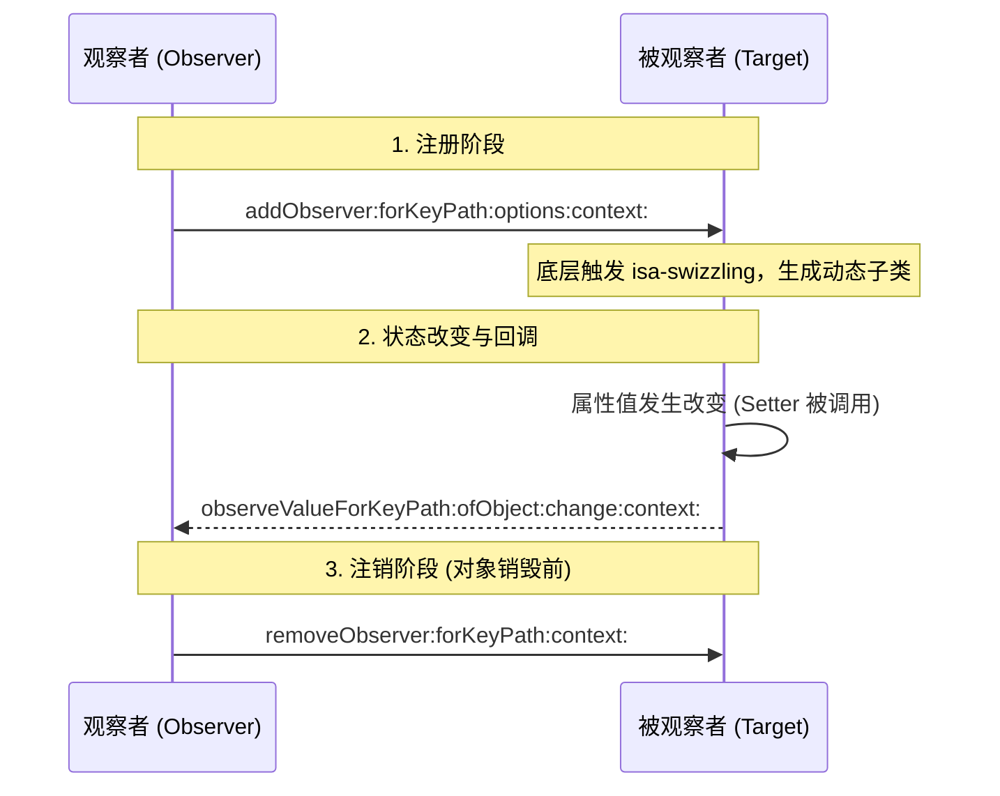
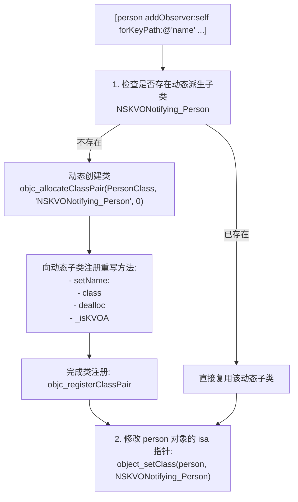
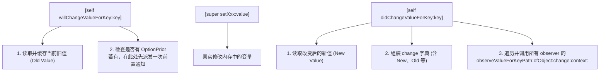
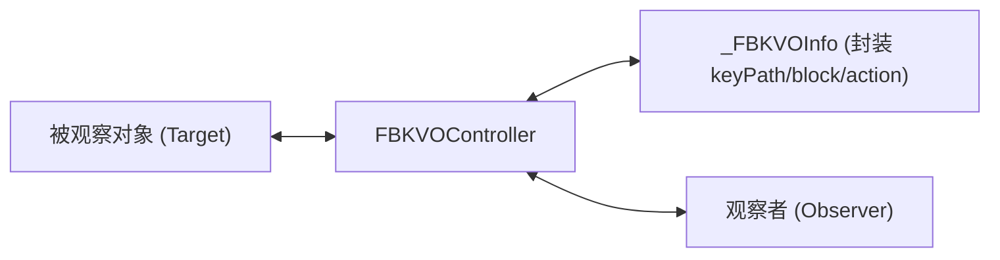

# Objective-C KVO 知识详解

> 全面剖析 Objective-C 中的键值观察（Key-Value Observing）体系：从观察者模式、`isa-swizzling` 动态派生子类、Setter 拦截与通知派发，到手动触发、键依赖、集合监听、崩溃防护及现代安全封装。
>
> 核心主线：**以 Runtime 动态派生子类为基石 → 劫持属性 Setter 注入通知钩子 → 伪装类对象隐藏实现细节 → 精准成对调度消除工程崩溃**

---

## 目录

- [第 0 章 KVO 核心心智模型](#第-0-章-kvo-核心心智模型)
- [第 1 章 KVO 基础 API 与规范使用](#第-1-章-kvo-基础-api-与规范使用)
- [第 2 章 isa-swizzling 核心底层原理](#第-2-章-isa-swizzling-核心底层原理)
- [第 3 章 重写的 Setter 与通知派发机制](#第-3-章-重写的-setter-与通知派发机制)
- [第 4 章 手动触发控制与精准通知](#第-4-章-手动触发控制与精准通知)
- [第 5 章 键依赖机制（Dependent Keys）](#第-5-章-键依赖机制dependent-keys)
- [第 6 章 集合属性变化的观察实战](#第-6-章-集合属性变化的观察实战)
- [第 7 章 KVO 崩溃陷阱与线程安全](#第-7-章-kvo-崩溃陷阱与线程安全)
- [第 8 章 现代 KVO 与安全封装（KVOController）](#第-8-章-现代-kvo-与安全封装kvocontroller)
- [第 9 章 KVC 与 KVO 的内在纽带](#第-9-章-kvc-与-kvo-的内在纽带)
- [第 10 章 易错陷阱与深度面试题全解](#第-10-章-易错陷阱与深度面试题全解)

---

# 第 0 章 KVO 核心心智模型

## 0.1 什么是 KVO？

**Key-Value Observing（键值观察）** 是 Cocoa 提供的一种用于监听对象属性变化的观察者模式（Observer Pattern）实现。通过 KVO，当一个被观察对象（Target）的指定属性发生改变时，系统会自动将变化前后的状态异步或同步派发给注册的观察者对象（Observer）。

与传统 Delegate（代理）和 NSNotificationCenter（通知中心）相比，KVO 具有显著特性：
1. **无需被观察者显式编写派发代码**：Delegate 和通知中心都需要目标对象显式调用 `[delegate xxx]` 或 `postNotification:`；而 KVO 对业务代码几乎是**零侵入**的。
2. **一对多强绑定**：一个属性可以被多个观察者同时监听。
3. **基于 Runtime 黑魔法**：无需编译期介入，运行时直接修改类继承体系与方法映射。

## 0.2 对比三种常见的通信机制

| 维度 | KVO | Delegate | NSNotificationCenter |
| --- | --- | --- | --- |
| **关系模型** | 一对多（属性级别监听） | 一对一（通常为主从关系） | 多对多（广播体系） |
| **耦合度** | 极低（仅依赖 keyPath 字符串） | 较高（需遵守相同 Protocol） | 最低（仅依赖全局通知名称） |
| **业务侵入** | 零侵入（修改属性即可被监听） | 高（需在方法中手动代理回调） | 高（需手动 post 通知） |
| **性能消耗** | 中等（动态派生类、方法拦截、装箱） | 最快（直接函数/消息调用） | 中等（查通知列表、字符串匹配） |
| **易错性** | 高（忘记注销导致 Crash、线程问题） | 低（遵循 weak 即可规避循环） | 低（iOS 9+ 无需手动注销普通 observer） |

---

# 第 1 章 KVO 基础 API 与规范使用

## 1.1 生命周期三部曲



### 1.1.1 注册监听

```objc
- (void)addObserver:(NSObject *)observer   
         forKeyPath:(NSString *)keyPath     
            options:(NSKeyValueObservingOptions)options    
            context:(nullable void *)context;   
```

### 1.1.2 响应回调

```objc
- (void)observeValueForKeyPath:(nullable NSString *)keyPath
                      ofObject:(nullable id)object
                        change:(nullable NSDictionary<NSKeyValueChangeKey, id> *)change
                       context:(nullable void *)context;
```

### 1.1.3 注销监听
```objc
- (void)removeObserver:(NSObject *)observer
            forKeyPath:(NSString *)keyPath 
               context:(nullable void *)context;
```

## 1.2 Options 深度解析

`NSKeyValueObservingOptions` 是一个位掩码枚举（Bitmask），通过按位或 `|` 组合传入： 

| 选项枚举 | 核心作用 | change 字典表现 |
| --- | --- | --- |
| `NSKeyValueObservingOptionNew` | 提供改变后的**新值** | 携带 `NSKeyValueChangeNewKey` |
| `NSKeyValueObservingOptionOld` | 提供改变前的**旧值** | 携带 `NSKeyValueChangeOldKey` |
| `NSKeyValueObservingOptionInitial` | 在 `addObserver:` 当前行**立即同步触发一次回调** | 回调中的 change 携带初始值，便于做 UI 初始化 |
| `NSKeyValueObservingOptionPrior` | 在属性改变**前、后分别触发一次通知** | 改变前触发时，携带 `NSKeyValueChangeNotificationIsPriorKey = @YES` |

### OptionPrior 的实战意义

当需要在某个属性即将被修改前做一些资源锁存、状态快照，或者在即将改变前停止正在进行的动画时，`NSKeyValueObservingOptionPrior` 极其有效。

## 1.3 Context 的工业级规范

很多初学者喜欢传 `context: nil`，这在生产环境中是极其危险的。

> **为什么必须使用 Context？**
> 假设父类 `BaseViewController` 监听了 `model.status`，子类 `DetailViewController` 同样也监听了 `model.status`。当 `status` 发生改变时，父类和子类都会收到同一个回调 `observeValueForKeyPath:...`。
> 如果没有 `context` 区分，子类无法准确判断这个通知是本类发起的还是父类注册的；若子类直接处理后没有调用 `super`，父类逻辑会丢失；若调用了 `super`，可能导致重复处理！

### 规范推荐：静态私有指针
```objc
// 当前文件全局静态唯一变量，直接取指针自身地址
static void *PersonAgeKVOContext = &PersonAgeKVOContext;

// 注册
[self.person addObserver:self
              forKeyPath:@"age"
                 options:NSKeyValueObservingOptionNew | NSKeyValueObservingOptionOld
                 context:PersonAgeKVOContext];

// 回调中精准识别
- (void)observeValueForKeyPath:(NSString *)keyPath
                      ofObject:(id)object
                        change:(NSDictionary<NSKeyValueChangeKey,id> *)change
                       context:(void *)context {
    if (context == PersonAgeKVOContext) {
        id oldVal = change[NSKeyValueChangeOldKey];
        id newVal = change[NSKeyValueChangeNewKey];
        NSLog(@"Person age changed from %@ to %@", oldVal, newVal);
    } else {
        // 不属于当前类的 context，严格向下透传给 super
        [super observeValueForKeyPath:keyPath ofObject:object change:change context:context];
    }
}

// 移除
- (void)dealloc {
    [self.person removeObserver:self forKeyPath:@"age" context:PersonAgeKVOContext];
}
```

## 1.4 Change 字典键值表

在回调中，`change` 字典包含了本次属性变更的全部快照：

| 字典 Key (`NSKeyValueChangeKey`) | 对应数据类型 | 说明 |
| --- | --- | --- |
| `NSKeyValueChangeKindKey` | `NSNumber` (包装枚举) | 变更类型：设置（1）、插入（2）、删除（3）、替换（4） |
| `NSKeyValueChangeNewKey` | `id` | 新属性值（配置 `OptionNew` 时存在） |
| `NSKeyValueChangeOldKey` | `id` | 旧属性值（配置 `OptionOld` 时存在） |
| `NSKeyValueChangeIndexesKey` | `NSIndexSet` | 集合属性发生插入/删除/替换时受影响的下标集合 |
| `NSKeyValueChangeNotificationIsPriorKey` | `NSNumber (BOOL)` | 是否为改变前的前置通知（配置 `OptionPrior` 时存在） |

---

# 第 2 章 isa-swizzling 核心底层原理

苹果官方文档明确指出：
> *Automatic key-value observing is implemented using a technique called **isa-swizzling**.*

## 2.1 动态派生子类的全流程

当对象 `person`（类型为 `Person`）第一次被添加观察者时，Objective-C Runtime 在底层悄然执行了以下骚操作：



## 2.2 验证 isa 指针的变化

我们可以通过代码直接观察这个“李代桃僵”的过程：

```objc
Person *p = [[Person alloc] init];

NSLog(@"[注册前] class 方法: %@", [p class]);
NSLog(@"[注册前] object_getClass 真实 isa: %@", object_getClass(p));
NSLog(@"[注册前] setName: 方法实现 IMP: %p", [p methodForSelector:@selector(setName:)]);

[p addObserver:self forKeyPath:@"name" options:NSKeyValueObservingOptionNew context:nil];

NSLog(@"---------------------------------------");
NSLog(@"[注册后] class 方法: %@", [p class]);
NSLog(@"[注册后] object_getClass 真实 isa: %@", object_getClass(p));
NSLog(@"[注册后] setName: 方法实现 IMP: %p", [p methodForSelector:@selector(setName:)]);
```

### 控制台输出结果：
```
[注册前] class 方法: Person
[注册前] object_getClass 真实 isa: Person
[注册前] setName: 方法实现 IMP: 0x100001f30 (指向 Person 类中的真实方法)
---------------------------------------
[注册后] class 方法: Person
[注册后] object_getClass 真实 isa: NSKVONotifying_Person
[注册后] setName: 方法实现 IMP: 0x7fff201a4e10 (指向 Foundation 私有函数 _NSSetObjectValueAndNotify)
```

## 2.3 深入剖析动态子类重写的四大方法

### ① 重写 Setter 方法（以 `setName:` 为例）
动态子类将 `setName:` 的实现指向了 Foundation 框架内部的 `_NSSetObjectValueAndNotify`（基础数据类型对应 `_NSSetIntValueAndNotify`、`_NSSetDoubleValueAndNotify` 等）。
这是整个 KVO 拦截机制的核心动力源！

### ② 重写 `-class` 方法（“瞒天过海”）
苹果为了让开发者感觉不到这个中间子类的存在，在动态子类中重写了 `-class`：
```objc
- (Class)class {
    // 伪装：返回自己的父类 Class，而不是当前的 NSKVONotifying_Person
    return class_getSuperclass(object_getClass(self));
}
```
因此调用 `[person class]` 依然返回 `Person`。若想获取真实的底层类，必须调用 Runtime 函数 `object_getClass(person)`。

### ③ 重写 `-dealloc` 方法
用于在被观察对象销毁时，执行 KVO 内部数据结构的收尾与清理，防止悬挂指针。

### ④ 重写私有方法 `-_isKVOA`
返回 `YES`。系统通过这个私有方法快速判定一个类是否是 KVO 动态派生的类。

---

# 第 3 章 重写的 Setter 与通知派发机制

## 3.1 `_NSSetObjectValueAndNotify` 的伪代码实现

`Foundation` 框架中经过逆向还原的 `_NSSetObjectValueAndNotify` 的核心执行逻辑如下：

```c
void _NSSetObjectValueAndNotify(id self, SEL _cmd, id value) {
    // 1. 调用 willChangeValueForKey:
    [self willChangeValueForKey:@"name"];
    
    // 2. 调用原始父类 (Person) 的 setName: 方法真实写入数据
    // 构造 objc_super 结构体，调用 objc_msgSendSuper
    struct objc_super superclassInfo = {
        .receiver = self,
        .super_class = class_getSuperclass(object_getClass(self)) // 即 Person
    };
    objc_msgSendSuper(&superclassInfo, _cmd, value);
    
    // 3. 调用 didChangeValueForKey:
    [self didChangeValueForKey:@"name"];
}
```

## 3.2 为什么必须成对调用 `willChange` 与 `didChange`？

很多同学以为通知是在 `didChangeValueForKey:` 内部直接生成的，那 `willChangeValueForKey:` 到底干了什么？



> **致命陷阱**：
> 如果只调用 `didChangeValueForKey:` 而省略 `willChangeValueForKey:`，KVO **根本不会派发通知**！因为内部的变更标记位和旧值缓存没有初始化，`didChange` 会判定本次变更不合法而直接退出。

---

# 第 4 章 手动触发控制与精准通知

在某些特定场景下，我们不希望属性一被赋值就盲目通知（例如新值和旧值完全一样，或者需要多次赋值后只通知一次）。

## 4.1 关闭自动通知：`automaticallyNotifiesObserversForKey:`

```objc
@implementation Account

// 控制是否开启自动 KVO 通知
+ (BOOL)automaticallyNotifiesObserversForKey:(NSString *)key {
    if ([key isEqualToString:@"balance"]) {
        return NO; // 对 balance 属性关闭自动通知
    }
    return [super automaticallyNotifiesObserversForKey:key];
}

@end
```

## 4.2 手动控制派发的标准范式

在 Setter 中引入防抖和校验：

```objc
- (void)setBalance:(double)balance {
    // 只有在余额真实发生变化时，才触发通知
    if (_balance != balance) {
        [self willChangeValueForKey:@"balance"];
        _balance = balance;
        [self didChangeValueForKey:@"balance"];
    }
}
```

也可以提供一个批量更新方法，多次更新只派发一次通知：
```objc
- (void)updateBalanceStep1:(double)b1 step2:(double)b2 {
    [self willChangeValueForKey:@"balance"];
    _balance += b1;
    _balance += b2;
    [self didChangeValueForKey:@"balance"]; // 仅派发一次
}
```

---

# 第 5 章 键依赖机制（Dependent Keys）

在面向对象设计中，经常会出现“衍生属性”或“计算属性”。例如：
```objc
@property (nonatomic, copy) NSString *firstName;
@property (nonatomic, copy) NSString *lastName;
@property (nonatomic, readonly) NSString *fullName; // 由 firstName 和 lastName 拼接而成
```

如果外部监听了 `fullName`，但在代码中修改了 `person.firstName = @"Jack"`，如何让监听 `fullName` 的观察者自动收到回调？

## 5.1 解决方案：`keyPathsForValuesAffectingValueForKey:`

在宿主类中实现类方法 `keyPathsForValuesAffectingValueForKey:` 或遵循命名规范的 `+keyPathsForValuesAffecting<Key>`：

```objc
@implementation Person

// 方式一：统一分发
+ (NSSet<NSString *> *)keyPathsForValuesAffectingValueForKey:(NSString *)key {
    NSSet *keyPaths = [super keyPathsForValuesAffectingValueForKey:key];
    if ([key isEqualToString:@"fullName"]) {
        NSSet *affectingKeys = [NSSet setWithObjects:@"firstName", @"lastName", nil];
        keyPaths = [keyPaths setByAddingObjectsFromSet:affectingKeys];
    }
    return keyPaths;
}

// 方式二：更清晰的属性专有方法（推荐）
+ (NSSet<NSString *> *)keyPathsForValuesAffectingFullName {
    return [NSSet setWithObjects:@"firstName", @"lastName", nil];
}

- (NSString *)fullName {
    return [NSString stringWithFormat:@"%@ %@", self.firstName ?: @"", self.lastName ?: @""];
}

@end
```

此时外部只要执行 `p.firstName = @"Jack";`，监听 `fullName` 的观察者就会收到变动通知！

---

# 第 6 章 集合属性变化的观察实战

## 6.1 观察集合属性的核心困境

```objc
@interface Team : NSObject
@property (nonatomic, strong) NSMutableArray *members;
@end

Team *team = [Team new];
[team addObserver:self forKeyPath:@"members" options:NSKeyValueObservingOptionNew context:nil];

// 错误调用：
[team.members addObject:@"Alice"]; // ❌ 完全无反应！
```
因为 `[team.members addObject:]` 只是对数组对象调用了方法，并没有触发 `team` 自身的 `setMembers:`。

## 6.2 方案一：使用 KVC 集合代理（最推荐）

```objc
// 通过 mutableArrayValueForKey 拿到代理对象
NSMutableArray *proxy = [team mutableArrayValueForKey:@"members"];
[proxy addObject:@"Alice"]; // ✅ 完美触发 KVO！
```

此时在回调中解析 `change` 字典：
```objc
- (void)observeValueForKeyPath:(NSString *)keyPath ofObject:(id)object change:(NSDictionary *)change context:(void *)context {
    NSNumber *kind = change[NSKeyValueChangeKindKey];
    if ([kind integerValue] == NSKeyValueChangeInsertion) {
        NSIndexSet *indexes = change[NSKeyValueChangeIndexesKey];
        id newValues = change[NSKeyValueChangeNewKey];
        NSLog(@"在索引 %@ 处插入了新数据: %@", indexes, newValues);
    }
}
```

## 6.3 方案二：手动触发集合变更通知

KVO 针对集合变更提供了专门的方法：
```objc
- (void)addMemberManually:(NSString *)member {
    NSIndexSet *indexSet = [NSIndexSet indexSetWithIndex:_members.count];
    
    [self willChange:NSKeyValueChangeInsertion valuesAtIndexes:indexSet forKey:@"members"];
    [_members addObject:member];
    [self didChange:NSKeyValueChangeInsertion valuesAtIndexes:indexSet forKey:@"members"];
}
```

---

# 第 7 章 KVO 崩溃陷阱与线程安全

KVO 在带来极大便利的同时，也是 iOS 面试和工程 Crash 统计排行榜上的“常客”。

## 7.1 常见崩溃五大毒瘤

### 1. 观察者销毁时未注销（Dangling Observer）
- **现象**：观察者 A 已经释放（`dealloc`），但被观察者 B 还活着。稍后 B 的属性发生变化，试图向已经释放的 A 发送 `observeValueForKeyPath:...` 消息。
- **后果**：直接引发 `EXC_BAD_ACCESS` 野指针崩溃。

### 2. 重复移除（Over-removing）
- **代码**：
```objc
[p removeObserver:self forKeyPath:@"name"];
[p removeObserver:self forKeyPath:@"name"]; // 重复调用
```
- **后果**：抛出致命异常：
```
*** Terminating app due to uncaught exception 'NSRangeException', 
reason: 'Cannot remove an observer <...> for the key path "name" from <Person ...> because it is not registered as an observer.'
```

### 3. 未添加即移除
在 `dealloc` 中盲目编写 `removeObserver:`，但在该实例的生命周期里并没有条件触发 `addObserver:`，同样引发上述 `NSRangeException`。

### 4. 跨线程更新属性引发 UI 渲染崩溃
- **核心法则**：**KVO 的回调线程与属性 Setter 执行的线程保持严格一致！**
- 如果后台网络请求在子线程执行了 `user.avatar = image;`，KVO 的 `observeValueForKeyPath:` 也会在**子线程**中同步执行。若在此处直接写 `self.imageView.image = image;`，轻则 UI 错乱，重则引发多线程竞争 Crash。

```objc
// 正确做法：在回调中强制回主线程刷新 UI
- (void)observeValueForKeyPath:(NSString *)keyPath ofObject:(id)object change:(NSDictionary *)change context:(void *)context {
    if ([keyPath isEqualToString:@"avatar"]) {
        dispatch_async(dispatch_get_main_queue(), ^{
            self.imageView.image = change[NSKeyValueChangeNewKey];
        });
    }
}
```

### 5. 父子类对同一个 KeyPath 的监听冲突
子类与父类均传 `context: nil`，导致子类的回调被父类吃掉，或者父类误处理了子类的状态。

---

# 第 8 章 现代 KVO 与安全封装（KVOController）

为了解决原生 KVO 繁琐的成对注销、易崩溃和逻辑分散（注册在 A 处，回调在 B 处）的问题，社区与苹果给出了演进方案。

## 8.1 iOS 10+ 苹果自带的 Block 风格 KVO

从 iOS 10 开始，苹果为 Foundation 引入了基于 Block 的现代化 API：

```objc
@property (nonatomic, strong) NSKeyValueObservation *observation;

// 使用
self.observation = [self.person observe:\.name options:NSKeyValueObservingOptionNew changeHandler:^(Person * _Nonnull observed, NSKeyValueObservedChange<NSString *> * _Nonnull change) {
    NSLog(@"Name changed to: %@", change.newValue);
}];
```
- **自动管理生命周期**：返回值 `NSKeyValueObservation` 对象会自动在 `dealloc` 时注销监听，彻底告别手动 `removeObserver`！

## 8.2 Facebook 开源库 `KVOController` 架构剖析

在老系统或大型架构中，Facebook 的 `FBKVOController` 被广泛应用。



### 核心安全原理
1. **中介者模式**：`Observer` 不直接向 `Target` 注册，而是通过一个专门的 `FBKVOController` 对象充当代理。
2. **生命周期自动绑定**：`FBKVOController` 作为 `Observer` 的关联对象存在。当 `Observer` 释放时，其关联的 `FBKVOController` 同步释放。
3. **安全注销保障**：在 `FBKVOController` 的 `dealloc` 方法中，自动遍历所有维护的 `_FBKVOInfo`，从 `Target` 上彻底安全注销观察者，杜绝遗漏与重复移除。

---

# 第 9 章 KVC 与 KVO 的内在纽带

| 关联维度 | KVC | KVO |
| --- | --- | --- |
| **角色定位** | 数据的**读写者**与访问通道 | 数据的**监督者**与事件派发者 |
| **协同工作** | 通过 `setValue:forKey:` 改变属性，底层依然会自动调用该属性的 Setter，从而触发 KVO。 |
| **绕过风险** | 若利用 KVC 绕过 Setter 直接修改私有 ivar（在没有 setter 的情况下），默认依然能触发 KVO 吗？ |

> **关键问题**：**如果一个类没有 Setter 方法，但有 `_name`，执行 `[p setValue:@"Jack" forKey:@"name"]` 会触发 KVO 吗？**
>
> **答案**：**会！**
> 因为 KVC 内部在通过 ivar 直接赋值时，底层会自动帮我们包裹：
> ```objc
> [self willChangeValueForKey:@"name"];
> // 直接修改 _name 内存
> [self didChangeValueForKey:@"name"];
> ```
> 这是 KVC 与 KVO 深度协同的绝佳体现！但如果是纯 C 语法直接写 `p->_name = @"Jack"`，则绝对不会触发 KVO。

---

# 第 10 章 易错陷阱与深度面试题全解

## 10.1 高频面试题 20 问 20 答

### Q1：简述 KVO 的底层实现原理。
**答**：KVO 基于 Runtime 的 `isa-swizzling` 机制实现。当对象被添加观察者时，系统在运行时动态派生一个名为 `NSKVONotifying_原类名` 的子类，并将对象的 `isa` 指针指向该子类。子类重写了被观察属性的 Setter 方法，在调用原类 Setter 真正赋值前后，分别插入 `willChangeValueForKey:` 和 `didChangeValueForKey:`，从而在 `didChange` 内部完成通知派发。

### Q2：为什么重写了 Setter 就能通知？原始类的 Setter 什么时候被调用的？
**答**：重写的 Setter 实现（如 `_NSSetObjectValueAndNotify`）内部构建了一个 `objc_super` 结构体，通过调用 `objc_msgSendSuper` 把真实的赋值操作转交给了父类（即原始类）的 Setter 方法去执行。

### Q3：被观察对象的类方法 `[obj class]` 返回的是什么？为什么？
**答**：返回的是原始类的 Class（如 `Person`），而不是真实的 `NSKVONotifying_Person`。因为动态子类重写了 `-class` 方法，在方法内部返回父类 Class，从而对外隐藏自身的存在。

### Q4：如何获取被观察对象在运行时的真实 Class？
**答**：调用 Runtime 提供的底阶函数 `object_getClass(obj)`。它直接读取对象内存结构中的真实 `isa` 指针，返回 `NSKVONotifying_Person`。

### Q5：动态子类 `NSKVONotifying_XXX` 重写了哪些关键方法？
**答**：
1. 被观察属性的 Setter 方法（如 `setName:`）；
2. `-class` 方法（伪装原类）；
3. `-dealloc` 方法（收尾释放）；
4. `-_isKVOA` 私有方法（标记为 KVO 类并返回 `YES`）。

### Q6：直接修改对象的成员变量（如 `person->_name = @"Tom"`）会触发 KVO 吗？为什么？
**答**：不会。因为直接给成员变量赋值是底层的内存写入，不会触发被动态子类拦截重写的 Setter 方法。

### Q7：如何让直接修改成员变量的操作也能触发 KVO？
**答**：手动在修改变量的前后分别调用 `willChangeValueForKey:` 和 `didChangeValueForKey:`：
```objc
[person willChangeValueForKey:@"name"];
person->_name = @"Tom";
[person didChangeValueForKey:@"name"];
```

### Q8：通过 KVC（`[person setValue:@"Tom" forKey:@"name"]`）修改属性，会触发 KVO 吗？
**答**：会。无论是走 Setter 还是因缺少 Setter 而由 KVC 直接读写 ivar，KVC 内部都会自动成对触发 `willChangeValueForKey:` 和 `didChangeValueForKey:`。

### Q9：KVO 的 `context` 参数有什么用？最佳实践是什么？
**答**：用于唯一区分和标识观察者的监听上下文，防止父类与子类监听同一个属性时产生逻辑冲突或误处理。最佳实践是使用当前类中定义的文件级静态私有指针：`static void *MyContext = &MyContext;`。

### Q10：如果观察者在 `observeValueForKeyPath:` 中遇到了不认识的 `context`，应该怎么处理？
**答**：必须显式调用 `[super observeValueForKeyPath:keyPath ofObject:object change:change context:context];`，将事件透传给父类处理。

### Q11：KVO 回调方法运行在哪个线程？可以在子线程回调中直接更新 UI 吗？
**答**：KVO 回调的执行线程严格取决于触发 Setter 赋值所在的线程。如果在子线程修改了属性，回调就在子线程同步触发，绝不能直接更新 UI，必须通过 `dispatch_async(dispatch_get_main_queue(), ...)` 切回主线程。

### Q12：只调用 `didChangeValueForKey:` 能否触发 KVO？
**答**：不能。必须成对调用 `willChangeValueForKey:` 和 `didChangeValueForKey:`。`willChange` 负责读取记录旧值并初始化变更上下文，缺少这一步 `didChange` 会直接忽略退出。

### Q13：如何实现属性间的键依赖（例如 `fullName` 依赖 `firstName` 和 `lastName`）？
**答**：重写类方法 `+keyPathsForValuesAffectingValueForKey:`，或者遵循特定命名规范实现 `+keyPathsForValuesAffectingFullName`，返回包含依赖键名字符串的 `NSSet`。

### Q14：对可变数组（`NSMutableArray`）执行 `addObject:` 操作，默认能否触发 KVO？如何解决？
**答**：默认不能，因为并未调用宿主对象的 Setter 方法。正确做法是通过 `[obj mutableArrayValueForKey:@"arrayName"]` 获取可变数组代理对象，通过代理对象进行添加/删除操作。

### Q15：KVO 会导致内存泄漏或循环引用吗？
**答**：原生的 `addObserver:` 不会对观察者或被观察者进行 `retain`，不会直接形成基于引用计数的强引用环（Retain Cycle）。但若观察者先释放而未注销，被观察者内部持有着观察者的弱/非安全指针，在后续派发通知时会访问悬挂指针导致野指针崩溃。

### Q16：如果多次对同一个对象、同一个 KeyPath 调用 `addObserver` 会怎样？
**答**：每次注册都会增加一条观察记录。当属性改变时，观察者会收到多次重复回调；同时必须调用同样次数的 `removeObserver` 才能彻底注销，否则引发管理混乱。

### Q17：如果重复调用 `removeObserver` 会发生什么？
**答**：会抛出 `NSRangeException` 致命异常导致 App 直接崩溃闪退。

### Q18：iOS 10 引入的 Block 形式 KVO 有什么优势？
**答**：通过 `observe:options:changeHandler:` 注册后返回一个 `NSKeyValueObservation` 对象。当该对象释放时，系统会自动解绑监听，免去了手动管理 `removeObserver` 的痛苦，从根本上防止了多移、漏移和野指针。

### Q19：简述开源库 `FBKVOController` 的核心优势。
**答**：
1. 基于 Block 或 Target-Action 风格，逻辑聚合，代码更清晰；
2. 引入中介者代理模式，让 Controller 的生命周期与 Observer 强绑定，在 Observer `dealloc` 时自动安全注销；
3. 线程安全且内部自动防止重复移除引发的 Crash。

### Q20：当一个被监听对象的所有观察者都被移除后，它的 `isa` 会变回原来的类吗？
**答**：**不会**。为了性能优化与避免重复开辟销毁类对象的开销，即便所有 Observer 都被注销，该对象的 `isa` 指针依然保留指向 `NSKVONotifying_` 子类，而动态创建的子类在 App 运行期间也不会被从内存中销毁。
