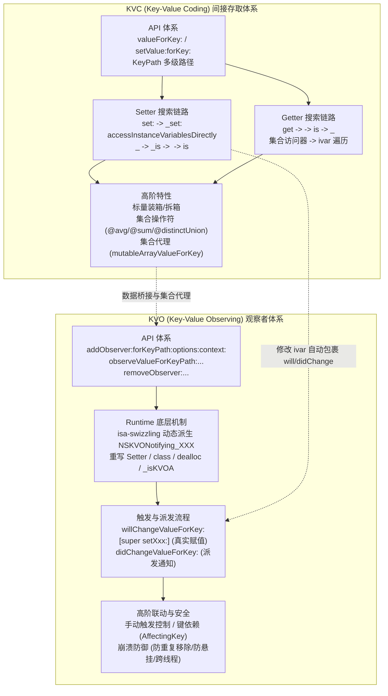

# iOS KVC 与 KVO 知识体系 · Objective-C

> 本目录系统整理 **Objective-C** 中 **KVC（Key-Value Coding，键值编码）** 与 **KVO（Key-Value Observing，键值监听）** 的完整知识体系：从基础 API 规范、底层搜索链路、`isa-swizzling` 动态子类实现，到标量装箱拆箱、集合操作符、键依赖联动、崩溃陷阱剖析及现代化安全封装方案。

---

## 一、文档导航

| 模块 | 文档 | 定位 | 适合人群与场景 |
| --- | --- | --- | --- |
| **KVC** | [OC-KVC-知识详解.md](KVC/OC-KVC-知识详解.md) | **系统详解**：原理 + 搜索链路 + 集合代理 + 20道深度面试题 | 系统学习、深挖源码与底层机制 |
| **KVC** | [OC-KVC-知识点总结.md](KVC/OC-KVC-知识点总结.md) | **速查手册**：图解决策树、表格化、关键 API、记忆卡片 | 复习备忘、面试前快速通关 |
| **KVO** | [OC-KVO-知识详解.md](KVO/OC-KVO-知识详解.md) | **系统详解**：`isa-swizzling` + Setter 拦截 + 安全防御 + 20道面试题 | 掌握动态子类、排查崩溃、架构封装 |
| **KVO** | [OC-KVO-知识点总结.md](KVO/OC-KVO-知识点总结.md) | **速查手册**：生命周期三部曲、Context 规范、崩溃预防表 | 规范编码、快速定位语法与流程 |

---

## 二、知识全景地图

---

## 三、KVC 与 KVO 的内在纽带与对比

| 维度 | KVC（键值编码） | KVO（键值观察） |
| --- | --- | --- |
| **本质定位** | 数据的**间接访问通道**（非形式化协议） | 数据的**状态监督者**（观察者设计模式） |
| **核心 API** | `valueForKey:` / `setValue:forKey:` | `addObserver:...` / `observeValueForKeyPath:...` |
| **依赖的底层技术** | Runtime 动态方法解析、元数据 ivar 偏移量计算 | Runtime `isa-swizzling` 动态类派生与方法拦截 |
| **面向对象影响** | 突破封装性（可直接读写 private ivar） | 动态改变对象类型（对象的 `isa` 指针被替换） |
| **协同工作** | 通过 KVC 设值（即使无 setter 仅有 ivar），内部也会触发 KVO；集合属性须靠 KVC 代理才能触发 KVO。 |

---

## 四、速查：最常被问的核心四题

| 核心问题 | 一句话黄金答案 | 详见章节 |
| --- | --- | --- |
| **KVC 的 Setter 查找顺序？** | 先找 `set<Key>:` / `_set<Key>:`；找不到看 `+accessInstanceVariablesDirectly`（默认 YES）；为 YES 按 `_<key>` → `_is<Key>` → `<key>` → `is<Key>` 找 ivar；找不到抛 `NSUnknownKeyException`。 | [KVC 详解第 2 章](KVC/OC-KVC-知识详解.md#第-2-章-setter-底层查找流程剖析) |
| **KVO 的底层实现机制？** | 利用 `isa-swizzling` 动态创建中间子类 `NSKVONotifying_原类名`，替换对象的 `isa` 指针，重写 setter 方法并在调用父类 setter 前后插入 `willChangeValueForKey:` 与 `didChangeValueForKey:`。 | [KVO 详解第 2 章](KVO/OC-KVO-知识详解.md#第-2-章-isa-swizzling-核心底层原理) |
| **为什么 `[obj class]` 看不出 KVO 动态子类？** | 动态子类重写了 `-class` 方法，在内部调用父类实现返回原类 Class，刻意向外部隐藏内部派生细节；使用 `object_getClass(obj)` 才能读取真实 `isa`。 | [KVO 详解第 2.3 节](KVO/OC-KVO-知识详解.md#深入剖析动态子类重写的四大方法) |
| **直接修改可变数组能触发 KVO 吗？如何解决？** | 不能，因为没走 setter。必须使用 `[obj mutableArrayValueForKey:@"array"]` 获取代理对象进行操作，代理内部会自动发通知。 | [KVO 详解第 6 章](KVO/OC-KVO-知识详解.md#第-6-章-集合属性变化的观察实战) |

---

## 五、相关进阶学习目录

- [Runtime 知识体系](../Runtime/)：`isa` 指针、方法交换（Swizzling）、元类与动态建类
- [iOS 内存管理](../iOS内存管理/)：引用计数、`dealloc` 生命周期与野指针排查
- [块(Block) 体系](<../块(Block)/>)：Block 内存类型、捕获机制与现代 Block 风格 KVO 配合
- [GCD 并发编程](../GCD/)：线程调度、主子线程同步与 KVO 跨线程通知处理
