# Objective-C Runtime 知识详解

> 整理自《RunTime学习AI对话》全 5,258 行内容，并按知识体系重新组织、补全源码层细节。
>
> 主线只有一条：**发送消息 → 找到方法 → 执行实现 → 找不到怎么办 → 如何在运行时改变行为**

---

## 目录

- [第 0 章 先把 Runtime 压缩成一句话](#第-0-章-先把-runtime-压缩成一句话)
- [第 1 章 对象模型：实例、类、元类、isa](#第-1-章-对象模型实例类元类isa)
- [第 2 章 方法三要素：SEL、Method、IMP](#第-2-章-方法三要素selmethodimp)
- [第 3 章 方法列表与方法缓存](#第-3-章-方法列表与方法缓存)
- [第 4 章 消息发送：objc_msgSend](#第-4-章-消息发送objc_msgsend)
- [第 5 章 方法查找的两条链](#第-5-章-方法查找的两条链)
- [第 6 章 找不到方法：动态解析与消息转发](#第-6-章-找不到方法动态解析与消息转发)
- [第 7 章 Method Swizzling 方法交换](#第-7-章-method-swizzling-方法交换)
- [第 8 章 四个修改方法的 API](#第-8-章-四个修改方法的-api)
- [第 9 章 Category 分类](#第-9-章-category-分类)
- [第 10 章 关联对象 Associated Objects](#第-10-章-关联对象-associated-objects)
- [第 11 章 Runtime 元数据 API](#第-11-章-runtime-元数据-api)
- [第 12 章 派生能力：动态建类、KVO、字典转模型](#第-12-章-派生能力动态建类kvo字典转模型)
- [第 13 章 总表、易错点、面试题、自测](#第-13-章-总表易错点面试题自测)

---

# 第 0 章 先把 Runtime 压缩成一句话

## 0.1 定义

> **Objective-C Runtime 是 Objective-C 的运行时系统。它在程序运行期间负责管理对象、类、方法和消息发送，让"调用一个方法"这件事从编译期确定变成运行期决定。**

Objective-C 的源代码不会被编译成"直接调用某个函数地址"的指令，而是被编译成"向某个对象发送某条消息"的指令，真正的函数地址要等到运行时才确定。这个"运行时决定"的过程，就是 Runtime。

## 0.2 它只回答三个问题

一段最常见的代码：

```objc
Person *person = [[Person alloc] init];
[person eat];
```

| 问题 | 对应的知识 | 本章位置 |
| --- | --- | --- |
| `person` 是什么？属于哪个类？从哪开始找？ | 实例对象、`Class`、`isa`、继承、元类 | 第 1 章 |
| `[person eat]` 怎么找到 `eat` 的实现？ | `SEL`、`Method`、方法列表、`superclass` 链、方法缓存 | 第 2、3、5 章 |
| 找到后执行哪段代码？找不到怎么办？ | `IMP`、`objc_msgSend`、动态方法解析、消息转发 | 第 4、6 章 |

把这三问串起来，Runtime 就不再是一堆零散的 API。

## 0.3 四层知识地图

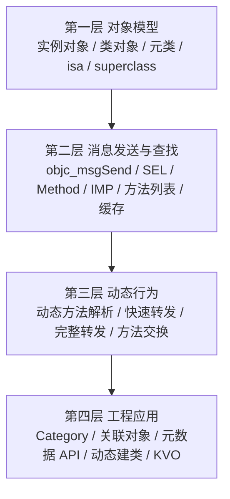

**学习顺序建议**：必须先把第二层（一次方法调用的完整过程）走通，再进第三层。否则会出现"每个词都认识，连起来看不懂"——这正是对话中途卡住的原因。

## 0.4 一次调用的完整时序

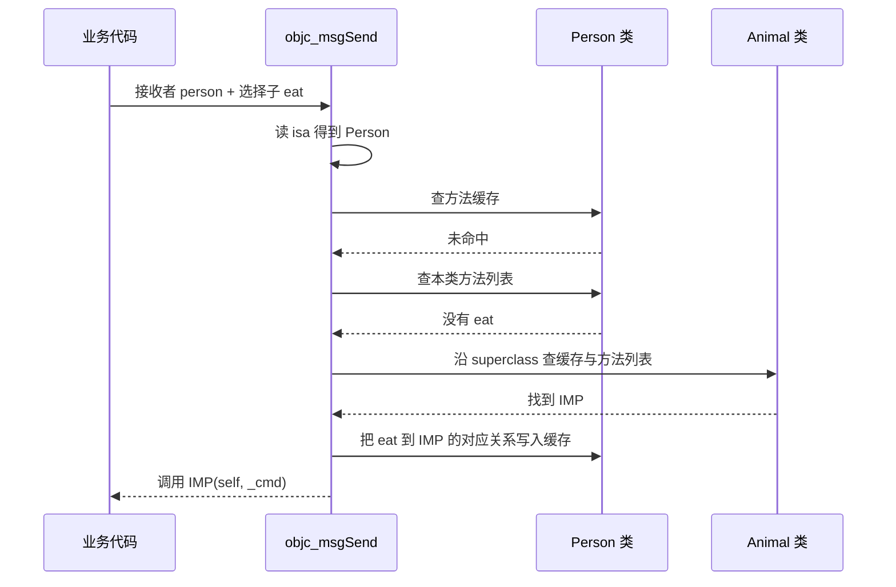

失败分支：

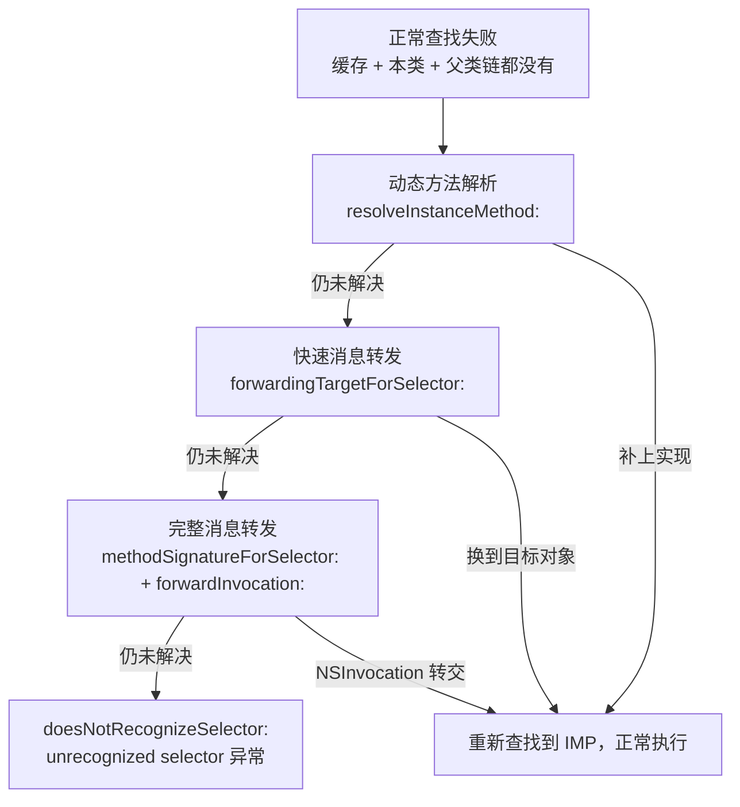

## 0.5 术语速查

| 术语 | 全称 | 一句话 |
| --- | --- | --- |
| Runtime | Objective-C Runtime | 运行时系统 |
| `isa` | is-a pointer | 对象指向"我是什么类"的指针 |
| `SEL` | Selector | 方法选择器，方法的身份标识 |
| `IMP` | Implementation | 函数指针，方法的代码入口 |
| `Method` | method_t | 描述方法的运行时结构体 |
| Cache | method cache | 加速方法查找的哈希表 |
| Swizzling | Method Swizzling | 交换两个方法的实现 |
| MRC/ARC | — | 手动/自动引用计数（与 Runtime 的关联见关联对象一章） |

---

# 第 1 章 对象模型：实例、类、元类、isa

> 本章解决：**`person` 到底是个什么东西？`Person` 又是什么？为什么类也是一个对象？**

## 1.1 三个实体

| 实体 | 例子 | 存放什么 | 说明 |
| --- | --- | --- | --- |
| 实例对象 | `person` | 实例变量的值 + `isa` | 通过 `alloc` 创建，堆上分配 |
| 类对象 | `Person` | 方法列表、属性列表、实例变量描述、父类指针、缓存 | 全局唯一，编译期生成，存放在 `__DATA` 段 |
| 元类 | `Person` 的元类 | **类方法**列表、父元类指针 | 为"类对象"服务的类，编译器隐式生成 |

关键认知：

> **类本身也是一个对象。** 所以类对象也有自己的 `isa`，指向它的元类。

正因为"类是对象"，`[Person new]` 才成立——`Person` 是接收者，`new` 是发给类对象的消息，要去元类里找 `+new`。

## 1.2 两条指针，两种关系

| 指针 | 回答的问题 | 存在于 |
| --- | --- | --- |
| `isa` | 我**是**哪个类的实例？（从哪开始找方法） | 每个对象（实例、类、元类都有） |
| `superclass` | 我**继承**自谁？（找不到时往哪继续） | 类对象、元类 |

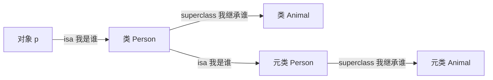

两个关系可以**交叉连接**，看起来"绕回去"了，但语义完全不同，所以不矛盾。

## 1.3 完整的指针关系图

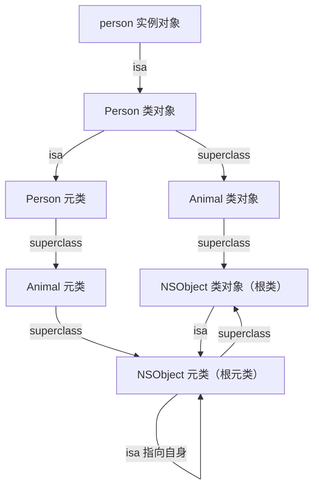

用文字复述一遍（面试常考）：

1. 实例对象的 `isa` → 类对象。
2. 类对象的 `isa` → 元类。
3. 元类的 `isa` → **根元类**（无论多深，所有元类的 `isa` 都指向根元类）。
4. 元类的 `superclass` → 父类对应的元类。
5. `NSObject` 类对象的 `isa` → `NSObject` 元类。
6. `NSObject` 元类的 `isa` → **它自己**。
7. `NSObject` 元类的 `superclass` → **`NSObject` 类对象**。

## 1.4 根类与根元类的三条特殊关系（重点）

| 关系 | 指向 |
| --- | --- |
| 根类 `NSObject` 的 `isa` | 根元类 `NSObject 元类` |
| 根元类 `NSObject 元类` 的 `isa` | **它自己** |
| 根元类 `NSObject 元类` 的 `superclass` | 根类 `NSObject` 类对象 |

**易错点**：根元类的 `superclass` 指向根类，但根元类**不是**根类。它是"根类对应的元类"，只是继承指针接到了根类上。

为什么会这样设计？因为要保证一件事：**类对象也能响应 `NSObject` 的实例方法**。`[Person description]` 能跑，靠的就是根元类 → 根类这条 `superclass` 连接。

> 对话里那句"那根元类是继承根类的"——严格说是：根元类的 `superclass` 指针指向根类。用"继承"描述 `superclass` 关系可以，但不要把"根元类 = 根类"混为一谈。

## 1.5 源码结构（简化）

### 实例对象

```objc
// 简化自 objc4 源码
struct objc_object {
    isa_t isa;          // 64 位，非指针才是常见情况，见 1.6
};
```

`id` 就是 `objc_object *`，所以**任何对象都能用 `id` 接**。

### 类 / 元类

```objc
struct objc_class : objc_object {
    Class superclass;        // 父类指针
    cache_t cache;           // 方法缓存（第 3 章）
    class_data_bits_t bits;  // 指向 class_rw_t，里面才是方法列表等
};
```

`objc_class` **继承自** `objc_object`——这句话本身就是"类是对象"的源码级证据：类对象也有 `isa`。

`bits` 展开后（简化）：

```objc
struct class_rw_t {          // 可读写，运行时可以改
    uint32_t flags;
    class_ro_t *ro;          // 指向只读部分
    method_array_t methods;  // 方法列表（二维数组，见第 9 章）
    property_array_t properties;
    protocol_array_t protocols;
};

struct class_ro_t {          // 只读，编译期确定
    uint32_t flags;
    uint32_t instanceStart;
    uint32_t instanceSize;              // 实例大小，Category 不能加 ivar 的根源
    const uint8_t *ivarLayout;
    const char *name;
    method_list_t *baseMethodList;      // 编译期方法列表
    protocol_list_t *baseProtocols;
    const ivar_list_t *ivars;           // 实例变量列表
    const uint8_t *weakIvarLayout;
    property_list_t *baseProperties;
};
```

一句话理解 `ro` 与 `rw`：

- `ro`（readonly）：编译时就定好的"原始类定义"，**不可变**。
- `rw`（readwrite）：运行时创建，是 `ro` 的可写副本，Category 的方法就是被追加到 `rw` 里（第 9 章）。

## 1.6 isa 的两种形态（进阶，但很值）

现代 64 位 Runtime 里 `isa` 不是裸指针，而是一个**位域（union）**：

```objc
union isa_t {
    Class cls;          // 直接当类指针用（老式/Tagged）
    uintptr_t bits;     // 按位解读
    struct {
        uintptr_t nonpointer        : 1;  // 0=纯指针，1=优化过的位域
        uintptr_t has_assoc         : 1;  // 是否有关联对象
        uintptr_t has_cxx_dtor      : 1;  // 是否有 C++ 析构
        uintptr_t shiftcls          : 33; // ★ 类对象地址（arm64）
        uintptr_t magic             : 6;  // 调试校验
        uintptr_t weakly_referenced : 1;  // 是否被弱引用
        uintptr_t unused            : 1;
        uintptr_t has_sidetable_rc  : 1;  // 引用计数是否溢出到 SideTable
        uintptr_t extra_rc          : 19; // ★ 内联引用计数
    };
};
```

由此得到几个非常实用的结论：

1. **`extra_rc` 存在 `isa` 里**：所以对象正常创建后，`retain` 不必立刻去操作 SideTable，速度快。
2. **`has_assoc` 存在 `isa` 里**：所以判断"这个对象有没有关联对象"是一次位运算，不用查全局表。
3. **`weakly_referenced` 存在 `isa` 里**：对象释放时能快速判断要不要清理弱引用表。
4. **取类指针要移位**：`isa & ISA_MASK`（arm64 下等价于 `bits >> 3` 再取位），这也是汇编里 `GetClassFromIsa_p16` 做的事。

> 具体位宽随架构和 runtime 版本变化（x86_64 的 `shiftcls` 是 44 位、`extra_rc` 只有 8 位），记"有哪些字段、各自干什么"比背位宽重要。

### Tagged Pointer

`NSNumber`、`NSDate`、短 `NSString` 等小对象**根本不是对象**：它们的值直接编码在指针里，没有 `isa`，也不占堆内存。

```objc
NSNumber *a = @(1);
NSNumber *b = @(2);
NSLog(@"%p %p", a, b);
// 64 位下形如 0xb000000000000012 0xb000000000000022
// 最高位为 1（0xb...），低位直接编码了数值
```

判断方式（Runtime 内部）：`objc_isTaggedPointer(ptr)`，判据是**最高位是否为 1**（64 位下 `_OBJC_TAG_MASK = 1UL << 63`）。所以：

- `objc_msgSend` 在取 `isa` 之前会先判断是不是 Tagged Pointer，是则走专门的分支（`NSNumber` 等各自的方法）。
- **不要**对 Tagged Pointer 用 `object_getClass`、`objc_setAssociatedObject` 之类需要真实 `isa` 的 API，会出错。

## 1.7 对象内存布局

一个对象在内存里就是：

```
┌─────────────────────┐  ← 对象起始地址
│ isa (8 bytes)       │
├─────────────────────┤  ← instanceStart（父类 ivar 结束处）
│ ivar 1              │
│ ivar 2              │
│ ...                 │
└─────────────────────┘
```

- `class_getInstanceSize([Person class])`：**至少需要多少字节**（含 `isa`，按 8 字节对齐）。
- `malloc_size((__bridge const void *)person)`：**实际分配了多少字节**（malloc 的粒度通常是 16 的倍数）。

两者经常不相等，例如一个只有 `isa` 的对象：`class_getInstanceSize` 返回 8，`malloc_size` 返回 16。

继承时的布局规则：

- 子类对象 = 父类的全部 ivar + 子类新增的 ivar，`isa` 在最前面。
- `instanceStart` 记录"本类第一个 ivar 的偏移"，正好等于父类的 `instanceSize`（考虑对齐）。
- 这解释了 **Category 为什么不能加 ivar**：已有对象的字节数已经分配好，`instanceSize` 是 `ro` 里定死的常量，运行期无处安放新变量（第 9 章详述）。

## 1.8 对象模型常用 API

| API | 作用 | 注意 |
| --- | --- | --- |
| `object_getClass(obj)` | 取对象真实 `isa` | KVO 后返回动态子类 |
| `[obj class]` | 取对象"自称"的类 | 可被重写，KVO 返回原类 |
| `objc_getClass("Person")` | 按名字取类 | 名字错了返回 `Nil` |
| `class_getSuperclass(cls)` | 取父类 | 根类返回 `Nil` |
| `class_isMetaClass(cls)` | 是否是元类 | 判断 `object_getClass([Person class])` |
| `objc_getMetaClass("Person")` | 按名字取元类 | — |
| `class_getName(cls)` | 类名 C 字符串 | 元类名与类名相同 |
| `class_getInstanceSize(cls)` | 实例最小字节数 | 含 `isa`，8 字节对齐 |
| `object_setClass(obj, cls)` | **改对象的 isa** | KVO 的核心；`isa-swizzling` |

### `object_getClass` vs `[obj class]`

```objc
Person *p = [[Person alloc] init];
[p addObserver:self forKeyPath:@"name" options:0 context:NULL];

NSLog(@"%@", object_getClass(p));  // NSKVONotifying_Person  ← 真实 isa
NSLog(@"%@", [p class]);           // Person                 ← 被重写过的 -class
```

这是面试高频题，也是理解"KVO 是 isa-swizzling"的入口（第 12 章）。

## 1.9 本章易错点

1. ❌ 类方法是"类自己实现的实例方法" → ✅ 类方法存放在**元类**里。
2. ❌ `Person` 是一个结构体变量 → ✅ `Person` 是**对象**（`objc_class` 实例）。
3. ❌ 元类只有一层 → ✅ 元类也有继承链，深度与类链**平行**。
4. ❌ 根元类就是根类 → ✅ 根元类的 `superclass` 指向根类，但两者是不同对象。
5. ❌ `isa` 永远是类指针 → ✅ 可能是位域，也可能是 Tagged Pointer。

---

# 第 2 章 方法三要素：SEL、Method、IMP

> 本章解决：**"方法"在 Runtime 里被拆成了哪几样东西？各自回答什么问题？**

## 2.1 一张对照表先立住

| 概念 | 本质 | 回答的问题 | 类比 |
| --- | --- | --- | --- |
| `SEL` | 方法选择器（一个不透明的标识） | 我要调用**哪个**方法？ | 函数名 / 菜单上的菜名 |
| `Method` | `method_t` 结构体 | 这个方法的**元数据**是什么？ | 菜单条目（名字+价格+描述） |
| `IMP` | 函数指针 | 这个方法对应**哪段代码**？ | 后厨做这道菜的那口锅 |

## 2.2 SEL：方法选择器

```objc
SEL selector = @selector(eat);
SEL selector2 = NSSelectorFromString(@"eat");
NSString *name = NSStringFromSelector(selector);   // @"eat"（不带冒号）
```

### 关键结论

1. **`SEL` 只标识方法，不代表实现。**
2. **`SEL` 由"方法名 + 参数标签（冒号）"构成，不包含参数类型和返回类型。**

```objc
- (void)eat:(NSString *)food;
- (void)eat:(NSInteger)count;
```

这两个方法的 `SEL` **都是** `@selector(eat:)`。

因此 Objective-C **不支持仅靠参数类型不同的重载**——编译会报 "Duplicate declaration of method 'eat:'"。这是 OC 与 C++/Java 的重要差异。

3. **`SEL` 在同一个进程中唯一**（由 `sel_registerName` 注册到全局表），所以可以直接用 `==` 比较：

```objc
if (sel == @selector(eat)) { ... }   // ✅ 正确，指针比较
```

4. **同一个 `SEL` 在不同类里可以对应不同 `IMP`**：

| 类 | `SEL` | `IMP` |
| --- | --- | --- |
| `Person` | `eat` | Person 的 eat 实现 |
| `Animal` | `eat` | Animal 的 eat 实现 |

所以"`SEL` → `IMP`"的映射**不是全局的**，而是**每个类各有一份**（方法列表 + 缓存）。

### 常用 SEL API

| API | 作用 |
| --- | --- |
| `@selector(x)` | 编译期生成选择器 |
| `NSSelectorFromString(@"x:")` | 运行期按字符串取 |
| `sel_registerName("x:")` | Runtime 层注册/取选择器 |
| `sel_getName(sel)` | 取名字（C 字符串） |
| `sel_isEqual(a, b)` | 比较（等价于 `==`） |
| `NSStringFromSelector(sel)` | 转 NSString |
| `respondsToSelector:` | 判断能否响应 |

## 2.3 IMP：方法实现

```objc
// objc.h 里的定义
typedef id (*IMP)(id self, SEL _cmd, ...);
```

含义：**一个至少接受 `(self, _cmd)` 两个隐藏参数的函数指针**。

```objc
- (void)eat {
    NSLog(@"吃饭");
}
```

编译后大致等价于：

```objc
void eat(id self, SEL _cmd) {
    NSLog(@"吃饭");
}
```

这就是为什么动态方法解析里可以直接写一个 C 函数当实现：

```objc
void danceIMP(id self, SEL _cmd) { NSLog(@"dance"); }
```

### 两个必须记住的点

1. **`IMP` 没有"方法名"的概念**，它只是地址。`method_exchangeImplementations` 交换的就是这个地址。
2. **类型必须匹配**。`IMP` 的声明是 `id(*)(id, SEL, ...)`，但实际函数可能是 `void(id, SEL, NSInteger)`。Runtime 不做类型检查，签名不匹配就是未定义行为。

## 2.4 Method：方法的元数据

```objc
// 简化自 objc4
struct method_t {
    SEL name;            // 方法选择器
    const char *types;   // 类型编码
    IMP imp;             // 实现入口
};
```

> 现代 Runtime 里 `method_t` 用了 `big` / `small` 两种存储方式来省内存（`small` 用相对偏移存 `SEL` 和 `IMP`）。**学习阶段按上面的三元组理解即可**，`method_getName` / `method_getTypeEncoding` / `method_getImplementation` 就是分别读这三个字段。

### Method 相关 API

| API | 作用 |
| --- | --- |
| `class_getInstanceMethod(cls, sel)` | 取实例方法（**会沿继承链找**） |
| `class_getClassMethod(cls, sel)` | 取类方法（等价于对元类调上一个） |
| `method_getName(m)` | 取 `SEL` |
| `method_getTypeEncoding(m)` | 取类型编码 |
| `method_getImplementation(m)` | 取 `IMP` |
| `method_setImplementation(m, imp)` | 换 `IMP`（第 8 章） |
| `method_exchangeImplementations(m1, m2)` | 互换 `IMP`（第 7 章） |
| `method_getNumberOfArguments(m)` | 参数个数（**含 self 和 _cmd**） |
| `method_getReturnType(m, buf, size)` | 返回类型编码 |
| `method_copyArgumentType(m, i)` | 第 i 个参数类型（需 `free`） |

## 2.5 类型编码 Type Encoding（必须掌握）

`class_addMethod` 的第四个参数、`method_getTypeEncoding` 的返回值，都是这个东西。

### 常用编码

| 编码 | 类型 | 编码 | 类型 |
| --- | --- | --- | --- |
| `v` | `void` | `@` | 对象 `id` |
| `:` | `SEL` | `#` | `Class` |
| `c` | `char` | `C` | `unsigned char` |
| `s` | `short` | `S` | `unsigned short` |
| `i` | `int` | `I` | `unsigned int` |
| `l` | `long` | `L` | `unsigned long` |
| `q` | `long long` | `Q` | `unsigned long long` |
| `f` | `float` | `d` | `double` |
| `B` | `BOOL` / C++ `bool` | `*` | `char *` |
| `^type` | 指向 type 的指针 | `?` | 未知类型 / 函数指针 |
| `@?` | Block | `[n type]` | 数组 |
| `{name=...}` | 结构体 | `(name=...)` | 联合体 |
| `b<n>` | 位域 | `T@"NSString"` | 属性里的具体对象类型 |

### `"v@:"` 到底怎么读

```objc
class_addMethod(self, sel, (IMP)runIMP, "v@:");
```

| 段 | 含义 |
| --- | --- |
| `v` | 返回值 `void` |
| `@` | 第 1 个隐藏参数 `self`（对象） |
| `:` | 第 2 个隐藏参数 `_cmd`（SEL） |

所以**任何无参数、无返回值的实例方法**都是 `"v@:"`。

带参数时按顺序往后拼：

```objc
- (void)eat:(NSString *)food;              // "v@:@"
- (NSInteger)add:(NSInteger)a to:(NSInteger)b;  // "q@:qq"
- (BOOL)isOK;                              // "B@:"
- (instancetype)initWithName:(NSString *)n; // "@@:@"
```

> 坑：`NSInteger` 在 64 位下是 `long`，编码 `q`；`CGFloat` 在 64 位下是 `double`，编码 `d`。写错编码，`class_addMethod` 不一定报错，但调用时会取到垃圾值。

## 2.6 三者的真实关系

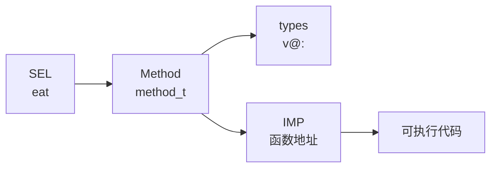

要点：

- 不是"`SEL` 包含 `Method`，`Method` 包含 `IMP`"的简单嵌套，而是 **`Method` 把三者绑在一条记录里**。
- 类的方法列表 = 一组 `Method`。
- 方法缓存 = `SEL` → `IMP` 的快速映射（不存完整 `Method`）。
- `SEL` 与 `IMP` 的绑定关系**可以在运行时被改写**——这就是 Swizzling 的全部原理。

## 2.7 本章易错点

1. ❌ `SEL` 里包含参数类型 → ✅ 只有名字和冒号。
2. ❌ `objc_msgSend` 就是 `IMP` → ✅ 前者是派发函数，后者是具体实现。
3. ❌ 一个 `SEL` 全局只有一个 `IMP` → ✅ 每个类各自绑定。
4. ❌ `method_getNumberOfArguments` 返回业务参数个数 → ✅ **要减 2**（`self`、`_cmd`）。

---

# 第 3 章 方法列表与方法缓存

> 本章解决：**类里存了哪些方法？为什么调用第二次就变快了？缓存里到底存了什么？**

## 3.1 方法列表：描述"这个类自己拥有什么"

```objc
@interface Person : NSObject
- (void)eat;
- (void)run;
@end
```

`Person` 的 `ro->baseMethodList` 里就是两条 `method_t`：

| `SEL` | `types` | `IMP` |
| --- | --- | --- |
| `eat` | `v@:` | Person 的 eat |
| `run` | `v@:` | Person 的 run |

### 三个必须建立的认知

1. **方法列表只描述本类直接拥有的方法，不等于这个类能调用的所有方法。**

```objc
@interface Animal : NSObject
- (void)eat;
@end

@interface Person : Animal
- (void)run;
@end
```

`Person` 能调用 `eat`，但 `Person` 的方法列表里**没有** `eat`——它在 `Animal` 的列表里，靠 `superclass` 链找到。

2. **继承 ≠ 复制**。Runtime 不会把父类方法复制进子类的方法列表，只是查找时沿链走。

3. **`class_copyMethodList` 只返回本类的**（第 11 章会实测）。

### 方法列表的容器：二维数组

`class_rw_t::methods` 的类型是 `method_array_t`，本质是 `method_list_t *` 的数组：

```
methods = [
    [ Category B 的方法列表 ],   ← 后 attach 的靠前
    [ Category A 的方法列表 ],
    [ 本类原始方法列表 ],         ← ro->baseMethodList
]
```

查找时**从前往后**遍历每个子列表，再遍历子列表里的每个 `method_t`。这解释了"分类方法优先于原类方法"（第 9 章）。

## 3.2 为什么需要方法缓存

```objc
for (int i = 0; i < 1000000; i++) {
    [person eat];       // eat 定义在 Animal
}
```

如果没有缓存，这一百万次调用每一次都要：

1. 查 `Person` 的方法列表（遍历，未命中）
2. 读 `Person.superclass` 得到 `Animal`
3. 查 `Animal` 的方法列表（遍历，命中）

**方法列表是数组，查找是 O(n) 的线性扫描**（现代 runtime 对 `SEL` 做了指针比较优化，但仍是遍历）。方法调用是最高频的操作，这个开销不可接受。

于是有了 `cache_t`：一次哈希，O(1)。

## 3.3 缓存的结构

```objc
struct cache_t {
    struct bucket_t *_buckets;  // 哈希桶数组
    mask_t _maybeMask;          // 容量 - 1，用于 & 取模
    uint16_t _occupied;         // 已占用数量
    ...
};

struct bucket_t {
    uintptr_t _imp;   // IMP（低位可能带标志）
    SEL _sel;         // 选择器
};
```

查找逻辑（概念版）：

```
index = sel & mask;
while (bucket[index].sel != sel) {
    index = (index - 1) & mask;   // 线性探测，向后找
}
return bucket[index].imp;
```

要点：

- **不是字典，是开放寻址的哈希表**，冲突时线性探测。
- 容量是 2 的幂，扩容时**清空重建**（不是 rehash），因为缓存丢了可以重建。
- 缓存里**只存 `SEL` 和 `IMP`**，不存 `types`。所以从缓存拿到 `IMP` 就能直接跳转，这是 `objc_msgSend` 快路径的全部依据。

## 3.4 缓存写在哪里？（高频误区）

> **问：子类调用父类的方法，IMP 会缓存到父类还是子类的 cache？**

答案：**缓存到"查找起点"那个类，也就是消息接收者所属的类**。

```objc
@interface Animal : NSObject
- (void)eat;
@end

@interface Dog : Animal
@end

Dog *dog = [[Dog alloc] init];
[dog eat];      // 第一次：Dog 的 cache 未命中 → 查 Dog 列表 → 未命中 → 查 Animal 列表 → 命中
                // 然后把 eat → Animal 的 IMP 写入 **Dog 的 cache**
[dog eat];      // 第二次：直接在 Dog 的 cache 命中，连 Animal 都不用看
```

源码里对应 `log_and_fill_cache(cls, imp, sel, inst, curClass)`：`cls` 是**起点类**，`curClass` 是**真正找到方法的类**，bucket 写进 `cls` 的 cache。

由此推论：

- `Animal` 对象调 `eat` 会写 `Animal` 的 cache；
- `Dog` 对象调 `eat` 会写 `Dog` 的 cache；
- 两份缓存，互不干扰。

> 注意：这里"缓存到子类"是**性能优化**，不改变"方法属于父类"这个事实。不要理解成"父类方法被复制进子类"。

## 3.5 缓存未命中 ≠ 方法不存在

| 现象 | 含义 |
| --- | --- |
| 缓存未命中 | 这次哈希没直接找到，**继续查方法列表** |
| 方法列表也没有 | 继续查父类 |
| 整条链都没有 | 进入动态方法解析 |

面试常问"缓存穿透/未命中的后果"，答案就是：只是慢一次，然后被填充。

## 3.6 方法实现被修改后，缓存怎么办

Runtime 提供了改实现的 API（`method_setImplementation`、`method_exchangeImplementations`），如果缓存还指向旧 `IMP`，行为就错了。

**Runtime 的做法：清缓存。**

```objc
// 概念示意，非逐行源码
void method_exchangeImplementations(Method m1, Method m2) {
    IMP imp1 = m1->imp();
    IMP imp2 = m2->imp();
    m1->setImplementation(imp2);
    m2->setImplementation(imp1);
    flushCaches(m1->getClass());
    flushCaches(m2->getClass());
}
```

所以：

- 你**不需要**手动清缓存。
- 但要知道"改实现 → 缓存失效 → 下一次调用重新查找"这个链条，才能解释"为什么 Swizzling 之后新调用生效"。
- 反过来说：**已经取出的 `IMP` 变量不会自动更新**：

```objc
IMP old = method_getImplementation(m);   // 拿到旧地址
method_exchangeImplementations(m, m2);
old(self, _cmd);                          // 仍然执行旧代码！
```

## 3.7 本节四个结论

1. `SEL` 标识**要找哪个方法**。
2. `Method` 描述**方法是什么**（名字、类型、实现）。
3. `IMP` 是**执行入口**。
4. 缓存是**加速结构**，不是方法本身，也不改变继承关系。

一句话主线：

```
isa 确定起点 → Cache 加速 → 方法列表与父类链兜底 → 拿到 IMP 执行
```

## 3.8 本章易错点

1. ❌ 缓存存在父类 → ✅ 存在**查找起点类**（通常是接收者的类）。
2. ❌ 缓存存 `Method` → ✅ 只存 `SEL` + `IMP`。
3. ❌ 缓存命中就不用管继承 → ✅ 命中说明之前已经查过继承链了。
4. ❌ 改实现后要手动清缓存 → ✅ Runtime 自动 flush。
5. ❌ 拿到 `IMP` 就永远是最新的 → ✅ 它只是那一刻的地址。

---

# 第 4 章 消息发送：objc_msgSend

> 本章解决：**`[person eat]` 编译成了什么？`objc_msgSend` 到底做了什么？它为什么快？**

## 4.1 为什么叫"消息发送"

```objc
// 普通 C 函数调用：编译期（或链接期）就确定了地址
add(1, 2);

// Objective-C 消息发送：地址到运行时才确定
[person eat];
```

| 维度 | C 函数调用 | OC 消息发送 |
| --- | --- | --- |
| 绑定时机 | 编译/链接期 | **运行期** |
| 决定依据 | 函数名 | 接收者的**实际类型** + `SEL` |
| 多态 | 需要函数指针手动实现 | 天然支持 |
| 失败行为 | 链接报错 / 段错误 | 有完整的补救流程（第 6 章） |

**"消息"的语义**：`[person eat]` 不是在说"调用 eat 函数"，而是在说"把 eat 这条消息投递给 person，你自己看着办"。谁来"看着办"？Runtime。

## 4.2 编译器做了什么

```objc
[person eat];
```

大致被编译为：

```objc
objc_msgSend(person, @selector(eat));
```

带参数时：

```objc
[person eat:food];
// →
objc_msgSend(person, @selector(eat:), food);
```

带返回值时按返回类型选用不同的入口（这是 ABI 决定的）：

| 返回类型 | x86_64 使用的函数 | arm64 |
| --- | --- | --- |
| 整型 / 指针 / 对象 | `objc_msgSend` | `objc_msgSend` |
| 结构体 | `objc_msgSend_stret`（大于 16 字节时） | `objc_msgSend` |
| `float` / `double` / `long double` | `objc_msgSend_fpret` / `objc_msgSend_fp2ret` | `objc_msgSend` |

> **arm64 上统一走 `objc_msgSend`**：靠 x0~x7 传参、x0/v0 返回，结构体由 ABI 处理。而 x86_64 因为返回值放在 x87/SSE 寄存器或需要隐藏指针，才有 `stret` / `fpret` 这些变体。所以"所有调用都是 `objc_msgSend`"这句话在 arm64（即现在所有 iOS 设备）上成立。

`super` 的调用不一样：

```objc
[super eat];
// →
objc_msgSendSuper(&(struct objc_super){ person, [Animal class] }, @selector(eat));
```

**关键点**：`super` 只改变**查找起点**（从父类开始），**不改变消息接收者**（仍然是 `person`）。这一点在第 5 章会展开。

## 4.3 源码级快路径

`objc_msgSend` 是**汇编实现**的（`objc-msg-arm64.s` 等），因为要极致地省指令。逻辑等价于：

```objc
// 伪代码，真实实现是汇编
id objc_msgSend(id self, SEL _cmd, ...) {
    // ① nil 检查：OC 对 nil 发消息直接返回 0，不崩溃
    if (!self) return nil;

    // ② 取类（处理 Tagged Pointer 与非指针 isa）
    Class cls = self->getIsa();

    // ③ 缓存查找
    IMP imp = cache_lookup(cls, _cmd);      // 内联汇编，几轮比较
    if (imp) {
        return imp(self, _cmd, ...);        // tail call，不增加栈帧
    }

    // ④ 慢路径
    return _objc_msgSend_uncached(self, _cmd, ...);
}
```

三个性能设计：

1. **`nil` 检查在最前**：省掉一次哈希。
2. **缓存查找内联成汇编**：`sel & mask` + 比较 + 线性探测，命中就 `br` 跳过去。
3. **tail call**：`objc_msgSend` 不建立自己的栈帧，直接跳到 `IMP`，所以栈上看到的调用者就是业务代码。

> 这就是为什么"OC 方法调用慢"这个说法不准确：**命中缓存后，它和虚函数调用是同一量级**，甚至更快（少一次虚表间接）。

## 4.4 慢路径做了什么

`_objc_msgSend_uncached` → `lookUpImpOrForward`：

```objc
// 简化自 objc4 / objc-runtime-new.mm
IMP lookUpImpOrForward(Class cls, SEL sel, id inst, bool initialize, bool cache) {
    IMP imp = nil;
    bool triedResolver = false;

    // ── 阶段 1：正常查找（缓存 → 本类列表 → 父类链）
retry:
    imp = cache_getImp(cls, sel);
    if (imp) return imp;

    if (!cls->isRealized()) {
        realizeClass(cls);            // 第一次用到时把 ro 展开成 rw
    }
    if (initialize && !cls->isInitialized()) {
        _class_initialize(cls);       // ★ 触发 +initialize
    }

    // 沿继承链找
    for (Class cur = cls; cur; cur = cur->superclass) {
        imp = cache_getImp(cur, sel);
        if (imp) goto done;

        method_t *m = getMethodNoSuper_nolock(cur, sel);   // 查方法列表
        if (m) {
            imp = m->imp();
            goto done;
        }
    }

    // ── 阶段 2：动态方法解析
    if (!triedResolver) {
        triedResolver = true;
        _class_resolveMethod(cls, sel, inst);   // +resolveInstanceMethod: / +resolveClassMethod:
        goto retry;
    }

    // ── 阶段 3：消息转发
    imp = _objc_msgForward_impcache;            // 转发入口

done:
    if (cache) log_and_fill_cache(cls, imp, sel, inst, cur);
    return imp;
}
```

> 注意 `goto retry`：**动态解析后要重新查一次**，因为解析可能刚把方法加进去。

## 4.5 `objc_msgSend` ≠ `IMP`

| | `objc_msgSend` | `IMP` |
| --- | --- | --- |
| 是什么 | 消息派发**函数** | 方法实现**地址** |
| 有几个 | 一个（加架构变体） | 每个方法一个 |
| 作用 | 找到并跳转到 `IMP` | 就是那段代码 |
| 能否交换 | 不能 | 能（Swizzling） |

可以这样记：

```
objc_msgSend 是"快递员"，SEL 是"地址"，IMP 是"收件人本人"
```

## 4.6 `+initialize` 与 `+load` 的时机

三个都与"第一次"有关，容易混：

| 钩子 | 时机 | 调用次数 | 特点 |
| --- | --- | --- | --- |
| `+load` | **镜像加载时**（`dyld` 阶段，`main` 之前） | 每个类/分类各 1 次 | 不 lazy；父类先于子类；分类的 `+load` 只调自己那个 |
| `+initialize` | **第一次给该类发消息时**（懒加载） | 每个类 1 次 | 走 `objc_msgSend`；父类会先被初始化；子类没实现会调用父类的实现（可能被调多次） |
| `+initialize` 并发 | 首次消息触发，Runtime 加锁 | — | 不要在 `+initialize` 里做重活或依赖其他类 |

`+initialize` 被调用的典型坑：

```objc
@implementation Animal
+ (void)initialize {
    if (self == [Animal class]) {     // ★ 必须判断，否则子类也会进来
        NSLog(@"Animal initialize");
    }
}
@end

@implementation Dog : Animal
@end

[Dog new];   // 会调用 Animal 的 +initialize，此时 self == Dog.class
```

## 4.7 nil 调用的返回值

```objc
Person *p = nil;
[p eat];                        // 什么也不发生，不崩溃
NSInteger n = [p count];        // 0
double d = [p rate];            // 0.0
CGRect r = [p frame];           // 全 0 的结构体
id obj = [p something];         // nil
```

规则：**`objc_msgSend` 在 `self == nil` 时直接返回 0 / 零值结构体**（32 位时代只保证返回 0，结构体返回值不保证；64 位下均被清零）。

这也是 OC 里"给 nil 发消息安全"的底层原因。

## 4.8 本章易错点

1. ❌ `objc_msgSend` 每次都要遍历继承链 → ✅ 有缓存，命中即跳转。
2. ❌ `[super foo]` 的接收者是父类 → ✅ 接收者不变，只改查找起点。
3. ❌ 所有方法调用都是同一个 `objc_msgSend` → ✅ 结构体/浮点返回有架构相关变体。
4. ❌ `+load` 和 `+initialize` 是一回事 → ✅ 前者加载期必调，后者首次消息懒调。

---

# 第 5 章 方法查找的两条链

> 本章解决：**实例方法和类方法分别沿哪条链找？元类什么时候参与？**

## 5.1 先纠正一个典型错误

> ❌ "方法查找顺序是：对象 → 父类 → 元类"

**错。** Runtime 不会"实例方法找完父类再去找元类"。走哪条链，**完全由消息接收者是实例还是类决定**。

| 调用 | 接收者 | 接收者的 `isa` | 起点 | 走的链 |
| --- | --- | --- | --- | --- |
| `[dog eat]` | 实例 `dog` | `Dog` 类 | `Dog` 类 | 普通类链 |
| `[Dog run]` | 类对象 `Dog` | `Dog` 元类 | `Dog` 元类 | 元类链 |
| `[super eat]` | 实例 `dog` | 仍是 `Dog` | **`Dog` 的父类** | 普通类链（起点前移） |

## 5.2 实例方法：沿普通类继承链

```objc
@interface Animal : NSObject
- (void)eat;
@end

@interface Dog : Animal
@end

Dog *dog = [[Dog alloc] init];
[dog eat];
```

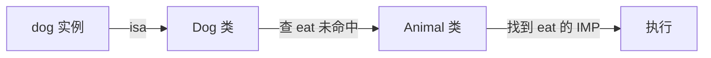

路径：`Dog 类 → Animal 类 → NSObject 类 → Nil`

要点：

- 对象本身**没有**方法列表，只有 `isa`。
- 到 `Nil` 还没找到 → 动态解析 / 转发。

## 5.3 类方法：沿元类继承链

```objc
@interface Animal : NSObject
+ (void)run;
@end

@interface Dog : Animal
@end

[Dog run];
```

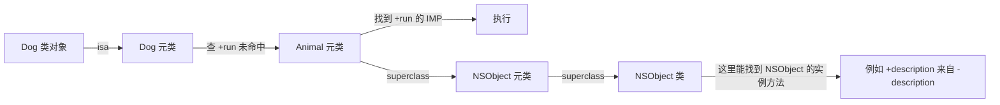

路径：`Dog 元类 → Animal 元类 → NSObject 元类 → NSObject 类 → Nil`

**最后那段很有意思**：根元类的 `superclass` 指向根类，所以类对象**也能响应 `NSObject` 的实例方法**。

```objc
[Dog description];    // ✅ 能跑
```

因为查找链走到了 `NSObject` 类，在那里找到了 `-description` 的 `IMP`。

## 5.4 `super` 到底做了什么

```objc
- (void)viewDidLoad {
    [super viewDidLoad];   // ← 每天都在写
}
```

编译为：

```objc
struct objc_super sup = { self, class_getSuperclass([self class]) };
objc_msgSendSuper(&sup, @selector(viewDidLoad));
```

| 项 | 值 | 说明 |
| --- | --- | --- |
| 消息接收者 `self` | **仍然是子类实例** | 不变 |
| 查找起点 | **父类** | 前移一层 |

为什么这很重要？看这个经典例子：

```objc
@interface A : NSObject
- (void)foo;
@end
@implementation A
- (void)foo { NSLog(@"A"); }
@end

@interface B : A
@end
@implementation B
- (void)foo { [super foo]; NSLog(@"B"); }
@end

@interface C : B
@end
@implementation C
- (void)foo { [super foo]; NSLog(@"C"); }
@end

[[C new] foo];
// 输出：A  B  C
```

`C` 的 `foo` 里 `[super foo]` 从 `B` 开始找，找到 `B` 的实现；而 `B` 的 `foo` 里的 `self` **仍然是那个 C 实例**，所以 `[super foo]` 又移动到了 `A`。这是"起点前移、接收者不变"的最佳证明。

## 5.5 同名方法：子类优先

```objc
@implementation Animal
- (void)eat { NSLog(@"Animal 吃饭"); }
@end

@implementation Person : Animal
- (void)eat { NSLog(@"Person 吃饭"); }
@end

[[Person new] eat];    // Person 吃饭
```

从 `Person` 开始找，第一次就命中，**根本不会去看父类**。这就是 OC 的方法覆盖（override）。

## 5.6 完整查找顺序表

| 起点类型 | 顺序 |
| --- | --- |
| 实例方法 `[obj m]` | `obj->isa` (类) 的 cache → 方法列表 → `superclass` 链 → 动态解析 → 转发 |
| 类方法 `[Cls m]` | `Cls->isa` (元类) 的 cache → 方法列表 → 元类的 `superclass` 链 → 根元类 → 根类 → 动态解析 → 转发 |
| `[super m]` | `[obj class]` 的父类 cache → 方法列表 → 父类链 → 动态解析 → 转发；接收者仍是 `obj` |
| `[Cls super_m]`（非语法，用 `objc_msgSendSuper`） | 元类的父元类起始 |

## 5.7 类方法的动态解析

实例方法用 `+resolveInstanceMethod:`，类方法用 `+resolveClassMethod:`：

```objc
+ (BOOL)resolveClassMethod:(SEL)sel {
    if (sel == @selector(sharedInstance)) {
        class_addMethod(object_getClass(self),   // ★ 注意：加到元类上
                        sel,
                        (IMP)sharedInstanceIMP,
                        "@@:");
        return YES;
    }
    return [super resolveClassMethod:sel];
}
```

**这是最容易写错的一行**：类方法要加在**元类**上，所以第一个参数是 `object_getClass(self)` 而不是 `self`。

## 5.8 元类链深度的规律

类链深度 = 元类链深度，且**一一对应**：

```
NSObject            元类 NSObject 元类
  ↑                     ↑
Animal              元类 Animal 元类
  ↑                     ↑
Dog                 元类 Dog 元类
```

所以"元类的 `superclass` 一定指向父类的元类"，唯一的例外是根元类（指向根类）。

## 5.9 本章易错点

1. ❌ 实例方法查找会进元类 → ✅ 不会，除非接收者是类对象。
2. ❌ `super` 的接收者变成父类 → ✅ 接收者不变。
3. ❌ 类方法存在类对象里 → ✅ 存在元类里。
4. ❌ `resolveClassMethod:` 里用 `self` 加方法 → ✅ 要用 `object_getClass(self)`。

---

# 第 6 章 找不到方法：动态解析与消息转发

> 本章解决：**"unrecognized selector" 之前，Runtime 还给了我几次机会？**

## 6.1 三个阶段的整体图

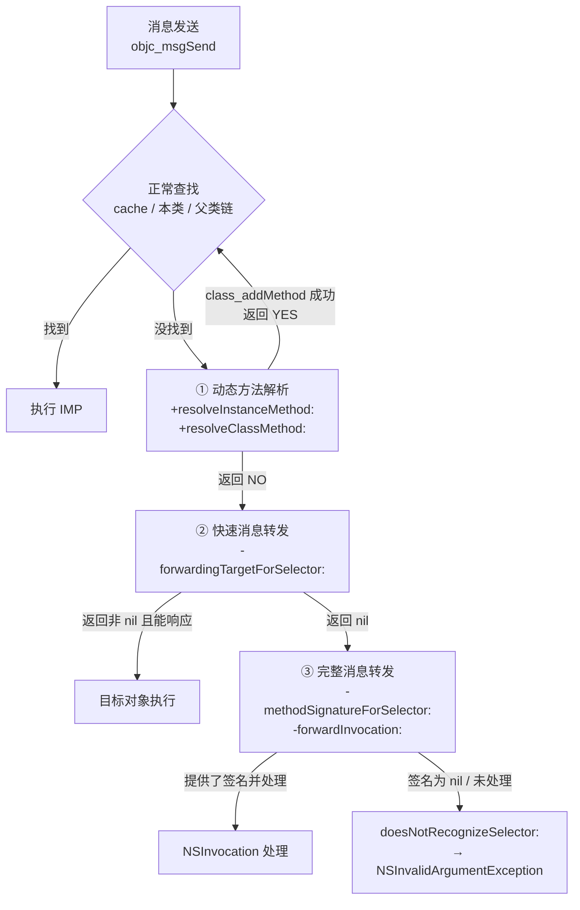

三个阶段一句话总结：

| 阶段 | 本质 | 对象还是原来那个吗 |
| --- | --- | --- |
| 动态方法解析 | **补实现** | 是 |
| 快速转发 | **换接收者** | 否（目标对象） |
| 完整转发 | **换处理方式** | 是（但可转交） |

## 6.2 阶段一：动态方法解析

### `+resolveInstanceMethod:`

```objc
#import <objc/runtime.h>

static void danceIMP(id self, SEL _cmd) {
    NSLog(@"动态添加的 dance 方法");
}

@implementation Person

+ (BOOL)resolveInstanceMethod:(SEL)sel {
    if (sel == @selector(dance)) {
        class_addMethod(self, sel, (IMP)danceIMP, "v@:");
        return YES;
    }
    return [super resolveInstanceMethod:sel];
}

@end
```

```objc
Person *p = [[Person alloc] init];
[p performSelector:@selector(dance)];    // 动态添加的 dance 方法
```

### 五个细节

1. **它本身是类方法**（`+`），但要解决的是**实例方法**不存在的问题。
2. **`self` 在这里是类对象**（`Person`），不是实例。
3. **返回 `YES` 不会自动创建方法**，真正干活的是 `class_addMethod`。必须先加成功再返回 `YES`。
4. **`class_addMethod` 不覆盖已存在的方法**，已存在时返回 `NO`。所以"解析成功"要以返回值为准：

```objc
+ (BOOL)resolveInstanceMethod:(SEL)sel {
    if (sel == @selector(dance)) {
        BOOL ok = class_addMethod(self, sel, (IMP)danceIMP, "v@:");
        return ok;      // ★ 按实际结果返回
    }
    return [super resolveInstanceMethod:sel];
}
```

5. **返回 `YES` 但没真的加方法 → 死循环 / 崩溃**。因为 Runtime 会 `goto retry`，重查一遍，还是找不到，再次进入解析……（实际实现有 `triedResolver` 标志，只会试一次，然后继续转发，最终崩溃。）

### `performSelector` 是干什么的

```objc
[p performSelector:@selector(dance)];
```

它只是**绕过编译器的未声明方法警告**，让代码能编过。**它不是动态解析的必要条件**。如果你在头文件里声明了 `- (void)dance;`，直接 `[p dance]` 也行。

### 静态语言 vs 动态补充

```objc
// 编译期：Person 的接口里根本没有 dance
// 运行期：class_addMethod 给 Person 补上了 dance 的 method_t
```

这就是"方法实现不一定要在编译期存在"的含义。

## 6.3 阶段二：快速消息转发

```objc
- (id)forwardingTargetForSelector:(SEL)aSelector;
```

语义：**"我自己处理不了，你帮我找个能处理的对象。"**

```objc
@interface Driver : NSObject
- (void)drive;
@end

@implementation Driver
- (void)drive { NSLog(@"Driver 正在开车"); }
@end

@implementation Person
- (id)forwardingTargetForSelector:(SEL)aSelector {
    if (aSelector == @selector(drive)) {
        return self.driver;                 // 交给 Driver
    }
    return [super forwardingTargetForSelector:aSelector];
}
@end
```

### 四个特点

1. 不要求把 `drive` 加到 `Person` 上。
2. **转发的是原消息**（`SEL` 不变），只是换了接收者。
3. 返回 `nil` 或目标不能响应 → 进入完整转发。
4. **不要返回 `self`**，会死循环。

### 实际用途：多继承模拟 / 组合

```objc
// 一个"多继承"的常见写法
- (id)forwardingTargetForSelector:(SEL)aSelector {
    if ([self.tableViewDelegate respondsToSelector:aSelector]) {
        return self.tableViewDelegate;
    }
    if ([self.dataSource respondsToSelector:aSelector]) {
        return self.dataSource;
    }
    return [super forwardingTargetForSelector:aSelector];
}
```

性能提示：快速转发比完整转发**快一个数量级**（不需要构造 `NSInvocation`），能用它就别用完整转发。

## 6.4 阶段三：完整消息转发

两个方法配合：

```objc
- (NSMethodSignature *)methodSignatureForSelector:(SEL)aSelector;
- (void)forwardInvocation:(NSInvocation *)anInvocation;
```

| 方法 | 职责 | 类比 |
| --- | --- | --- |
| `methodSignatureForSelector:` | 告诉 Runtime 这次调用**长什么样**（参数、返回值） | 填快递单：几个包裹、多大、寄到哪 |
| `forwardInvocation:` | 拿到封装好的调用，决定**怎么处理** | 拿到包裹，决定转寄给谁 |

### 为什么必须先有签名

Runtime 要把一次调用打包成 `NSInvocation`，就必须知道：

- 有几个参数
- 每个参数多大、什么类型
- 返回值多大、什么类型

这些信息全在 `NSMethodSignature` 里。**签名为 `nil`，完整转发根本不会开始**，直接 `doesNotRecognizeSelector:`。

`NSMethodSignature` 从哪来？`method_getTypeEncoding`（第 2 章的类型编码）解析而来。

### 完整示例

```objc
@interface Person : NSObject
@property (nonatomic, strong) Dancer *dancer;
@end

@implementation Person

- (NSMethodSignature *)methodSignatureForSelector:(SEL)aSelector {
    NSMethodSignature *sig = [super methodSignatureForSelector:aSelector];
    if (!sig) {
        sig = [self.dancer methodSignatureForSelector:aSelector];
    }
    return sig;
}

- (void)forwardInvocation:(NSInvocation *)anInvocation {
    SEL sel = anInvocation.selector;
    if ([self.dancer respondsToSelector:sel]) {
        [anInvocation invokeWithTarget:self.dancer];
    } else {
        [super forwardInvocation:anInvocation];
    }
}

@end
```

调用：

```objc
Person *p = [Person new];
p.dancer = [Dancer new];
[p performSelector:@selector(dance)];   // Dancer 正在跳舞
```

六步流程：

1. 正常查 `Person` 的 `dance` —— 失败。
2. 动态解析 —— 没解决。
3. 快速转发 —— 返回 nil。
4. Runtime 调 `methodSignatureForSelector:` 要签名。
5. 有签名 → 打包成 `NSInvocation` → 调 `forwardInvocation:`。
6. 里面 `invokeWithTarget:` 把调用交给 `dancer`。

### `NSInvocation` 的能力

它把"一次调用"变成了**对象**，于是可以：

```objc
// 读参数
NSInteger a; [invocation getArgument:&a atIndex:2];   // index 0=self, 1=_cmd

// 改参数
[invocation setArgument:&newValue atIndex:2];

// 改返回值
[invocation setReturnValue:&result];

// 改目标
[invocation invokeWithTarget:other];

// 读返回
[invocation getReturnValue:&ret];
```

这就是 AOP、Mock、RPC 客户端等框架的基础能力。

### 三个注意点

1. **签名必须有效**，否则直接崩。
2. `respondsToSelector:` 检查**不是强制的**，但建议加，避免把消息丢给不支持它的对象。
3. 用转发"伪造"出来的方法，`respondsToSelector:` **默认返回 `NO`**。要对外保持一致，得自己重写：

```objc
- (BOOL)respondsToSelector:(SEL)aSelector {
    if ([self.dancer respondsToSelector:aSelector]) return YES;
    return [super respondsToSelector:aSelector];
}
```

## 6.5 三种机制横向对比

| 维度 | 动态方法解析 | 快速转发 | 完整转发 |
| --- | --- | --- | --- |
| 核心方法 | `+resolveInstanceMethod:` | `-forwardingTargetForSelector:` | `-methodSignatureForSelector:` + `-forwardInvocation:` |
| 本质 | 补实现 | 换接收者 | 换处理方式 |
| 需要方法签名 | 不需要 | 不需要 | **需要** |
| 开销 | 低（一次性） | 低 | 高（构造 `NSInvocation`） |
| 能否改参数 | 不涉及 | 不能 | 能 |
| 典型用途 | `@dynamic`、懒加载方法、JS 桥接 | 组合 / 多继承模拟 / 代理 | AOP、消息录制、Mock、RPC |
| 转发后原对象还有这个方法吗 | **有**（真的加上了） | 没有 | 没有 |

## 6.6 `@dynamic` 与动态解析的关系

```objc
@interface Person : NSObject
@property (nonatomic, copy) NSString *name;
@end

@implementation Person
@dynamic name;      // 告诉编译器：别给我合成 getter/setter
@end
```

`@dynamic` 只是**关掉自动合成**，运行时如果没人提供 `name` / `setName:`，照样崩。常见做法是配合 `resolveInstanceMethod:` 在运行时补上（Core Data 的 `NSManagedObject` 就是这么干的）。

## 6.7 什么时候真的会崩

```objc
*** Terminating app due to uncaught exception 'NSInvalidArgumentException',
reason: '-[Person dance]: unrecognized selector sent to instance 0x600000c04100'
```

崩在 `NSObject` 的 `-doesNotRecognizeSelector:`：

```objc
- (void)doesNotRecognizeSelector:(SEL)sel {
    [NSException raise:NSInvalidArgumentException
                format:@"-[%@ %@]: unrecognized selector sent to instance %p",
                       NSStringFromClass([self class]), NSStringFromSelector(sel), self];
}
```

想在最后关头兜底（比如防崩溃 SDK），可以重写 `forwardInvocation:` 而不调 `super`，或者重写 `doesNotRecognizeSelector:`——但**这是在掩盖 bug**，业务代码不该这么干。

## 6.8 本章易错点

1. ❌ `resolveInstanceMethod:` 返回 `YES` 就代表方法有了 → ✅ 要看 `class_addMethod` 是否成功。
2. ❌ 动态解析加的方法只在这次调用有效 → ✅ 是**真的加进类**了，后续调用都有效（也在缓存里）。
3. ❌ 快速转发可以改参数 → ✅ 不能，它只是换接收者。
4. ❌ 完整转发不需要签名 → ✅ **必须有**，`nil` 签名直接崩。
5. ❌ `respondsToSelector:` 会自动感知转发 → ✅ 要自己重写。

---

# 第 7 章 Method Swizzling 方法交换

> 本章解决：**怎么在运行时替换方法的实现？为什么 `+load` 里 `[self log_eat]` 不会递归？**

## 7.1 本质：交换的是一个映射

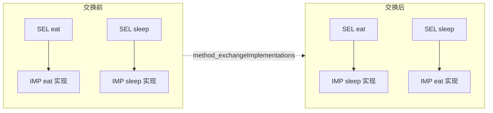

**交换的是 `Method` 记录里的 `IMP` 指针**，不是：

- ❌ 交换源代码
- ❌ 交换方法名
- ❌ 交换对象
- ❌ 重新编译

## 7.2 最小示例

```objc
#import <objc/runtime.h>

Method m1 = class_getInstanceMethod([Person class], @selector(eat));
Method m2 = class_getInstanceMethod([Person class], @selector(sleep));

method_exchangeImplementations(m1, m2);

Person *p = [Person new];
[p eat];      // 睡觉（执行的是 sleep 的实现）
[p sleep];    // 吃饭（执行的是 eat 的实现）
```

为什么结果变了？因为 `objc_msgSend` **仍然按 `SEL` 查找**，只是 `SEL` 现在绑到了另一个 `IMP`。

## 7.3 经典套路：Category + `+load` 包装原方法

需求：给 `Person` 的 `eat` 加日志，同时保留原逻辑，且**不改 `Person.m`**。

```objc
// Person+Logging.m
#import "Person.h"
#import <objc/runtime.h>

@implementation Person (Logging)

+ (void)load {
    static dispatch_once_t onceToken;
    dispatch_once(&onceToken, ^{
        Class cls = [self class];
        Method original = class_getInstanceMethod(cls, @selector(eat));
        Method swizzled = class_getInstanceMethod(cls, @selector(log_eat));

        if (original && swizzled) {
            method_exchangeImplementations(original, swizzled);
        }
    });
}

- (void)log_eat {
    NSLog(@"开始执行 eat");
    [self log_eat];          // ★ 看起来是递归，其实不是
    NSLog(@"结束执行 eat");
}

@end
```

### 为什么 `[self log_eat]` 不递归

交换前：

| `SEL` | `IMP` |
| --- | --- |
| `eat` | 原 `eat` 实现 |
| `log_eat` | Category 的 `log_eat` 实现 |

交换后：

| `SEL` | `IMP` |
| --- | --- |
| `eat` | **Category 的 `log_eat` 实现** |
| `log_eat` | **原 `eat` 实现** |

于是：

```
[person eat]
  └─ 进入 log_eat 的代码（因为 eat 现在指向它）
       ├─ NSLog("开始执行 eat")
       ├─ [self log_eat] → 这个 SEL 现在指向原 eat → 执行"正在吃饭"
       └─ NSLog("结束执行 eat")
```

输出：

```
开始执行 eat
正在吃饭
结束执行 eat
```

> 记忆口诀：**交换后，方法体里的"自己"就是"原来的别人"**。所以包装方法里调用"同名方法"，实际调用的是被包装的原方法。

## 7.4 为什么用 `+load` 而不是 `+initialize`

| 维度 | `+load` | `+initialize` |
| --- | --- | --- |
| 调用时机 | 镜像加载（`main` 之前） | 第一次收到消息（懒） |
| 调用次数 | 1 次（每类/每分类） | 1 次（每类，但子类可能触发父类再调） |
| 是否走 `objc_msgSend` | 否（直接函数调用） | 是 |
| 适合 Swizzling | ✅ 早、确定 | ❌ 太晚，可能已有调用发生 |

Swizzling 要保证"**在任何业务调用之前完成**"，所以必须 `+load`。

### `+load` 的执行顺序（值得记住）

1. 父类先于子类（按继承层次，不是声明顺序）。
2. 类的 `+load` 先于它自己的分类。
3. 同一层级内，按**编译顺序**（链接顺序），**不确定**。
4. 分类的 `+load` 会**各自都被调用**（不像普通方法会被覆盖）。

第 4 点很关键：

```objc
@implementation Person (A)
+ (void)load { NSLog(@"A load"); }
@end

@implementation Person (B)
+ (void)load { NSLog(@"B load"); }
@end
```

两个都会打印（顺序不定）。所以**用 Category 写 Swizzling 不会互相覆盖**，这既是优点（多方可插桩），也是风险（重复交换）。

## 7.5 六个真实风险

| 风险 | 说明 | 应对 |
| --- | --- | --- |
| 重复交换 | 交换两次就还原，甚至错乱 | `dispatch_once` |
| 继承方法陷阱 | `class_getInstanceMethod` 可能返回**父类**的方法 | 先判归属，或先 `class_addMethod` 再交换 |
| 签名不兼容 | 参数/返回值不同，交换后取到垃圾值 | 确保签名一致 |
| 系统类污染 | 交换 `UIViewController` 生命周期影响全 App | 明确影响范围，灰度、开关 |
| 顺序依赖 | 多个 SDK 交换同一方法，顺序不可控 | 减少 Swizzling，或统一注册中心 |
| 调试困难 | 崩溃栈与源码对不上 | 保留原 IMP，加日志开关 |

### 继承方法陷阱的标准写法

```objc
+ (void)load {
    static dispatch_once_t onceToken;
    dispatch_once(&onceToken, ^{
        Class cls = [self class];
        SEL originalSel = @selector(eat);
        SEL swizzledSel = @selector(log_eat);

        Method original = class_getInstanceMethod(cls, originalSel);
        Method swizzled = class_getInstanceMethod(cls, swizzledSel);

        // ① 尝试只给"当前类"添加一个自己的实现（若方法来自父类，这一步会成功）
        BOOL didAdd = class_addMethod(cls,
                                      originalSel,
                                      method_getImplementation(swizzled),
                                      method_getTypeEncoding(swizzled));

        if (didAdd) {
            // 说明 originalSel 原本来自父类：把自己实现挂上去，再把 log_eat 指向父类实现
            class_replaceMethod(cls,
                                swizzledSel,
                                method_getImplementation(original),
                                method_getTypeEncoding(original));
        } else {
            // 说明方法本来就在本类：直接交换
            method_exchangeImplementations(original, swizzled);
        }
    });
}
```

这段代码值得逐行理解，它是"安全 Swizzling"的标准范式：

- `class_addMethod` 成功 → 说明本类**原本没有**这个方法（是从父类继承的）。此时不能直接交换，否则改的是父类的 `Method`，会波及所有兄弟子类。正确做法是：给本类加一个"包装实现"，再把 `log_eat` 指向父类原实现。
- `class_addMethod` 失败 → 说明本类自己就有这个方法，直接交换是安全的。

## 7.6 Swizzling 与消息转发的关系

| 机制 | 触发时机 | 适用 |
| --- | --- | --- |
| Swizzling | **任何时候**（主动执行） | 已有方法，想改行为 |
| 动态解析 | 方法**不存在**时 | 想凭空造方法 |
| 消息转发 | 方法**不存在**时 | 想借别人的方法 |

一句话区分：

- **Swizzling 是"换心脏"**：方法存在，换掉它的实现。
- **转发是"换身体"**：方法不存在，找别人代劳。

## 7.7 本章易错点

1. ❌ 交换后 `[self log_eat]` 会递归 → ✅ 交换后它就是原方法。
2. ❌ 用 `+initialize` 做 Swizzling 也行 → ✅ 太晚，可能已被调用。
3. ❌ 多个 Category 的 `+load` 只执行一个 → ✅ 都执行，顺序不定。
4. ❌ `class_getInstanceMethod` 一定返回本类的方法 → ✅ 会沿继承链，可能返回父类的。

---

# 第 8 章 四个修改方法的 API

> 本章解决：**`class_addMethod`、`class_replaceMethod`、`method_setImplementation`、`method_exchangeImplementations` 到底差在哪？**

## 8.1 一张总表

| API | 参数 | 能否新增 | 能否替换 | 是否影响父类 | 典型用途 |
| --- | --- | --- | --- | --- | --- |
| `class_addMethod` | `Class` + `SEL` + `IMP` + `types` | ✅ | ❌（已有则失败） | 否 | 动态解析、给子类加实现 |
| `class_replaceMethod` | `Class` + `SEL` + `IMP` + `types` | ✅（不存在时） | ✅ | 视目标类而定 | 定向替换 |
| `method_setImplementation` | `Method` + `IMP` | ❌ | ✅ | **可能**（若 `Method` 来自父类） | 改单个方法实现 |
| `method_exchangeImplementations` | `Method` + `Method` | ❌ | ✅（互换） | **可能** | Swizzling |

记忆锚点：

- `add` = 只加不改
- `replace` = 有则改，无则加
- `set` = 只改，且要你先拿到 `Method`
- `exchange` = 两个互换

## 8.2 `class_addMethod`

```objc
BOOL class_addMethod(Class cls, SEL name, IMP imp, const char *types);
```

| 参数 | 含义 |
| --- | --- |
| `cls` | 目标类 |
| `name` | 方法选择器 |
| `imp` | 实现函数 |
| `types` | 类型编码（第 2 章） |
| 返回 | `YES` 成功；`NO` 失败（**该类自己已有同名方法**） |

### 关键：检查的是"本类自己的方法列表"

```objc
@interface Person : NSObject
- (void)eat;
@end
@implementation Person
- (void)eat { NSLog(@"Person 吃饭"); }
@end

@interface Student : Person
@end
@implementation Student
@end
```

```objc
// Student 能从父类"响应" eat，但自己方法列表里没有
BOOL r1 = class_addMethod(Student.class, @selector(eat), (IMP)studentEat, "v@:");
NSLog(@"%d", r1);   // 1 ✅ 成功

BOOL r2 = class_addMethod(Student.class, @selector(eat), (IMP)otherEat, "v@:");
NSLog(@"%d", r2);   // 0 ❌ 失败（已经有了）
```

对比 `respondsToSelector:`：

```objc
[student respondsToSelector:@selector(eat)];   // YES（继承来的）
```

**所以"能响应" ≠ "class_addMethod 会成功"**，这是最容易错的点。

### 典型用途：给子类加实现，覆盖继承来的方法

```objc
static void studentEat(id self, SEL _cmd) {
    NSLog(@"Student 吃饭");
}

class_addMethod(Student.class, @selector(eat), (IMP)studentEat, "v@:");

[[Student new] eat];   // Student 吃饭
[[Person new] eat];    // Person 吃饭   ← 父类完全不受影响
```

这是"运行时 override"，比 Swizzling 更安全，因为只影响子类。

## 8.3 `class_replaceMethod`

```objc
BOOL class_replaceMethod(Class cls, SEL name, IMP imp, const char *types);
```

行为分两种情况：

| 情况 | 行为 |
| --- | --- |
| 目标类**已有**自己的该方法 | **替换** IMP |
| 目标类**没有**自己的该方法（可能继承） | 在**目标类上新增** |

```objc
// 情况 A：Person 自己实现了 eat → 替换，影响 Person 及其未覆盖的子类
class_replaceMethod(Person.class, @selector(eat), (IMP)newEat, "v@:");

// 情况 B：Student 没有自己的 eat → 在 Student 上新增，父类不变
class_replaceMethod(Student.class, @selector(eat), (IMP)studentEat, "v@:");
```

**这两种情况语义完全不同**，写代码前必须确认目标类有没有自己的实现。最可靠的判断方式是自己遍历本类的方法列表：

```objc
static BOOL SGClassOwnsMethod(Class cls, SEL sel) {
    unsigned int count = 0;
    Method *list = class_copyMethodList(cls, &count);   // 只看本类
    BOOL owns = NO;
    for (unsigned int i = 0; i < count; i++) {
        if (method_getName(list[i]) == sel) { owns = YES; break; }
    }
    free(list);
    return owns;
}
```

> 不要用 `class_getInstanceMethod` 来判断归属——它会沿继承链返回父类的方法，看起来"有"，实际上本类并没有。

## 8.4 `method_setImplementation`

```objc
IMP method_setImplementation(Method m, IMP imp);   // 返回旧 IMP
```

| 特点 | 说明 |
| --- | --- |
| 参数 | 必须先有 `Method` |
| 返回 | **旧的 `IMP`**（可以用来保存原实现） |
| 能否新增 | 不能 |
| 风险 | `Method` 可能来自父类，改了会波及父类 |

```objc
Method m = class_getInstanceMethod(Person.class, @selector(eat));
IMP old = method_setImplementation(m, (IMP)newEat);

// 想恢复：
method_setImplementation(m, old);
```

**保存旧 `IMP` 是最实用的技巧**，比 `exchange` 更可控（不需要成对操作）。

## 8.5 `method_exchangeImplementations`

```objc
void method_exchangeImplementations(Method m1, Method m2);
```

- 互换两个 `Method` 的 `IMP`。
- 内部会 flush 相关类的缓存。
- 不可逆地成对操作：再调用一次就还原。

## 8.6 源码层的实现差异（为什么 `replace` 有时会"新增"）

```objc
// 概念示意
BOOL class_addMethod(Class cls, SEL name, IMP imp, const char *types) {
    if (getMethodNoSuper_nolock(cls, name)) {   // ★ 只看本类！
        return NO;
    }
    addMethod(cls, name, imp, types);
    return YES;
}

BOOL class_replaceMethod(Class cls, SEL name, IMP imp, const char *types) {
    Method m = getMethodNoSuper_nolock(cls, name);
    if (m) {
        IMP old = m->imp();
        m->setImp(imp);
        flushCaches(cls);
        return old != NULL;
    }
    return class_addMethod(cls, name, imp, types);   // 没有就新增
}
```

看到 `getMethodNoSuper_nolock`（名字里的 `NoSuper`）就明白了：**这两个 API 都只看本类，不看父类**。而 `class_getInstanceMethod` 是 `getMethod_nolock`（**看父类**）。

这一行差异解释了大量困惑：

| API | 是否沿继承链 |
| --- | --- |
| `class_addMethod` | 否（只看本类） |
| `class_replaceMethod` | 否（只看本类） |
| `class_getInstanceMethod` | **是**（会返回父类方法） |
| `method_setImplementation` | 不涉及查找，改的是你给它的那个 `Method` |

## 8.7 四个 API 的选择决策树

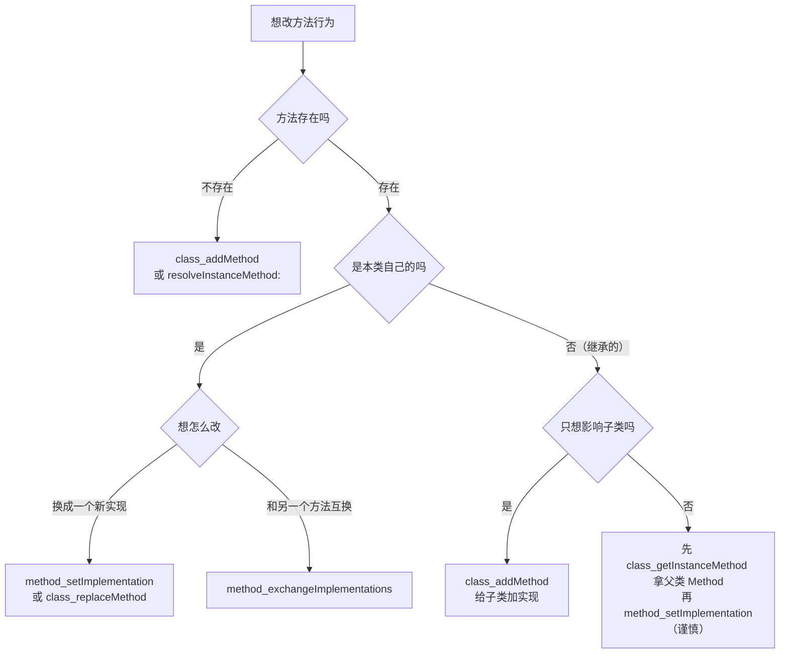

## 8.8 本章易错点

1. ❌ `class_addMethod` 失败是因为"类不能响应" → ✅ 是因为**本类自己的列表**里已有。
2. ❌ `class_replaceMethod` 一定替换 → ✅ 本类没有时会**新增**。
3. ❌ `method_setImplementation` 会新建方法 → ✅ 它只改已有 `Method`。
4. ❌ 改父类方法只影响父类 → ✅ 会影响**所有继承且未覆盖**的子类。

---

# 第 9 章 Category 分类

> 本章解决：**分类为什么能加方法？为什么不能加实例变量？多个分类同名怎么办？**

## 9.1 是什么

```objc
// Person+Run.h
@interface Person (Run)
- (void)run;
@end

// Person+Run.m
@implementation Person (Run)
- (void)run { NSLog(@"Person 正在跑步"); }
@end
```

```objc
[[Person new] run];     // ✅
```

- `(Run)` 是**分类名**，不是新类 `PersonRun`。
- 不修改原类源码就能扩展方法。
- 实例仍是 `Person` 对象，`isa` 仍指向 `Person` 类对象。

## 9.2 Category vs 继承 vs Extension

| 对比 | Category | 继承 | Extension（类扩展） |
| --- | --- | --- | --- |
| 创建新类 | 否 | 是 | 否 |
| 能否加方法 | ✅ | ✅ | ✅ |
| 能否加 ivar | ❌ | ✅ | ✅（在 `@implementation` 里） |
| 能否加属性（带存储） | ❌（需关联对象） | ✅ | ✅ |
| 是否需要原类源码 | 否 | 需要头文件 | **需要**（同一个 `@implementation`） |
| 是否有独立实现文件 | ✅ `.m` | ✅ | 无（必须在主 `@implementation` 内） |

> `()` 空括号就是**类扩展**（匿名分类），它和 Category 长得像但能力不同：类扩展能加 ivar 和属性，因为它在编译期就参与类的定义。

## 9.3 为什么能加方法：底层流程

### 编译期

```objc
@interface Person (Run)
- (void)run;
@end
```

被编译成 `category_t`：

```objc
struct category_t {
    const char *name;                        // "Run"
    classref_t cls;                          // 指向 Person
    struct method_list_t *instanceMethods;   // ★ 实例方法
    struct method_list_t *classMethods;      // ★ 类方法
    struct protocol_list_t *protocols;
    struct property_list_t *instanceProperties;
    struct property_list_t *_classProperties;
};
```

**关键点**：分类的方法在编译期是**独立的一份 `method_list_t`**，并没有混进 `Person` 的 `ro->baseMethodList`。

### 运行期（`_read_images` 阶段）

```objc
// 简化自 objc-runtime-new.mm
static void attachCategories(Class cls, category_list *cats) {
    method_list_t **mlists = ...;
    for (每个 category) {
        // 按"倒序"取出，使后编译的分类排在前面
        mlists[count++] = cats[i].instanceMethods;
    }
    // 追加到 class_rw_t 的 methods 数组**前面**
    cls->data()->methods.attachLists(mlists, count);
}
```

`attachLists` 的行为：

```objc
void attachLists(method_list_t **addedLists, int addedCount) {
    // 原列表整体后移，新列表放在前面
    memmove(array() + addedCount, array(), oldCount * sizeof(...));
    memcpy(array(), addedLists, addedCount * sizeof(...));
}
```

于是最终的 `methods` 数组长这样：

```
index 0: [ 分类方法列表 n ]
index 1: [ 分类方法列表 ... ]
...
index k: [ Person 原始方法 ]      ← 原类方法被整体挤到最后
```

关键结论有两条：

1. **分类方法一定排在原类方法之前**（这是 `attachLists` 的固定行为）。
2. **多个分类之间的相对顺序，取决于链接顺序和 Runtime 版本**——不同版本里 `attachCategories` 收集与插入的方向并不一致，所以"先编译的赢"和"后编译的赢"在不同环境下都出现过。

这就是"顺序不可依赖"的准确含义：**不是"随机"，而是"由你无法控制的因素决定"。**

查找时**从 index 0 往后遍历，每个子列表内部也遍历**，**先找到就返回**。

### 结论

> **分类方法"覆盖"原类方法，本质是"在数组里排得更前面，先被找到"，原方法并没有被删除。**

这个结论解释了：

- 为什么"覆盖"后原方法其实还在（只是没人找得到）；
- 为什么多个分类同名时，谁在前面谁生效（顺序依赖）；
- 为什么 Swizzling 能"找回"原方法——`class_getInstanceMethod` 也能拿到，因为原方法还在列表里，只是排在后面。

## 9.4 为什么不能加实例变量

### 根本原因：对象内存已经分配好了

```objc
@interface Person : NSObject {
    NSString *_name;
    NSInteger _age;
}
@end
```

对象布局在**编译期**就确定为：

```
offset 0: isa
offset 8: _name
offset 16: _age      ← instanceSize = 24
```

`alloc` 时按 `instanceSize` 分配字节数。**如果分类能加 `_nickname`，那么这个类所有已存在的对象都要重新分配、重新计算偏移**，而：

1. 对象可能已经在堆上（数量不可控）；
2. 偏移量被编译进机器码（`ivar_getOffset` 那种 `self + 16`）；
3. `instanceSize` 是 `ro` 里的 `const`，运行期不可变（`ro` 是只读段）。

所以语言层面直接禁止：分类里写 ivar 会编译报错。

```objc
@interface Person (Info) {
    NSString *_nickname;    // ❌ Compile Error: instance variables may not be placed in categories
}
@end
```

### 但 `@property` 为什么能编过

因为 `@property` 只是**声明了一组方法**（`nickname` / `setNickname:`），编译器认为"你会自己实现"：

```objc
@interface Person (Info)
@property (nonatomic, copy) NSString *nickname;    // ✅ 编译通过
@end
```

它**不会**生成：

- ❌ `_nickname` 实例变量
- ❌ getter 实现
- ❌ setter 实现

所以：

```objc
person.nickname = @"小明";    // 💥 unrecognized selector sent to instance
```

编译器会给出警告（`property 'nickname' requires method 'nickname' to be defined`），但**只是警告**，运行时才崩。这也是为什么很多项目把它当"必须实现"的提示。

### 两个概念必须分清

| 概念 | 含义 | Category 中 |
| --- | --- | --- |
| 增加属性**声明** | 只写 `@property`，声明接口 | ✅ 可以 |
| 增加属性**存储** | 真正的 ivar + getter + setter | ❌ 不行（需关联对象） |

## 9.5 多个 Category 同名方法

```objc
@implementation Person
- (void)eat { NSLog(@"原类 eat"); }
@end

@implementation Person (A)
- (void)eat { NSLog(@"A eat"); }
@end

@implementation Person (B)
- (void)eat { NSLog(@"B eat"); }
@end

[[Person new] eat];
```

会发生什么？

| 事实 | 说明 |
| --- | --- |
| 只执行**一个** | 不会依次调用三个 |
| 执行哪个 | 取决于方法列表顺序（**链接顺序 + Runtime 版本**），不同环境结论可能相反 |
| 是否稳定 | ❌ **不保证**，不同编译器版本、不同链接顺序可能不同 |
| 原方法去哪了 | 还在列表里，只是排在后面，永远轮不到 |

**工程结论**：不要依赖多个分类同名方法的优先级；不要在分类里"重写"原类方法（想改行为请用 Swizzling）。

### 那我想调用原实现怎么办

有几种方案：

1. **Swizzling + 包装方法**（推荐，第 7 章）
2. **`class_getInstanceMethod` 拿原方法再调**：

```objc
Method original = class_getInstanceMethod([Person class], @selector(eat));
IMP imp = method_getImplementation(original);
((void (*)(id, SEL))imp)(self, @selector(eat));
```

> 但注意：分类的 `eat` 已经排在前面，`class_getInstanceMethod` 拿到的**可能就是分类自己的实现**，会死循环。所以这个方案不可靠。

3. **改名**：分类里用 `xx_eat`，不覆盖原方法。

## 9.6 分类能加类方法吗

可以。但要注意它加在**元类**上：

```objc
@implementation Person (Run)
+ (void)classRun { NSLog(@"+classRun"); }
@end

[Person classRun];   // ✅
```

底层：`category_t` 有 `classMethods` 字段，attach 时进的是元类的 `methods`。

## 9.7 分类能加协议吗

可以，但只是**声明**：

```objc
@interface Person (Run) <NSCopying>
@end
```

它要求 `Person` 已经有 `copyWithZone:` 的实现（或在分类里实现）。协议方法不会被自动实现。

## 9.8 Category 与 Swizzling 的配合（重点辨析）

```objc
@implementation Person (Logging)
- (void)logging_eat {
    NSLog(@"开始");
    [self logging_eat];     // 交换后 = 原 eat
    NSLog(@"结束");
}
@end
```

| 谁在做什么 | 说明 |
| --- | --- |
| Category | **提供** `logging_eat` 这个方法，让它进入 `Person` 的方法列表 |
| Swizzling | **交换** `eat` 和 `logging_eat` 的 `IMP` |
| 结果 | `[p eat]` → 进入 logging 代码 → 内部调 `logging_eat` → 实际执行原 `eat` |

**Category 本身不等于方法交换**：分类只负责"让方法存在"，交换是另一个动作。这一点对话里反复强调过。

## 9.9 分类的加载顺序为什么"不确定"

因为：

1. 编译单元（`.m` 文件）的编译顺序由 Xcode 的 build phase / 依赖图决定；
2. 链接顺序影响 `__objc_catlist` 段里的排列；
3. `dyld` 加载镜像的顺序也参与；
4. `attachCategories` 是从后往前取，再插到最前面（相当于两次反转）。

**任何一环变化都可能改变最终顺序**。所以唯一正确的态度是：**不依赖它**。

## 9.10 本章易错点

1. ❌ 分类创建了新类 → ✅ 只是往原类追加方法列表。
2. ❌ 分类覆盖了原方法，原方法被删除 → ✅ 原方法还在，只是排在后面。
3. ❌ 分类的 `@property` 会自动合成 → ✅ 不会，只有声明。
4. ❌ 多个分类同名有确定优先级 → ✅ 不保证，禁止依赖。
5. ❌ 类扩展和分类一样 → ✅ 类扩展能加 ivar，分类不能。

---

# 第 10 章 关联对象 Associated Objects

> 本章解决：**分类不能加 ivar，那"给已有类的对象附加数据"怎么办？**

## 10.1 三个 API

```objc
#import <objc/runtime.h>

void objc_setAssociatedObject(id object, const void *key, id value, objc_AssociationPolicy policy);
id   objc_getAssociatedObject(id object, const void *key);
void objc_removeAssociatedObjects(id object);
```

| API | 作用 |
| --- | --- |
| `objc_setAssociatedObject` | 设置/更新（`value` 传 `nil` 即删除该项） |
| `objc_getAssociatedObject` | 读取 |
| `objc_removeAssociatedObjects` | 移除该对象的**全部**关联 |

## 10.2 标准写法：给 Category 加属性

```objc
// ── 第一步：头文件声明（只是接口）
@interface Person (Info)
@property (nonatomic, copy) NSString *nickname;
@property (nonatomic, assign) NSInteger age;
@end

// ── 第二步：实现 getter / setter
#import "Person+Info.h"
#import <objc/runtime.h>

@implementation Person (Info)

static const void *kNicknameKey = &kNicknameKey;   // 推荐写法
static char kAgeKey;                                // 也可以

- (void)setNickname:(NSString *)nickname {
    objc_setAssociatedObject(self, kNicknameKey, nickname, OBJC_ASSOCIATION_COPY_NONATOMIC);
}

- (NSString *)nickname {
    return objc_getAssociatedObject(self, kNicknameKey);
}

- (void)setAge:(NSInteger)age {
    objc_setAssociatedObject(self, &kAgeKey, @(age), OBJC_ASSOCIATION_RETAIN_NONATOMIC);
}

- (NSInteger)age {
    NSNumber *n = objc_getAssociatedObject(self, &kAgeKey);
    return n.integerValue;       // nil → 0
}

@end
```

### `key` 怎么写最好

| 写法 | 评价 |
| --- | --- |
| `static char kKey;` + `&kKey` | ✅ 常用，地址唯一 |
| `static const void *kKey = &kKey;` | ✅ 更明确，推荐 |
| `@selector(nickname)` | ⚠️ 可用，但可能与其他用途冲突 |
| `@"nickname"` | ❌ **危险**：字符串常量可能被合并，不同文件同名会撞 key |
| 局部变量地址 | ❌ **致命**：栈地址复用，不同属性撞 key |

> 为什么字符串字面量危险？编译器会把相同的字符串字面量合并到 `__cstring` 段，两个文件都写 `"nickname"` 会拿到**同一个地址**。

## 10.3 内存管理策略

```objc
typedef OBJC_ENUM(uintptr_t, objc_AssociationPolicy) {
    OBJC_ASSOCIATION_ASSIGN = 0,
    OBJC_ASSOCIATION_RETAIN_NONATOMIC = 1,
    OBJC_ASSOCIATION_COPY_NONATOMIC = 3,
    OBJC_ASSOCIATION_RETAIN = 01401,
    OBJC_ASSOCIATION_COPY = 01403
};
```

| 策略 | 等价 `@property` | 说明 |
| --- | --- | --- |
| `OBJC_ASSOCIATION_ASSIGN` | `assign` | **不持有**，不自动置 nil，可能悬空 |
| `OBJC_ASSOCIATION_RETAIN_NONATOMIC` | `strong, nonatomic` | 强持有，非原子 |
| `OBJC_ASSOCIATION_COPY_NONATOMIC` | `copy, nonatomic` | 复制，非原子 |
| `OBJC_ASSOCIATION_RETAIN` | `strong, atomic` | 强持有，加锁 |
| `OBJC_ASSOCIATION_COPY` | `copy, atomic` | 复制，加锁 |

### 三个致命误区

| ❌ 误区 | ✅ 事实 |
| --- | --- |
| `ASSIGN` 就是 `weak` | `ASSIGN` **不会**在被引用对象释放时把值置 nil，会变成野指针；`weak` 会置 nil |
| `RETAIN` 和 `COPY` 差不多 | 对 `NSMutableString` 完全不同：`RETAIN` 拿到的是可变引用，外部改动会同步；`COPY` 是快照 |
| 加了 `NONATOMIC` 就不安全 | `NONATOMIC` 只是不加锁，**不保证线程安全的是 `atomic` 之外的语义**——注意：`atomic` 也只保证单次读写原子，不保证复合操作安全 |

## 10.4 底层实现

### 数据结构

```objc
// 简化自 objc-references.mm
class AssociationsManager {
    static AssociationsHashMap *_map;      // 全局唯一，加锁访问
};

// 全局表：从"对象地址"映射到"该对象的关联表"
typedef DenseMap<DisguisedPtr<objc_object>, ObjectAssociationMap *> AssociationsHashMap;

// 单个对象的关联表：从"key"映射到"值+策略"
typedef DenseMap<const void *, ObjcAssociation> ObjectAssociationMap;

class ObjcAssociation {
    uintptr_t _policy;      // 策略
    id _value;              // 值
};
```

所以整体是**两层哈希表**：

```
obj ──▶ [ key1: value1, key2: value2, ... ]
obj2 ─▶ [ key3: value3 ]
```

### `set` 的核心逻辑

```objc
void objc_setAssociatedObject(id object, const void *key, id value, objc_AssociationPolicy policy) {
    if (!object) return;                    // ★ nil 直接返回

    AssociationsManager manager;            // 内部加锁
    auto &map = *manager.get();
    auto ref = map.find(object);

    if (value) {
        if (ref == map.end()) {
            // 首次关联：创建该对象的关联表
            ObjectAssociationMap *refs = new ObjectAssociationMap();
            map[object] = refs;
            (*refs)[key] = ObjcAssociation(policy, value);
        } else {
            (*ref->second)[key] = ObjcAssociation(policy, value);   // 覆盖
        }
        object->setHasAssociatedObjects();  // ★ 置 isa.has_assoc = 1
    } else {
        // value == nil：删除该项
        if (ref != map.end()) {
            ref->second->erase(key);
            if (ref->second->empty()) {
                map.erase(ref);
                object->setHasAssociatedObjects();  // 重新计算
            }
        }
    }
}
```

### 三个源码级洞察

1. **`isa.has_assoc` 位**：设过关联对象后，这个位被置 1。释放对象时（`dealloc` 前的 `_object_remove_assocations`）可以**一次位判断**决定要不要扫全局表，避免每个对象都查一遍。

2. **不是"挂"在对象内存上**：关联对象存在**全局的 `AssociationsHashMap`** 里，用对象地址作 key。对象只是"被当作 key"，内存布局完全不变。这正面回答了"为什么不用改 `instanceSize`"。

3. **两点查找 + 全局锁**：比直接访问 ivar 慢得多，所以**不要用关联对象存高频访问的数据**。

### 释放时的清理

```objc
// 对象 dealloc 流程中（简化）
void _object_remove_assocations(id object) {
    if (!object->hasAssociatedObjects()) return;    // 快速路径：没有就直接跳过
    // 从全局表移除，并 release 所有 value
}
```

所以关联对象**随宿主对象释放而清理**，不需要手动 remove。

## 10.5 `objc_removeAssociatedObjects` 的坑

```objc
objc_removeAssociatedObjects(person);    // 清掉 person 的【所有】关联
```

问题：别的库可能也给 `person` 加了关联对象（比如某种埋点、UI 复用标记），你这一行会**误伤**。

正确做法：把对应 key 的值设为 `nil`。

```objc
objc_setAssociatedObject(self, kNicknameKey, nil, OBJC_ASSOCIATION_COPY_NONATOMIC);
```

## 10.6 循环引用风险

```objc
// 💥 危险
objc_setAssociatedObject(self, kOwnerKey, self, OBJC_ASSOCIATION_RETAIN_NONATOMIC);
```

关联值是 `self`，而 `self` 强持有这条关联 → **自己引用自己**，永远不会释放。

常见于：

```objc
// 把 block 作为关联值，block 里又强引用 self
objc_setAssociatedObject(self, kBlockKey, ^{
    [self doSomething];     // 💥 self -> block -> self
}, OBJC_ASSOCIATION_COPY_NONATOMIC);
```

修复：

```objc
__weak typeof(self) weakSelf = self;
objc_setAssociatedObject(self, kBlockKey, ^{
    __strong typeof(weakSelf) self = weakSelf;
    [self doSomething];
}, OBJC_ASSOCIATION_COPY_NONATOMIC);
```

## 10.7 实际应用：给 UIButton 加点击回调

这是关联对象最经典的实战场景（代替 `addTarget:`）。

```objc
// UIButton+Block.h
typedef void (^SGButtonActionBlock)(UIButton *sender);

@interface UIButton (Block)
- (void)sg_addActionHandler:(SGButtonActionBlock)handler forControlEvents:(UIControlEvents)events;
@end

// UIButton+Block.m
#import "UIButton+Block.h"
#import <objc/runtime.h>

static const void *kSGButtonHandlersKey = &kSGButtonHandlersKey;

@implementation UIButton (Block)

- (void)sg_addActionHandler:(SGButtonActionBlock)handler forControlEvents:(UIControlEvents)events {
    NSMutableDictionary *handlers = objc_getAssociatedObject(self, kSGButtonHandlersKey);
    if (!handlers) {
        handlers = [NSMutableDictionary dictionary];
        objc_setAssociatedObject(self, kSGButtonHandlersKey, handlers, OBJC_ASSOCIATION_RETAIN_NONATOMIC);
    }
    handlers[@(events)] = [handler copy];
    [self addTarget:self action:@selector(sg_handleEvent:) forControlEvents:events];
}

- (void)sg_handleEvent:(UIButton *)sender {
    NSMutableDictionary *handlers = objc_getAssociatedObject(self, kSGButtonHandlersKey);
    [handlers enumerateKeysAndObjectsUsingBlock:^(NSNumber *key, SGButtonActionBlock block, BOOL *stop) {
        if (sender.state & key.unsignedIntegerValue) {
            block(sender);
        }
    }];
}

@end
```

要点：

- 用 `NSMutableDictionary` 按 `UIControlEvents` 分组存多个 block（否则多次 add 会互相覆盖）。
- block 要 `copy`（`NSMutableDictionary` 里的 block 是栈上的，`copy` 后才是堆上的）。
- **注意**：这个实现里 block 强引用 `self`（UIButton）时同样有循环引用风险，调用方要 `weak`。

## 10.8 `@property` / getter-setter / 关联对象 三者关系

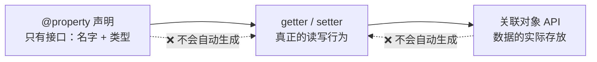

三句话：

1. **`@property` 只是声明**，在 Category 里不产生任何实现。
2. **getter / setter 必须自己写**（分类中编译器不合成）。
3. **关联对象是"存哪"的答案**，但要把 getter/setter 和它手动接起来。

## 10.9 关联对象 vs 继承加 ivar vs 全局字典

| 方案 | 是否改类布局 | 生命周期 | 性能 | 适用 |
| --- | --- | --- | --- | --- |
| 关联对象 | 否 | 随宿主自动清理 | 中（两次哈希+锁） | 给第三方类加小数据 |
| 继承加 ivar | 是（新子类） | 随对象 | 高 | 能改类型时首选 |
| 全局 `NSMapTable` | 否 | 需手动管理 | 中 | 需要弱引用 key 时 |
| 全局 `NSMutableDictionary` | 否 | 需手动管理，易泄漏 | 中 | 不推荐 |

`NSMapTable` 的更优写法（可控强弱）：

```objc
NSMapTable *table = [NSMapTable mapTableWithKeyOptions:NSPointerFunctionsWeakMemory
                                          valueOptions:NSPointerFunctionsStrongMemory];
```

## 10.10 本章易错点

1. ❌ 关联对象改变了对象内存布局 → ✅ 存在全局表里，`instanceSize` 不变。
2. ❌ `ASSIGN` 等于 `weak` → ✅ 不置 nil，会悬空。
3. ❌ `objc_removeAssociatedObjects` 可以删单个属性 → ✅ 会删全部。
4. ❌ key 用字符串字面量没问题 → ✅ 可能被合并，导致撞 key。
5. ❌ 关联对象一定会随对象释放 → ✅ 会，但如果你在里面强引用宿主就永远不释放。

---

# 第 11 章 Runtime 元数据 API

> 本章解决：**怎么"读取"一个类声明了什么？为什么读到的和想象的不一样？**

## 11.1 先分清三个概念

```objc
@interface Person : NSObject {
    NSInteger _age;                              // 实例变量 Ivar
}

@property (nonatomic, copy) NSString *name;      // 属性 Property
- (void)eat;                                     // 方法 Method

@end
```

| 概念 | 是什么 | 对应 API | 能否单独存在 |
| --- | --- | --- | --- |
| 属性 Property | 一组"接口约定"：名字 + 类型 + 语义 | `class_copyPropertyList` | ✅ 可以只有属性没方法（Category） |
| 实例变量 Ivar | 内存里的一个槽位 | `class_copyIvarList` | ✅ 可以只有 ivar 没属性 |
| 方法 Method | 可被消息触发的实现 | `class_copyMethodList` | ✅ 可以只有方法没属性 |

三者的默认关系（普通类）：

```objc
@property (nonatomic, copy) NSString *name;
```

编译器自动生成：

```
_objc_ivar:  _name           ← Ivar（默认名字是 _属性名）
method:      -name           ← getter
method:      -setName:       ← setter
property:    name            ← 元数据描述
```

所以在普通类里三者**通常**同时存在；但在 Category 里只有 `property` 声明，没有前两者。

## 11.2 属性列表：`class_copyPropertyList`

```objc
objc_property_t *class_copyPropertyList(Class cls, unsigned int *outCount);
```

```objc
#import <objc/runtime.h>

unsigned int count = 0;
objc_property_t *properties = class_copyPropertyList(Person.class, &count);

for (unsigned int i = 0; i < count; i++) {
    objc_property_t property = properties[i];

    const char *name = property_getName(property);            // "name"
    const char *attrs = property_getAttributes(property);     // "T@\"NSString\",C,N,V_name"

    NSLog(@"属性名：%s", name);
    NSLog(@"特征串：%s", attrs);
}

free(properties);     // ★ 必须释放
```

### `objc_property_t` 是什么

一个**不透明指针**，指向编译期生成的属性描述结构。只能通过 API 读，不能直接改。

```objc
typedef struct objc_property *objc_property_t;
```

### `property_getAttributes` 的特征串怎么读

```
T@"NSString",C,N,V_name
```

| 段 | 含义 |
| --- | --- |
| `T@"NSString"` | **T**ype：类型为 `NSString *` |
| `C` | **C**opy 语义 |
| `N` | **N**onatomic |
| `V_name` | **V**ar instance：对应的 ivar 名是 `_name` |
| `R` | readonly |
| `&` | retain/strong |
| `W` | weak |
| `G<name>` | 自定义 getter 名 |
| `S<name>` | 自定义 setter 名 |
| `D` | `@dynamic` |
| `P` | 可用于 GC（历史遗留） |

> 想解析出"类型名"和"是否 readonly"，就是拆这个逗号分隔串。第三方库（如 `MJExtension`、`YYModel`）的核心逻辑之一就是它。

### 三个细节

1. **`outCount` 是输出参数**，函数内部写进去。传 `NULL` 也可以，只是拿不到数量。
2. **`free` 释放的是数组**，不是属性本身，也不是对象。
3. **不递归父类**：

```objc
@interface Animal : NSObject
@property (nonatomic, copy) NSString *species;
@end

@interface Person : Animal
@property (nonatomic, copy) NSString *name;
@end

class_copyPropertyList(Person.class, &count);   // count == 1，只有 name
```

想拿全链：

```objc
NSMutableArray *all = [NSMutableArray array];
for (Class c = Person.class; c != Nil; c = class_getSuperclass(c)) {
    unsigned int n = 0;
    objc_property_t *ps = class_copyPropertyList(c, &n);
    for (unsigned int i = 0; i < n; i++) {
        [all addObject:@(property_getName(ps[i]))];
    }
    free(ps);
}
```

## 11.3 实例变量列表：`class_copyIvarList`

```objc
Ivar *class_copyIvarList(Class cls, unsigned int *outCount);
```

```objc
unsigned int count = 0;
Ivar *ivars = class_copyIvarList(Person.class, &count);

for (unsigned int i = 0; i < count; i++) {
    Ivar ivar = ivars[i];
    const char *name = ivar_getName(ivar);              // "_age"
    const char *type = ivar_getTypeEncoding(ivar);      // "q"
    ptrdiff_t offset = ivar_getOffset(ivar);            // 8 / 16 ...
    NSLog(@"%s : %s @ %td", name, type, offset);
}
free(ivars);
```

### Ivar 能读什么

| API | 作用 |
| --- | --- |
| `ivar_getName` | 变量名（注意带下划线） |
| `ivar_getTypeEncoding` | 类型编码 |
| `ivar_getOffset` | 相对对象起始地址的偏移 |

### 三个细节

1. **属性名 ≠ 变量名**：

| 属性 | Ivar | getter | setter |
| --- | --- | --- | --- |
| `name` | `_name` | `name` | `setName:` |

四份**不同的元数据**，不要混。

2. **`@property` 不一定有对应 Ivar**：

```objc
@property (nonatomic, readonly) NSInteger computed;   // 只声明 getter，可以不合成 ivar
```

3. **同样不递归父类。**

## 11.4 方法列表：`class_copyMethodList`

```objc
unsigned int count = 0;
Method *methods = class_copyMethodList(Person.class, &count);

for (unsigned int i = 0; i < count; i++) {
    Method m = methods[i];
    SEL sel = method_getName(m);
    const char *types = method_getTypeEncoding(m);
    NSLog(@"%@  %s", NSStringFromSelector(sel), types);
}
free(methods);
```

如果 `Person` 有 `@property name` 且实现了 `eat`，输出可能是：

```
eat       v@:
name      @16@0:8
setName:  v24@0:8@16
```

> `@16@0:8` 这种带数字的编码是**带偏移量的类型编码**（`method_getTypeEncoding` 会带，`class_addMethod` 时可省略数字）。数字表示各参数在栈/寄存器中的偏移。

### 关键：这份列表包含什么

| 包含 | 说明 |
| --- | --- |
| ✅ 本类实现的方法 | 原始方法 |
| ✅ Category 的方法 | attach 后进 `rw->methods` |
| ✅ 编译器合成的方法 | 如 `-name` / `-setName:` |
| ❌ 父类的方法 | 不递归 |
| ❌ 只有声明没有实现的 | 不存在于运行时 |

## 11.5 三个 API 的对照表

| API | 返回 | 元素类型 | 是否含父类 | 是否含分类 | 是否需 free |
| --- | --- | --- | --- | --- | --- |
| `class_copyPropertyList` | 属性数组 | `objc_property_t` | ❌ | ⚠️ 视 Runtime 版本 | ✅ |
| `class_copyIvarList` | ivar 数组 | `Ivar` | ❌ | ❌（分类不能加 ivar） | ✅ |
| `class_copyMethodList` | 方法数组 | `Method` | ❌ | ✅ | ✅ |
| `class_copyProtocolList` | 协议数组 | `Protocol *` | ❌ | ⚠️ 视 Runtime 版本 | ✅ |

> ⚠️ 那一行的意思：**分类里声明的属性/协议，是否出现在 `class_copyPropertyList` / `class_copyProtocolList` 里，历史上不同 Runtime 版本行为不一致**（早期版本只读 `ro->baseProperties`，较新版本会把分类的属性 attach 进 `class_rw_t`）。所以**不要依赖它来枚举分类属性**——需要时自己维护一份清单，或统一用关联对象 + 显式声明。
>
> 唯一可靠的是方法：分类方法一定会在 `class_copyMethodList` 里（因为 `attachLists` 就是干这个的）。

> 注意"是否含父类"这一列全是 ❌，但"能调用/能读值"可能是 ✅。这就是**元数据枚举 ≠ 消息查找**的核心区别。

## 11.6 获取单个实例变量

```objc
Ivar ivar = class_getInstanceVariable(Person.class, "_age");
```

与 `class_copyIvarList` 最大的不同：**它会沿继承链查找**。

```objc
@interface Animal : NSObject {
    NSInteger _legs;
}
@end

@interface Dog : Animal
@end

Ivar iv = class_getInstanceVariable(Dog.class, "_legs");   // ✅ 能拿到父类的
```

### 读写的正确姿势

```objc
// ❌ 不要这样（虽然能跑）
ptrdiff_t offset = ivar_getOffset(ivar);
NSInteger *p = (NSInteger *)((char *)(__bridge void *)dog + offset);
*p = 4;

// ✅ 用官方 API
Ivar ivar = class_getInstanceVariable([Dog class], "_legs");
NSInteger legs = *(NSInteger *)((char *)(__bridge void *)dog + ivar_getOffset(ivar));

// ✅✅ 更推荐（KVC / 类型安全封装）
[dog setValue:@4 forKey:@"legs"];
```

> `ivar_getOffset` 返回的是**布局信息**，不代表鼓励你做指针运算。它会破坏 ARC 语义、绕过属性观察、在 KVO 场景下出错。

## 11.7 运行时读写的其它常用 API

| API | 作用 | 备注 |
| --- | --- | --- |
| `object_getIvar(obj, ivar)` | 读对象类型 ivar | 返回 `id`，非对象类型不可用 |
| `object_setIvar(obj, ivar, value)` | 写对象类型 ivar | 不做内存管理（ARC 下需注意） |
| `ivar_getOffset` | 偏移 | 同上 |
| `class_getInstanceSize` | 实例最小字节数 | 含 `isa` |
| `class_getInstanceVariable` | 按名取 Ivar | **递归父类** |
| `class_getClassVariable` | 按名取类变量 | 基本不用 |

## 11.8 `class_copyProtocolList` 与 `class_conformsToProtocol`

```objc
unsigned int count = 0;
Protocol * __unsafe_unretained *protocols = class_copyProtocolList(Person.class, &count);
for (unsigned int i = 0; i < count; i++) {
    NSLog(@"协议：%s", protocol_getName(protocols[i]));
}
free(protocols);

// 单个判断（会沿继承链）
BOOL ok = class_conformsToProtocol(Person.class, @protocol(NSCopying));
```

## 11.9 `class_getInstanceSize` 与内存布局

```objc
@interface Empty : NSObject
@end

@interface Person : NSObject {
    NSInteger _age;      // 8
    BOOL _flag;          // 1 → 对齐到 8
}
@end

class_getInstanceSize([Empty class]);    // 8   （只有 isa）
class_getInstanceSize([Person class]);   // 24  （8 + 8 + 8，_flag 占 8）

// 实际分配
malloc_size((__bridge const void *)[[Person alloc] init]);   // 32（malloc 按 16 对齐）
```

规律：

1. **以 `isa` 开头，占 8 字节。**
2. **按 8 字节对齐**（64 位下，`NSInteger` / 指针都是 8）。
3. **`BOOL` 也会占满 8 字节对齐单位**（下一个成员若放不下就另起）。
4. **`malloc_size` ≥ `class_getInstanceSize`**，因为系统分配器的粒度。

这个知识点直接解释了：

- 为什么 Category 不能加 ivar（`instanceSize` 定死）。
- 为什么 `sizeof(obj)` 不是对象大小（它是指针大小 8）。
- 为什么小对象用 Tagged Pointer 更省（连 `isa` 都不占）。

## 11.10 实战：全部 API 输出演示

```objc
@interface Animal : NSObject
@property (nonatomic, copy) NSString *species;
- (void)breathe;
@end

@interface Person : Animal {
    NSInteger _age;
}
@property (nonatomic, copy) NSString *name;
- (void)eat;
@end

@implementation Person
- (void)eat { NSLog(@"eat"); }
@end

void dumpClass(Class cls) {
    unsigned int n = 0;

    NSLog(@"=== %s ===", class_getName(cls));
    NSLog(@"instanceSize = %zu", class_getInstanceSize(cls));

    // 属性
    objc_property_t *ps = class_copyPropertyList(cls, &n);
    for (unsigned int i = 0; i < n; i++)
        NSLog(@"  property: %s", property_getName(ps[i]));
    free(ps);

    // ivar
    Ivar *ivs = class_copyIvarList(cls, &n);
    for (unsigned int i = 0; i < n; i++)
        NSLog(@"  ivar: %s (%s) @%td",
              ivar_getName(ivs[i]),
              ivar_getTypeEncoding(ivs[i]),
              ivar_getOffset(ivs[i]));
    free(ivs);

    // 方法
    Method *ms = class_copyMethodList(cls, &n);
    for (unsigned int i = 0; i < n; i++)
        NSLog(@"  method: %@", NSStringFromSelector(method_getName(ms[i])));
    free(ms);
}

dumpClass([Person class]);
```

预期输出（关键部分）：

```
=== Person ===
instanceSize = 32
  property: name          ← 只有本类的，没有 species
  ivar: _age (q) @8
  ivar: _name (@) @16     ← 合成的 name ivar
  method: eat
  method: name
  method: setName:
  method: .cxx_destruct   ← 编译器插入的 ARC 清理方法
```

三个值得注意的点：

1. `species` **不出现**（父类的）。
2. `_name` 出现了，虽然你没手写（合成的）。
3. `.cxx_destruct` 出现了（ARC 下负责释放 ivar，名字带点）。

## 11.11 本章易错点

1. ❌ 三个 `class_copy...List` 会返回父类内容 → ✅ 都不会。
2. ❌ 属性列表里的 `name` 就是 ivar 名 → ✅ 是 `_name`。
3. ❌ `class_getInstanceVariable` 不查父类 → ✅ **会查**（与 `class_copyIvarList` 相反）。
4. ❌ `free` 释放的是属性/方法 → ✅ 释放的是数组。
5. ❌ `class_getInstanceSize` == `malloc_size` → ✅ 前者是最小需求，后者是实际分配。

---

# 第 12 章 派生能力：动态建类、KVO、字典转模型

> 本章解决：**Runtime 除了"用"，还能"造"。这些能力在真实工程里怎么落地？**

## 12.1 动态创建类：`objc_allocateClassPair`

```objc
Class objc_allocateClassPair(Class superclass, const char *name, size_t extraBytes);
void  objc_registerClassPair(Class cls);
void  objc_disposeClassPair(Class cls);
```

完整流程：

```objc
// ① 创建
Class DynClass = objc_allocateClassPair([NSObject class], "SGMessageForwarder", 0);

// ② 加方法
class_addMethod(DynClass,
                @selector(handle:),
                (IMP)handleIMP,
                "v@:@");

// ③ 加 ivar（★ 只有在 register 之前可以）
class_addIvar(DynClass, "_payload", sizeof(id), log2(sizeof(id)), @encode(id));

// ④ 加协议
class_addProtocol(DynClass, @protocol(NSCoding));

// ⑤ 注册（注册后就固定了）
objc_registerClassPair(DynClass);

// ⑥ 使用
id obj = [[DynClass alloc] init];

// ⑦ 销毁（必须先确认没有实例）
objc_disposeClassPair(DynClass);
```

### 三个关键限制

1. **`class_addIvar` 只能在 `registerClassPair` 之前**，之后加会失败（`instanceSize` 已定）。
2. **销毁前必须保证没有存活实例**，否则崩溃。
3. **元类已自动创建**，`objc_allocateClassPair` 会同时生成元类。

### 别和 Category 混

| 能力 | Category | 动态建类 |
| --- | --- | --- |
| 加方法 | ✅ | ✅ |
| 加 ivar | ❌ | ✅（注册前） |
| 新类名 | ❌ | ✅ |
| 何时用 | 编译期已知扩展 | 运行期才能确定结构 |

## 12.2 KVO 的 isa-swizzling

KVO 是 Runtime 最"漂亮"的应用之一。

```objc
Person *p = [Person new];
[p addObserver:self forKeyPath:@"name" options:NSKeyValueObservingOptionNew context:NULL];

NSLog(@"%@", object_getClass(p));   // NSKVONotifying_Person  ← 真实类变了
NSLog(@"%@", [p class]);            // Person                 ← 但"自称"没变
```

### Runtime 干了什么

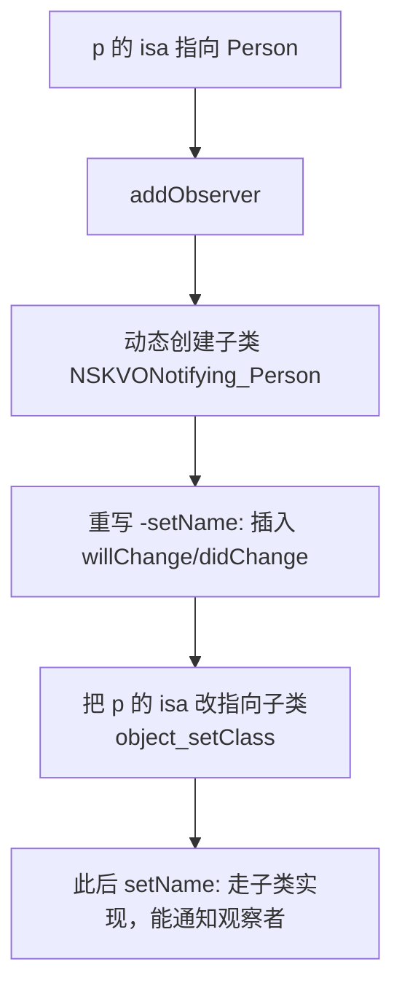

具体重写了四个方法：

| 方法 | 目的 |
| --- | --- |
| `-setName:` | 发通知（willChange / didChange） |
| `-class` | **返回 `Person`**，对外隐藏子类 |
| `-dealloc` | 清理观察者关系 |
| `-_isKVOA` | 标记"我是 KVO 动态子类" |

### 几个可直接考的点

1. **`object_getClass(p)` 和 `[p class]` 结果不同**——前者取真实 `isa`，后者被重写。
2. **KVO 只对"属性赋值走 setter"生效**，直接改 ivar（`_name = ...`）不会触发。
3. **Swift 中要加 `@objc dynamic`** 才能被 KVO 观察。
4. **KVO 是"子类 + 重写 + isa 改写"**，不是"改了原类的方法"。

## 12.3 字典转模型的核心

所有 JSON → Model 的库（`MJExtension`、`YYModel`、`JSONModel`）最终都靠这两件事：

```objc
// ① 读属性列表，拿到有哪些字段
unsigned int count = 0;
objc_property_t *props = class_copyPropertyList(cls, &count);
for (unsigned int i = 0; i < count; i++) {
    const char *name = property_getName(props[i]);
    const char *attrs = property_getAttributes(props[i]);
    // 从 attrs 里解析类型：T@"NSString" / Tq / T@"NSArray"
}
free(props);

// ② 用 KVC 赋值
[model setValue:dict[key] forKey:key];
```

典型优化：把"属性名 → 类型"缓存起来（`didAddMethod` 时生成映射表），避免每次转换都走 Runtime 查询。

## 12.4 `NSInvocation` 做 AOP

```objc
// 拦截所有方法调用，记录耗时
- (void)forwardInvocation:(NSInvocation *)invocation {
    CFTimeInterval start = CACurrentMediaTime();
    [invocation invokeWithTarget:self.realObject];
    NSLog(@"%@ 耗时 %.3fms",
          NSStringFromSelector(invocation.selector),
          (CACurrentMediaTime() - start) * 1000);
}
```

这比 Swizzling 更适合"批量代理"的场景（比如给所有 API 加统一日志）。

## 12.5 解归档与 `NSClassFromString`

```objc
// 从字符串反序列化成类（"反射"）
Class cls = NSClassFromString(@"Person");
id p = [[cls alloc] init];

// 类名 → 字符串
NSString *name = NSStringFromClass([Person class]);   // @"Person"
```

用途：路由（URL → 页面）、插件化、配置驱动。

**注意**：Swift 类名要带模块前缀：`NSClassFromString("MyApp.Person")`。

## 12.6 `method_getNumberOfArguments` 与 JS 桥接

`JSPatch` / `React Native` 的方法调用桥接依赖：

```objc
unsigned int count = method_getNumberOfArguments(method);   // 含 self、_cmd
for (unsigned int i = 2; i < count; i++) {                  // 从 2 开始
    char type[256];
    method_getArgumentType(method, i, type, sizeof(type));
    // 按 type 决定怎么从 NSInvocation 里取参
}
```

## 12.7 Runtime 的工程应用全景

| 场景 | 用到的能力 |
| --- | --- |
| 埋点（无侵入） | Swizzling + `+load` |
| 崩溃防护（数组越界等） | Swizzling 系统方法 |
| 字典转模型 | `class_copyPropertyList` + KVC |
| 主题 / 皮肤 | 关联对象 + Swizzling |
| 路由 | `NSClassFromString` |
| KVO | 动态子类 + `object_setClass` |
| 多继承模拟 | 消息转发 |
| Mock / 单元测试 | `NSInvocation` 转发 |
| 热修复 | 动态建类 + 方法替换 |
| 组件化通信 | 协议 + `NSClassFromString` |

## 12.8 什么时候**不该**用 Runtime

1. **能用继承/协议/组合解决的** —— 可读性远好于 Swizzling。
2. **性能敏感路径** —— 关联对象两次哈希 + 全局锁；转发的开销更大。
3. **团队无法统一管控时** —— 多个 SDK 的 Swizzling 会互相打架。
4. **App Store 审核红线** —— 修改系统私有方法、热更新有被拒风险。

---

# 第 13 章 总表、易错点、面试题、自测

## 13.1 各机制解决什么问题（总表）

| 机制 | 核心 API / 概念 | 解决的问题 | 本质 |
| --- | --- | --- | --- |
| 对象模型 | `isa`、`superclass`、元类 | 对象属于哪个类？从哪开始找？ | 定位 |
| 方法标识 | `SEL`、`Method`、`IMP` | 找哪个方法？信息是什么？执行哪段代码？ | 描述 |
| 消息派发 | `objc_msgSend` | 一条消息怎么发出去 | 派发 |
| 方法查找 | 方法列表、父类链、Cache | 去哪个类找？怎么加速？ | 查找 |
| 动态方法解析 | `resolveInstanceMethod:` + `class_addMethod` | 方法不存在时补上 | 补实现 |
| 快速转发 | `forwardingTargetForSelector:` | 换一个对象处理 | 换接收者 |
| 完整转发 | `methodSignatureForSelector:` + `forwardInvocation:` | 用 `NSInvocation` 灵活处理 | 换处理方式 |
| 方法交换 | `method_exchangeImplementations` | 改变已有方法与实现的绑定 | 换实现 |
| 分类 | `category_t` + attach | 不改源码扩展方法 | 追加方法 |
| 关联对象 | `objc_set/getAssociatedObject` | 不改布局附加数据 | 外挂存储 |
| 元数据读取 | `class_copy*List` | 观察类声明了什么 | 反射 |
| 动态建类 | `objc_allocateClassPair` | 运行时从零造类 | 造类 |

## 13.2 一张图收尾

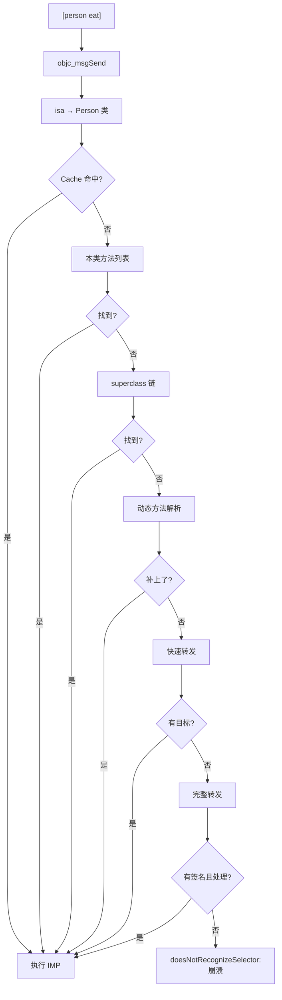

## 13.3 十六个易错点（全部来自对话中的反复纠正）

| # | 错误认知 | 正确认知 |
| --- | --- | --- |
| 1 | 根元类就是根类 | 根元类的 `superclass` 指向根类，但两者是不同对象 |
| 2 | `isa` 和 `superclass` 是同一回事 | `isa` 是"我是谁"，`superclass` 是"我继承谁" |
| 3 | 方法查找顺序是"对象→父类→元类" | 实例走类链，类方法走元类链，**由接收者决定** |
| 4 | 元类是实例方法查完父类后的下一站 | **不是**，两条链互不衔接 |
| 5 | 缓存未命中说明方法不存在 | 只是这次哈希没命中，还要查列表和父类 |
| 6 | 父类方法被复制进子类方法列表 | 继承靠沿链查找，不复制 |
| 7 | 缓存写在父类 | 写在**查找起点类**（接收者的类） |
| 8 | `SEL` 包含参数类型 | 只含名字和冒号，**不支持仅类型不同的重载** |
| 9 | `objc_msgSend` 就是 `IMP` | 前者派发，后者是实现地址 |
| 10 | `resolveInstanceMethod:` 返回 YES 就有方法了 | 要看 `class_addMethod` 是否成功 |
| 11 | 完整转发不需要签名 | **必须有**，`nil` 签名直接崩 |
| 12 | `class_getInstanceMethod` 只拿本类的 | 会沿继承链，可能拿到父类的 |
| 13 | `class_addMethod` 失败是因为类不能响应 | 是因为**本类列表**里已有 |
| 14 | 分类"覆盖"后原方法被删除 | 原方法还在，只是排在列表后面 |
| 15 | 分类的 `@property` 会自动合成 | 只有声明，getter/setter 要自己写 |
| 16 | `OBJC_ASSOCIATION_ASSIGN` 等于 `weak` | 不会自动置 nil，会悬空 |

## 13.4 面试题（含答案要点）

### Q1：Runtime 是什么？它解决了什么问题？

**要点**：OC 的运行时系统；把"方法调用"从编译期绑定推迟到运行时决定；核心是消息发送 + 方法查找 + 动态能力（解析/转发/交换）。

### Q2：对象的 `isa` 指向什么？类对象的 `isa` 呢？

**要点**：实例 → 类；类 → 元类；元类 → 根元类；根元类 → 自己。类方法存在元类里。

### Q3：为什么要有元类？

**要点**：因为"类也是对象"，类方法需要一个存放的地方；元类就是"类的类"，让 `[Person new]` 能够走统一的消息发送机制。

### Q4：`SEL`、`Method`、`IMP` 的区别？

**要点**：`SEL` 是方法名标识（不含类型）；`Method` 是包含 `SEL`/`types`/`IMP` 的结构体；`IMP` 是函数指针。同一个 `SEL` 在不同类可以有不同的 `IMP`。

### Q5：OC 方法调用有多快？为什么？

**要点**：命中缓存后与虚函数调用同级；`objc_msgSend` 是汇编实现，`sel & mask` 定位 bucket，tail call 跳转，不建栈帧。

### Q6：方法缓存存在哪？缓存的是什么？

**要点**：存在**查找起点类**的 `cache_t`；存 `SEL` → `IMP`；开放寻址哈希表；容量 2 的幂；改实现时 flush。

### Q7：消息发送失败了会怎样？按顺序说。

**要点**：动态方法解析（`+resolveInstanceMethod:` / `+resolveClassMethod:`）→ 快速转发（`-forwardingTargetForSelector:`）→ 完整转发（`-methodSignatureForSelector:` + `-forwardInvocation:`）→ `doesNotRecognizeSelector:` 抛 `NSInvalidArgumentException`。

### Q8：快速转发和完整转发的区别？怎么选？

**要点**：快速转发只换接收者，不能改参数，开销小；完整转发拿到 `NSInvocation`，可读写参数/返回值、动态选目标，开销大。能用快速就用快速。

### Q9：Method Swizzling 的原理？有什么风险？

**要点**：交换 `Method` 里的 `IMP`；风险：重复交换、继承方法陷阱、签名不兼容、系统类污染、多 SDK 冲突。用 `dispatch_once` + `class_addMethod` 判归属。

### Q10：为什么 `[self log_eat]` 在 Swizzling 后不会递归？

**要点**：交换后 `log_eat` 这个 `SEL` 指向原 `eat` 的 `IMP`，所以调用它执行的是原方法。

### Q11：Category 能加属性吗？

**要点**：能声明，不能自动合成；需要自己实现 getter/setter + 关联对象。

### Q12：Category 为什么不能加实例变量？

**要点**：对象内存布局（`instanceSize`）在编译期确定，`ro` 只读；分类不是新类，无法重新分配已有对象的空间。

### Q13：多个 Category 同名方法谁生效？

**要点**：取决于方法列表顺序（`attachLists` 插到前面），**不保证**；不要依赖。原方法没被删，只是排在后面。

### Q14：关联对象的原理？

**要点**：全局 `AssociationsHashMap`（对象地址 → 关联表），关联表里 `key → (policy, value)`；`isa.has_assoc` 位标记；随宿主释放清理。

### Q15：`class_copyMethodList` 能拿到父类方法吗？

**要点**：不能。需要 `class_getSuperclass` 逐级遍历。`class_getInstanceVariable` 例外，**会**查父类。

### Q16：KVO 的底层实现？

**要点**：`addObserver` 时动态创建 `NSKVONotifying_XXX` 子类，重写 setter 插入 `willChangeValueForKey:` / `didChangeValueForKey:`，并用 `object_setClass` 改 `isa`；同时重写 `-class` 隐藏子类。

### Q17：`+load` 和 `+initialize` 的区别？

**要点**：`+load` 在镜像加载时（`main` 前）每类/每分类各调一次，直接函数调用；`+initialize` 在首次收到消息时懒调，走 `objc_msgSend`，子类未实现会调父类的（需 `if (self == [X class])` 判断）。

### Q18：`[super foo]` 的接收者是谁？

**要点**：仍然是 `self`（子类实例），只是查找起点变成父类。证据：多级继承时 `[super foo]` 会链式向上。

### Q19：`class_addMethod` 和 `class_replaceMethod` 的区别？

**要点**：`add` 只看本类，已有则失败返回 `NO`；`replace` 本类有则替换，没有则新增。二者都**不查父类**（`NoSuper`），而 `class_getInstanceMethod` 查父类。

### Q20：对象的内存布局？`class_getInstanceSize` 和 `malloc_size` 为什么不同？

**要点**：`isa` 在最前，随后是父类 ivar、本类 ivar，8 字节对齐；`getInstanceSize` 是最小需求，`malloc_size` 是分配器实际给的（16 对齐）。

## 13.5 自测清单

能不看笔记答出来，说明这一章掌握了：

**对象模型**
- [ ] 画出实例、类、元类、根类、根元类之间全部 `isa` / `superclass` 关系
- [ ] 解释根元类 `isa` 指向自己、`superclass` 指向根类的原因
- [ ] 说明为什么"类也是对象"，并给出源码证据
- [ ] 说出 `object_getClass` 与 `[obj class]` 在 KVO 下的差异

**方法机制**
- [ ] 说明 `SEL` / `Method` / `IMP` 各回答什么问题
- [ ] 解释为什么 OC 不支持仅参数类型不同的重载
- [ ] 读懂 `"v@:"`、`"v@:@"`、`"q@:qq"`
- [ ] 说出缓存存在哪、存什么、什么时候失效

**消息发送**
- [ ] 说明 `objc_msgSend` 的快路径三步
- [ ] 解释 `[super foo]` 的接收者与查找起点
- [ ] 说出 `nil` 调用的返回值规则
- [ ] 区分 `+load` 与 `+initialize` 的时机

**异常路径**
- [ ] 按顺序说出失败后的三个阶段及核心方法
- [ ] 解释为什么完整转发必须先有方法签名
- [ ] 说明动态解析返回 `YES` 但没加方法会怎样（死循环/崩溃的机制）

**动态修改**
- [ ] 解释 Swizzling 后 `[self log_eat]` 为什么不是递归
- [ ] 说出 `class_addMethod` / `class_replaceMethod` / `method_setImplementation` / `method_exchangeImplementations` 的差异
- [ ] 说明"继承方法陷阱"以及标准的安全 Swizzling 写法

**工程应用**
- [ ] 解释 Category 为什么能加方法、为什么不能加 ivar（从 `instanceSize` 与 `ro` 角度）
- [ ] 说出多个 Category 同名方法的行为及为什么不建议依赖
- [ ] 用关联对象给 Category 加一个属性（含 key 的正确写法）
- [ ] 说出 `OBJC_ASSOCIATION_ASSIGN` 与 `weak` 的区别
- [ ] 说明 `class_copyMethodList` 为什么拿不到父类方法，怎么补
- [ ] 描述 KVO 的 isa-swizzling 全过程

## 13.6 建议的复习路径

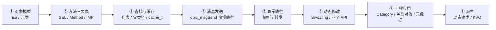

每一步只解决一个问题，始终用同一组 `Person` / `Animal` / `Dog` 例子。

## 13.7 不建议现在深挖的部分

以下内容属于"源码级"，不影响工程判断，可以在需要时再看：

| 主题 | 为什么可以先跳过 |
| --- | --- |
| `cache_t` 的哈希算法与扩容策略 | 只需知道"哈希 + 线性探测 + 扩容清空" |
| `method_t` 的 `big`/`small` 双形态 | 只需知道三个字段 |
| `isa` 的位域精确位宽 | 各架构不同，记字段含义即可 |
| `objc_msgSend` 的汇编指令细节 | 只需知道"缓存查找 + tail call" |
| `realizeClass` 的 `ro`→`rw` 展开过程 | 只需知道"首次使用时展开" |
| 弱引用表 `SideTable` 的实现 | 属于内存管理主题 |

> 真正需要的是**判断力**：什么时候该用 Runtime、什么时候不该用。这比背 API 重要得多。

---

## 附录 A：常用头文件与导入

```objc
#import <objc/runtime.h>     // 绝大部分 Runtime API
#import <objc/message.h>     // objc_msgSend 及变体（直接调用需要它）
#import <objc/objc.h>        // id / BOOL / Class / SEL 基本定义
```

## 附录 B：API 速查

### 类

| API | 作用 |
| --- | --- |
| `objc_getClass(name)` | 按名取类 |
| `objc_getMetaClass(name)` | 按名取元类 |
| `class_getName(cls)` | 类名 |
| `class_getSuperclass(cls)` | 父类 |
| `class_getInstanceSize(cls)` | 实例大小 |
| `class_isMetaClass(cls)` | 是否元类 |
| `class_getInstanceMethod(cls, sel)` | 实例方法（递归父类） |
| `class_getClassMethod(cls, sel)` | 类方法 |
| `class_addMethod(...)` | 加方法（只看本类） |
| `class_replaceMethod(...)` | 替换/新增 |
| `class_copyMethodList(...)` | 方法列表 |
| `class_copyPropertyList(...)` | 属性列表 |
| `class_copyIvarList(...)` | ivar 列表 |
| `class_getInstanceVariable(cls, name)` | 单个 ivar（递归父类） |
| `class_conformsToProtocol(...)` | 是否遵循协议 |
| `class_addProtocol(...)` | 加协议 |

### 方法

| API | 作用 |
| --- | --- |
| `method_getName(m)` | SEL |
| `method_getTypeEncoding(m)` | 类型编码 |
| `method_getImplementation(m)` | IMP |
| `method_setImplementation(m, imp)` | 设置 IMP |
| `method_exchangeImplementations(a, b)` | 互换 IMP |
| `method_getNumberOfArguments(m)` | 参数数（含 self/_cmd） |
| `method_getReturnType(m, buf, n)` | 返回类型 |
| `method_getArgumentType(m, i, buf, n)` | 第 i 个参数类型 |

### 对象

| API | 作用 |
| --- | --- |
| `object_getClass(obj)` | 真实类 |
| `object_setClass(obj, cls)` | 改 isa |
| `object_getIvar(obj, ivar)` | 读 ivar（对象类型） |
| `object_setIvar(obj, ivar, val)` | 写 ivar |
| `objc_setAssociatedObject(...)` | 设关联 |
| `objc_getAssociatedObject(...)` | 取关联 |
| `objc_removeAssociatedObjects(obj)` | 清全部关联 |

### ivar / 属性

| API | 作用 |
| --- | --- |
| `ivar_getName(iv)` | 变量名 |
| `ivar_getTypeEncoding(iv)` | 类型编码 |
| `ivar_getOffset(iv)` | 偏移 |
| `property_getName(p)` | 属性名 |
| `property_getAttributes(p)` | 特征串 |
| `property_copyAttributeValue(p, name)` | 单个特征（需 free） |

## 附录 C：一句话记忆卡

| 概念 | 一句话 |
| --- | --- |
| `isa` | 我是谁 |
| `superclass` | 我继承谁 |
| 元类 | 放类方法的类 |
| `SEL` | 方法的名字牌 |
| `IMP` | 方法的肉身 |
| `Method` | 名字牌 + 类型 + 肉身的登记表 |
| Cache | 查过就记住的备忘录 |
| `objc_msgSend` | 派件员 |
| 动态解析 | 现场造一个方法 |
| 快速转发 | 转给别人接电话 |
| 完整转发 | 把整通电话打包转寄 |
| Swizzling | 换心脏 |
| Category | 给老房子加个房间（不能加承重墙） |
| 关联对象 | 挂在门外的储物柜 |
| KVO | 偷偷把住户换成双胞胎 |
