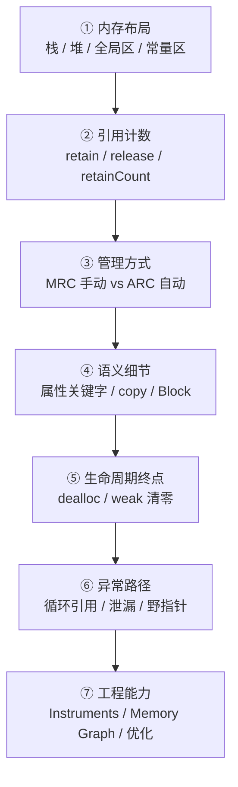
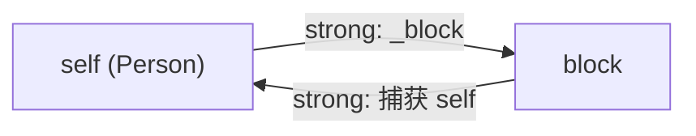
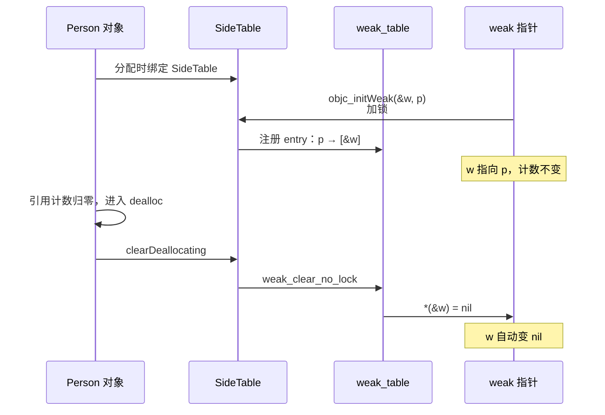
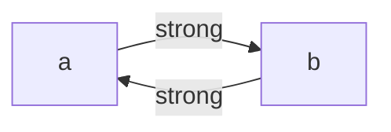
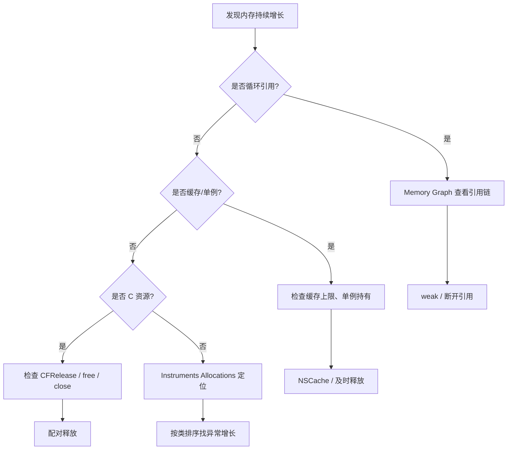
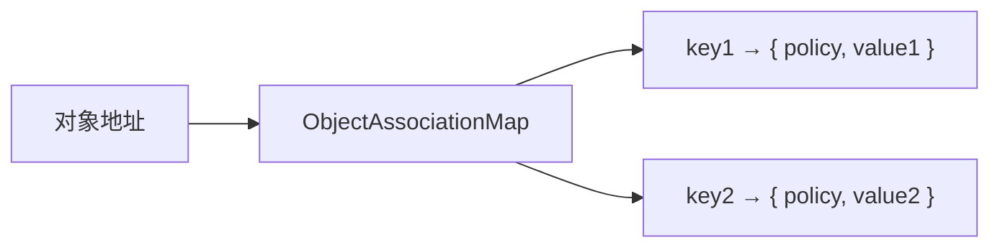
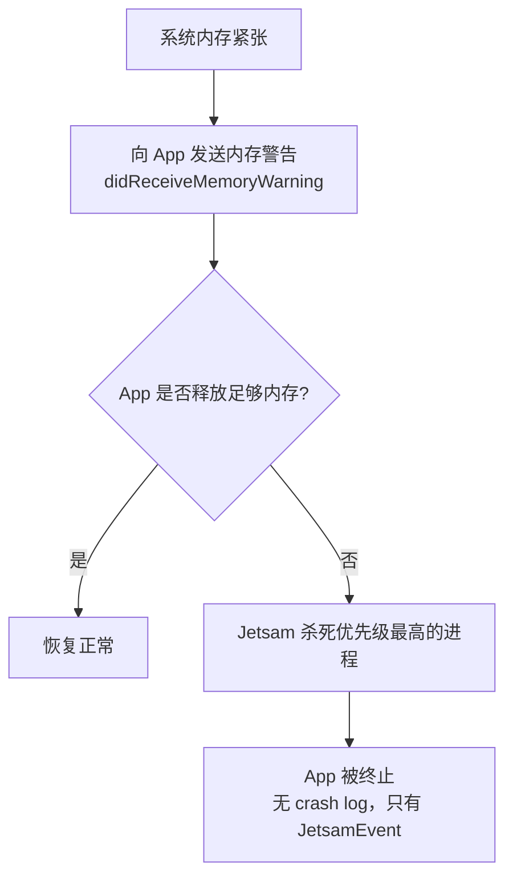
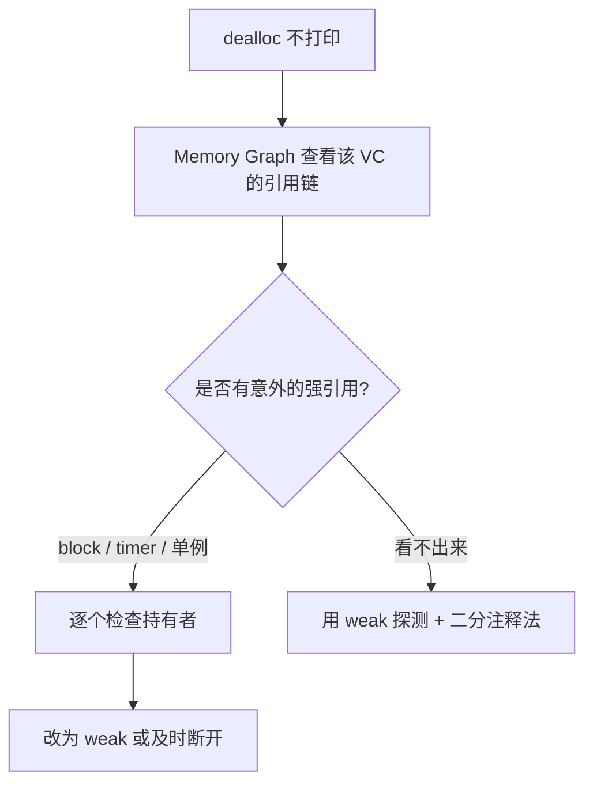

# Objective-C 内存管理知识详解

> 主线：**一个对象从 `alloc` 出生，到 `dealloc` 死亡，中间被谁持有、被谁释放、为什么会漏、漏了怎么查。**
>
> 本文把内存布局、引用计数、MRC / ARC、属性语义、`copy`、Block、`weak`、`autoreleasepool`、循环引用、内存泄漏、CF 桥接串成一条完整的线，并附 15 个真实工程案例，既适合系统学习，也适合面试前速查。

---

## 目录

- [第 0 章 先把内存管理压缩成一句话](#第-0-章-先把内存管理压缩成一句话)
- [第 1 章 进程内存布局与对象的内存](#第-1-章-进程内存布局与对象的内存)
- [第 2 章 引用计数：一切的基础](#第-2-章-引用计数一切的基础)
- [第 3 章 MRC 手动引用计数](#第-3-章-mrc-手动引用计数)
- [第 4 章 ARC 自动引用计数](#第-4-章-arc-自动引用计数)
- [第 5 章 属性关键字与内存语义](#第-5-章-属性关键字与内存语义)
- [第 6 章 copy 与深浅拷贝](#第-6-章-copy-与深浅拷贝)
- [第 7 章 Block 的内存管理](#第-7-章-block-的内存管理)
- [第 8 章 weak 原理与弱引用容器](#第-8-章-weak-原理与弱引用容器)
- [第 9 章 autorelease 与自动释放池](#第-9-章-autorelease-与自动释放池)
- [第 10 章 dealloc 与对象销毁](#第-10-章-dealloc-与对象销毁)
- [第 11 章 循环引用](#第-11-章-循环引用)
- [第 12 章 内存泄漏、关联对象与优化](#第-12-章-内存泄漏关联对象与优化)
- [第 13 章 Core Foundation 与 Toll-Free Bridging](#第-13-章-core-foundation-与-toll-free-bridging)
- [第 14 章 实战案例集](#第-14-章-实战案例集)
- [第 15 章 面试题、易错点、自测](#第-15-章-面试题易错点自测)

---

# 第 0 章 先把内存管理压缩成一句话

## 0.1 一句话定义

> **Objective-C 的内存管理，本质上是"通过引用计数管理堆上对象的生命周期"：谁需要这个对象，谁就持有它（计数 +1）；不需要了就放弃持有（计数 -1）；计数归零，对象销毁。**

栈上的局部变量由编译器自动管理，不需要你操心；真正需要管理的是**堆上的 Objective-C 对象**（`alloc` / `new` / `copy` / `mutableCopy` 出来的那些）。

## 0.2 它只回答五个问题

| 问题 | 对应的知识 |
| --- | --- |
| 对象分配在哪里？长什么样？ | 进程内存布局、对象内存结构、内存对齐、`malloc_size` |
| "持有"这个动作在底层是什么？ | 引用计数、`retain` / `release`、`isa` 的 `extra_rc`、`SideTable` |
| 谁负责释放？什么时候释放？ | 所有权规则、MRC 四法则、ARC 插入规则、`dealloc` |
| 对象释放后，指针怎么办？ | `weak` 弱引用表、`unsafe_unretained`、野指针 |
| 为什么对象释放不掉？ | 循环引用、Block、Timer、Delegate、通知、单例、缓存 |

把这三层（**分配 → 持有 → 释放**）想清楚，剩下的都是细节。

## 0.3 知识地图



## 0.4 一条主线：对象的一生

```objc
Person *p = [[Person alloc] init];   // 1. 分配 + 初始化，引用计数 = 1
[p doSomething];                     // 2. 使用
NSString *name = p.name;             // 3. 别人持有它（retain / strong）
p = nil;                             // 4. 放弃持有（release），计数 -1
// 计数归零 → dealloc → 释放 ivar → 释放对象内存
```

对应到底层：

```
alloc ──▶ class_createInstance ──▶ calloc ──▶ initIsa（isa 指向类，extra_rc = 0）
                                                    │
使用 ◀──────────────────────────────────────────────┘
    │
retain  ──▶ extra_rc++（溢出则写 SideTable）
release ──▶ extra_rc--（为 0 则走 SideTable / 直接 dealloc）
    │
dealloc ──▶ objc_destructInstance ──▶ 释放 ivar / 清关联对象 / 清 weak 表 ──▶ free
```

## 0.5 术语表

| 术语 | 含义 |
| --- | --- |
| 引用计数（Reference Count） | 当前有多少个"持有者"指向这个对象 |
| 持有（Own） | 让引用计数 +1 的动作：`retain`、`strong` 赋值、`copy` |
| 放弃持有 | 让引用计数 -1：`release`、强引用置 nil、离开作用域 |
| ARC | Automatic Reference Counting，编译器在编译期自动插入 retain/release |
| MRC | Manual Reference Counting，手动调用 retain/release |
| 循环引用 | A 持有 B，B 持有 A，两者计数都不为 0，永远不释放 |
| 悬垂指针（野指针） | 对象已释放，指针还指向原地址 |
| 内存泄漏 | 对象已经不会被使用，但因为仍被持有而无法释放 |
| Tagged Pointer | 把小值直接编码进指针本身，不分配堆内存、不走引用计数 |
| 自动释放池 | 延迟 release 的容器，pool drain 时统一释放 |

---

# 第 1 章 进程内存布局与对象的内存

## 1.1 虚拟内存：你看到的地址不是物理地址

每个 iOS 进程都拥有一套独立的**虚拟地址空间**。你打印出来的对象地址（如 `0x600000c1c0e0`）是虚拟地址，由 CPU 的 MMU 映射到物理内存页。

这带来几个直接后果：

| 现象 | 原因 |
| --- | --- |
| 不同进程可以打印出相同地址 | 每个进程有独立页表 |
| 分配了内存但没写入，物理内存不增长 | 只有"脏页"才占用物理内存 |
| 大文件可以 `mmap` 映射而不全量读入 | 虚拟内存按页映射 |
| 访问已释放页会 `EXC_BAD_ACCESS` | 页被取消映射，或对象内存被复用 |

iOS 没有交换分区（swap），内存压力下由系统向 App 发送内存警告，极端情况直接杀死进程（OOM，Jetsam）。

## 1.2 进程地址空间布局

```
高地址
┌─────────────────────────────┐
│          内核空间            │  用户态不可访问
├─────────────────────────────┤
│          栈 Stack            │  局部变量、函数参数、返回地址
│            ↓ 向低地址增长     │  线程私有，自动管理
├─────────────────────────────┤
│            ...              │
├─────────────────────────────┤
│          堆 Heap             │  alloc / malloc 出来的对象
│            ↑ 向高地址增长     │  手动或 ARC 管理，进程内共享
├─────────────────────────────┤
│      BSS 段（未初始化全局）    │  如 static int a;
├─────────────────────────────┤
│     Data 段（已初始化全局）    │  如 static int a = 1;
├─────────────────────────────┤
│   常量区（__TEXT, __cstring） │  @"hello" 等字符串常量
├─────────────────────────────┤
│        代码段（__TEXT）        │  编译后的机器指令，只读
└─────────────────────────────┘
低地址
```

> 注意：栈向低地址增长、堆向高地址增长，这是大多数平台的约定；两者的"中间空地"由虚拟内存动态分配。

## 1.3 五大分区对照表

| 分区 | 存放内容 | 分配/释放 | 生命周期 | 典型例子 |
| --- | --- | --- | --- | --- |
| 栈 | 局部变量、参数、返回地址 | 编译器自动 | 函数调用期间 | `int a = 1;`、`Person *p;` 这个指针本身 |
| 堆 | 对象、动态内存 | `alloc` / `malloc` / ARC | 引用计数归零 | `[[Person alloc] init]` |
| BSS | 未初始化全局/静态变量 | 程序加载时 | 整个进程 | `static int count;` |
| Data | 已初始化全局/静态变量 | 程序加载时 | 整个进程 | `static NSString *k = @"a";`（指针在 Data） |
| 常量区 | 字符串常量、const 常量 | 编译期 | 整个进程 | `@"hello"`、`__NSCFConstantString` |
| 代码段 | 机器指令 | 编译期 | 整个进程 | 函数体 |

**一个容易混淆的点**：

```objc
static NSString *kName = @"Tom";
// 变量 kName（指针）存放在 Data 段
// 指针指向的 @"Tom" 对象存放在常量区
```

**另一个**：

```objc
- (void)foo {
    NSString *s = @"Tom";      // s 在栈上，@"Tom" 在常量区
    NSString *t = [NSString stringWithFormat:@"Tom"]; // t 在栈，对象在堆
}
```

## 1.4 栈 vs 堆

| 维度 | 栈 | 堆 |
| --- | --- | --- |
| 管理者 | 编译器 | 程序员 / ARC / runtime |
| 分配速度 | 极快（移动栈指针） | 较慢（malloc 查找空闲块） |
| 释放 | 函数返回自动回收 | 引用计数归零才回收 |
| 大小 | 主线程 1MB，子线程 512KB（iOS） | 受设备内存限制 |
| 碎片 | 无 | 有 |
| 线程安全 | 线程私有，天然安全 | 需加锁（malloc 内部有锁） |
| 典型对象 | 基本类型、对象指针 | Objective-C 对象本体 |

> 面试常问："`NSString *s` 这个变量在哪？"——**指针在栈上，对象在常量区/堆上**。问的是变量还是对象，答案不同。

## 1.5 对象在内存中长什么样

每个 Objective-C 对象的第一个成员都是 `isa`：

```objc
// 简化后的 objc_object
struct objc_object {
    isa_t isa;   // 8 字节（64 位）
};
```

一个自定义对象：

```objc
@interface Person : NSObject
@property (nonatomic, copy) NSString *name;
@property (nonatomic, assign) int age;
@end
```

内存布局（64 位、无属性重排）：

```
偏移量      内容
0x00       isa 指针（8 字节）
0x08       _name（8 字节指针）
0x10       _age（4 字节）
0x14       padding（4 字节，为了整体 8 字节对齐）
--------
总大小      0x18 = 24 字节（class_getInstanceSize）
```

`malloc_size` 可能是 32 字节（malloc 按 16 字节对齐分配）。

## 1.6 三个 "size" 必须分清

| API | 含义 | NSObject | Person（上面例子） |
| --- | --- | --- | --- |
| `sizeof(Person)` | **编译期**类型大小，对对象指针是 8 | 8（指针） | 8（指针） |
| `class_getInstanceSize(cls)` | 实例**结构体**大小，含 isa，按 8 字节对齐 | 8 | 24 |
| `malloc_size(ptr)` | `malloc` 实际分配的**堆块**大小，按 16 字节对齐 | 16 | 32 |

实测代码：

```objc
#import <objc/runtime.h>
#import <malloc/malloc.h>

NSObject *obj = [[NSObject alloc] init];
NSLog(@"instance size = %zu", class_getInstanceSize([NSObject class])); // 8
NSLog(@"malloc size   = %zu", malloc_size((__bridge const void *)obj)); // 16
```

**为什么 `NSObject` 的 `malloc_size` 是 16 而不是 8？**

因为 malloc 在 64 位下保证返回的指针 16 字节对齐（`malloc` 的最小对齐粒度），8 字节的请求也会给 16 字节。这也是为什么 `malloc_size` 永远 ≥ `class_getInstanceSize`。

## 1.7 对齐规则

1. **每个 ivar 按自身类型大小对齐**：`int` 4 字节对齐，`double` 8 字节对齐，指针 8 字节对齐。
2. **整个对象按 8 字节对齐**（`WORD_MASK = 7`）。
3. **malloc 块按 16 字节对齐**（64 位）。

```objc
@interface Mixed : NSObject
@property (nonatomic, assign) char  c;   // 偏移 8，占 1
@property (nonatomic, assign) int   i;   // 偏移 12（对齐到 4），占 4
@property (nonatomic, assign) char  c2;  // 偏移 16，占 1
@end
// 8 + 1 + padding(3) + 4 + 1 + padding(7) = 24
```

## 1.8 从 alloc 到 free 的完整路径

```objc
Person *p = [Person new];
```

等价于：

```objc
Person *p = [[Person alloc] init];
```

底层大致是：

```
+[Person alloc]
   └─ callAlloc()
        └─ class_createInstance(cls, 0)
             └─ _class_createInstanceFromZone()
                  ├─ size = class_getInstanceSize(cls)      // 计算大小
                  ├─ obj = calloc(1, size)                  // 堆上分配、清零
                  ├─ initIsa(cls, obj, false)               // 设置 isa，extra_rc = 0
                  └─ 返回 obj
-[Person init]
   └─ 通常直接 return self（或初始化 ivar）
```

销毁：

```
objc_release(obj)
   └─ 引用计数减到 0
        └─ dealloc
             └─ _objc_rootDealloc
                  └─ objc_destructInstance
                       ├─ object_cxxDestruct        // 释放 C++ 成员
                       ├─ _object_remove_assocations // 释放关联对象
                       └─ clearDeallocating          // 清 weak 表、清 SideTable
                  └─ free(obj)                       // 归还堆内存
```

## 1.9 常量字符串的特殊性

```objc
NSString *a = @"hello";
NSString *b = @"hello";
NSLog(@"%p %p", a, b);  // 相同地址，同一个对象
```

- `@"hello"` 编译进 `__TEXT,__cstring`，运行时标记为 `__NSCFConstantString`。
- 它**永远不释放**，`retainCount` 是一个极大值（`NSUIntegerMax`），`retain` / `release` 对它没有实际意义。
- 所以对常量字符串做 `copy` 返回自身，做 `retain` 也不增加真实引用计数。

## 1.10 Tagged Pointer：小对象根本不在堆上

### 1.10.1 问题背景

`NSNumber`、短 `NSString`、`NSDate` 在业务中极其常见。如果每个都分配一个堆对象：

```objc
NSNumber *n = @(42);
// 需要：malloc 16 字节 + 写 isa + 写值 + 引用计数管理 + 将来 free
```

64 位系统下指针有 64 位，而 `42` 只需要几个 bit。**用 64 位指针去装一个小整数，是巨大的浪费。**

### 1.10.2 解决方案：把值塞进指针

```
普通对象指针（nonpointer = 0 的 isa 不参与，这里指对象地址）
┌──────┬────────────────────────────────────────────┐
│ 0000 │            堆对象地址（56 位可用）            │
└──────┴────────────────────────────────────────────┘
  高位标记 0 → 这是真实地址

Tagged Pointer
┌──────┬────────┬───────────────────────────────────┐
│ 1011 │ 类信息  │           值（payload）            │
└──────┴────────┴───────────────────────────────────┘
  高位标记非 0 → 这不是地址，是值本身
```

- **最高位为 1**（macOS/iOS 上通常是 `0xb` 开头）表示 Tagged Pointer；
- 中间几位标识"这是哪种类型"（`NSNumber` / `NSString` / `NSDate`）；
- 剩余位直接存值。

```objc
NSNumber *n = @(42);
NSLog(@"%p", n);   // 0xb0000000000002a2 之类，明显不是堆地址
```

### 1.10.3 三个直接后果

| 后果 | 说明 |
| --- | --- |
| **不分配堆内存** | 没有 `malloc`，没有 `free` |
| **不走引用计数** | `retain` / `release` 是空操作，`retainCount` 无意义 |
| **不是真正意义上的对象** | 但它能响应 `NSNumber` 的方法（runtime 特殊处理） |

```objc
NSNumber *a = @(1);
NSNumber *b = @(1);
NSLog(@"%p %p", a, b);        // 相同地址（值相同，编码相同）
NSLog(@"%lu", [a retainCount]); // 极大值，别用

NSString *s1 = @"a";           // 常量字符串
NSString *s2 = [NSString stringWithFormat:@"a"]; // 可能是 Tagged Pointer
```

### 1.10.4 如何判断

```objc
static inline BOOL isTaggedPointer(id obj) {
#if __LP64__
    return ((uintptr_t)obj & (1UL << 63)) != 0;
#else
    return ((uintptr_t)obj & (1UL << 31)) != 0;
#endif
}
```

objc4 源码中的宏：

```c
#if OBJC_HAVE_TAGGED_POINTERS
#define _OBJC_TAG_MASK (1UL << 63)
static inline bool isTaggedPointer(id obj) {
    return ((uintptr_t)obj & _OBJC_TAG_MASK) != 0;
}
#endif
```

### 1.10.5 什么时候会变成 Tagged Pointer

| 类型 | 条件（大致） |
| --- | --- |
| `NSNumber` | 整数在 60 位范围内、小浮点数 |
| `NSString` | 短 ASCII 字符串（约 7~10 个字符内，随系统版本变化） |
| `NSDate` | 时间戳能塞进 60 位 |
| `NSIndexPath` | 短路径 |

```objc
// Tagged Pointer 与普通对象在"类型"上看起来一样
NSLog(@"%@", NSStringFromClass([@(1) class]));     // __NSCFNumber
NSLog(@"%@", NSStringFromClass([@"hi" class]));     // NSTaggedPointerString / __NSCFString

// 但地址形态完全不同
NSLog(@"%p", @(1));            // 0xb000000000000012 之类（高位非 0）
NSLog(@"%p", [NSObject new]);  // 0x600000c1c0e0 之类（堆地址）
```

### 1.10.6 面试陷阱

```objc
// 陷阱 1：以为"不是真对象"就不能响应方法
NSNumber *n = @(1);
NSLog(@"%d", [n isKindOfClass:[NSNumber class]]);  // 1
// runtime 会从 Tagged Pointer 的 tag 位反解出类，再走正常的 isKindOfClass:
// 但 objc_getClass("...")、object_getClass 的行为与普通对象不同，别依赖它做类型判断

// 陷阱 2：以为 weak 能"看住" Tagged Pointer
__weak id w = @(1);
// 合法，但 weak 表不会登记它（没有对象头）；
// 它也不会被释放，所以读出来永远有值，与 weak 的语义无关

// 陷阱 3：用 CF 的引用计数管理它
// Tagged Pointer 不是 CF 对象，没有 CF 的引用计数；
// 不要对它 CFRetain / CFRelease，也不要放进需要 CFTypeRef 生命周期的容器
```

### 1.10.7 性能收益

| 场景 | 普通对象 | Tagged Pointer |
| --- | --- | --- |
| 创建 | malloc + init + 写 isa | 位运算 |
| 销毁 | release + free | 无 |
| 内存 | 16~32 字节 | 0（就在指针里） |
| 缓存 | 堆上分散 | 随指针传递，缓存友好 |

Apple 的测试数据：`NSNumber` 创建速度提升约 **3 倍**，内存占用下降明显。

## 1.11 本章易错点

| 易错点 | 正确理解 |
| --- | --- |
| "对象都在堆上" | 对象本体在堆，指向对象的指针在栈；常量字符串对象在常量区 |
| `sizeof(obj)` 是对象大小 | `obj` 是指针，`sizeof` 是 8；对象大小用 `class_getInstanceSize` |
| `class_getInstanceSize` 等于 `malloc_size` | 前者按 8 字节对齐，后者按 16 字节对齐，通常更大 |
| 栈一定比堆快 | 分配快，但访问速度受缓存影响，不能一概而论 |
| 内存泄漏 = 内存溢出 | 泄漏是"该释放没释放"，溢出是"申请超过上限" |
| `@(1)` 是一个堆对象 | 小整数是 Tagged Pointer，不分配堆、不走引用计数 |
| 所有 `NSNumber` 都一样大 | Tagged Pointer 的"大小"就是 8 字节指针本身 |

### Tagged Pointer 的三个补充结论

1. **不能用 `retainCount` 判断它**：它根本没有计数；
2. **不能用 `CFRetain` / `CFRelease` 管理它**：它不是 CF 对象；
3. **它不能被 `weak` 表记录**：没有对象头，`weak` 对它等价于 `unsafe_unretained`（但值本身安全，因为不释放）。

---

# 第 2 章 引用计数：一切的基础

## 2.1 为什么需要引用计数

一个对象可能被多个"人"使用：

```objc
Person *p = [[Person alloc] init];     // A 用它
self.person = p;                        // B（self）也用它
array = @[p];                           // C（数组）也用它
```

如果 A 用完就释放，B、C 手里的指针立刻变野。所以需要一个计数器，记录"还有几个人要它"，**最后一个放手的人才负责销毁**。

## 2.2 核心规则

> **每个对象有一个引用计数；持有 +1，放弃 -1；减到 0 就销毁。**

```objc
NSObject *obj = [[NSObject alloc] init];   // 计数 1
[obj retain];                              // 计数 2
[obj release];                             // 计数 1
[obj release];                             // 计数 0 → dealloc
```

## 2.3 计数器存在哪里

这是容易出错的地方。现代 objc4 运行时**不是**一个简单的 `NSUInteger retainCount` 字段，而是分两层：

### 第一层：`isa` 指针的位域（快路径）

64 位下 `isa_t` 是一个 union：

```c
union isa_t {
    uintptr_t bits;
    struct {
        uintptr_t nonpointer        : 1;  // 是否启用指针优化
        uintptr_t has_assoc         : 1;  // 是否有关联对象
        uintptr_t has_cxx_dtor      : 1;  // 是否有 C++ 析构
        uintptr_t shiftcls          : 33; // 类对象地址（后 3 位清零）
        uintptr_t magic             : 6;  // 调试用
        uintptr_t weakly_referenced : 1;  // 是否被 weak 引用
        uintptr_t unused            : 1;
        uintptr_t has_sidetable_rc  : 1;  // 是否使用 SideTable 存计数
        uintptr_t extra_rc          : 19; // 额外的引用计数（存的是 count - 1）
    };
};
```

关键字段：

| 字段 | 作用 |
| --- | --- |
| `nonpointer` | 0 表示原始 isa（纯指针），1 表示优化过的 isa（含位域） |
| `extra_rc` | **额外的引用计数**，19 位，最大约 52 万；存的是 `真实计数 - 1` |
| `has_sidetable_rc` | `extra_rc` 溢出了，计数转移到 `SideTable` |
| `weakly_referenced` | 对象被 weak 引用过，dealloc 时需要清 weak 表 |
| `has_assoc` | 有关联对象，dealloc 时需要清理 |
| `has_cxx_dtor` | 有 C++ 析构函数 |

**为什么 `extra_rc` 存的是 `count - 1`？**

因为新对象计数为 1，此时 `extra_rc = 0`。这样 `alloc` 后不需要任何额外写操作，节省一次赋值。只有 `retain` 时才把 `extra_rc++`。

### 第二层：`SideTable`（慢路径 / 溢出）

```c
struct SideTable {
    spinlock_t        slock;      // 锁
    RefcountMap       refcnts;    // 引用计数表（哈希表：obj → count）
    weak_table_t      weak_table; // 弱引用表
};
```

全局有一个 `StripedMap<SideTable>`，以对象地址哈希到 64 个（或更多）条带，降低锁冲突。

**什么时候用 `SideTable`？**

1. `extra_rc` 溢出（计数超过 2^19 - 1 ≈ 52 万，实际几乎不会）；
2. 对象被 `weak` 引用（需要记录 weak 表）；
3. 对象有关联对象（需要记录关联表）；
4. 对象正在被 `dealloc`（`clearDeallocating` 需要访问 SideTable）。

### 为什么这么设计

| 设计 | 收益 |
| --- | --- |
| 计数放 isa 位域 | 无额外内存开销，`retain`/`release` 只是位运算，极快 |
| 溢出才用 SideTable | 99.99% 的对象不需要哈希表 |
| 分条带加锁 | 多线程 retain/release 减少锁竞争 |
| `weak` 表与引用计数同表 | 一个对象只需定位一次 SideTable |

## 2.4 `retain` / `release` / `retainCount` 的语义

| 方法 | 语义 | 返回值 |
| --- | --- | --- |
| `retain` | 计数 +1，返回对象本身 | `instancetype` |
| `release` | 计数 -1，减到 0 时 `dealloc` | `void` |
| `autorelease` | 加入当前自动释放池，将来 -1 | `instancetype` |
| `retainCount` | 返回当前计数（**不可靠**） | `NSUInteger` |

**为什么 `retainCount` 不可靠？**

```objc
NSString *s = @"hello";
NSLog(@"%lu", (unsigned long)[s retainCount]);  // 18446744073709551615

NSNumber *n = @(1);   // Tagged Pointer
NSLog(@"%lu", (unsigned long)[n retainCount]);  // 极大值或崩溃风险

NSObject *o = [NSObject new];
NSLog(@"%lu", (unsigned long)[o retainCount]);  // 1
[o autorelease];
NSLog(@"%lu", (unsigned long)[o retainCount]);  // 1（池还没 drain）
```

原因：

1. **常量对象**（`__NSCFConstantString`、`NSNumber` 小整数）不走引用计数；
2. **Tagged Pointer** 根本不是对象，没有计数；
3. **autorelease** 只是延迟 release，计数暂未变化；
4. **系统框架可能 retain 你的对象**（如 `UIView` 被父视图持有），你看到的不是你以为的；
5. **ARC 下编译器可能优化掉 retain/release**。

结论：**`retainCount` 只能用于调试打印，永远不要用它做逻辑判断。**

## 2.5 引用计数的加减规则（MRC 四法则）

这是 MRC 时代的口诀，也是理解 ARC 的基础：

| 操作 | 计数变化 | 谁负责释放 |
| --- | --- | --- |
| `alloc` / `new` / `copy` / `mutableCopy` | +1（你拥有） | **你** |
| `retain` | +1（你拥有） | **你** |
| `release` | -1 | — |
| `autorelease` | 延迟 -1 | 未来的池 |
| 非上述方法返回的对象（如 `[NSArray array]`） | 0（你不拥有） | 返回者（通常 autorelease） |

**记忆口诀**：

> **谁创建（alloc/new/copy/mutableCopy），谁释放；谁 retain，谁 release；不是我创建的，我不负责。**

## 2.6 一个完整的 MRC 生命周期

```objc
- (void)example {
    // 1. 创建，拥有
    Person *p = [[Person alloc] init];      // count = 1

    // 2. 使用
    p.name = @"Tom";

    // 3. 别人也想要
    [p retain];                              // count = 2

    // 4. 自己用完，放手
    [p release];                             // count = 1

    // 5. 别人用完，放手
    [p release];                             // count = 0 → dealloc
    // p 现在是野指针，不应再访问
    p = nil;                                 // 好习惯
}
```

## 2.7 引用计数与线程安全

`retain` / `release` 是**原子**的（内部有锁或原子指令），但"**读指针 + retain**"这个组合**不是原子的**：

```objc
// 线程 A
id obj = _sharedObject;
[obj retain];   // obj 可能已在此前被线程 B release 掉

// 线程 B
[_sharedObject release];
_sharedObject = nil;
```

竞态窗口：A 读完指针、还没 retain，B 就把对象释放了 → A retain 的是已释放内存。

**解决方式**：

1. 用锁保护读写；
2. 用 `objc_loadWeakRetained` / `__weak`（weak 表有锁保护）；
3. 用 `atomic` 属性（只保证 getter/setter 原子，不保证多步操作）；
4. 用串行队列 / 线程 confinement。

这也是为什么 `atomic` 属性**不能**解决线程安全问题——它只保证单次存取不撕裂，不保证业务逻辑原子。

## 2.8 引用计数的代价

| 代价 | 说明 |
| --- | --- |
| 时间 | 每次 strong 赋值都有 retain + release |
| 空间 | isa 位域免费，但 weak/关联对象要走 SideTable |
| 循环引用 | 计数模型的天然缺陷，需要 weak 打破 |
| 多线程 | 需要原子操作，热点对象有锁竞争 |
| 缓存不友好 | 对象分散在堆上，访问局部性差 |

## 2.9 retain / release 的快路径与慢路径

`objc_retain` / `objc_release` 是内存管理里调用最频繁的两个函数，objc4 把它们写成了手写汇编，核心思路是**先试无锁快路径，失败才加锁走慢路径**。

### 快路径的伪代码

```c
// objc_retain 的语义（实际是汇编实现）
id objc_retain(id obj) {
    if (!obj) return obj;                     // ① nil 直接返回
    if (isTaggedPointer(obj)) return obj;     // ② Tagged Pointer 无计数
    if (!obj->isa.nonpointer) {               // ③ 非优化 isa，走慢路径
        return objc_retain_slow(obj);
    }
    if (obj->isa.extra_rc < EXTRA_RC_MAX) {   // ④ 快路径：isa 内 +1
        obj->isa.extra_rc++;
        return obj;
    }
    return objc_retain_slow(obj);             // ⑤ 溢出，计数转移到 SideTable
}

// objc_release 的语义
void objc_release(id obj) {
    if (!obj) return;                          // ① nil 直接返回
    if (isTaggedPointer(obj)) return;          // ② 无计数，无需释放
    if (!obj->isa.nonpointer) {
        objc_release_slow(obj);
        return;
    }
    if (obj->isa.extra_rc > 0) {               // ③ 快路径：isa 内 -1
        obj->isa.extra_rc--;
        return;
    }
    objc_release_slow(obj);                    // ④ 归零，走 dealloc 流程
}
```

### 四个判断的意义

| 判断 | 作用 |
| --- | --- |
| `obj == nil` | 所以 `[nil retain]`、`[nil release]` 都安全 |
| Tagged Pointer | 没有对象头，不走计数 |
| `nonpointer == 0` | 老式 isa（纯指针），计数只能在 SideTable |
| `extra_rc` 边界 | 正常情况在 isa 内完成，溢出才用哈希表 |

### 为什么 `extra_rc` 存的是 `count - 1`

新对象计数为 1，此时 `extra_rc = 0`。这样 `alloc` 之后**不需要任何写操作**，天然满足"计数 1"；第一次 `retain` 才把它变成 1（即计数 2）。

`release` 时 `extra_rc` 从 0 减到 -1（下溢），就说明计数归零，该进 `dealloc` 了。

### 慢路径做什么

```
objc_release_slow(obj)
   └─ 定位 SideTable(obj)（按地址哈希到某个条带）
        └─ lock(sideTable->slock)
             ├─ 若 isa 里还有计数：把它搬到 refcnts 表
             ├─ refcnts[obj] -= 1
             ├─ 若结果 > 0：写回，unlock，返回
             └─ 若结果 == 0：unlock → objc_destructInstance → free
```

### 性能量级（参考）

| 操作 | 大约耗时 |
| --- | --- |
| `objc_retain` / `objc_release` 快路径 | 几纳秒，无锁 |
| 慢路径（SideTable） | 几十纳秒，含锁 |
| `objc_storeWeak` | 几十纳秒，含哈希 + 锁 |
| `malloc` + `free` | 几十到几百纳秒 |

**结论**：普通 `strong` 赋值的开销很小，真正贵的是 `weak` 和堆分配。热点路径优化应优先关注这两者，而不是纠结 retain/release。

### 一个值得知道的事实

```objc
for (int i = 0; i < 1000000; i++) {
    id obj = array[i];     // strong 局部变量：retain + release
    [obj doSomething];
}
```

每次循环都有 2 次引用计数操作。如果**能确定** `array` 在循环期间不变、元素不会被释放，可以用 `__unsafe_unretained` 省掉：

```objc
// 仅在确定安全时使用
for (int i = 0; i < 1000000; i++) {
    __unsafe_unretained id obj = array[i];
    [obj doSomething];
}
```

这是"用安全性换性能"的典型取舍，绝大多数业务代码**不该**这么做。

## 2.10 本章易错点

| 易错点 | 正确理解 |
| --- | --- |
| 引用计数存在对象的某个 `int` 字段 | 现代运行时存在 `isa.extra_rc`，溢出才进 `SideTable` |
| `retainCount` 可以用来判断对象是否泄漏 | 完全不可靠，常量对象、Tagged Pointer、autorelease 都会误导 |
| `retain` 就是 `count++` | 还需处理溢出、弱引用标志、非指针 isa 等情况 |
| `release` 后对象立即消失 | 计数归零才 `dealloc`，之前对象仍有效 |
| `atomic` 属性 = 线程安全 | 只保证存取原子，不保证组合操作 |

---

# 第 3 章 MRC 手动引用计数

## 3.1 什么是 MRC

MRC（Manual Reference Counting）要求开发者**手动**调用 `retain` / `release` / `autorelease`。Xcode 中通过 `-fno-objc-arc` 编译标志对单个文件关闭 ARC。

```objc
// 开启 ARC 的工程里，让这个文件用 MRC
// Build Phases → Compile Sources → 该文件 → -fno-objc-arc
```

## 3.2 内存管理四法则

> **1. 自己生成的对象，自己持有。**
> **2. 非自己生成的对象，自己也能持有。**
> **3. 自己持有的对象不再需要时，自己释放。**
> **4. 非自己持有的对象，不能释放。**

对应代码：

```objc
// 法则 1：alloc/new/copy/mutableCopy 生成并持有
id obj1 = [[NSObject alloc] init];   // 持有
id obj2 = [NSObject new];            // 持有
id obj3 = [obj1 copy];               // 持有
id obj4 = [obj1 mutableCopy];        // 持有

// 法则 2：非自己生成的对象，retain 后持有
id obj5 = [NSMutableArray array];    // 不持有（autorelease）
[obj5 retain];                       // 持有

// 法则 3：自己持有的自己释放
[obj1 release];
[obj5 release];

// 法则 4：非自己持有的不能释放
id obj6 = [NSMutableArray array];
[obj6 release];   // ❌ 崩溃：过度释放
```

## 3.3 对象的所有权转移

### 场景：getter

```objc
- (NSString *)name {
    return _name;   // ❌ MRC 下错误：调用方可能释放它
}

- (NSString *)name {
    return [[_name retain] autorelease];  // ✅ 保证调用期间有效
}
```

### 场景：setter

```objc
- (void)setName:(NSString *)name {
    if (_name != name) {
        [_name release];        // 先释放旧的
        _name = [name retain];  // 再持有新的
    }
}
```

**为什么先 release 再 retain？**

如果 `name == _name`（自赋值），先 release 可能把对象释放掉，再 retain 就是访问已释放内存。所以要么判等，要么先 retain 再 release：

```objc
- (void)setName:(NSString *)name {
    [name retain];       // 先持有新的（计数 +1）
    [_name release];     // 再释放旧的（计数 -1）
    _name = name;
}
```

这个顺序在 `name == _name` 时也安全：先 +1 再 -1，计数不变。

### 场景：copy setter

```objc
- (void)setName:(NSString *)name {
    if (_name != name) {
        [_name release];
        _name = [name copy];   // copy 出来的对象计数为 1，直接拥有
    }
}
```

## 3.4 dealloc 的正确写法

```objc
- (void)dealloc {
    [_name release];       // 释放自己持有的 ivar
    [_items release];
    [super dealloc];       // ✅ 必须最后调用，且只调用一次
}
```

**常见错误**：

```objc
- (void)dealloc {
    [super dealloc];       // ❌ 先调 super，之后访问 _name 是访问已销毁对象
    [_name release];
}

- (void)dealloc {
    [_name release];
    [_name release];       // ❌ 过度释放
}

- (void)dealloc {
    [_name release];
    // ❌ 忘记 [super dealloc]，会导致父类资源泄漏
}
```

## 3.5 容器对象的内存管理

```objc
// 数组会 retain 其中的元素
NSMutableArray *array = [[NSMutableArray alloc] init];
Person *p = [[Person alloc] init];     // count = 1
[array addObject:p];                    // count = 2（数组持有）
[p release];                            // count = 1，p 仍存活

// 数组释放时，会 release 所有元素
[array release];                        // p count = 0 → dealloc
```

**关键认知**：容器持有元素，**移除元素或容器销毁时才会释放元素**。

```objc
[array removeObject:p];   // p count -1
```

## 3.6 属性与 MRC

MRC 下 `@property` 只生成声明，`@synthesize` 生成 ivar 和存取方法（Xcode 4.4 后自动 synthesize），**但 setter 的内存语义需要手动实现，或依赖编译器生成的版本**。

```objc
@property (nonatomic, retain) NSString *name;
```

编译器生成的 setter 大致是：

```objc
- (void)setName:(NSString *)name {
    if (_name != name) {
        [_name release];
        _name = [name retain];
    }
}
```

生成的 dealloc **不会**自动释放 ivar，仍需手写。

## 3.7 MRC 常见崩溃

| 崩溃 | 原因 | 修复 |
| --- | --- | --- |
| `EXC_BAD_ACCESS` | 访问已释放对象 | 检查 release 配对，置 nil |
| `-[__NSCFConstantString release]: message sent to deallocated instance` | 释放了常量字符串 | 不要 release 不拥有的对象 |
| `malloc: *** error for object: pointer being freed was not allocated` | 重复 free / 释放非堆对象 | 检查是否过度 release |
| `-[NSMutableArray addObject:]: object cannot be nil` | 向容器加 nil | 判空 |
| Zombie 消息 | 对象已 dealloc 但被发消息 | 开 Zombie 定位 |

## 3.8 MRC 与 ARC 混编

| 需求 | 做法 |
| --- | --- |
| ARC 工程用 MRC 文件 | `-fno-objc-arc` |
| MRC 工程用 ARC 文件 | `-fobjc-arc` |
| 混编时头文件暴露 | 用 `NS_REQUIRES_SUPER`、`CF_RETURNS_RETAINED` 等标注 |
| 桥接 | `__bridge` / `__bridge_retained` / `__bridge_transfer` |

## 3.9 MRC 还值得学吗

值得，原因有三：

1. **面试**：几乎所有 OC 内存管理面试题都会问 MRC 四法则、setter 写法；
2. **读老代码**：大量 2013 年前的开源库仍是 MRC；
3. **理解 ARC**：ARC 只是"编译器帮你写 MRC"，不懂 MRC 就无法理解 ARC 的插入规则。

## 3.10 MRC 下的 NSAutoreleasePool

ARC 用 `@autoreleasepool {}`，MRC 时代用 `NSAutoreleasePool` 对象：

```objc
NSAutoreleasePool *pool = [[NSAutoreleasePool alloc] init];

for (int i = 0; i < 10000; i++) {
    NSAutoreleasePool *innerPool = [[NSAutoreleasePool alloc] init];
    NSString *s = [NSString stringWithFormat:@"%d", i];
    // 处理
    [innerPool release];   // 等价于 drain
}

[pool release];
```

### `release` 与 `drain` 的区别

| 方法 | 语义 |
| --- | --- |
| `release` | 释放池对象本身（MRC 下计数归零时 drain） |
| `drain` | 立即释放池内对象，并释放池对象（推荐） |

```objc
[pool drain];   // 推荐：即使池对象被其他因素 retain，也会释放内部对象
[pool release]; // 只是 release 池对象
```

**为什么推荐 `drain`**：在 GC 环境下（历史遗留），`release` 可能不触发回收，而 `drain` 有明确语义。现在虽然 GC 早已废弃，但 `drain` 仍是更清晰的写法。

### 常见错误

```objc
// ❌ 忘 release，池对象泄漏
NSAutoreleasePool *pool = [[NSAutoreleasePool alloc] init];
// ...

// ❌ 在 pool 释放后继续使用池内对象
NSAutoreleasePool *pool = [[NSAutoreleasePool alloc] init];
Person *p = [[[Person alloc] init] autorelease];
[pool drain];
[p doSomething];   // 崩溃：p 已被释放

// ❌ 在 ARC 文件中使用 NSAutoreleasePool
// 编译错误：ARC forbids explicit message send of 'release'
```

### ARC 下还能用 `NSAutoreleasePool` 吗

不能显式 `alloc` / `release`。但可以：

```objc
@autoreleasepool {
    // ...
}
```

`@autoreleasepool` 编译后调用 `objc_autoreleasePoolPush/Pop`，底层仍然是 `AutoreleasePoolPage`，与 `NSAutoreleasePool` 共享同一套机制。

## 3.11 本章易错点

| 易错点 | 正确理解 |
| --- | --- |
| `[NSObject new]` 不需要 release | `new` = `alloc` + `init`，需要 release |
| `[NSMutableArray array]` 需要 release | 它是 autorelease 返回的，你不拥有，不该 release |
| setter 里先 release 再 retain 总是对的 | 自赋值时会崩溃，应先判等或调换顺序 |
| dealloc 里可以调 `[super dealloc]` 后再访问 ivar | 顺序必须最后，且之后不能再访问 ivar |
| 容器 addObject 后可以立刻 release 元素 | 可以，容器已持有；但不能再访问该指针做释放 |

---

# 第 4 章 ARC 自动引用计数

## 4.1 ARC 是什么

> **ARC 不是运行时垃圾回收，而是编译器在编译期自动插入 `retain` / `release` / `autorelease` 的机制。**

它和**追踪式垃圾回收（Tracing GC）**有本质区别：

| 维度 | ARC | 追踪式 GC |
| --- | --- | --- |
| 时机 | 编译期插入代码 | 运行期后台扫描 |
| 停顿 | 无 | 有 STW 或短暂停顿 |
| 循环引用 | 无法自动解决 | 可被追踪式 GC 解决 |
| 开销 | retain/release 指令 | 扫描 + 标记 + 压缩 |
| 可预测性 | 高（引用计数归零立即释放） | 低（不确定何时回收） |

## 4.2 ARC 的编译期插入规则

ARC 会在以下位置插入代码：

| 场景 | 插入的代码 |
| --- | --- |
| 强引用赋值 | `objc_storeStrong(&_ivar, newValue)` → retain 新值、release 旧值 |
| 弱引用赋值 | `objc_storeWeak(&_weak, newValue)` |
| 局部强引用离开作用域 | `objc_release`（或 `objc_storeStrong(&p, nil)`） |
| 返回值 | `objc_autoreleaseReturnValue` / `objc_retainAutoreleasedReturnValue` |
| 方法参数 | 通常不 retain（调用期间由调用方保证存活） |
| `__block` 变量 | 随 Block 一起复制/释放 |

### 看汇编验证

```objc
- (void)test {
    Person *p = [[Person alloc] init];
    NSLog(@"%@", p);
}
```

Clang 生成的伪代码：

```objc
Person *p = objc_msgSend(objc_msgSend(Person, @selector(alloc)), @selector(init));
NSLog(@"%@", p);
objc_release(p);   // 作用域结束
```

## 4.3 所有权修饰符

ARC 引入了四个所有权修饰符：

| 修饰符 | 语义 | 计数 | 置 nil | 典型用途 |
| --- | --- | --- | --- | --- |
| `__strong` | 强引用（默认） | +1 | 不影响 | 绝大多数对象引用 |
| `__weak` | 弱引用 | 不 +1 | **自动置 nil** | delegate、Block 内 self、避免循环引用 |
| `__unsafe_unretained` | 弱引用 | 不 +1 | **不置 nil**（野指针） | 极少数性能场景、兼容 MRC |
| `__autoreleasing` | 自动释放 | 延迟 -1 | 不影响 | 传出参数 `NSError **` |

### 默认是 `__strong`

```objc
Person *p = [[Person alloc] init];
// 等价于
__strong Person *p = [[Person alloc] init];
```

### `__weak` 的声明位置

```objc
__weak Person *wp = p;         // 变量本身是 weak
@property (nonatomic, weak) id delegate;  // 属性
- (void)foo:(__weak id)obj;    // 参数（少见）
```

### `__autoreleasing` 的典型场景

最常见的形态是「传出参数」（out-parameter）：

```objc
- (BOOL)doSomething:(NSError * __autoreleasing *)error {
    if (失败) {
        *error = [NSError errorWithDomain:@"..." code:1 userInfo:nil];
    }
    return YES;
}
```

ARC 下 `NSError **` 默认被推断为 `NSError * __autoreleasing *`，因为传出参数需要在方法返回后仍然有效。

> `__autoreleasing` 是四个修饰符里最容易被忽略、但规则最特殊的一个：**它管的是「二级指针的指向物」**。下一节单独展开。

## 4.4 `__autoreleasing` 与二级指针

### 4.4.1 一句话规则

> **在 ARC 下，凡是「指向 Objective-C 对象指针的指针」（二级指针），如果没有显式写所有权修饰符，它指向的那一级默认就是 `__autoreleasing`。**

```objc
NSError **err;          // 等价于 NSError * __autoreleasing *err
NSString **str;         // 等价于 NSString * __autoreleasing *str
id *obj;                // 等价于 id __autoreleasing *obj
NSArray **list;         // 等价于 NSArray * __autoreleasing *list
```

注意区分两级：

```objc
NSError * __autoreleasing * p;
//        └──────┬──────┘  └┬┘
//         指向物的修饰符    外层的指针本身（指针不参与引用计数）
```

- **一级指针**（`NSError *`）默认 `__strong`；
- **二级指针的指向物**（`NSError **` 里的那个 `NSError *`）默认 `__autoreleasing`。

这条规则只对「Objective-C 对象指针」生效。`int *`、`CGRect *`、`void *` 这些不参与引用计数，没有所有权修饰符的概念。

### 4.4.2 五种写法的对照

| 写法 | 展开后 | 语义 | 典型用途 |
| --- | --- | --- | --- |
| `NSError **` | `NSError * __autoreleasing *` | 被调用方写入 **autoreleased** 对象 | 绝大多数 out-param |
| `NSError * __autoreleasing *` | 同上 | 显式表达同一语义 | 与协议签名对齐、强调语义 |
| `NSError * __strong *` | 指向 strong 指针 | 被调用方写入 **+1** 对象 | 所有权转移（少见） |
| `NSError * __weak *` | 指向 weak 指针 | 被调用方写入 weak 引用 | 弱引用 out-param（很少见） |
| `NSError * __unsafe_unretained *` | 指向裸指针 | 不管理生命周期 | 极特殊场景 |

### 4.4.3 为什么默认是 `__autoreleasing`

三个原因，缺一不可：

**原因 1：与 MRC 时代的约定保持一致**

MRC 下 out-param 的标准写法就是「返回 autoreleased 对象」：

```objc
// MRC
- (BOOL)doSomething:(NSError **)error {
    if (失败) {
        *error = [NSError errorWithDomain:@"..." code:1 userInfo:nil];
        // errorWithDomain: 返回 autoreleased 对象，调用方不需要 release
    }
    return YES;
}
```

ARC 沿用这个约定，老代码可以无缝迁移。

**原因 2：让「传 `&strongLocal`」成为可能**

```objc
NSError *error = nil;         // __strong 局部变量
[self doSomething:&error];    // &error 的类型是 NSError * __strong *
```

参数是 `NSError * __autoreleasing *`，实参是 `NSError * __strong *`，类型并不匹配，但 ARC 允许这种传递，并自动插入「临时变量 + 写回」（见 4.4.4）。

如果默认是 `__strong *`，虽然类型直接匹配、不需要写回，但语义会变成「被调用方必须交出 +1 对象」：

- 所有历史实现（写 `[NSError errorWithDomain:...]` 这种 +0 对象）都要改；
- MRC 调用方会按「+0」使用，导致泄漏；
- 每个 out-param 都要多一次 retain/release。

`__autoreleasing` 则让 callee 只写 +0、caller 不必管释放，语义最轻。

**原因 3：所有权契约最简单**

| 契约 | 被调用方职责 | 调用方职责 |
| --- | --- | --- |
| `__autoreleasing *` | 写入 autoreleased（+0）对象即可 | 需要长期持有时自己 retain（ARC 自动做） |
| `__strong *` | 按约定写入 +1 对象 | 按约定负责最终 release |
| `__unsafe_unretained *` | 不保证生命周期 | 自己保证对象存活 |

绝大多数 API 都想表达第一种：**「我只是把结果告诉你，你自己决定要不要留着」**。

### 4.4.4 编译器到底插了什么代码

#### 场景一：被调用方

```objc
- (BOOL)loadConfig:(NSDictionary **)outConfig
             error:(NSError **)outError {
    if (出错了) {
        if (outError) {
            *outError = [NSError errorWithDomain:@"Net" code:-1 userInfo:nil];
        }
        return NO;
    }
    if (outConfig) {
        *outConfig = @{@"timeout": @30};
    }
    return YES;
}
```

`NSDictionary **` 展开为 `NSDictionary * __autoreleasing *`。对 `*outError` 赋值时，ARC 必须保证「写进去的对象一定在自动释放池里」。编译器按右侧对象的已知所有权选择不同指令（以下为 arm64 实测）：

**情况 A：右侧是 `alloc` / `init` 出来的 +1 对象** → 直接 `objc_autorelease`（把所有权交给池）

```objc
*outError = [[NSError alloc] initWithDomain:@"Net" code:1 userInfo:nil];

// 生成：
//   bl  _objc_alloc
//   bl  _objc_msgSend$initWithDomain:code:userInfo:   ← +1
//   bl  _objc_autorelease                              ← 所有权转交池
//   str x0, [x8]                                       ← 写入 *outError
```

**情况 B：右侧是便捷构造器返回的 +0 对象**（`errorWithDomain:`） → 先 `objc_retainAutoreleasedReturnValue`（吃掉 RV 优化），再 `objc_autorelease`

```objc
//   bl  _objc_msgSend$errorWithDomain:code:userInfo:
//   bl  _objc_retainAutoreleasedReturnValue
//   bl  _objc_autorelease
```

**情况 C：右侧是字面量 / 常量**（`@[@1, @2]`、`@"str"`）→ 直接用 `objc_retainAutorelease`（retain + autorelease 一步到位，净计数不变）

```objc
//   bl  _objc_retainAutorelease
```

三种情况的共同目标：**赋值完成后，`*outError` 指向的对象一定在当前池里**。所以：

- 调用方拿到时对象有效（不会在方法返回瞬间被释放）；
- 调用方不持有它也不会泄漏（池 drain 时自然释放）；
- 池 drain 后如果没人持有，对象自然销毁。

> **实践含义**：你不需要关心编译器插的是 `autorelease` 还是 `retainAutorelease`，只要记住**赋给 `__autoreleasing` 变量的对象最终都会进池**即可。

#### 场景二：调用方

```objc
NSDictionary *config = nil;   // __strong
NSError *error = nil;         // __strong
BOOL ok = [self loadConfig:&config error:&error];
```

`&config` 的类型是 `NSDictionary * __strong *`，与参数 `NSDictionary * __autoreleasing *` 不匹配，但 ARC 允许隐式转换。编译器生成的伪代码：

```objc
NSDictionary *config = nil;
NSError *error = nil;

// ① 为每个二级指针参数创建临时变量（类型是 __autoreleasing）
NSDictionary * __autoreleasing tmpConfig = config;
NSError * __autoreleasing tmpError = error;

// ② 传临时变量的地址
BOOL ok = [self loadConfig:&tmpConfig error:&tmpError];

// ③ 调用返回后写回（隐含 objc_storeStrong，即 retain 新值 + release 旧值）
config = tmpConfig;
error = tmpError;
```

所以：

- 你在方法内部写 `*outConfig = ...`，改的是 `tmpConfig`；
- 方法返回后，ARC 把 `tmpConfig` 的值**写回** `config`；
- 写回时 `config` 作为强引用会持有该对象，即使池 drain 也不会变野指针。

**这就是「二级指针默认 `__autoreleasing`」能安全工作的完整机制。**

#### 场景三：显式写 `__strong *` 会怎样

```objc
- (BOOL)loadConfig:(NSDictionary * __strong *)outConfig;
```

此时不产生临时变量，`&config` 直接传入（arm64 实测：默认版本有 2 处 `objc_storeStrong`，`__strong *` 版本只有 1 处——少了写回那一步）。被调用方必须写入 **+1** 对象：

```objc
- (BOOL)loadConfig:(NSDictionary * __strong *)outConfig {
    if (outConfig) {
        *outConfig = [[NSDictionary alloc] initWithObjectsAndKeys:@30, @"timeout", nil];
        //           ^^^^^^^^^^^^^^^^^^^^^ +1，所有权转移给调用方
    }
    return YES;
}
```

如果这里偷懒写成 `*outConfig = @{@"timeout": @30};`（+0），调用方按 +1 处理，作用域结束 release 一次 → **过度释放崩溃**。

| 参数声明 | 被调用方写入 | 实参是 `__strong *` 时是否插临时变量 + 写回 | 调用方汇编特征 |
| --- | --- | --- | --- |
| `NSError **`（默认） | **+0**（autoreleased） | 是 | 2 次 `objc_storeStrong` |
| `NSError * __autoreleasing *` | **+0** | 是 | 同上 |
| `NSError * __strong *` | **+1** | 否 | 1 次 `objc_storeStrong` |

### 4.4.5 完整示例：带 out-param 的解析方法

```objc
// Model.h
@interface ConfigParser : NSObject

/// 解析成功时通过 outConfig 返回结果；失败时通过 outError 返回错误。
/// 两个参数都是默认的 __autoreleasing 二级指针。
- (BOOL)parseData:(NSData *)data
       outConfig:(NSDictionary **)outConfig
        outError:(NSError **)outError;

@end
```

```objc
// Model.m
- (BOOL)parseData:(NSData *)data
       outConfig:(NSDictionary **)outConfig
        outError:(NSError **)outError {

    if (data.length == 0) {
        if (outError) {
            *outError = [NSError errorWithDomain:@"ConfigParser"
                                            code:1001
                                        userInfo:@{NSLocalizedDescriptionKey: @"数据为空"}];
        }
        return NO;
    }

    NSError *jsonError = nil;
    id json = [NSJSONSerialization JSONObjectWithData:data options:0 error:&jsonError];
    if (![json isKindOfClass:[NSDictionary class]]) {
        if (outError) {
            *outError = jsonError ?: [NSError errorWithDomain:@"ConfigParser"
                                                         code:1002
                                                     userInfo:nil];
        }
        return NO;
    }

    if (outConfig) {
        *outConfig = json;   // +0，符合 __autoreleasing 契约
    }
    return YES;
}
```

调用：

```objc
NSDictionary *config = nil;   // strong
NSError *error = nil;         // strong

BOOL ok = [parser parseData:data outConfig:&config outError:&error];
if (!ok) {
    NSLog(@"解析失败：%@", error);
    return;
}
NSLog(@"配置：%@", config);   // config 已被写回，强引用持有
```

**要点**：

1. 进入方法先判断 `outConfig` / `outError` 是否为 `NULL`——调用方可以只关心其中一个；
2. 失败时**不要**给 `*outConfig` 赋值，成功时**不要**给 `*outError` 赋值；
3. 赋给 `*outXxx` 的对象必须是 autoreleased（或常量），不能是 `alloc` 出来的 +1 对象。

### 4.4.6 常见坑

#### 坑 1：把 `alloc` 出来的对象赋给默认二级指针

```objc
// ❌ 泄漏：alloc 是 +1，但契约要求 +0，没人 release
- (BOOL)load:(NSString **)outStr {
    *outStr = [[NSString alloc] initWithFormat:@"x"];
    return YES;
}

// ✅ 加 autorelease（MRC）或改用便捷构造器（ARC）
- (BOOL)load:(NSString **)outStr {
    *outStr = [NSString stringWithFormat:@"x"];   // +0
    return YES;
}
```

ARC 下不能手写 `autorelease`，所以**只能用便捷构造器 / 字面量 / `copy` 之后再交给池**：

```objc
// ✅ ARC 下若一定要 +1 对象，显式声明为 __strong *
- (BOOL)load:(NSString * __strong *)outStr {
    *outStr = [[NSString alloc] initWithFormat:@"x"];   // +1，契约一致
    return YES;
}
```

#### 坑 2：以为 `__autoreleasing` 对象能长期保存

```objc
- (void)foo {
    NSString * __autoreleasing s = nil;
    [self load:&s];

    @autoreleasepool {
        // 这里 s 还能用
    }
    // 如果 s 没有被任何强引用接管，池 drain 后 s 就是野指针
}
```

**结论**：`__autoreleasing` 变量只适合「临时接收 out-param 结果」，需要长期保存时**立即转成 `__strong`**：

```objc
NSString * __autoreleasing tmp = nil;
[self load:&tmp];
NSString *keep = tmp;   // strong 接管
```

#### 坑 3：在 Block / 异步回调里用 out-param

```objc
// ❌ 危险：方法返回后自动释放池可能已经 drain
- (void)fetch {
    __block NSError *error = nil;
    dispatch_async(queue, ^{
        [self load:&error];   // 若 load: 内部对象进了主线程的池，这里可能已释放
    });
}
```

正确做法：在**同一个线程、同一个池作用域**内完成「调用 + 取值」，或让方法返回 +1（`__strong *`）。

#### 坑 4：和 `__weak` 混写

```objc
NSError * __weak *p;   // 合法：指向 weak 指针
NSError * __weak __autoreleasing *p2;   // ❌ 编译错误：同一级不能有两个所有权修饰符
```

#### 坑 5：误以为属性可以用 `__autoreleasing`

```objc
@property (nonatomic, __autoreleasing) NSString *name;   // ❌ 不是合法的属性修饰符
```

属性的所有权只能由 `assign` / `strong` / `weak` / `copy` / `unsafe_unretained` 决定。

#### 坑 6：C 函数指针 / 回调里的二级指针

```objc
typedef void (*Callback)(NSError **error);   // 默认仍是 __autoreleasing
```

跨 C 边界时要格外小心：C 代码不会帮你管理自动释放池，回调返回后对象可能失效。此时应显式用 `__strong *` 并明确所有权。

### 4.4.7 什么时候必须显式写

| 场景 | 写法 | 理由 |
| --- | --- | --- |
| 普通 out-param | `NSError **`（默认） | 无需显式，语义已是 `__autoreleasing` |
| 与协议/父类签名完全一致 | `NSError * __autoreleasing *` | 让头文件自解释，避免读者误解 |
| 所有权转移 | `NSString * __strong *` | 明确告诉调用方「你要 release」 |
| 与 CF 桥接 | `CFErrorRef *` + `__bridge` | CF 指针不参与 ARC 所有权 |
| 弱引用 out-param | `id __weak *` | 极少数 API 需要 |

**实践建议**：日常业务代码**不要**写 `__autoreleasing`，让默认规则生效即可；只有在「签名需要强调所有权」或「与 CF 互操作」时才显式写出。

### 4.4.8 与 `NSError **` 的关系速记

> **`NSError **` 不是「NSError 的二级指针」这么简单，它是「指向一个 autoreleased NSError 指针的指针」。**
>
> 你在方法里写 `*error = ...`，写进去的对象会被放进调用方的自动释放池；调用方用 `&error` 传参时，ARC 自动加临时变量和写回，所以看起来像「直接赋值」。

## 4.5 ARC 下的引用计数变化

```objc
{
    Person *p = [[Person alloc] init];   // count = 1
    Person *q = p;                        // count = 2（q 是 strong）
    q = nil;                              // count = 1
}                                          // 作用域结束，p 释放，count = 0 → dealloc
```

编译后：

```objc
Person *p = objc_msgSend(...alloc...);  // +1
Person *q = objc_retain(p);              // +1
objc_release(q);                         // -1
q = nil;
objc_release(p);                         // -1
```

## 4.6 ARC 下的属性

```objc
@property (nonatomic, strong) NSString *name;
@property (nonatomic, weak)   id delegate;
@property (nonatomic, copy)   NSString *title;
@property (nonatomic, assign) int age;
```

编译器自动生成的代码：

```objc
// strong
- (void)setName:(NSString *)name {
    if (_name != name) {
        _name = name;   // 实际是 objc_storeStrong，内部 retain 新值 + release 旧值
    }
}
- (NSString *)name {
    return _name;
}

// weak
- (void)setDelegate:(id)delegate {
    _delegate = delegate;  // objc_storeWeak
}

// copy
- (void)setTitle:(NSString *)title {
    _title = [title copy];  // 先 copy，再 storeStrong
}
```

## 4.7 ARC 下不能做的事

| 禁止 | 原因 |
| --- | --- |
| 手动调用 `[obj retain]` / `[obj release]` / `[obj autorelease]` | 编译器不允许 |
| 手动调用 `[super dealloc]` | 编译器不允许 |
| 使用 `NSAutoreleasePool` 的 `release` | 用 `@autoreleasepool` 代替 |
| 把对象指针强转成 `void *` 后传递 | 需要 `__bridge` |
| 在 C 结构体中放对象指针 | 需要 `__unsafe_unretained` 或改用类 |
| `free()` 一个 OC 对象 | 必须让 ARC 走 dealloc |

## 4.8 ARC 与 C 结构体

```objc
// ❌ 编译错误：ARC 不允许结构体成员是 strong 引用
struct Node {
    NSString *name;   // error: ARC forbids Objective-C objects in structs
};

// ✅ 方案 1：__unsafe_unretained（结构体不再参与引用计数）
struct Node {
    __unsafe_unretained NSString *name;  // 不管理生命周期，需自己保证
};

// ✅ 方案 2：用类代替（推荐）
@interface Node : NSObject
@property (nonatomic, copy) NSString *name;
@end
```

### 方案 1 的正确用法

`__unsafe_unretained` 只是让编译器闭嘴，生命周期要自己兜：

```objc
struct Node {
    __unsafe_unretained NSString *name;
};

// 创建：手动持有
struct Node node;
node.name = [someString retain];   // MRC 写法

// 销毁：手动释放
[node.name release];
```

在 ARC 文件里不能写 `retain` / `release`，所以更常见的做法是：

```objc
// 结构体只存"弱引用"，真正的强引用交给某个对象持有
struct Node {
    __unsafe_unretained NSString *name;   // 只是借用
};

@interface NodeOwner : NSObject
@property (nonatomic, copy) NSString *name;   // 真正持有者
@end
```

### 为什么 ARC 禁止

ARC 需要在对象生命周期结束时插入 `release`，但 C 结构体没有析构函数，编译器不知道何时该释放。C++ 结构体可以（有析构函数），但那是 Objective-C++ 的范畴，本文不展开。

### 替代方案

| 需求 | 做法 |
| --- | --- |
| 存一组对象 | 用 `NSArray` / `NSDictionary` |
| 存一个对象指针 | 用 `NSValue` 包装，或直接改成类 |
| 高性能数据 | 用 C 数组存基本类型，对象另存 |
| 需要传递结构体 | 用 `NSValue` 的 `valueWithBytes:objCType:` |


## 4.9 ARC 与 `__bridge`

| 转换 | 语义 | 计数变化 |
| --- | --- | --- |
| `__bridge` | 只转换指针，不转移所有权 | 无 |
| `__bridge_retained` | OC → CF，转移所有权给 CF | +1（CF 负责释放） |
| `__bridge_transfer` | CF → OC，转移所有权给 ARC | ARC 负责释放，不额外 +1 |

```objc
CFStringRef cf = (__bridge_retained CFStringRef)nsStr;  // nsStr 计数 +1
CFRelease(cf);                                          // 配平

NSString *ns = (__bridge_transfer NSString *)cf;        // ARC 接管
// 不需要 CFRelease
```

## 4.10 ARC 的优化：`objc_autoreleaseReturnValue`

ARC 编译器会做 **返回值优化**，避免不必要的 autorelease：

```objc
- (Person *)createPerson {
    return [[Person alloc] init];
}
```

编译器可能生成：

```objc
Person *p = [[Person alloc] init];
return objc_autoreleaseReturnValue(p);
```

调用方：

```objc
Person *p = objc_retainAutoreleasedReturnValue([self createPerson]);
```

`objc_autoreleaseReturnValue` 会检查调用方是否紧接着调用了 `objc_retainAutoreleasedReturnValue`，如果是，就**跳过 autorelease** 直接返回，减少一次池操作。这就是所谓的 **RV（Return Value）优化**。

## 4.11 ARC 下的循环引用仍需手动处理

ARC 只负责"该 retain 时 retain，该 release 时 release"，**不会**分析对象图。所以：

```objc
// ❌ 循环引用，ARC 无法解决
self.block = ^{
    NSLog(@"%@", self);   // block 持有 self，self 持有 block
};
```

必须用 `__weak` 打破：

```objc
__weak typeof(self) weakSelf = self;
self.block = ^{
    __strong typeof(weakSelf) strongSelf = weakSelf;
    if (!strongSelf) return;
    NSLog(@"%@", strongSelf);
};
```

## 4.12 方法族：ARC 怎么知道该不该 retain 返回值

这是 ARC 最容易被忽略、但面试很爱问的一点。

### 问题

```objc
- (Person *)person;          // 返回的对象归调用方吗？
- (Person *)newPerson;       // 归调用方吗？
- (Person *)copyPerson;      // 归调用方吗？
- (Person *)sharedPerson;    // 归调用方吗？
```

MRC 时代靠**命名约定**：

| 方法名前缀 | 归属 | 例子 |
| --- | --- | --- |
| `alloc` | 调用方拥有（+1） | `[Person alloc]` |
| `new` | 调用方拥有（+1） | `[Person new]` |
| `copy` | 调用方拥有（+1） | `[str copy]` |
| `mutableCopy` | 调用方拥有（+1） | `[str mutableCopy]` |
| `init` | 调用方拥有（+1） | `[[Person alloc] initWithName:]` |
| 其他 | 不拥有（autorelease） | `[NSArray array]`、`[Person person]` |

这个约定叫 **Method Family（方法族）**，定义在 Clang 的 `objc_method_family` 规则里。

### ARC 如何利用它

ARC 编译器在**编译调用方**时，看方法名判断返回值是否需要 release：

```objc
// 调用方
Person *p1 = [Person newPerson];   // ARC 认为 +1，会在作用域结束时 release
Person *p2 = [Person person];      // ARC 认为 +0（autoreleased），不额外 release
```

在**编译实现方**时，ARC 会插入对应的返回代码：

```objc
// newPerson 实现
- (Person *)newPerson {
    return [[Person alloc] init];   // ARC 插入 objc_retainAutoreleasedReturnValue 优化
}
```

### 名字取错会怎样

```objc
// ❌ 方法名以 new 开头，但实际返回 autoreleased 对象
- (Person *)newPerson {
    return [Person person];   // ARC 认为这是 +1 返回，会多 release 一次 → 崩溃
}

// ❌ 方法名不以 copy 开头，但返回 +1 对象
- (Person *)duplicatePerson {
    return [[Person alloc] init];   // ARC 认为 +0，不会 release → 泄漏
}
```

**真实崩溃信息**：

```
-[Person release]: message sent to deallocated instance 0x...
```

### 如何标注例外

如果确实需要违反命名约定，用属性标注：

```objc
- (Person *)duplicatePerson NS_RETURNS_RETAINED;   // 告诉 ARC：这是 +1
- (Person *)newPerson NS_RETURNS_NOT_RETAINED;     // 告诉 ARC：这是 +0
```

| 标注 | 含义 |
| --- | --- |
| `NS_RETURNS_RETAINED` / `CF_RETURNS_RETAINED` | 返回 +1，调用方负责释放 |
| `NS_RETURNS_NOT_RETAINED` / `CF_RETURNS_NOT_RETAINED` | 返回 +0 |
| `NS_RETURNS_INNER_POINTER` | 返回内部指针，不转移所有权 |
| `objc_method_family(none)` | 不属于任何方法族 |

### 自定义 init 的规则

```objc
- (instancetype)initWithName:(NSString *)name {
    self = [super init];
    if (self) {
        _name = [name copy];
    }
    return self;   // ARC 自动处理
}
```

**必须遵守**：

1. 返回类型用 `instancetype` 而非 `id`（让子类正确推断类型）；
2. 失败时返回 `nil`；
3. 不要在 `init` 里调用 `[self class]` 之外的多态方法。

### 一个真实案例

```objc
// 某网络库
- (NSData *)newRequestData {   // 名字以 new 开头
    return [self cachedData];   // 但返回的是缓存的 +0 对象
}

// 调用方
NSData *data = [client newRequestData];
// ARC 认为 data 是 +1，作用域结束 release
// 但 cachedData 从未被 retain，计数被错误 -1 → 崩溃
```

修复：改名为 `requestData`，或加 `NS_RETURNS_NOT_RETAINED`。

### 速记

> **`alloc` / `new` / `copy` / `mutableCopy` / `init` 开头 = 你拥有；其他 = 不拥有。名字不能乱取。**

## 4.13 ARC 的精确生命周期

默认情况下，ARC 允许在"最后一次使用"之后就 release 局部变量，而不是等到作用域结束：

```objc
- (void)foo {
    Person *p = [[Person alloc] init];
    [p doSomething];
    // 编译器可能在这里就 release p
    [self doSomethingElse];   // 若 doSomethingElse 依赖 p 仍然存活，就会出问题
}
```

如果需要在整个作用域内保证存活：

```objc
__attribute__((objc_precise_lifetime)) Person *p = [[Person alloc] init];
```

或使用等价的宏：

```objc
NS_VALID_UNTIL_END_OF_SCOPE Person *p = [[Person alloc] init];
```

### 什么时候必须用

| 场景 | 原因 |
| --- | --- |
| 把对象地址传给 C API | 编译器不知道 C 函数会用多久 |
| `NSError **` 传出参数 | 对象需要在方法返回后仍然有效 |
| 把 `void *` 上下文传给回调 | 同上 |
| 调试时观察对象存活 | 避免提前释放导致断点信息失真 |

**注意**：这不是"让对象活得更久"的通用手段，只是告诉编译器"别提前优化掉它"。对象仍然会在作用域结束时正常 release。

### 与 `@autoreleasepool` 的区别

| 手段 | 作用 |
| --- | --- |
| `objc_precise_lifetime` | 延长**局部强引用**的存活到作用域结束 |
| `@autoreleasepool` | 缩短**autorelease 对象**的存活到池结束 |
| 两者方向相反，别混用 | 一个保命，一个早死 |


## 4.14 本章易错点

| 易错点 | 正确理解 |
| --- | --- |
| ARC = GC | ARC 是编译期插入引用计数代码，没有运行期扫描 |
| ARC 能解决循环引用 | 不能，必须用 weak / 手动打破 |
| ARC 下不需要 dealloc | 仍可能需要，用于移除通知、KVO、Timer、CF 释放 |
| ARC 下不能写 dealloc | 可以写，但不能调 `[super dealloc]` |
| `__weak` 一定安全 | 访问瞬间可能被释放，多线程下需要 `strongSelf` 持有 |
| `assign` 用于对象也安全 | 对象释放后变成野指针，必须用 `weak` |
| `NSError **` 就是普通二级指针 | 展开是 `NSError * __autoreleasing *`，写入的必须是 +0 对象 |
| 所有指针都默认 `__strong` | 一级指针默认 `strong`，**二级指针的指向物默认 `__autoreleasing`** |
| `__autoreleasing` 变量可以长期保存 | 池 drain 后失效，需要 `__strong` 接管 |
| `__autoreleasing` 可以修饰属性 | 不能，属性只能用 `assign`/`strong`/`weak`/`copy` |
| 显式写 `__strong *` 更安全 | 反而要求被调用方写入 +1 对象，写错就是过度释放 |

---

# 第 5 章 属性关键字与内存语义

## 5.1 属性的完整语法

```objc
@property (原子性, 读写权限, 内存语义, 自定义getter/setter) 类型 名称;
```

| 类别 | 关键字 | 说明 |
| --- | --- | --- |
| 原子性 | `atomic` / `nonatomic` | 是否对 getter/setter 加锁 |
| 读写 | `readwrite` / `readonly` | 是否生成 setter |
| 内存语义 | `assign` / `strong` / `weak` / `copy` / `unsafe_unretained` / `retain` | 引用计数行为 |
| 存取器 | `getter=` / `setter=` | 自定义方法名 |
| 其他 | `nullable` / `nonnull` / `null_resettable` / `class` | 空值标注、类属性 |

## 5.2 内存语义关键字详解

### `assign`

```objc
@property (nonatomic, assign) int age;
@property (nonatomic, assign) CGFloat height;
```

- 用于**基本数据类型**（`int`、`float`、`BOOL`、`CGRect` 等）。
- 不改变引用计数，直接赋值。
- **不要用于对象**：对象释放后指针变野。

### `strong`（MRC 下叫 `retain`）

```objc
@property (nonatomic, strong) Person *person;
```

- 强引用，计数 +1。
- **强引用本身会阻止对象释放**；与 `weak` 不同，它不提供"对象销毁时自动置 nil"的保护。
- ARC 下 `strong` 与 `retain` 等价，推荐用 `strong`。

### `weak`

```objc
@property (nonatomic, weak) id<UITableViewDelegate> delegate;
```

- 弱引用，计数不 +1。
- **对象释放后自动置 nil**（runtime 的 weak 表机制）。
- 只能用于对象类型（`id`、类实例）。
- 用于避免循环引用：delegate、Block 捕获 self、父子关系中的子指向父。

### `copy`

```objc
@property (nonatomic, copy) NSString *name;
@property (nonatomic, copy) NSArray *items;
@property (nonatomic, copy) void (^completion)(void);
```

- setter 中调用 `[newValue copy]`，得到不可变副本。
- 用于**有可变子类**的类型：`NSString` / `NSMutableString`、`NSArray` / `NSMutableArray`、`NSDictionary` / `NSMutableDictionary`、`NSSet` / `NSMutableSet`。
- 用于 Block：Block 需要从栈复制到堆。

**为什么 `NSString` 要用 `copy` 而不是 `strong`？**

```objc
NSMutableString *mStr = [NSMutableString stringWithString:@"Tom"];
self.name = mStr;          // 如果用 strong，_name 和 mStr 是同一个对象
[mStr appendString:@" Lee"];
NSLog(@"%@", self.name);   // 输出 "Tom Lee" —— 值被意外改变了！

// 用 copy，_name 是不可变副本，不受 mStr 影响
```

### `unsafe_unretained`

```objc
@property (nonatomic, unsafe_unretained) id delegate;
```

- 等价于 MRC 的 `assign` 用于对象。
- 不改变计数，**不自动置 nil**。
- 只在需要兼容极老代码或极特殊性能场景使用。
- 现代代码一律用 `weak`。

### `retain`

- MRC 时代的 `strong`，ARC 下仍可用，但语义与 `strong` 相同。
- 推荐统一用 `strong`。

## 5.3 `atomic` vs `nonatomic`

| 维度 | `atomic` | `nonatomic` |
| --- | --- | --- |
| 加锁 | 是（自旋锁/互斥锁） | 否 |
| 性能 | 较慢 | 快 |
| 线程安全 | 仅保证 getter/setter 单次调用原子 | 不保证 |
| 默认值 | 是（不写时默认 atomic） | — |
| 推荐 | 极少用 | **绝大多数场景** |

**`atomic` 不能保证什么？**

```objc
// 线程 A
if (self.count > 0) {
    self.count = self.count - 1;   // 读-改-写三步，非原子
}

// 线程 B 同时执行同样的代码
// 两个线程可能都读到 count = 1，都减成 0，实际应该减两次
```

`atomic` 只保证 `self.count` 的 getter 和 setter 各自不被打断，**不保证组合操作原子**。

**`atomic` 的实现**：

`atomic` 属性并不是用 C11 原子操作，而是用 **runtime 的全局锁表** 实现的：

```objc
// 编译器生成的 atomic getter
- (NSString *)name {
    return objc_getProperty(self, _cmd, offsetof(Person, _name), YES);
    //                                                     ^^^ atomic
}

// 编译器生成的 atomic setter
- (void)setName:(NSString *)name {
    objc_setProperty(self, _cmd, offsetof(Person, _name), name, YES, NO);
    //                                                       ^^^ atomic
}
```

`objc_getProperty` / `objc_setProperty` 内部按对象地址取一把锁（`objc_getProperty` 用 `spinlock_t` 或 `os_unfair_lock`，不同版本实现不同），**加锁 → 读/写指针 → 解锁**。

**注意**：这把锁只保护"指针本身的读写"，不保护对象内部状态，也不覆盖两次调用之间的间隙。

**iOS 开发实践**：几乎全部用 `nonatomic`，线程安全交给串行队列、锁或线程约束（thread confinement）。

## 5.4 `readwrite` / `readonly`

```objc
// 头文件暴露只读
@property (nonatomic, readonly, copy) NSString *identifier;

// 类扩展中改为可读写
@interface Person ()
@property (nonatomic, readwrite, copy) NSString *identifier;
@end
```

这是"对外只读、对内可写"的标准做法。

## 5.5 自定义存取器

```objc
@property (nonatomic, getter=isEnabled) BOOL enabled;
// 调用：person.isEnabled 或 [person isEnabled]

@property (nonatomic, setter=setCustomName:) NSString *name;
```

## 5.6 空值标注

```objc
@property (nonatomic, copy, nullable) NSString *nickname;
@property (nonatomic, copy, nonnull) NSString *name;
@property (nonatomic, copy, null_resettable) NSString *title;  // getter 永不为 nil，setter 可传 nil
```

`null_resettable` 需要自己实现 getter，保证返回非 nil。

## 5.7 属性自动合成

Xcode 4.4 之后：

```objc
@interface Person : NSObject
@property (nonatomic, copy) NSString *name;
@end
```

编译器自动：

1. 生成 `_name` 实例变量；
2. 生成 `-name` getter；
3. 生成 `-setName:` setter。

**如果你想自己实现 setter 和 getter**，自动合成会失效（除非加 `@synthesize`）：

```objc
@implementation Person
@dynamic name;   // 告诉编译器：方法在运行时提供，不要合成
@end
```

`@dynamic` 常见于 `NSManagedObject`（Core Data）和消息转发场景。

## 5.8 属性 vs 实例变量

| 维度 | 属性 | 实例变量 |
| --- | --- | --- |
| 访问 | 点语法 / getter/setter | 直接访问 `_ivar` |
| KVO | 支持（自动） | 不支持（需手动） |
| 内存语义 | 由关键字决定 | 需手动管理 |
| 封装 | 可控制读写权限 | 默认 private |
| 线程安全 | `atomic` 可加锁 | 无 |

**ARC 下访问 ivar 与属性的区别**：

```objc
_name = @"Tom";          // 直接赋值，不经过 setter，不 copy
self.name = @"Tom";      // 经过 setter，执行 copy
```

所以 `copy` 属性的**初始化**也建议用 `self.name = ...` 或显式 `_name = [@"Tom" copy]`。

## 5.9 属性关键字组合速查

| 类型 | 推荐写法 |
| --- | --- |
| 基本类型 | `nonatomic, assign` |
| 对象（一般） | `nonatomic, strong` |
| 可变对象的不可变版本 | `nonatomic, copy` |
| Block | `nonatomic, copy` |
| delegate | `nonatomic, weak` |
| IBOutlet | `nonatomic, weak`（或 strong，取决于是否被视图持有） |
| 只读对外 | `nonatomic, readonly, copy` |
| 单例 | `class` 属性（`+ (instancetype)sharedInstance`） |

## 5.10 属性 setter 的底层实现

### `objc_setProperty`：为什么 copy/strong 的 setter 不走普通赋值

```objc
@property (nonatomic, copy) NSString *name;
```

编译器不会简单生成 `_name = [name copy]`，而是：

```objc
- (void)setName:(NSString *)name {
    // 实际签名：objc_setProperty(id self, SEL _cmd, ptrdiff_t offset,
    //                            id newValue, BOOL atomic, signed char shouldCopy)
    objc_setProperty(self, _cmd, offsetof(Person, _name), name, NO, YES);
    //                self  _cmd     偏移量                 新值  原子  是否copy
}
```

`objc_setProperty` 内部根据 `shouldCopy` 分派到：

| 函数 | 对应属性 |
| --- | --- |
| `objc_setProperty_atomic` | `atomic, copy/strong` |
| `objc_setProperty_nonatomic` | `nonatomic, strong` |
| `objc_setProperty_atomic_copy` | `atomic, copy` |
| `objc_setProperty_nonatomic_copy` | `nonatomic, copy` |

**为什么要绕这一层？**

因为**自定义 setter 仍然要复用同一套实现**。如果你自己写了 setter，但想保留 `copy` 语义，可以：

```objc
- (void)setName:(NSString *)name {
    objc_setProperty_nonatomic_copy(self, _cmd, name, offsetof(Person, _name));
}
```

更实际的价值：这是 runtime 层面的统一入口，方便 KVO / 调试工具 hook。

### `nonatomic` setter 的真实代码

```objc
- (void)setName:(NSString *)name {
    if (_name != name) {
        [_name release];       // 或 objc_release
        _name = [name retain];  // 或 objc_retain
    }
}
```

### 一个真实存在的竞态

`nonatomic` 的 `strong` setter 在多线程下**可能崩溃**：

```objc
// 线程 A
obj.name = @"A";    // release 旧值 → 旧值计数归零 → dealloc

// 线程 B 同时
NSString *tmp = obj.name;   // 读到旧指针，但对象正在 dealloc
[tmp length];                // 野指针
```

原因：`nonatomic` 的 getter 就是一条 `return _name;`，不 retain；setter 的 `release` 与 `retain` 之间也没有锁保护。

**这不是"概率很低所以可以忽略"**——Apple 的 objc4 源码里 `objc_storeStrong` 用了 `objc_retain` + `objc_release` 的顺序，但 `nonatomic` 属性仍然是裸指针读写。

**结论**：

| 需求 | 做法 |
| --- | --- |
| 单线程访问 | `nonatomic` 完全够用 |
| 多线程读写同一属性 | 加锁 / 串行队列 / 用 `atomic`（仅缓解） |
| 跨线程传递对象 | 传递前先 `strong` 持有 |

### `atomic` 的 setter

```objc
- (void)setName:(NSString *)name {
    // 内部用 spinlock 或 os_unfair_lock
    lock();
    if (_name != name) {
        [_name release];
        _name = [name retain];
    }
    unlock();
}
```

`atomic` 的 getter 也是加锁的：

```objc
- (NSString *)name {
    lock();
    NSString *tmp = [[_name retain] autorelease];  // MRC
    unlock();
    return tmp;
}
```

所以 `atomic` 至少保证了"读到的对象在返回时是有效的"，但**不保证后续使用期间有效**（另一个线程可以立刻 release 它）。

## 5.11 本章易错点

| 易错点 | 正确理解 |
| --- | --- |
| `assign` 可以修饰对象 | 会野指针，对象必须用 `weak` / `strong` |
| `atomic` 是线程安全 | 只保证单次存取，不保证业务逻辑 |
| `copy` 属性 = 深拷贝 | 对不可变对象是浅拷贝（返回自身），对可变对象是"单层不可变拷贝" |
| `strong` 和 `retain` 有区别 | ARC 下完全等价 |
| 属性一定生成 ivar | 手写 getter+setter 或 `@dynamic` 时不生成 |
| `readonly` 属性不能被修改 | 可以通过 KVC、ivar、类扩展修改 |

---

# 第 6 章 copy 与深浅拷贝

## 6.1 三个概念

| 概念 | 含义 | 是否新对象 | 是否新内存 |
| --- | --- | --- | --- |
| 强引用（赋值） | 两个指针指向同一对象 | 否 | 否 |
| 浅拷贝（shallow copy） | 新对象，但内部元素仍共享 | 是 | 是（仅容器本身） |
| 深拷贝（deep copy） | 新对象，内部元素也复制 | 是 | 是（递归） |

## 6.2 `copy` 与 `mutableCopy` 的区别

| 消息 | 结果 | 对象类型 |
| --- | --- | --- |
| `[immutable copy]` | 通常返回自身（系统不可变类型） | 不可变 |
| `[immutable mutableCopy]` | 新对象 | 可变 |
| `[mutable copy]` | 新对象 | 不可变 |
| `[mutable mutableCopy]` | 新对象 | 可变 |

> 上表的"返回自身"只适用于 `NSString` / `NSArray` / `NSDictionary` / `NSSet` / `NSData` 等**系统不可变类型**的优化实现。自定义类实现 `copyWithZone:` 时，完全可以返回一个新对象——协议只要求"返回不可变副本"，没要求"必须复用自身"。

## 6.3 不可变对象的 `copy` 返回自身

```objc
NSString *s1 = @"hello";
NSString *s2 = [s1 copy];
NSLog(@"%p %p", s1, s2);   // 相同地址

NSArray *a1 = @[@1, @2];
NSArray *a2 = [a1 copy];
NSLog(@"%p %p", a1, a2);   // 相同地址
```

原因：不可变对象复制后内容不会变，没必要新分配——这是**性能优化**，也是 `copy` 属性的 setter 可以放心用的原因。

## 6.4 可变对象的 `copy` 是"单层不可变拷贝"

```objc
NSMutableArray *mArr = [NSMutableArray arrayWithObjects:@1, @2, nil];
NSArray *arr = [mArr copy];

NSLog(@"%p %p", mArr, arr);        // 不同地址
NSLog(@"%p %p", mArr[0], arr[0]);  // 相同地址（元素共享）

[mArr addObject:@3];                // arr 不受影响
NSLog(@"%@", arr);                  // (1, 2)
```

**关键**：`copy` 只复制容器本身（一层），内部元素仍是同一批对象的引用。

## 6.5 深拷贝的三种实现

### 方案 1：`initWithArray:copyItems:YES`

```objc
NSArray *deep = [[NSArray alloc] initWithArray:original copyItems:YES];
```

但注意：它只对**遵循 `NSCopying` 的元素**做 `copy`，如果元素是可变对象，得到的是不可变副本；如果元素是容器，只深一层。

### 方案 2：归档解档

```objc
NSData *data = [NSKeyedArchiver archivedDataWithRootObject:original
                                     requiringSecureCoding:NO
                                                     error:nil];
NSArray *deep = [NSKeyedUnarchiver unarchivedObjectOfClass:[NSArray class]
                                                  fromData:data
                                                     error:nil];
```

真正递归深拷贝，但要求所有元素遵循 `NSCoding`，性能差。

### 方案 3：手动递归

```objc
- (NSArray *)deepCopyArray:(NSArray *)array {
    NSMutableArray *result = [NSMutableArray array];
    for (id obj in array) {
        if ([obj isKindOfClass:[NSArray class]]) {
            [result addObject:[self deepCopyArray:obj]];
        } else if ([obj conformsToProtocol:@protocol(NSCopying)]) {
            [result addObject:[obj copy]];
        } else {
            [result addObject:obj];
        }
    }
    return [result copy];
}
```

## 6.6 自定义对象实现 `NSCopying`

```objc
@interface Person : NSObject <NSCopying>
@property (nonatomic, copy) NSString *name;
@property (nonatomic, strong) NSMutableArray *tags;
@end

@implementation Person

- (id)copyWithZone:(NSZone *)zone {
    Person *copy = [[[self class] allocWithZone:zone] init];
    copy->_name = [_name copy];                  // 不可变，copy
    copy->_tags = [[NSMutableArray alloc] initWithArray:_tags copyItems:YES]; // 深一层
    return copy;
}

@end
```

**要点**：

1. 用 `[[self class] allocWithZone:zone]` 而非 `[Person alloc]`，支持子类；
2. 用 `->_ivar` 直接赋值，避免触发 setter 的副作用；
3. 明确每个字段是浅拷贝还是深拷贝；
4. 若对象可变，同时实现 `NSMutableCopying`。

## 6.7 `copy` 属性与 setter

```objc
@property (nonatomic, copy) NSString *name;
```

编译器生成的 setter：

```objc
- (void)setName:(NSString *)name {
    _name = [name copy];   // 实际是 objc_setProperty 或直接 copy
}
```

**注意**：`copy` 属性在**初始化时**不会自动 copy：

```objc
// ❌ 直接赋值 ivar，绕过了 copy
_name = mutableString;

// ✅ 走 setter
self.name = mutableString;
```

## 6.8 Block 的 `copy`

Block 在 MRC 下有三种类型：

| 类型 | 存储位置 | 捕获外部变量 | 需要 copy |
| --- | --- | --- | --- |
| `NSGlobalBlock` | 全局区（`__TEXT`） | 否 | 不需要 |
| `NSStackBlock` | 栈 | 是 | **需要 copy 到堆** |
| `NSMallocBlock` | 堆 | 是 | 已 copy，可 retain/release |

ARC 下：

- 赋值给 `strong` / `copy` 属性时，编译器自动 `copy`；
- 作为方法参数传递时，不自动 copy；
- 作为返回值时，自动 copy（`objc_retainBlock`）。

```objc
// ARC 下安全
@property (nonatomic, copy) void (^completion)(BOOL success);
self.completion = ^{
    NSLog(@"done");
};
```

## 6.9 集合的 `copy` 语义

| 原对象 | `copy` 结果 | `mutableCopy` 结果 |
| --- | --- | --- |
| `NSArray` | 自身（不可变） | `NSMutableArray` 新对象 |
| `NSMutableArray` | `NSArray` 新对象 | `NSMutableArray` 新对象 |
| `NSDictionary` | 自身 | `NSMutableDictionary` |
| `NSMutableDictionary` | `NSDictionary` | `NSMutableDictionary` |
| `NSSet` | 自身 | `NSMutableSet` |
| `NSString` | 自身（常量或不可变） | `NSMutableString` |
| `NSMutableString` | `NSString` 新对象 | `NSMutableString` 新对象 |
| `NSData` | 自身 | `NSMutableData` |

## 6.10 `copy` 的性能考量

```objc
// 高频调用的 setter
- (void)setName:(NSString *)name {
    _name = [name copy];   // 每次赋值都分配新对象
}
```

如果 `name` 已经是不可变字符串，`copy` 直接返回自身，开销很小；如果是 `NSMutableString`，则每次都分配。

**优化建议**：

1. 明确知道传入的是不可变对象时，可用 `strong`；
2. 对外 API 用 `copy` 保证安全，内部热路径可用 `strong`；
3. 不要在循环里反复 `copy` 大对象。

## 6.11 本章易错点

| 易错点 | 正确理解 |
| --- | --- |
| `copy` 一定是深拷贝 | 对不可变对象返回自身；对容器只复制一层 |
| `mutableCopy` 是深拷贝 | 只复制容器本身，元素仍共享 |
| `copy` 属性初始化也 copy | 直接赋值 ivar 会绕过 setter |
| 所有对象都能 `copy` | 必须遵循 `NSCopying`，否则崩溃 |
| Block 用 `strong` 也行 | ARC 下 `strong` 会隐式 copy，但显式 `copy` 语义更清晰 |
| `copyWithZone:` 里可以用 `self.name = ...` | 可能触发副作用，建议直接赋值 ivar |

---

# 第 7 章 Block 的内存管理

## 7.1 Block 是什么

> **Block 是带有自动变量（捕获变量）的匿名函数**，本质是一个 Objective-C 对象（结构体 + `isa`）。

```objc
int multiplier = 3;
int (^multiply)(int) = ^(int x) {
    return x * multiplier;   // 捕获 multiplier
};
```

底层结构（简化）：

```c
struct __block_impl {
    void *isa;          // _NSConcreteStackBlock / _NSConcreteMallocBlock / _NSConcreteGlobalBlock
    int Flags;
    int Reserved;
    void *FuncPtr;      // 函数指针
};

struct __main_block_impl_0 {
    struct __block_impl impl;
    struct __main_block_desc_0 *Desc;
    int multiplier;     // 捕获的变量（值拷贝）
};
```

## 7.2 三种 Block 类型

| 类型 | `isa` | 存储位置 | 捕获变量 | 生命周期 |
| --- | --- | --- | --- | --- |
| 全局 Block | `_NSConcreteGlobalBlock` | 全局区 | 不捕获 | 进程级 |
| 栈 Block | `_NSConcreteStackBlock` | 栈 | 捕获 | 函数返回即失效 |
| 堆 Block | `_NSConcreteMallocBlock` | 堆 | 捕获 | 引用计数管理 |

**判断规则**：

- 不捕获任何外部变量 → 全局 Block；
- 捕获外部变量 → 栈 Block（MRC）或堆 Block（ARC 赋值给 strong 时自动 copy）；
- 对栈 Block 调用 `copy` → 堆 Block。

```objc
// 全局 Block
void (^globalBlock)(void) = ^{
    NSLog(@"hello");
};

// 栈 Block（MRC 下）
int a = 1;
void (^stackBlock)(void) = ^{
    NSLog(@"%d", a);
};
```

## 7.3 为什么 Block 需要 copy

栈 Block 的生命周期跟随函数栈帧。函数返回后，栈帧销毁，Block 及其捕获的变量都没了。如果此时还有指针指向它，就是野指针。

所以：**要把 Block 保存起来（属性、容器、异步回调），必须先 copy 到堆。**

```objc
// MRC 下必须手动 copy
@property (nonatomic, copy) void (^completion)(void);
self.completion = [^{
    NSLog(@"done");
} copy];
```

ARC 下编译器自动处理，但**属性声明仍应写 `copy`**，这是语义约定。

## 7.4 Block 捕获变量的规则

### 捕获基本类型：值拷贝

```objc
int a = 10;
void (^block)(void) = ^{
    NSLog(@"%d", a);   // 捕获的是 10 的副本
};
a = 20;
block();               // 输出 10，不是 20
```

### 捕获对象：强引用（ARC）

```objc
Person *p = [[Person alloc] init];
void (^block)(void) = ^{
    NSLog(@"%@", p);   // 强引用 p，p 的计数 +1
};
```

### `__block` 修饰：可修改

```objc
__block int a = 10;
void (^block)(void) = ^{
    a = 20;            // 可以修改
};
block();
NSLog(@"%d", a);       // 20
```

`__block` 在 ARC 下会把变量包装成 `__Block_byref_a_0` 结构体，**在 Block copy 到堆时，被 `__block` 修饰的对象变量会被 retain**。

### `__block` 的内存语义

| 场景 | 行为 |
| --- | --- |
| 基本类型 + `__block` | 包装到堆上的结构体，值可修改 |
| 对象 + `__block`（ARC） | copy 到堆时 retain，Block 销毁时 release |
| 对象 + `__block`（MRC） | 不 retain（需手动管理） |
| 循环引用 | `__block` 在 MRC 下可打破循环，ARC 下不行（会 retain） |

**重要**：ARC 下用 `__block` 打破循环引用是**错误**的：

```objc
// ❌ ARC 下仍然循环引用
__block typeof(self) weakSelf = self;
self.block = ^{
    NSLog(@"%@", weakSelf);   // __block 变量被 Block retain，间接持有 self
};
```

必须用 `__weak`。

## 7.5 Block 的循环引用

### 经典场景

```objc
@interface Person : NSObject
@property (nonatomic, copy) void (^block)(void);
@end

@implementation Person
- (void)setup {
    self.block = ^{
        NSLog(@"%@", self);   // self 持有 block，block 持有 self
    };
}
@end
```

对象图：



### 解决方案 1：`__weak` + `__strong`（推荐）

```objc
__weak typeof(self) weakSelf = self;
self.block = ^{
    __strong typeof(weakSelf) strongSelf = weakSelf;
    if (!strongSelf) return;
    NSLog(@"%@", strongSelf);
};
```

**为什么要 `strongSelf`？**

`weakSelf` 在使用过程中可能被其他线程释放，`strongSelf` 保证整个 Block 执行期间对象存活。

### 解决方案 2：`__unsafe_unretained`

```objc
__unsafe_unretained typeof(self) weakSelf = self;
self.block = ^{
    NSLog(@"%@", weakSelf);   // 对象释放后是野指针，危险
};
```

不推荐，除非确定 Block 执行时 self 一定存活。

### 解决方案 3：传参代替捕获

```objc
self.block = ^(Person *person) {
    NSLog(@"%@", person);
};
self.block(self);
```

## 7.6 Block 作为属性为什么用 `copy`

| 关键字 | MRC 下行为 | ARC 下行为 |
| --- | --- | --- |
| `strong` / `retain` | 栈 Block 不会 copy，保存后野指针 | 自动 copy 到堆 |
| `copy` | 显式 copy 到堆 | 自动 copy，语义一致 |
| `assign` | 不 copy，危险 | 编译警告/危险 |

**结论**：无论 MRC 还是 ARC，Block 属性一律用 `copy`。

## 7.7 Block 与 `self` 的隐式捕获

```objc
self.block = ^{
    [self doSomething];        // 捕获 self
    _ivar = 1;                  // 也捕获 self（隐式）
    NSLog(@"%@", _name);        // 也捕获 self
};
```

任何对 ivar 的直接访问都会隐式捕获 `self`。所以：

```objc
// 这样也会循环引用
self.block = ^{
    _count++;   // 隐式 self
};
```

## 7.8 Block 的内存布局与 copy 过程

```
栈 Block
┌─────────────────────────┐
│ isa = _NSConcreteStackBlock │
│ FuncPtr                  │
│ 捕获变量（值拷贝）         │
└─────────────────────────┘
        │ copy
        ▼
堆 Block
┌─────────────────────────┐
│ isa = _NSConcreteMallocBlock │
│ FuncPtr                  │
│ 捕获变量（堆上副本）       │
│ 引用计数                  │
└─────────────────────────┘
```

`Block_copy` 的工作：

1. 在堆上分配内存；
2. 拷贝结构体；
3. 对捕获的对象变量 `retain`；
4. 对 `__block` 变量执行 `_Block_object_assign`（引用计数 +1，多个 Block 共享同一份 `__block` 变量）；
5. 修改 `isa` 为 `_NSConcreteMallocBlock`。

`Block_release` 反向操作：release 捕获对象、release `__block` 变量、free 内存。

## 7.9 Block 在 ARC 下的 retain/release

```objc
{
    void (^block)(void) = ^{
        NSLog(@"%@", self);
    };
    // block 是 strong 局部变量，ARC 插入 objc_retainBlock
}   // 作用域结束，objc_release(block) → 堆 Block 释放 → 捕获的 self release
```

## 7.10 Block 与异步回调

```objc
- (void)fetchDataWithCompletion:(void (^)(NSData *data, NSError *error))completion {
    dispatch_async(dispatch_get_global_queue(0, 0), ^{
        NSData *data = ...;
        dispatch_async(dispatch_get_main_queue(), ^{
            if (completion) {
                completion(data, nil);
            }
        });
    });
}
```

**内存要点**：

1. `completion` 被外层 Block 捕获，外层 Block 又传给 `dispatch_async`，GCD 会 copy 它；
2. 如果 `completion` 里捕获了 `self`，而 `self` 又持有这个 Block 的拥有者（如 VC），可能形成链式循环；
3. 异步任务未完成时，相关对象不会释放——这是"临时泄漏"，任务结束自动解除。

## 7.11 本章易错点

| 易错点 | 正确理解 |
| --- | --- |
| ARC 下 Block 不需要 copy | 属性声明仍应 `copy`，语义清晰且防止未来切 MRC |
| `__block` 可以打破循环引用 | ARC 下不行，`__block` 对象会被 retain |
| Block 捕获的是变量当前值 | 捕获的是**定义时**的值，之后变量改变不影响 |
| 访问 ivar 不捕获 self | 会隐式捕获 self |
| `weakSelf` 一定安全 | 使用前需 `strongSelf` 或判空 |
| Block 里调用 `[self foo]` 不会循环 | 会，只要 self 持有 block |

---

# 第 8 章 weak 原理与弱引用容器

## 8.1 `weak` 的语义

> **`weak` 是一种不增加引用计数的引用；当对象被销毁时，所有指向它的 `weak` 指针自动置为 `nil`。**

```objc
__weak Person *wp = nil;
{
    Person *p = [[Person alloc] init];
    wp = p;
    NSLog(@"%@", wp);   // 有值
}                        // p 释放
NSLog(@"%@", wp);        // (null)，自动置 nil
```

## 8.2 为什么需要 `weak`

| 场景 | 原因 |
| --- | --- |
| delegate | 避免"被代理者持有代理，代理又持有被代理者" |
| Block 捕获 self | 避免 self → block → self |
| 父子关系 | 子对象 weak 指向父对象 |
| IBOutlet | 视图层级已持有，VC 不需要再强引用 |
| 缓存 | 缓存不应阻止对象释放 |
| 通知观察者 | 避免观察者无法释放 |

## 8.3 `weak` 的底层实现

### 数据结构

```c
struct weak_table_t {
    weak_entry_t *weak_entries;   // 哈希表
    size_t num_entries;
    size_t mask;
    uintptr_t max_hash_displacement;
};

struct weak_entry_t {
    DisguisedPtr<objc_object> referent;   // 被指向的对象
    union {
        struct {
            weak_referrer_t *referrers;    // 指向该对象的所有 weak 指针地址
            uintptr_t out_of_line : 1;
            ...
        };
        weak_referrer_t inline_referrers[WEAK_INLINE_COUNT];  // 少量时内联
    };
};
```

关键：**弱引用表存的是"对象的地址 → 所有指向它的 weak 指针的地址"的映射**。

```
对象 A 的地址  ──▶  [ &wp1, &wp2, &wp3, ... ]
```

所以对象销毁时，可以遍历这些指针地址，逐个置 nil。

### 注册过程：`objc_initWeak`

```objc
__weak Person *wp = p;
```

编译为：

```objc
__weak Person *wp = nil;
objc_initWeak(&wp, p);
```

`objc_initWeak` 内部：

```
objc_initWeak(location, obj)
   └─ if (obj) {
          newObj = obj;
          if (newObj 不是 Tagged Pointer) {
              sideTable = SideTable(newObj);
              lock(sideTable);
              weak_register_no_lock(&sideTable->weak_table, newObj, location);
              unlock(sideTable);
          }
          *location = newObj;
      } else {
          *location = nil;
      }
```

`weak_register_no_lock`：

1. 以对象地址为 key，查找 `weak_entry_t`；
2. 找不到就新建，把 `location` 加入 `referrers`；
3. 找到就把 `location` 追加进去。

### 赋值过程：`objc_storeWeak`

```objc
wp = otherObj;
```

编译为：

```objc
objc_storeWeak(&wp, otherObj);
```

内部：

1. 如果 `wp` 原来有值，先从旧对象的 weak 表移除 `&wp`；
2. 如果 `otherObj` 非 nil，把 `&wp` 注册到新对象的 weak 表；
3. 设置 `*wp = otherObj`。

### 读取过程：`objc_loadWeak`

```objc
NSLog(@"%@", wp);
```

编译为：

```objc
id obj = objc_loadWeakRetained(&wp);
// 使用 obj
objc_release(obj);
```

`objc_loadWeakRetained` 会：

1. 加锁读 `*wp`；
2. 如果非 nil，`retain` 它（防止使用期间被释放）；
3. 返回。

所以 `weak` 读取不是"零成本"，但比 `strong` 多了一次哈希查找和锁。

### 销毁过程：`clearDeallocating`

对象 `dealloc` 时：

```
objc_release → 计数 0 → dealloc
   └─ _objc_rootDealloc
        └─ objc_destructInstance
             └─ clearDeallocating
                  ├─ sideTable = SideTable(obj)
                  ├─ lock
                  ├─ weak_clear_no_lock(&sideTable->weak_table, obj)
                  │    └─ 遍历该对象的所有 referrers
                  │         └─ *referrer = nil    ← 这就是"自动置 nil"
                  ├─ 从 weak_table 删除该 entry
                  └─ unlock
```

## 8.4 `weak` 的完整生命周期图



## 8.5 `weak`  vs `unsafe_unretained` vs `assign`

| 特性 | `weak` | `unsafe_unretained` | `assign`（用于对象） |
| --- | --- | --- | --- |
| 计数 +1 | 否 | 否 | 否 |
| 自动置 nil | ✅ | ❌ | ❌ |
| 运行时开销 | 有（哈希表 + 锁） | 无 | 无 |
| 安全性 | 安全 | 野指针 | 野指针 |
| 适用 | 现代代码 | 极特殊场景 | 基本类型 |

## 8.6 `weak` 的性能

| 操作 | 开销 |
| --- | --- |
| `objc_initWeak` | 一次哈希查找 + 加锁 + 追加 |
| `objc_storeWeak` | 两次哈希查找（移除旧的、加入新的）+ 加锁 |
| `objc_loadWeakRetained` | 一次哈希查找 + 加锁 + retain |
| `clearDeallocating` | 遍历该对象的所有 weak 指针 |

**结论**：`weak` 不是免费的，热点路径（如每秒数千次的属性访问）应避免频繁读写 `weak`。

## 8.7 `weak` 的常见坑

### 坑 1：`weak` 对象在调用过程中释放

```objc
__weak Person *wp = self.person;
[wp doSomething];   // 如果此时 person 被其他线程释放，wp 可能是 nil 或野指针
```

正确写法：

```objc
__weak Person *wp = self.person;
Person *strongP = wp;   // 立即强引用
if (strongP) {
    [strongP doSomething];
}
```

### 坑 2：`weak` 属性在 `dealloc` 中访问

```objc
- (void)dealloc {
    NSLog(@"%@", self.weakDelegate);   // 可能已经被置 nil
}
```

### 坑 3：`weak` 不能修饰基本类型

```objc
@property (nonatomic, weak) int age;   // ❌ 编译错误
```

### 坑 4：`weak` 与 `__block` 混用

```objc
__block __weak id obj = ...;   // 合法但语义复杂，一般不需要
```

### 坑 5：ARC 下 `weak` 指针作为方法参数

```objc
- (void)foo:(__weak id)obj;   // 方法执行期间 obj 可能被释放
```

## 8.8 弱引用容器

普通集合（`NSArray` / `NSDictionary` / `NSSet`）会**强引用**元素，放进容器就意味着计数 +1。如果想让容器"只是观察"对象，就要用弱引用容器。

| 容器 | 对应强引用版本 | 弱引用能力 |
| --- | --- | --- |
| `NSHashTable` | `NSSet` | 可配置为 weak / strong / copy |
| `NSMapTable` | `NSDictionary` | key 和 value 可分别配置 |
| `NSPointerArray` | `NSArray` | 可存 NULL，可配置 weak |

### `NSHashTable`

```objc
NSPointerFunctionsOptions options =
    NSPointerFunctionsWeakMemory | NSPointerFunctionsObjectPointerPersonality;

NSHashTable *table = [NSHashTable hashTableWithOptions:options];
[table addObject:someObject];   // 不增加计数
// someObject 释放后，table 中自动移除（或返回 nil）
```

常用 options：

| Option | 含义 |
| --- | --- |
| `NSPointerFunctionsWeakMemory` | 弱引用，对象释放自动置 nil |
| `NSPointerFunctionsStrongMemory` | 强引用（默认） |
| `NSPointerFunctionsCopyIn` | 存入时 copy |
| `NSPointerFunctionsObjectPointerPersonality` | 用 `isEqual:` / `hash` 判等 |

### `NSMapTable`

```objc
// key 强引用，value 弱引用
NSMapTable *map = [NSMapTable strongToWeakObjectsMapTable];
[map setObject:value forKey:key];

// 完全自定义
NSMapTable *custom = [[NSMapTable alloc]
    initWithKeyOptions:NSPointerFunctionsStrongMemory
          valueOptions:NSPointerFunctionsWeakMemory
              capacity:10];
```

工厂方法：

| 方法 | key | value |
| --- | --- | --- |
| `strongToStrongObjectsMapTable` | strong | strong |
| `strongToWeakObjectsMapTable` | strong | weak |
| `weakToStrongObjectsMapTable` | weak | strong |
| `weakToWeakObjectsMapTable` | weak | weak |

### `NSPointerArray`

```objc
NSPointerArray *array = [NSPointerArray weakObjectsPointerArray];
[array addPointer:(__bridge void *)obj];
// obj 释放后，array 中对应位置变 NULL

// 注意：NULL 不会自动压缩，需要手动 compact
[array compact];
```

### 典型用途

| 场景 | 容器 |
| --- | --- |
| 多个 delegate / 观察者 | `NSHashTable` weak |
| 缓存（key 弱引用） | `NSMapTable` |
| 关联表（对象 → 附加信息） | `NSMapTable` weak key |
| 避免循环引用的父子列表 | `NSPointerArray` weak |

### 坑

```objc
// ❌ 存入后立刻释放，容器里什么都没有
NSHashTable *table = [NSHashTable weakObjectsHashTable];
@autoreleasepool {
    Person *p = [[Person alloc] init];
    [table addObject:p];
}   // p 释放，table 自动移除
NSLog(@"%lu", (unsigned long)table.count);   // 0

// ✅ 需要外部有强引用
self.strongRef = p;
[table addObject:p];
```

## 8.9 本章易错点

| 易错点 | 正确理解 |
| --- | --- |
| `weak` 是零成本 | 有哈希查找和锁，热点路径慎用 |
| `weak` 指针读取总是安全 | 读取瞬间可能被释放，多线程需 strong 化 |
| `weak` 表存在对象内部 | 存在全局 `SideTable` 的 `weak_table` 中 |
| `weak` 可以修饰任何类型 | 只能修饰对象类型 |
| 对象 dealloc 后 weak 指针变成野指针 | 被自动置 nil |

---

# 第 9 章 autorelease 与自动释放池

## 9.1 `autorelease` 是什么

> **`autorelease` 把对象加入当前自动释放池，池销毁（drain / pop）时对所有入池的对象统一执行一次 `release` 操作。**

```objc
- (NSString *)fullName {
    NSString *result = [[NSString alloc] initWithFormat:@"%@ %@", _first, _last];
    return [result autorelease];   // MRC：延迟释放
}
```

ARC 下禁止显式调用 `[obj autorelease]`，但底层机制并未改变——编译器在编译非 `alloc`/`new`/`copy`/`mutableCopy` 开头的方法时，会自动根据所有权契约插入相应的 autorelease 逻辑（配合返回值优化）。

## 9.2 哪些对象会进入 `autoreleasepool`？

在日常开发中，判断一个对象是否会进入自动释放池，关键看 **Cocoa 命名约定（Cocoa Method Naming Convention）**：

> **Cocoa 命名约定：**
> 1. **方法名以 `alloc`、`new`、`copy`、`mutableCopy` 开头**：表示调用者拥有该对象（强引用计数 +1），**不会进入 autoreleasepool**，由调用者负责释放（ARC 下由离开作用域或置 nil 时的 release 负责）。
> 2. **其他方法名（如 `stringWithFormat:`、`array`、`date` 等）**：返回具有 autorelease 语义的对象，**会进入 autoreleasepool**，由自动释放池统一安排释放。
> 3. **显式使用 `__autoreleasing` 修饰符的对象**：强制注册到当前自动释放池。

### 判定汇总表

| 情况 | 是否进入 autoreleasepool | 说明 | 示例 |
| --- | :---: | --- | --- |
| `[[Class alloc] init]` | **否** | 调用者持有（+1），不进入池 | `[[NSString alloc] initWithFormat:@"Hello"]` |
| `[Class new]` | **否** | 调用者持有（+1），不进入池 | `[Person new]` |
| `[array copy]` / `[array mutableCopy]` | **否** | 调用者持有（+1），不进入池 | `[list copy]` |
| `[NSString stringWithFormat:]` 等便利构造方法 | **是** | 返回具有 autorelease 语义的对象，进池 | `[NSString stringWithFormat:@"Hello_%d", i]` |
| `[NSArray array]`、`[NSDate date]` 等类方法 | **是** | 方法名不以 alloc/new/copy/init 开头 | `[NSArray arrayWithObject:obj]` |
| `__autoreleasing` 修饰的对象 | **是** | 显式指定加入当前自动释放池 | `NSError * __autoreleasing *outError` |

## 9.3 核心案例对比：进池 vs 不进池

我们通过具体代码，深入剖析对象在 ARC 下的完整生命周期与执行过程。

### 1. 不进入 autoreleasepool

```objc
@autoreleasepool {
    NSString *str = [[NSString alloc] initWithFormat:@"Hello"];
    NSLog(@"%@", str);
}
```

**执行过程**：
1. `alloc init` 在堆上创建对象，初始引用计数为 1。
2. 指针 `str` 建立强引用（调用者持有）。
3. 离开作用域，局部变量 `str` 销毁，ARC 自动插入 `objc_release(str)` 释放其强引用。
4. 此时引用计数归 0，如果没有其他引用，**对象在这个瞬间就可以被立即释放**（调用 `dealloc`）。

### 2. 进入 autoreleasepool

```objc
@autoreleasepool {
    NSString *str = [NSString stringWithFormat:@"Hello"];
    NSLog(@"%@", str);
}
```

**执行过程**：
1. `stringWithFormat:` 返回具有 **autorelease 语义**的对象（对象已被安排加入当前自动释放池）。
2. 指针 `str` 建立强引用，接收该对象。
3. 离开作用域，局部变量 `str` 销毁，ARC 自动插入 `objc_release(str)` 释放 `str` 的强引用。
4. 自动释放池排空（pool drain / pop），执行之前安排的自动释放操作（对池内对象发送 `release`）。
5. 引用计数归 0，如果没有其他引用，对象正式完成释放。

---

### 3. 真正的区别：强引用提前消失（`str = nil`）

在上面的代码中，因为 `str` 离开作用域的时机与 `@autoreleasepool` 右大括号排空的时机挨在一起，直观上感知不深。

**它们最本质的区别在于：当强引用提前断开时，对象的存活状态截然不同！**

#### 场景 A：具有 autorelease 语义的对象置为 nil

假设我们把强引用提前置为 nil：

```objc
@autoreleasepool {
    NSString *str = [NSString stringWithFormat:@"Hello"];

    str = nil;

    NSLog(@"继续执行后续耗时操作...");
}
```

这里要注意：
- `str = nil` 会释放 `str` 持有的强引用。
- **但对象还具有 autorelease 语义，自动释放操作尚未执行**（仍在当前的 `AutoreleasePoolPage` 中等待 pop）。
- **因此，对象通常还会暂时存活在内存中**。
- 等到 `autoreleasepool` 排空，才真正完成释放。

#### 场景 B：非 autorelease 对象置为 nil

而如果使用 `alloc init`：

```objc
@autoreleasepool {
    NSString *str = [[NSString alloc] initWithFormat:@"Hello"];

    str = nil;

    NSLog(@"继续执行后续耗时操作...");
}
```

执行细节：
- 该对象只由 `str` 强引用持有，**根本没有进入 autoreleasepool**。
- 当执行 `str = nil` 时，ARC 立即释放强引用。
- **如果没有其他强引用，对象在 `str = nil` 时就可以立刻释放，不必等待自动释放池排空**。

> [!TIP] 实验验证提示（避开 Tagged Pointer 优化）
> 在 64 位系统下，短字符串（如 `"Hello"`）可能会被 runtime 自动优化为 **Tagged Pointer**（值直接编码在指针本身，不走堆分配也不走引用计数）。
> 如果你想通过重写 `-dealloc` 打印日志来观察上述现象，建议使用自定义类（如 `Person`）或稍长的动态字符串：
> ```objc
> Person *p = [Person personWithName:@"Tom"]; // 进池
> Person *p2 = [[Person alloc] initWithName:@"Tom"]; // 不进池
> ```

## 9.4 自动释放池的结构

```c
class AutoreleasePoolPage {
    magic_t const magic;
    id *next;                    // 下一个可写位置
    pthread_t const thread;      // 所属线程
    AutoreleasePoolPage *parent; // 双向链表
    AutoreleasePoolPage *child;
    uint32_t const depth;
    uint32_t hiwat;
    // 后面跟着对象指针数组
};
```

- 每个线程有独立的池栈（`TLS` 中的 `hotPage`）；
- 池由**双向链表**连接的 `AutoreleasePoolPage` 组成；
- 每页大小 4096 字节，除去头部约 504 个对象指针；
- `next` 指向当前可写位置，push 时写入对象地址并 `next++`。

## 9.5 `@autoreleasepool` 的原理

```objc
@autoreleasepool {
    Person *p = [[Person alloc] init];
    // ...
}
```

编译为：

```objc
void *pool = objc_autoreleasePoolPush();
Person *p = [[Person alloc] init];
// ...
objc_autoreleasePoolPop(pool);
```

`push`：

1. 如果当前页已满，新建页并链接；
2. 在 `next` 处写入一个 `POOL_BOUNDARY`（哨兵）；
3. 返回哨兵地址。

`pop(token)`：

1. 从 `next` 往前遍历，直到遇到 `token` 对应的哨兵；
2. 对遍历到的每个对象调 `objc_release`；
3. 把 `next` 移回哨兵位置。

## 9.6 嵌套池

```objc
@autoreleasepool {          // 外层池
    @autoreleasepool {      // 内层池
        // 内层对象
    }                        // 内层 drain
    // 外层对象
}                            // 外层 drain
```

嵌套时，`pop` 只释放到当前池的哨兵为止，不会影响外层。

## 9.7 主线程的自动释放池

- 主线程的 RunLoop 在每次事件循环开始时 `push` 一个池，结束时 `pop`；
- 所以主线程上的 autorelease 对象通常在**当前 RunLoop 迭代结束**时释放；
- 子线程默认**没有**自动释放池，需要手动加 `@autoreleasepool`。

```objc
dispatch_async(dispatch_get_global_queue(0, 0), ^{
    @autoreleasepool {
        for (int i = 0; i < 100000; i++) {
            NSString *s = [NSString stringWithFormat:@"%d", i];
            // 如果没有池，这 10 万个对象会一直堆积到线程结束
        }
    }
});
```

## 9.8 什么时候需要手动加 `@autoreleasepool`

| 场景 | 原因 |
| --- | --- |
| 大循环创建临时对象 | 避免内存峰值 |
| 子线程 | 子线程默认无池 |
| 命令行工具 | 无 RunLoop |
| 大量图片处理 | 及时释放中间对象 |
| 解析大文件 | 分块处理 |

```objc
for (int i = 0; i < 10000; i++) {
    @autoreleasepool {
        UIImage *image = [UIImage imageNamed:@"large"];
        // 处理
    }   // 每轮结束释放
}
```

## 9.9 `autorelease` 的返回值优化（RV）

ARC 下：

```objc
- (Person *)createPerson {
    return [[Person alloc] init];
}
```

编译器可能生成：

```objc
Person *p = [[Person alloc] init];
return objc_autoreleaseReturnValue(p);
```

`objc_autoreleaseReturnValue` 会检查调用方的返回地址，如果调用方紧接着调用 `objc_retainAutoreleasedReturnValue`，就直接返回对象并跳过 autorelease。这避免了"放进池又马上取出"的开销。

## 9.10 自动释放池的内存峰值与强引用陷阱

```objc
// ❌ 峰值高：池里的临时对象要等到 RunLoop 本轮结束才释放
for (int i = 0; i < 100000; i++) {
    NSString *s = [NSString stringWithFormat:@"%d", i];   // autorelease，进当前池
    NSData *d = [s dataUsingEncoding:NSUTF8StringEncoding]; // 又一个 autorelease
    [self handleData:d];                                     // 用完就扔
}
// 10 万个 s 和 10 万个 d 全部堆在池里，峰值 = 20 万个临时对象

// ✅ 峰值低：每轮结束立刻释放临时对象
for (int i = 0; i < 100000; i++) {
    @autoreleasepool {
        NSString *s = [NSString stringWithFormat:@"%d", i];
        NSData *d = [s dataUsingEncoding:NSUTF8StringEncoding];
        [self handleData:d];
    }   // 这里的 s、d 立即被释放
}
```

**关键区别**：如果对象被 `array` / `self.property` 等**强引用**接收了，池释放它不会让对象消失——它只是把"池的那一份持有"减掉。所以"加池"只能降低**临时对象**的峰值，不能降低**最终要保存的数据**的占用。

```objc
// 反例：加池也没用，因为 array 持有所有元素
for (int i = 0; i < 100000; i++) {
    @autoreleasepool {
        NSString *s = [NSString stringWithFormat:@"%d", i];
        [array addObject:s];   // array +1，池释放后 s 仍存活
    }
}
// 峰值依然是 10 万个对象，只是每个对象少了一次多余的 autorelease 持有
```

## 9.11 本章易错点

| 易错点 | 正确理解 |
| --- | --- |
| 子线程有自动释放池 | 默认没有，需手动加 |
| `@autoreleasepool` 会立即释放对象 | 只释放池内的 autorelease 对象，strong 引用仍持有 |
| ARC 下不能用 `@autoreleasepool` | 可以，且推荐在循环中使用 |
| autorelease 对象一定在池 drain 时释放 | 如果被 strong 引用，不会释放 |
| 池是按线程共享的 | 每个线程独立，互不影响 |
| `alloc init` 出来的对象也会进池 | 否，调用方独自持有，不进池；置 nil 时立即 dealloc |
| `[Class method]` 永远不进池 | 只要方法名不是以 alloc/new/copy/mutableCopy 开头，就会进池 |


---

# 第 10 章 dealloc 与对象销毁

## 10.1 `dealloc` 的调用时机

> **当对象的引用计数减到 0 时，runtime 调用 `dealloc`，随后释放对象内存。**

```objc
Person *p = [[Person alloc] init];   // count = 1
p = nil;                              // count = 0 → dealloc
```

## 10.2 `dealloc` 里该做什么

| 该做 | 不该做 |
| --- | --- |
| 释放自己持有的 C 资源（`CFRelease`、`free`、`close`） | 调用 `[super dealloc]`（ARC 禁止） |
| 移除通知观察者（iOS 9 前） | 调用异步任务 |
| 取消 Timer / GCD 任务 | 访问可能已释放的对象 |
| 移除 KVO 观察者（iOS 11 前） | 调用 `[self foo]` 可能触发 KVO |
| 释放 `__bridge_retained` 的 CF 对象 | 释放不属于自己的对象 |
| 关闭文件 / socket | 执行耗时操作 |

## 10.3 ARC 下的 `dealloc`

```objc
- (void)dealloc {
    [[NSNotificationCenter defaultCenter] removeObserver:self];
    [_timer invalidate];
    CFRelease(_cfObject);
    // 不能调用 [super dealloc]
}
```

ARC 会自动：

1. 释放所有 `strong` ivar；
2. 释放所有 `copy` ivar；
3. 释放 `__block` 变量；
4. 清理关联对象；
5. 把 `weak` 指针置 nil；
6. 调用 `free`。

## 10.4 `dealloc` 的底层调用链

```
objc_release(obj)
  └─ 计数归零
       └─ [obj dealloc]
            └─ _objc_rootDealloc
                 └─ objc_destructInstance
                      ├─ object_cxxDestruct(obj)       // C++ 析构
                      ├─ _object_remove_assocations(obj) // 关联对象
                      └─ clearDeallocating(obj)         // weak 表 + SideTable
                 └─ free(obj)
```

**注意**：`dealloc` 执行时，对象的 `isa` 仍然有效（还能调用方法），但对象即将被 free。

## 10.5 `dealloc` 中的陷阱

### 陷阱 1：在 `dealloc` 中调用 `[self foo]`

```objc
- (void)dealloc {
    [self cleanup];   // ❌ 可能触发 KVO、访问已释放 ivar
}
```

### 陷阱 2：`dealloc` 中访问 `weak` 属性

```objc
- (void)dealloc {
    self.delegate = nil;   // 可能触发 setter 副作用
}
```

### 陷阱 3：`dealloc` 中开启异步任务

```objc
- (void)dealloc {
    dispatch_async(queue, ^{
        [self doSomething];   // ❌ self 即将销毁
    });
}
```

### 陷阱 4：`dealloc` 中调用 `[super dealloc]`（ARC）

编译错误。ARC 自动处理。

### 陷阱 5：`dealloc` 中释放不属于自己的对象

```objc
- (void)dealloc {
    [_sharedCache release];   // ❌ 可能不是自己持有的
}
```

## 10.6 `dealloc` 与 KVO

- iOS 11 之前，KVO 观察者必须在 `dealloc` 前移除，否则崩溃；
- iOS 11 之后，KVO 自动清理（但仍有边界情况）；
- 最佳实践：在 `dealloc` 中显式 `removeObserver`。

```objc
- (void)dealloc {
    [self removeObserver:self forKeyPath:@"name"];
}
```

## 10.7 `dealloc` 与通知

- iOS 9 之前，`NSNotificationCenter` 不会自动移除观察者，必须在 `dealloc` 中移除；
- iOS 9 之后，使用 block 方式的观察者需要手动移除（返回 token）；
- 使用 `addObserver:selector:` 方式，iOS 9+ 自动弱引用，无需手动移除。

```objc
// iOS 9+ 推荐
[[NSNotificationCenter defaultCenter] addObserverForName:@"event"
                                                  object:nil
                                                   queue:nil
                                              usingBlock:^(NSNotification *note) {
    // 需要手动移除
}];
```

## 10.8 `dealloc` 与 Timer

```objc
// ❌ Timer 持有 self，self 持有 Timer，永远不 dealloc
self.timer = [NSTimer scheduledTimerWithTimeInterval:1
                                              target:self
                                            selector:@selector(tick)
                                            userInfo:nil
                                             repeats:YES];

// ✅ 用 block + weak
__weak typeof(self) weakSelf = self;
self.timer = [NSTimer scheduledTimerWithTimeInterval:1
                                             repeats:YES
                                               block:^(NSTimer *timer) {
    __strong typeof(weakSelf) strongSelf = weakSelf;
    if (!strongSelf) {
        [timer invalidate];
        return;
    }
    [strongSelf tick];
}];
```

## 10.9 对象销毁的顺序

```
1. 调用子类 dealloc
2. 子类 dealloc 执行完毕，调用 [super dealloc]（MRC）
3. 父类 dealloc 执行
4. 一直向上到 NSObject dealloc
5. objc_destructInstance：
   a. C++ 析构
   b. 移除关联对象
   c. 清空 weak 表（weak 指针置 nil）
   d. 清空 SideTable
6. free(obj)
```

## 10.10 本章易错点

| 易错点 | 正确理解 |
| --- | --- |
| ARC 下不需要写 dealloc | 仍需处理 C 资源、通知、Timer |
| dealloc 中调用 `[super dealloc]` | ARC 禁止，MRC 必须最后调用 |
| dealloc 中对象已经不能调用方法 | 还能调用，但不应依赖 |
| dealloc 一定在主线程 | 不一定，取决于最后一次 release 所在线程 |
| weak 指针在 dealloc 前就变 nil | 在 `clearDeallocating` 阶段变 nil |

---

# 第 11 章 循环引用

## 11.1 什么是循环引用

> **两个或多个对象互相强引用，形成环，导致引用计数永远不归零。**

```objc
@interface Person : NSObject
@property (nonatomic, strong) Person *friend;
@end

Person *a = [[Person alloc] init];
Person *b = [[Person alloc] init];
a.friend = b;   // a → b
b.friend = a;   // b → a
a = nil;         // a 的计数 = 1（被 b 持有）
b = nil;         // b 的计数 = 1（被 a 持有）
// 两者都无法释放
```

对象图：



## 11.2 常见循环引用场景

### 场景 1：delegate

```objc
// ❌ 循环
@interface MyView : UIView
@property (nonatomic, strong) id<MyViewDelegate> delegate;
@end

// ✅ 正确
@property (nonatomic, weak) id<MyViewDelegate> delegate;
```

### 场景 2：Block

```objc
// ❌
self.block = ^{
    [self doSomething];
};

// ✅
__weak typeof(self) weakSelf = self;
self.block = ^{
    [weakSelf doSomething];
};
```

### 场景 3：NSTimer

```objc
// ❌ Timer 强引用 target
[NSTimer scheduledTimerWithTimeInterval:1 target:self selector:@selector(tick) userInfo:nil repeats:YES];

// ✅ 用 block + weak，或使用代理对象
```

### 场景 4：CADisplayLink

```objc
// ❌ 与 NSTimer 同理
self.displayLink = [CADisplayLink displayLinkWithTarget:self selector:@selector(render:)];

// ✅ 用 weak proxy
```

### 场景 5：通知 Block

```objc
// ❌
[[NSNotificationCenter defaultCenter] addObserverForName:@"event"
                                                  object:nil
                                                   queue:nil
                                              usingBlock:^(NSNotification *note) {
    [self handle];
}];

// ✅
__weak typeof(self) weakSelf = self;
[[NSNotificationCenter defaultCenter] addObserverForName:@"event"
                                                  object:nil
                                                   queue:nil
                                              usingBlock:^(NSNotification *note) {
    [weakSelf handle];
}];
```

### 场景 6：单例持有

```objc
// ❌ 单例强引用 self
@interface Manager : NSObject
@property (nonatomic, strong) id client;
@end

Manager *m = [Manager shared];
m.client = self;   // 单例永远活着，self 也永远活着
```

### 场景 7：父子对象

```objc
// ❌ 父持有子，子强引用父
@interface Child : NSObject
@property (nonatomic, strong) Parent *parent;
@end

// ✅ 子 weak 指向父
@property (nonatomic, weak) Parent *parent;
```

### 场景 8：Block 作为方法参数被 self 持有

```objc
// ❌
self.handler = ^(id obj) {
    [self process:obj];
};
```

### 场景 9：`__block` 在 ARC 下的误用

```objc
// ❌ ARC 下 __block 仍会 retain
__block typeof(self) blockSelf = self;
self.block = ^{
    [blockSelf doSomething];
};
```

### 场景 10：WKWebView 的 messageHandler

```objc
// ❌ WKUserContentController 强引用 handler，handler 强引用 self
[self.webView.configuration.userContentController addScriptMessageHandler:self name:@"bridge"];

// ✅ 用 weak proxy
```

## 11.3 如何打破循环

| 方式 | 适用 |
| --- | --- |
| `weak` | delegate、Block 捕获、父子关系 |
| `__weak` + `__strong` | Block 内需要保证对象存活 |
| `unsafe_unretained` | 确定生命周期时 |
| 手动置 nil | 在合适的时机断开引用 |
| 弱引用容器 | `NSHashTable` / `NSMapTable` |
| 代理对象（proxy） | Timer / CADisplayLink |
| 生命周期管理 | 在 `viewDidDisappear` 等时机清理 |

## 11.4 `weak` 自引用

```objc
__weak typeof(self) weakSelf = self;
self.block = ^{
    __strong typeof(weakSelf) strongSelf = weakSelf;
    if (!strongSelf) return;
    // 使用 strongSelf
};
```

**为什么需要 `strongSelf`？**

- `weakSelf` 在 Block 执行过程中可能被释放；
- `strongSelf` 保证 Block 执行期间对象存活；
- `if (!strongSelf) return;` 防止对 nil 发消息（虽然安全，但逻辑上应退出）。

## 11.5 循环引用检测

### 方法 1：Memory Graph Debugger

Xcode → Debug → Memory Graph（或点击调试栏的图标）：

- 显示对象引用图；
- 紫色感叹号标记泄漏；
- 可以查看引用链。

### 方法 2：Instruments Leaks

- Product → Profile → Leaks；
- 自动检测泄漏对象；
- 显示引用计数和引用链。

### 方法 3：`dealloc` 打印

```objc
- (void)dealloc {
    NSLog(@"%@ dealloc", [self class]);
}
```

如果 VC 退出后没有打印，说明没释放。

### 方法 4：`weak` 探测

```objc
__weak typeof(self) weakSelf = self;
dispatch_after(dispatch_time(DISPATCH_TIME_NOW, (int64_t)(2 * NSEC_PER_SEC)), dispatch_get_main_queue(), ^{
    NSLog(@"self 是否释放：%@", weakSelf ? @"否" : @"是");
});
```

## 11.6 循环引用的"假阳性"

有些情况看起来像循环引用，其实是正常的：

| 情况 | 说明 |
| --- | --- |
| 单例持有对象 | 单例本就常驻，不算泄漏 |
| 缓存 | 缓存持有对象是设计意图 |
| 异步任务未完成 | 任务结束后自动释放 |
| RunLoop / Timer 持有 | 需要手动 invalidate |
| 视图层级 | 父视图持有子视图是正常的 |

## 11.7 单例的内存管理

单例的生命周期等于进程，所以它持有的任何东西也等于进程——这是最隐蔽的一类"泄漏"。

### 标准写法（线程安全 + 只初始化一次）

```objc
+ (instancetype)sharedManager {
    static Manager *instance = nil;
    static dispatch_once_t onceToken;
    dispatch_once(&onceToken, ^{
        instance = [[self alloc] init];
    });
    return instance;
}
```

**为什么不用 `if (!instance)`**：多线程下两个线程可能同时判断为 nil，创建两个实例。

**为什么用 `[[self alloc] init]` 而不是 `[[Manager alloc] init]`**：支持子类调用 `[SubManager sharedManager]` 时返回子类实例。

### 单例的三种泄漏形态

| 形态 | 代码 | 后果 |
| --- | --- | --- |
| 持有 VC | `[Cache shared].lastVC = self` | VC 永不释放 |
| 持有大数组只增不减 | `[Store shared].records addObject:x` | 内存阶梯上涨 |
| 持有 Block | `[Center shared].handler = ^{ [self ...] }` | self 永不释放 |

### 让单例"可重置"

测试或登出时，往往需要清空单例状态：

```objc
+ (void)reset {
    static dispatch_once_t onceToken;
    // 不能重置 dispatch_once，只能清内部状态
    [[self sharedManager] clearAll];
}

- (void)clearAll {
    _cache = nil;
    _records = nil;
    _handler = nil;
    _delegate = nil;
}
```

**注意**：`dispatch_once` 的 token 一旦执行就无法"重新执行"，所以重置单例只能清内部状态，不能重建实例。若确实需要重建，改用锁 + 可空静态变量：

```objc
static Manager *_instance = nil;
static NSLock *_lock = nil;

+ (instancetype)sharedManager {
    [_lock lock];
    if (!_instance) {
        _instance = [[self alloc] init];
    }
    [_lock unlock];
    return _instance;
}

+ (void)destroy {
    [_lock lock];
    _instance = nil;
    [_lock unlock];
}
```

### 单例持有关系的检查清单

| 检查项 | 正确做法 |
| --- | --- |
| 单例属性是否持有 VC / View | 用 `weak` 或退出时置 nil |
| 单例里的集合是否有上限 | `NSCache` / 定期 trim |
| 单例里的 Block 是否捕获 self | `__weak` |
| 登出 / 切换账号是否清理 | 提供 `clearAll` / `destroy` |
| 单例是否监听通知 | `dealloc` 不会调用，需要显式移除 |

## 11.8 本章易错点

| 易错点 | 正确理解 |
| --- | --- |
| 循环引用 = 内存泄漏 | 循环引用是原因，泄漏是结果；有些循环引用是设计需要 |
| `__block` 能打破循环 | ARC 下不能 |
| `weak` 一定安全 | 多线程下需 strong 化 |
| 所有 delegate 都用 weak | 有些系统 delegate 是 strong（如 `CAAnimation.delegate`） |
| 循环引用只能靠工具发现 | 代码审查、`dealloc` 打印同样有效 |

---

# 第 12 章 内存泄漏、关联对象与优化

## 12.1 什么是内存泄漏

> **对象已经不再被业务使用，但因为仍被引用（引用计数 > 0），无法释放，导致内存持续占用。**

注意区分：

| 概念 | 定义 |
| --- | --- |
| 内存泄漏（Memory Leak） | 该释放的对象没释放 |
| 内存溢出（OOM） | 申请内存超过系统上限，进程被杀 |
| 内存堆积（Memory Bloat） | 短时间内大量对象存活，峰值过高 |
| 野指针（Dangling Pointer） | 指针指向已释放内存 |

## 12.2 常见泄漏原因

| 原因 | 示例 |
| --- | --- |
| 循环引用 | Block、delegate、Timer |
| 忘记释放 C 资源 | `CFRelease`、`free`、`fclose` |
| 单例持有 | 单例属性强引用 VC |
| 缓存无上限 | `NSCache` 用成 `NSMutableDictionary` |
| 通知未移除 | block 方式的通知观察者 |
| Timer 未 invalidate | `NSTimer` / `CADisplayLink` |
| 大图未释放 | `UIImage` 缓存 |
| 循环创建 | 每次请求都 new 一个对象并持有 |
| 静态集合 | `static NSMutableArray` 只增不减 |

## 12.3 检测工具

### Instruments - Leaks

```
Xcode → Product → Profile (⌘I) → Leaks
```

- 检测泄漏对象；
- 显示调用栈；
- 可配合 Allocations 查看内存增长。

### Instruments - Allocations

- 查看对象分配数量；
- 按类分组；
- 查看持久对象（Persistent）和临时对象（Transient）。

### Xcode Memory Graph

```
Debug → Memory Graph (⌘⇧M)
```

- 可视化对象引用图；
- 紫色感叹号标记泄漏；
- 右键可查看引用链。

### `MallocStackLogging`

```bash
# 开启
MallocStackLogging=1
```

记录每次 malloc 的调用栈，配合 `malloc_history` 使用。

### Zombie Objects

```
Scheme → Run → Diagnostics → Zombie Objects
```

检测向已释放对象发消息。

### Address Sanitizer

```
Scheme → Run → Diagnostics → Address Sanitizer
```

检测越界访问、use-after-free。

## 12.4 内存警告处理

```objc
- (void)didReceiveMemoryWarning {
    [super didReceiveMemoryWarning];
    // 释放可重建的资源
    self.imageCache = nil;
    self.largeData = nil;
}
```

**注意**：

- iOS 6 之后 `viewDidUnload` 被废弃；
- 内存警告时系统可能杀死后台 App；
- `NSCache` 会在内存警告时自动清理。

## 12.5 内存优化策略

| 策略 | 说明 |
| --- | --- |
| 懒加载 | 用到才创建，用完可释放 |
| 图片降采样 | 用 `UIImageIO` 按目标尺寸解码，避免大图常驻 |
| 复用 | `UITableViewCell` / `UICollectionViewCell` 复用 |
| 分页 | 大列表分页加载 |
| 缓存 | 用 `NSCache` 而非 `NSMutableDictionary` |
| 自动释放池 | 循环中加 `@autoreleasepool` |
| 避免循环引用 | weak、及时断开 |
| 减少对象数量 | 用轻量对象（struct、Tagged Pointer） |
| 按需加载 | 大文件分块读取 |
| 及时释放 | `viewDidDisappear` 清理 |

## 12.6 图片内存优化

```objc
// ❌ 直接加载大图，解码后占用巨大内存
UIImage *image = [UIImage imageNamed:@"huge.jpg"];

// ✅ 降采样
CGImageSourceRef source = CGImageSourceCreateWithURL((__bridge CFURLRef)url, NULL);
NSDictionary *options = @{
    (id)kCGImageSourceCreateThumbnailFromImageAlways: @YES,
    (id)kCGImageSourceThumbnailMaxPixelSize: @(screenWidth * scale)
};
CGImageRef thumbnail = CGImageSourceCreateThumbnailAtIndex(source, 0, (__bridge CFDictionaryRef)options);
UIImage *image = [UIImage imageWithCGImage:thumbnail];
CGImageRelease(thumbnail);
CFRelease(source);
```

**图片内存计算公式**：

```
内存 = 宽 × 高 × 每像素字节数
     = 宽 × 高 × 4（RGBA8888）
```

一张 4000×3000 的图，解码后约 48MB，与文件大小无关。

## 12.7 内存指标

| 指标 | 含义 | 查看方式 |
| --- | --- | --- |
| Resident Size (RSS) | 实际占用物理内存 | Instruments / `task_info` |
| Virtual Size | 虚拟内存大小 | `task_info` |
| Dirty Memory | 脏页 | Instruments |
| Clean Memory | 可回收页 | Instruments |
| Compressed | 压缩内存 | Instruments |
| Footprint | 系统统计的占用 | Xcode Memory Report |

## 12.8 内存泄漏排查流程



## 12.9 关联对象的内存语义

关联对象常被用来给 Category "加属性"，但它本身也是一个强引用，会参与内存管理。

### 五种关联策略

| 策略 | 等价属性 | 计数 |
| --- | --- | --- |
| `OBJC_ASSOCIATION_ASSIGN` | `assign` | 不 +1 |
| `OBJC_ASSOCIATION_RETAIN_NONATOMIC` | `nonatomic, strong` | +1 |
| `OBJC_ASSOCIATION_COPY_NONATOMIC` | `nonatomic, copy` | +1（副本） |
| `OBJC_ASSOCIATION_RETAIN` | `atomic, strong` | +1 |
| `OBJC_ASSOCIATION_COPY` | `atomic, copy` | +1（副本） |

```objc
- (void)setName:(NSString *)name {
    objc_setAssociatedObject(self, @selector(name), name, OBJC_ASSOCIATION_COPY_NONATOMIC);
}

- (NSString *)name {
    return objc_getAssociatedObject(self, @selector(name));
}
```

### 关联对象存在哪

不是存在对象内部，而是存在全局的 `AssociationsManager`：

```c
class AssociationsManager {
    static AssociationsHashMap *_map;   // 全局哈希表
};

// 结构：对象地址 → ObjectAssociationMap
//       ObjectAssociationMap：key → ObjcAssociation { policy, value }
```



### 内存要点

1. **关联对象会在 dealloc 时自动释放**：`objc_destructInstance` 调用 `_object_remove_assocations`；
2. **`OBJC_ASSOCIATION_ASSIGN` 不 retain**，对象释放后是野指针；
3. **关联对象本身也可能造成循环引用**：

```objc
// ❌ self 关联的对象又强引用 self
objc_setAssociatedObject(self, @selector(helper), helper, OBJC_ASSOCIATION_RETAIN_NONATOMIC);
// helper.owner = self;  → 循环
```

4. **关联对象不能替代 ivar 的性能**：每次 get/set 都要查全局哈希表 + 加锁，比 ivar 慢一个数量级。

### 什么时候不该用关联对象

| 场景 | 更好的做法 |
| --- | --- |
| 需要频繁读写 | 用 ivar 或子类 |
| 需要 KVO | 关联对象不支持自动 KVO |
| 大量对象都需要 | 用 `NSMapTable` 或改设计 |
| 需要线程安全 | 关联对象有锁，但业务逻辑仍需自己保证 |

## 12.10 NSProxy 弱代理

`NSTimer` / `CADisplayLink` 会**强引用 target**，直接用 `self` 会导致循环引用。`NSProxy` 可以做一个"中间人"，只弱引用真实对象。

```objc
@interface WeakProxy : NSProxy
@property (nonatomic, weak, readonly) id target;
- (instancetype)initWithTarget:(id)target;
@end

@implementation WeakProxy

- (instancetype)initWithTarget:(id)target {
    _target = target;
    return self;
}

- (NSMethodSignature *)methodSignatureForSelector:(SEL)sel {
    return [_target methodSignatureForSelector:sel];
}

- (void)forwardInvocation:(NSInvocation *)invocation {
    if ([_target respondsToSelector:invocation.selector]) {
        [invocation invokeWithTarget:_target];
    }
}

- (BOOL)respondsToSelector:(SEL)aSelector {
    return [_target respondsToSelector:aSelector];
}

@end
```

使用：

```objc
self.timer = [NSTimer scheduledTimerWithTimeInterval:1
                                             target:[WeakProxy proxyWithTarget:self]
                                           selector:@selector(tick)
                                           userInfo:nil
                                            repeats:YES];
```

**为什么用 `NSProxy` 而不是 `NSObject` 子类？**

- `NSProxy` 是专门的代理基类，不实现 `NSObject` 的完整方法表；
- 消息转发路径更短，性能更好；
- 不会意外响应 `NSObject` 的方法（如 `description`）而掩盖真实对象的行为。

**内存要点**：

- `WeakProxy` 强引用 `target` 会变成 `weak`，所以 target 可以正常释放；
- target 释放后，proxy 的 `_target` 自动变 nil，`forwardInvocation:` 判断后不转发；
- Timer 仍持有 proxy，但 proxy 很轻，且在 `invalidate` 后释放。

## 12.11 大文件与 mmap：不把整个文件读进内存

### 三种读文件方式的差异

```objc
// 1. 全部读入内存（最差）
NSData *data = [NSData dataWithContentsOfFile:path];
// 文件 200MB → 内存 +200MB，且立刻全部驻留

// 2. 映射（推荐大文件）
NSData *data = [NSData dataWithContentsOfFile:path
                                      options:NSDataReadingMappedIfSafe
                                        error:&error];
// 只有访问到的页才真正载入物理内存，系统可在内存压力下回收

// 3. 流式读取（推荐顺序处理）
NSInputStream *stream = [NSInputStream inputStreamWithFileAtPath:path];
```

| 方式 | 峰值内存 | 随机访问 | 适用 |
| --- | --- | --- | --- |
| `dataWithContentsOfFile:` | 文件大小 | ✅ | 小文件 |
| `NSDataReadingMappedIfSafe` | 访问到的页 | ✅ | 大文件、只读 |
| `NSInputStream` | 缓冲区大小 | ❌ | 顺序处理、超大文件 |
| `NSFileHandle` 分块 | 块大小 | ✅（手动 seek） | 精确控制 |

### mmap 的原理

```objc
// 底层就是 mmap
void *addr = mmap(NULL, length, PROT_READ, MAP_PRIVATE, fd, 0);
```

- 把文件的一段**虚拟地址**映射到进程空间；
- 访问某页时触发缺页中断，内核从磁盘读入；
- 文件页属于 **Clean Memory**，内存压力下可直接丢弃，不需要写回；
- 所以 `NSDataReadingMappedIfSafe` 的内存是"可回收"的，比 `malloc` 的堆内存友好得多。

### 什么时候 mmap 反而更慢

| 场景 | 原因 |
| --- | --- |
| 顺序读取整个文件 | 每次缺页都是一次中断，不如一次性 `read` |
| 文件很小 | 建立映射的开销大于直接读 |
| 需要修改内容 | 写时复制会触发 page copy，反而更慢 |
| 网络文件 / 不稳定存储 | 缺页可能阻塞很久 |

### 大图解码与 mmap 的关系

```objc
// ❌ imageNamed 会缓存解码后的位图
UIImage *img = [UIImage imageNamed:@"huge.jpg"];

// ✅ imageWithContentsOfFile 不缓存，但解码后仍占内存
UIImage *img = [UIImage imageWithContentsOfFile:path];

// ✅ 真正省内存：ImageIO 降采样 + 及时释放
CGImageSourceRef src = CGImageSourceCreateWithURL((__bridge CFURLRef)url, NULL);
```

**关键认知**：图片文件本身可以 mmap，但**解码后的位图一定在堆上**，且大小 = 宽 × 高 × 4。所以省内存的关键是"按需解码到目标尺寸"，而不是"怎么读文件"。

## 12.12 Jetsam、OOM 与内存警告的完整链路

### iOS 的内存压力响应顺序



### Jetsam 是什么

Jetsam 是 iOS 内核的内存回收机制：内存不足时，按"优先级 + 占用"选择进程杀死。

| 特性 | 说明 |
| --- | --- |
| 无 crash log | 进程被 SIGKILL，不产生崩溃日志 |
| 有 JetsamEvent | 设置 → 隐私 → 分析与改进 → 分析数据 → `JetsamEvent-*.ips` |
| 前台优先保留 | 前台 App 优先级高于后台 |
| 后台易被杀 | 后台 App 内存回收更激进 |

### 如何确认线上 OOM

```objc
// 1. App 启动时写标记
[[NSUserDefaults standardUserDefaults] setBool:YES forKey:@"AppRunning"];
[[NSUserDefaults standardUserDefaults] synchronize];

// 2. 正常退出时清除
- (void)applicationWillTerminate:(UIApplication *)application {
    [[NSUserDefaults standardUserDefaults] setBool:NO forKey:@"AppRunning"];
}

// 3. 下次启动检查
if ([[NSUserDefaults standardUserDefaults] boolForKey:@"AppRunning"]) {
    // 上次是异常退出，可能是 OOM 或崩溃
}
```

**注意**：`applicationWillTerminate:` 在 OOM 时**不会**被调用（进程直接被 kill），所以这个标记能区分"正常退出"与"异常终止"。

更精确的方式：用 ` MetricKit` 的 `MXAppExitMetric`（iOS 14+）。

### 内存警告的处理原则

```objc
- (void)didReceiveMemoryWarning {
    [super didReceiveMemoryWarning];

    // ✅ 只清理可重建的资源
    self.imageCache = nil;
    self.decodedImages = nil;

    // ❌ 不要清理正在显示的数据
    // self.dataSource = nil;

    // ❌ 不要在这里做耗时操作
    // [self reloadAllData];
}
```

**注意**：iOS 6 之后 `viewDidUnload` 被废弃，VC 的 view 不会被自动卸载。所以内存警告时**不能假设 view 已经消失**。

### 内存警告的传播

```
UIApplicationDidReceiveMemoryWarningNotification
   └─ UIViewController 收到 didReceiveMemoryWarning
        └─ 子 VC 也会收到（如果实现了）
   └─ NSCache 自动清理
   └─ UIImage 的缓存可能被清理
```

手动监听：

```objc
[[NSNotificationCenter defaultCenter] addObserver:self
                                         selector:@selector(handleMemoryWarning)
                                             name:UIApplicationDidReceiveMemoryWarningNotification
                                           object:nil];
```

### 各机型的内存上限（量级参考）

| 设备内存 | 单 App 可用（约） |
| --- | --- |
| 2GB | 300~500MB |
| 3GB | 600~900MB |
| 4GB | 1.2~1.8GB |
| 6GB | 2~3GB |
| 8GB | 3~5GB |

**注意**：这不是官方数字，且随 iOS 版本、前台/后台、系统负载变化。**永远不要把上限当作设计目标**，而是尽量把峰值压到 200MB 以内。

## 12.13 本章易错点

| 易错点 | 正确理解 |
| --- | --- |
| 内存泄漏一定会崩溃 | 不一定，可能只是内存缓慢增长 |
| Instruments 能查出所有泄漏 | 只能查出"不可达"对象，循环引用需 Memory Graph |
| `NSCache` 和字典一样 | `NSCache` 会自动清理，字典不会 |
| 图片文件小就不占内存 | 解码后按像素算，与文件大小无关 |
| 内存警告一定会调用 | 不保证，极端情况直接杀进程 |

---

# 第 13 章 Core Foundation 与 Toll-Free Bridging

## 13.1 Core Foundation 的引用计数

CF 对象使用 `CFRetain` / `CFRelease`：

```c
CFStringRef str = CFStringCreateWithCString(NULL, "hello", kCFStringEncodingUTF8);
// 使用
CFRelease(str);
```

**创建规则**：

| 函数前缀 | 是否拥有 | 谁释放 |
| --- | --- | --- |
| `Create` / `Copy` | 是（+1） | 你 |
| `Get` | 否 | 原持有者 |

## 13.2 Toll-Free Bridging

> **某些 CF 类型与 NS 类型可以互相转换，因为它们底层是同一个对象。**

| CF 类型 | NS 类型 |
| --- | --- |
| `CFStringRef` | `NSString` |
| `CFArrayRef` | `NSArray` |
| `CFDictionaryRef` | `NSDictionary` |
| `CFSetRef` | `NSSet` |
| `CFDataRef` | `NSData` |
| `CFURLRef` | `NSURL` |
| `CFErrorRef` | `NSError` |

## 13.3 三种桥接

### `__bridge`：只转换，不转移所有权

```objc
NSString *nsStr = @"hello";
CFStringRef cfStr = (__bridge CFStringRef)nsStr;
// 不要 CFRelease(cfStr)，因为 ARC 还在管理 nsStr
```

### `__bridge_retained`：OC → CF，转移所有权

```objc
NSString *nsStr = [[NSString alloc] initWithFormat:@"hello"];
CFStringRef cfStr = (__bridge_retained CFStringRef)nsStr;
// 现在由你负责 CFRelease(cfStr)
CFRelease(cfStr);
```

等价于 `CFBridgingRetain(nsStr)`。

### `__bridge_transfer`：CF → OC，转移所有权

```objc
CFStringRef cfStr = CFStringCreateWithCString(NULL, "hello", kCFStringEncodingUTF8);
NSString *nsStr = (__bridge_transfer NSString *)cfStr;
// ARC 接管，不需要 CFRelease
```

等价于 `CFBridgingRelease(cfStr)`。

## 13.4 桥接的所有权对照表

| 转换 | 方向 | 转换后谁负责释放 | 计数变化 |
| --- | --- | --- | --- |
| `__bridge` | 双向 | 原持有者 | 无 |
| `__bridge_retained` | OC → CF | CF 侧 | +1 |
| `__bridge_transfer` | CF → OC | ARC | 转移（不额外 +1） |

## 13.5 常见错误

```objc
// ❌ 内存泄漏：__bridge 后 CFRelease 了不该释放的对象
NSString *nsStr = @"hello";
CFStringRef cfStr = (__bridge CFStringRef)nsStr;
CFRelease(cfStr);   // 崩溃或过度释放

// ❌ 内存泄漏：__bridge_retained 后忘记 CFRelease
CFStringRef cfStr = (__bridge_retained CFStringRef)nsStr;
// 忘记 CFRelease

// ❌ 野指针：__bridge_transfer 后又 CFRelease
NSString *nsStr = (__bridge_transfer NSString *)cfStr;
CFRelease(cfStr);   // 双重释放
```

## 13.6 `CFBridgingRetain` / `CFBridgingRelease`

```objc
// 等价写法
CFStringRef cfStr = (__bridge_retained CFStringRef)nsStr;
CFStringRef cfStr2 = CFBridgingRetain(nsStr);

NSString *nsStr = (__bridge_transfer NSString *)cfStr;
NSString *nsStr2 = CFBridgingRelease(cfStr);
```

## 13.7 Core Foundation 内存管理规则

| 规则 | 说明 |
| --- | --- |
| `Create` / `Copy` 返回的对象归你 | 必须 `CFRelease` |
| `Get` 返回的对象不归你 | 不要 `CFRelease` |
| `CFRetain` / `CFRelease` 必须配对 | 否则泄漏或崩溃 |
| CF 对象可以桥接到 OC | 注意所有权转移 |
| CF 对象不参与 ARC | 必须手动管理 |

## 13.8 本章易错点

| 易错点 | 正确理解 |
| --- | --- |
| `__bridge` 会转移所有权 | 不会，只是类型转换 |
| `CFRelease` 可以释放任意 CF 对象 | 只能释放自己拥有的 |
| Toll-Free Bridging 适用于所有类型 | 只有部分类型 |
| `__bridge_transfer` 后还要 CFRelease | 不需要，ARC 接管 |

---

# 第 14 章 实战案例集

> 这一章把前面的原理落到"看到现象 → 定位原因 → 修复 → 验证"的完整流程上。每个案例都来自真实工程中最常见的形态。

## 14.1 案例一：VC 退出后不释放

### 现象

```objc
- (void)dealloc {
    NSLog(@"DetailVC dealloc");
}
```

反复 push / pop 详情页，控制台从未打印 `DetailVC dealloc`，内存持续上涨。

### 定位步骤



**Step 1：Memory Graph**

Xcode 运行到详情页 → 退出 → 点调试栏 Memory Graph 图标（⌘⇧M）→ 搜索 `DetailVC`：

```
DetailVC  ←── strong ──  SomeManager.shared.cache        ← 单例
                            ↑ 这就是持有者
```

**Step 2：`weak` 探测**

```objc
// 在 viewDidDisappear 中
__weak typeof(self) weakSelf = self;
dispatch_after(dispatch_time(DISPATCH_TIME_NOW, (int64_t)(2 * NSEC_PER_SEC)),
               dispatch_get_main_queue(), ^{
    NSLog(@"DetailVC %@", weakSelf ? @"仍存活" : @"已释放");
});
```

**Step 3：二分注释**

如果 Memory Graph 看不出，把可疑的 `self.xxx = ^{...}`、`addObserver`、`timer` 逐个注释，看 `dealloc` 是否打印。

### 常见元凶

| 元凶 | 特征 | 修复 |
| --- | --- | --- |
| Block 捕获 self | `self.completion = ^{ [self ...] }` | `__weak` |
| NSTimer | `target:self` | block + weak / proxy |
| 通知 block | `addObserverForName:usingBlock:` | `__weak` + 保存 token 移除 |
| 单例缓存 | `[Cache shared].lastVC = self` | 用 weak 或退出时清理 |
| delegate 写成 strong | `@property (strong) id delegate` | 改 `weak` |
| KVO 未移除 | iOS 11 前 | `dealloc` 中 remove |

## 14.2 案例二：EXC_BAD_ACCESS 崩溃

### 现象

```
Thread 1: EXC_BAD_ACCESS (code=1, address=0x...)
```

### 原因分类

| 地址特征 | 可能原因 |
| --- | --- |
| `0x0` 附近 | 访问 nil 的 ivar / C 结构体成员 |
| 极大值 / 非法地址 | 野指针、已释放对象 |
| 对齐错误 | 类型强转错误 |
| 栈溢出 | 无限递归 |

### 定位手段

**1. 开 Zombie Objects**

```
Scheme → Run → Diagnostics → ✅ Zombie Objects
```

崩溃时会打印：

```
*** -[Person doSomething]: message sent to deallocated instance 0x600000c1c0e0
```

这直接告诉你：**对象已释放，但还有人给它发消息**。

**2. 开 Address Sanitizer**

```
Scheme → Run → Diagnostics → ✅ Address Sanitizer
```

可以捕获 use-after-free、越界、double-free，并给出分配/释放的调用栈。

**3. 用 `MallocStackLogging`**

```bash
# 环境变量
MallocStackLogging=1

# 崩溃后
malloc_history <pid> <address>
```

### 典型案例

```objc
// ❌ 案例：delegate 是 assign
@interface MyView : UIView
@property (nonatomic, assign) id<MyViewDelegate> delegate;
@end

// Controller 释放后，MyView 仍持有野指针，回调时崩溃
```

修复：改为 `weak`。

```objc
// ❌ 案例：__unsafe_unretained
__unsafe_unretained typeof(self) weakSelf = self;
self.block = ^{
    [weakSelf doSomething];   // self 释放后崩溃
};
```

修复：改为 `__weak`。

```objc
// ❌ 案例：异步回调中访问已释放的局部对象
Person *p = [[Person alloc] init];
dispatch_async(queue, ^{
    [p doSomething];   // p 在 block 外没有强引用，可能已释放
});
```

注意：Block 捕获 `p` 会 retain 它，所以这个例子其实**安全**。真正危险的是：

```objc
__unsafe_unretained Person *p = ...;
dispatch_async(queue, ^{
    [p doSomething];   // 危险
});
```

## 14.3 案例三：内存警告后崩溃

### 现象

收到内存警告 → 清理缓存 → 某个页面崩溃。

### 常见原因

```objc
// ❌ 清理时把还在用的对象置 nil
- (void)didReceiveMemoryWarning {
    [super didReceiveMemoryWarning];
    self.dataSource = nil;          // 当前页面还在用
    self.tableView.dataSource = nil; // 导致 tableView 崩溃
}
```

**正确做法**：

1. 只清理**可重建且当前不可见**的资源；
2. 用 `NSCache` 让系统自动管理；
3. 清理后要能让 UI 恢复到一致状态。

```objc
- (void)didReceiveMemoryWarning {
    [super didReceiveMemoryWarning];
    if (!self.isViewLoaded || self.view.window == nil) {
        self.imageCache = nil;
        self.heavyData = nil;
    }
}
```

## 14.4 案例四：图片列表内存暴涨

### 现象

滚动图片列表，内存从 80MB 涨到 800MB，最终 OOM。

### 原因

```objc
// ❌ 直接加载原图
cell.imageView.image = [UIImage imageWithContentsOfFile:path];
```

一张 4000×3000 的图，解码后：

```
4000 × 3000 × 4 = 48,000,000 字节 ≈ 45.8 MB
```

10 张就是 458MB。

### 修复：降采样

```objc
+ (UIImage *)thumbnailWithURL:(NSURL *)url maxPixelSize:(CGFloat)maxPixel {
    CGImageSourceRef source = CGImageSourceCreateWithURL((__bridge CFURLRef)url, NULL);
    if (!source) return nil;

    NSDictionary *options = @{
        (id)kCGImageSourceCreateThumbnailFromImageAlways: @YES,
        (id)kCGImageSourceCreateThumbnailWithTransform: @YES,
        (id)kCGImageSourceThumbnailMaxPixelSize: @(maxPixel)
    };

    CGImageRef cgImage = CGImageSourceCreateThumbnailAtIndex(source, 0, (__bridge CFDictionaryRef)options);
    CFRelease(source);

    if (!cgImage) return nil;
    UIImage *image = [UIImage imageWithCGImage:cgImage];
    CGImageRelease(cgImage);
    return image;
}
```

调用：

```objc
CGFloat scale = [UIScreen mainScreen].scale;
CGFloat maxPixel = 80 * scale;   // cell 宽度 80pt
cell.imageView.image = [UIImage thumbnailWithURL:url maxPixelSize:maxPixel];
```

内存从 45MB 降到约 0.1MB。

### 配套优化

| 优化 | 效果 |
| --- | --- |
| 降采样 | 按显示尺寸解码 |
| `NSCache` 缓存缩略图 | 避免重复解码，可被系统清理 |
| Cell 复用 | 减少同时存在的图片 |
| 取消不可见请求 | 滚动时取消离屏加载 |
| 分页加载 | 控制同时解码数量 |

## 14.5 案例五：后台线程创建的对象泄漏

### 现象

大量网络请求后内存持续增长，主线程正常。

### 原因

```objc
// ❌ 子线程没有 autoreleasepool
dispatch_async(dispatch_get_global_queue(0, 0), ^{
    for (int i = 0; i < 10000; i++) {
        NSString *s = [NSString stringWithFormat:@"%d", i];  // autorelease 对象
        // 没有池，全部堆积到线程结束
    }
});
```

### 修复

```objc
dispatch_async(dispatch_get_global_queue(0, 0), ^{
    @autoreleasepool {
        for (int i = 0; i < 10000; i++) {
            @autoreleasepool {
                NSString *s = [NSString stringWithFormat:@"%d", i];
                // 处理
            }
        }
    }
});
```

**判断技巧**：如果内存增长只发生在 GCD 并发队列 / `NSThread` 中，优先怀疑缺池。

## 14.6 案例六：`NSNotificationCenter` block 观察者泄漏

### 现象

页面反复打开关闭，内存持续增长，`dealloc` 不打印。

### 原因

```objc
// ❌ block 被通知中心强引用，block 又强引用 self
[[NSNotificationCenter defaultCenter] addObserverForName:@"Update"
                                                  object:nil
                                                   queue:[NSOperationQueue mainQueue]
                                              usingBlock:^(NSNotification *note) {
    [self refresh];
}];
```

### 修复

```objc
@property (nonatomic, strong) id observerToken;

__weak typeof(self) weakSelf = self;
self.observerToken = [[NSNotificationCenter defaultCenter]
    addObserverForName:@"Update"
                object:nil
                 queue:[NSOperationQueue mainQueue]
            usingBlock:^(NSNotification *note) {
    __strong typeof(weakSelf) strongSelf = weakSelf;
    if (!strongSelf) return;
    [strongSelf refresh];
}];

- (void)dealloc {
    [[NSNotificationCenter defaultCenter] removeObserver:self.observerToken];
}
```

**注意**：`addObserver:selector:` 方式在 iOS 9+ 是零开销弱引用（内部用 weak 存储观察者），不需要手动移除；但 block 方式**必须**手动移除。

## 14.7 案例七：KVO 崩溃

### 现象

```
Cannot remove an observer <XXX> for the key path "name" from <YYY> because it is not registered as an observer.
```

或

```
An -observeValueForKeyPath:ofObject:change:context: message was received but not handled.
```

### 原因

1. 重复 `removeObserver`；
2. 添加了但没移除（iOS 11 前崩溃）；
3. 移除的 keyPath 与添加的不一致；
4. `context` 没判断，父类 KVO 被误处理。

### 正确写法

```objc
static void *kNameContext = &kNameContext;

- (void)viewDidLoad {
    [super viewDidLoad];
    [self.person addObserver:self
                  forKeyPath:@"name"
                     options:NSKeyValueObservingOptionNew | NSKeyValueObservingOptionOld
                     context:kNameContext];
}

- (void)observeValueForKeyPath:(NSString *)keyPath
                      ofObject:(id)object
                        change:(NSDictionary *)change
                       context:(void *)context {
    if (context == kNameContext) {
        // 处理自己的
    } else {
        [super observeValueForKeyPath:keyPath ofObject:object change:change context:context];
    }
}

- (void)dealloc {
    [self.person removeObserver:self forKeyPath:@"name" context:kNameContext];
}
```

**要点**：

- 用 `context` 而非字符串比较；
- 添加和移除必须**成对且 keyPath 一致**；
- 不要重复移除（可用标记位）。

## 14.8 案例八：单例持有大量数据

### 现象

App 运行越久内存越大，重启后恢复。

### 原因

```objc
@interface DataManager : NSObject
@property (nonatomic, strong) NSMutableArray *allRecords;   // 只增不减
@end

@implementation DataManager
+ (instancetype)shared {
    static DataManager *instance;
    static dispatch_once_t onceToken;
    dispatch_once(&onceToken, ^{
        instance = [[DataManager alloc] init];
        instance.allRecords = [NSMutableArray array];
    });
    return instance;
}
@end
```

每次请求都 `[DataManager shared].allRecords addObject:record]`，永不清理。

### 修复

```objc
// 1. 用 NSCache（自动清理）
@property (nonatomic, strong) NSCache<NSString *, Record *> *cache;

// 2. 设置上限
self.cache.countLimit = 100;
self.cache.totalCostLimit = 50 * 1024 * 1024;

// 3. 或定期清理
- (void)trimToCount:(NSUInteger)count {
    if (self.allRecords.count > count) {
        [self.allRecords removeObjectsInRange:NSMakeRange(0, self.allRecords.count - count)];
    }
}
```

**判断技巧**：如果内存曲线是"阶梯上升、从不下降"，优先怀疑单例 / 静态集合。

## 14.9 案例九：`UICollectionView` 复用导致的内存问题

### 现象

快速滚动后内存暴涨，或 Cell 内容错乱。

### 原因

```objc
// ❌ 在 cellForItem 里给 cell 加子视图，每次复用都加一个
- (UICollectionViewCell *)collectionView:(UICollectionView *)cv
                  cellForItemAtIndexPath:(NSIndexPath *)ip {
    Cell *cell = [cv dequeueReusableCellWithReuseIdentifier:@"Cell" forIndexPath:ip];
    UILabel *label = [[UILabel alloc] init];
    [cell.contentView addSubview:label];   // 越加越多
    return cell;
}
```

### 修复

```objc
// ✅ 在 Cell 内部创建一次，复用只更新数据
@interface Cell : UICollectionViewCell
@property (nonatomic, strong) UILabel *titleLabel;
@end

@implementation Cell
- (instancetype)initWithFrame:(CGRect)frame {
    self = [super initWithFrame:frame];
    if (self) {
        _titleLabel = [[UILabel alloc] init];
        [self.contentView addSubview:_titleLabel];
    }
    return self;
}
@end

// cellForItem 中只赋值
cell.titleLabel.text = self.data[ip.item].title;
```

## 14.10 案例十：`WKWebView` 内存不释放

### 现象

打开 H5 页面再关闭，内存不降。

### 原因

1. `WKUserContentController` 强引用 `messageHandler`；
2. `WKWebView` 的 `configuration` 复用了同一个 `WKProcessPool`；
3. JS Bridge 的 handler 强引用 VC。

### 修复

```objc
// 1. 用弱代理
@interface WeakScriptMessageHandler : NSObject <WKScriptMessageHandler>
@property (nonatomic, weak) id<WKScriptMessageHandler> target;
@end

// 2. 退出时移除 handler
- (void)dealloc {
    [self.webView.configuration.userContentController removeScriptMessageHandlerForName:@"bridge"];
    [self.webView stopLoading];
    self.webView.navigationDelegate = nil;
    self.webView.UIDelegate = nil;
}
```

**补充**：`WKWebView` 本身有独立的 WebContent 进程，部分内存不在 App 进程内，Instruments 的 Allocations 看不到，需要用 Xcode Memory Report 或 `os_proc_available_memory` 观察。

## 14.11 案例十一：`copy` 属性没生效

### 现象

```objc
@property (nonatomic, copy) NSString *name;

NSMutableString *m = [NSMutableString stringWithString:@"Tom"];
self.name = m;
[m appendString:@" Lee"];
NSLog(@"%@", self.name);   // 期望 "Tom"，实际 "Tom Lee"
```

### 原因

```objc
// ❌ 直接赋值 ivar，绕过 setter
_name = m;

// ❌ 用了 KVC 的 setValue:forKey: 但 key 写错
[self setValue:m forKey:@"names"];

// ❌ 在 init 中
- (instancetype)init {
    if (self = [super init]) {
        _name = m;   // 绕过 copy
    }
    return self;
}
```

### 修复

```objc
self.name = m;          // 走 setter
// 或
_name = [m copy];       // init 中显式 copy
```

## 14.12 案例十二：`atomic` 误以为线程安全

### 现象

```objc
@property (atomic, assign) NSInteger count;

// 多线程同时执行
self.count = self.count + 1;
```

最终 `count` 小于预期。

### 原因

`atomic` 只保证 `getter` 和 `setter` 各自原子，`self.count + 1` 是"读 → 加 → 写"三步，中间可被打断。

### 修复

```objc
// 1. 串行队列
self.queue = dispatch_queue_create("count", DISPATCH_QUEUE_SERIAL);
dispatch_async(self.queue, ^{
    self.count += 1;
});

// 2. 锁
@synchronized (self) {
    self.count += 1;
}

// 3. os_unfair_lock
os_unfair_lock_lock(&_lock);
_count += 1;
os_unfair_lock_unlock(&_lock);

// 4. 原子操作（OSAtomic 系列已废弃，新代码用 os_unfair_lock 或 GCD）
// 若确实需要无锁计数，可用 C11 的 stdatomic.h：
// #include <stdatomic.h>
// _Atomic(int) counter;
// atomic_fetch_add(&counter, 1);
```

## 14.13 案例十三：`__bridge` 导致的 CF 泄漏

### 现象

Instruments Leaks 显示 `CFString` / `CGImage` 持续增长。

### 典型错误

```objc
// ❌ __bridge_retained 后忘记释放
CFStringRef cf = (__bridge_retained CFStringRef)nsStr;
// 没有 CFRelease(cf)

// ❌ Create 出来的对象没释放
CGImageSourceRef src = CGImageSourceCreateWithURL(...);
CGImageRef img = CGImageSourceCreateImageAtIndex(src, 0, NULL);
// 忘记 CFRelease(src) / CGImageRelease(img)

// ❌ __bridge 后错误地 CFRelease
CFStringRef cf = (__bridge CFStringRef)@"hello";
CFRelease(cf);   // 常量字符串，崩溃
```

### 修复原则

| 函数 | 谁释放 |
| --- | --- |
| `Create` / `Copy` | 你（`CFRelease`） |
| `Get` | 不释放 |
| `__bridge_retained` | 你（`CFRelease`） |
| `__bridge_transfer` | ARC |

**工具**：Xcode 的静态分析（Product → Analyze，⌘⇧B）能查出大部分 CF 配对问题。

## 14.14 案例十四：Block 内 `strongSelf` 使用错误

### 现象

```objc
__weak typeof(self) weakSelf = self;
self.block = ^{
    [weakSelf doSomething];
    [weakSelf doSomethingElse];
};
```

两个调用之间 `weakSelf` 被释放，第二次调用无声失败。

### 修复

```objc
__weak typeof(self) weakSelf = self;
self.block = ^{
    __strong typeof(weakSelf) strongSelf = weakSelf;
    if (!strongSelf) return;
    [strongSelf doSomething];
    [strongSelf doSomethingElse];
};
```

**原则**：只要 Block 内多次使用 `weakSelf`，就应该立即 `strongSelf` 化。

## 14.15 案例十五：`dealloc` 中调用 `invalidate` 导致 Timer 永不释放

### 现象

```objc
- (void)dealloc {
    [_timer invalidate];   // 永远不会执行
}
```

### 原因

`NSTimer` 强引用 `target`（self），self 的计数永远 ≥ 1，`dealloc` 永远不会被调用，所以 `invalidate` 永远不执行——**死锁式循环**。

### 修复

```objc
// 方案 1：block + weak
__weak typeof(self) weakSelf = self;
self.timer = [NSTimer scheduledTimerWithTimeInterval:1 repeats:YES block:^(NSTimer *t) {
    __strong typeof(weakSelf) strongSelf = weakSelf;
    if (!strongSelf) {
        [t invalidate];
        return;
    }
    [strongSelf tick];
}];

// 方案 2：NSProxy 弱代理
self.timer = [NSTimer scheduledTimerWithTimeInterval:1
                                             target:[WeakProxy proxyWithTarget:self]
                                           selector:@selector(tick)
                                           userInfo:nil
                                            repeats:YES];

// 方案 3：在 viewDidDisappear / 合适时机 invalidate
- (void)viewDidDisappear:(BOOL)animated {
    [super viewDidDisappear:animated];
    [self.timer invalidate];
    self.timer = nil;
}
```

**同理**：`CADisplayLink` 也一样。

## 14.16 本章小结：一张排查表

| 现象 | 首选工具 | 常见原因 |
| --- | --- | --- |
| `dealloc` 不打印 | Memory Graph | Block / Timer / 单例 / delegate |
| `EXC_BAD_ACCESS` | Zombie + ASan | 野指针、已释放对象 |
| 内存阶梯上涨 | Instruments Allocations | 单例集合、缓存无上限 |
| 内存锯齿上涨 | Allocations + 代码审查 | 缺 autoreleasepool、图片未降采样 |
| CF 对象增长 | Leaks + Analyzer | `Create`/`Copy` 未释放 |
| 崩溃在 `removeObserver` | 断点 + 日志 | KVO 重复移除 / keyPath 不一致 |
| 子线程内存暴涨 | 代码审查 | 缺 `@autoreleasepool` |
| 滚动卡顿 + 内存高 | Time Profiler + Allocations | Cell 重复加子视图、图片未降采样 |

---

# 第 15 章 面试题、易错点、自测

## 15.1 核心面试题

### Q1：Objective-C 的内存管理机制是什么？

**要点**：

- 基于引用计数（Reference Counting）；
- 每个对象有一个计数器，持有 +1，释放 -1；
- 计数为 0 时调用 `dealloc`，释放内存；
- MRC 手动管理，ARC 由编译器自动插入 retain/release；
- 无法自动解决循环引用，需要 weak。

### Q2：MRC 的内存管理四法则？

1. 自己生成的对象自己持有（`alloc` / `new` / `copy` / `mutableCopy`）；
2. 非自己生成的对象可以 retain 持有；
3. 自己持有的对象不再需要时释放；
4. 非自己持有的对象不能释放。

### Q3：ARC 是什么？它和 GC 的区别？

- ARC 是编译器特性，在编译期插入 retain/release/autorelease；
- GC 是运行时机制，后台扫描回收；
- ARC 无停顿、可预测，但无法解决循环引用；
- GC 可以解决循环引用，但有停顿和不确定性。

### Q4：`strong` / `weak` / `assign` / `copy` 的区别？

| 关键字 | 计数 | 对象销毁时自动置 nil | 用途 |
| --- | --- | --- | --- |
| `strong` | +1 | —（强引用下对象不会先销毁） | 一般对象 |
| `weak` | 不 +1 | ✅ | delegate、Block |
| `assign` | 不 +1 | 否（野指针） | 基本类型 |
| `copy` | +1（副本） | —（同 strong） | 字符串、容器、Block |

### Q5：为什么 `NSString` 属性用 `copy`？

- `NSString` 有可变子类 `NSMutableString`；
- 如果用 `strong`，外部修改可变字符串会影响属性值；
- `copy` 得到不可变副本，保证值稳定。

### Q6：`weak` 的原理？

- runtime 维护全局 `SideTable`，其中 `weak_table` 以对象地址为 key，存储所有 weak 指针的地址；
- 对象 dealloc 时，`clearDeallocating` 遍历 weak 表，把所有指针置 nil；
- `objc_loadWeakRetained` 读取时加锁并 retain，保证使用期间有效。

### Q7：`autorelease` 的原理？

- 自动释放池是 `AutoreleasePoolPage` 组成的双向链表；
- `push` 写入哨兵，`pop` 时释放到哨兵为止；
- 主线程 RunLoop 每次迭代自动 push/pop；
- 子线程需手动 `@autoreleasepool`。

### Q8：Block 为什么用 `copy`？

- 栈 Block 生命周期跟随栈帧，函数返回后失效；
- `copy` 把 Block 从栈复制到堆，延长生命周期；
- ARC 下 `strong` 也会隐式 copy，但 `copy` 语义更明确。

### Q9：`__block` 的作用？

- 让 Block 内可以修改外部变量；
- 把变量包装成结构体，copy 到堆时一起复制；
- ARC 下会 retain 对象变量，**不能**用来打破循环引用。

### Q10：如何检测循环引用？

- Memory Graph Debugger；
- Instruments Leaks；
- `dealloc` 打印；
- `weak` 探测；
- 代码审查（Block、delegate、Timer）。

### Q11：`retainCount` 为什么不可靠？

- 常量对象不走引用计数；
- Tagged Pointer 没有计数；
- autorelease 延迟释放；
- 系统框架可能额外 retain；
- ARC 可能优化。

### Q12：`dealloc` 里应该做什么？

- 释放 C 资源（`CFRelease`、`free`、`close`）；
- 移除通知、KVO、Timer；
- 不能调 `[super dealloc]`（ARC）；
- 不能开异步任务；
- 不能访问可能已释放的对象。

### Q13：`class_getInstanceSize` 和 `malloc_size` 的区别？

- 前者是对象结构体大小，按 8 字节对齐；
- 后者是 malloc 实际分配的堆块大小，按 16 字节对齐；
- 通常 `malloc_size >= class_getInstanceSize`。

### Q14：Tagged Pointer 是什么？

- 把小值（如 `NSNumber` 小整数、短 `NSString`）直接编码进指针；
- 不分配堆内存，不走引用计数；
- 提高性能，减少内存占用；
- 判断方法：`obj & (1UL << 63)` 非零，或 `isTaggedPointer`。

### Q15：`__weak` 和 `__unsafe_unretained` 的区别？

- `__weak` 对象释放后自动置 nil，安全；
- `__unsafe_unretained` 不置 nil，野指针；
- `__weak` 有运行时开销，`__unsafe_unretained` 没有。

### Q16：`atomic` 能保证线程安全吗？

- 不能，只保证 getter/setter 单次调用原子；
- 组合操作（读-改-写）仍需加锁；
- iOS 开发一般用 `nonatomic` + 串行队列/锁。

### Q17：`copy` 和 `mutableCopy` 的区别？

- `copy` 得到不可变副本；
- `mutableCopy` 得到可变副本；
- 对不可变对象 `copy` 返回自身；
- 都是浅拷贝（容器只复制一层）。

### Q18：如何实现深拷贝？

- `initWithArray:copyItems:YES`（一层）；
- 归档解档（递归，需 `NSCoding`）；
- 手动递归；
- 自定义 `copyWithZone:`。

### Q19：`autoreleasepool` 什么时候需要手动加？

- 大循环；
- 子线程；
- 命令行工具；
- 大量临时对象；
- 图片处理。

### Q20：内存泄漏的常见原因？

- 循环引用（Block、delegate、Timer）；
- 单例持有；
- 缓存无上限；
- 通知未移除；
- C 资源未释放；
- 静态集合只增不减。

### Q21：引用计数到底存在哪里？为什么不用一个 `NSUInteger` 字段？

存在 `isa` 的位域里（`extra_rc`，19 位）。原因：

1. **省内存**：每个对象少 8 字节，10 万个对象省 800KB；
2. **快**：`retain`/`release` 变成位运算，无需哈希查表；
3. **缓存友好**：计数与 isa 在同一缓存行。

溢出（超过约 52 万）才把计数转移到 `SideTable` 的 `refcnts` 哈希表。绝大多数对象一辈子都用不到慢路径。

### Q22：`objc_retain` 的快路径做了哪几件事？

四步判断 + 一次自增：

1. `obj == nil` → 直接返回；
2. Tagged Pointer → 直接返回；
3. `nonpointer == 0` → 走慢路径；
4. `extra_rc` 未溢出 → `extra_rc++` 并写回 isa。

整个过程无锁、无函数调用，只有两次内存读写。

### Q23：`__autoreleasing` 什么时候用？为什么 `NSError **` 默认是它？

用于**传出参数**：

```objc
- (BOOL)doSomething:(NSError * __autoreleasing *)error;
```

原因：

1. **对象要在方法返回后仍然有效**——放进调用方的自动释放池，由未来的池统一释放；
2. **所有权契约最简单**——被调用方写 +0 对象，调用方不需要负责 release；
3. **兼容 MRC 约定**——MRC 下 out-param 本来就返回 autoreleased 对象。

若用 `__strong **`，被调用方必须写入 +1 对象，调用方必须负责最终释放，签名一改所有调用点都要审查。

**ARC 的默认规则**：

> 所有没有显式指定所有权修饰符的 Objective-C 对象**二级指针**，其指向物默认是 `__autoreleasing`。

```objc
NSError **err;       // ≡ NSError * __autoreleasing *err
NSString **str;      // ≡ NSString * __autoreleasing *str
id *obj;             // ≡ id __autoreleasing *obj
```

**调用时的隐式转换**：

```objc
NSError *error = nil;            // __strong
[self doSomething:&error];       // &error 是 __strong *，与 __autoreleasing * 不匹配
                                 // 编译器自动插入临时变量 + 写回
```

编译后大致是：

```objc
NSError *error = nil;
NSError * __autoreleasing tmp = error;
BOOL ok = [self doSomething:&tmp];
error = tmp;                     // 写回，strong 接管
```

**实践**：日常不写 `__autoreleasing`；只有在需要强调所有权转移（`__strong *`）或与 CF 互操作时才显式标注。

### Q24：`objc_setProperty` 是什么？为什么 setter 不直接赋值？

`objc_setProperty` 是属性 setter 的统一入口：

```objc
objc_setProperty(self, _cmd, offset, newValue, atomic, shouldCopy);
```

好处：

1. **统一 copy/retain 语义**：运行时根据 `shouldCopy` 分派；
2. **支持自定义 setter**：手写 setter 也能复用同一套实现；
3. **便于 runtime hook / 调试**。

代价是多一次函数调用。现代 objc4 会用 `objc_storeStrong` 等更直接的函数优化常见路径。

### Q25：`nonpointer isa` 是什么？

把 isa 指针的一部分位用来存元数据：

| 位域 | 用途 |
| --- | --- |
| `extra_rc` | 引用计数 |
| `weakly_referenced` | 是否被 weak 引用 |
| `has_assoc` | 是否有关联对象 |
| `has_cxx_dtor` | 是否有 C++ 析构 |
| `magic` | 调试校验 |

好处：省内存、加速 retain/release；代价：取真实类指针需要 `isa & ISA_MASK`（掩码）。

### Q26：`objc_msgSend` 和内存管理有关系吗？

有间接关系：

- 方法调用本身不改变引用计数；
- 但 ARC 会在方法调用前后插入 `objc_retain` / `objc_release`（尤其返回值）；
- `objc_msgSend` 的 `nil` 检查与 `retain` 的 `nil` 检查是两套独立逻辑。

### Q27：为什么 `NSProxy` 比 `NSObject` 更适合做代理？

| 维度 | `NSProxy` | `NSObject` 子类 |
| --- | --- | --- |
| 定位 | 专门的代理基类 | 通用基类 |
| 方法表 | 极小，几乎全部转发 | 完整实现，可能"意外响应" |
| 转发路径 | 短 | 长 |
| `respondsToSelector:` | 需自己实现 | 继承默认实现，可能误判 |
| 内存 | 极轻 | 有额外 ivar |

用 `NSObject` 做代理时，`description`、`isEqual:` 等方法会直接命中基类实现，掩盖真实对象行为。

### Q28：`NSTimer` 为什么会造成循环引用？怎么解？

`NSTimer` 的 `target` 是**强引用**（`timer` 持有 `target`）。如果 `target` 是 `self`，而 `self` 又持有 `timer`，就形成环。

三种解法：

```objc
// 1. block + weak
__weak typeof(self) weakSelf = self;
[NSTimer scheduledTimerWithTimeInterval:1 repeats:YES block:^(NSTimer *t) {
    __strong typeof(weakSelf) s = weakSelf;
    if (!s) { [t invalidate]; return; }
    [s tick];
}];

// 2. NSProxy 弱代理
[NSTimer scheduledTimerWithTimeInterval:1 target:[WeakProxy proxyWithTarget:self] ...];

// 3. 在合适时机 invalidate（viewDidDisappear）
```

**注意**：在 `dealloc` 里 `invalidate` 是无效的，因为 `dealloc` 永远不会被调用。

### Q29：`CADisplayLink` 和 `NSTimer` 的内存问题一样吗？

一样。`CADisplayLink` 也强引用 `target`，也需要 `NSProxy` 或 block 方案。区别是 `CADisplayLink` 与屏幕刷新同步，频率更高（60/120Hz），泄漏后 CPU 占用更明显。

### Q30：`WKWebView` 为什么会内存不释放？

三个原因：

1. `WKUserContentController` 强引用 `messageHandler`，handler 又强引用 VC；
2. `WKWebView` 的 WebContent 进程有独立内存，App 无法直接回收；
3. `WKProcessPool` 复用导致进程常驻。

解法：弱代理 handler、退出时 `removeScriptMessageHandlerForName:`、置空 delegate。

### Q31：`atomic` 的 getter 和 setter 分别怎么实现？

- getter：加锁读指针，并 `retain + autorelease`（MRC）或返回强引用副本；
- setter：加锁，release 旧值，retain/copy 新值。

但**加锁范围仅限单次调用**，两次调用之间对象可能被其他线程释放。

### Q32：`copy` 属性在 `init` 里为什么容易失效？

因为 `init` 里通常直接写 `_name = name;`，绕过了 setter。ARC 不会自动把直接赋值改成 copy。

正确写法：

```objc
_name = [name copy];
// 或
self.name = name;   // 如果此时 self 已初始化完成
```

### Q33：`NSHashTable` / `NSMapTable` 与普通集合的区别？

普通集合**强引用**元素/key/value；`NSHashTable` / `NSMapTable` 可以配置为 **weak**，对象释放后自动移除。

用途：多 delegate、观察者列表、缓存、避免容器造成的循环引用。

### Q34：`mmap` 为什么能省内存？

`mmap` 把文件映射到虚拟地址，只有访问到的页才载入物理内存，且这些页属于 **Clean Memory**，内存压力下可被系统直接丢弃（无需写回）。

所以读大文件时 `NSDataReadingMappedIfSafe` 比 `dataWithContentsOfFile:` 的内存友好得多。

**注意**：图片解码后的位图仍然在堆上，mmap 只省"读文件"这一层。

### Q35：什么是 Jetsam？为什么 OOM 没有崩溃日志？

Jetsam 是 iOS 的内存回收机制：内存不足时按优先级杀进程。被杀的进程收到 `SIGKILL`，**不会**产生 crash log，只会在系统分析数据里留下 `JetsamEvent-*.ips`。

线上判断 OOM 常用"启动写标记 + 正常退出清标记"的方式，或用 MetricKit 的 `MXAppExitMetric`。

### Q36：`__bridge` / `__bridge_retained` / `__bridge_transfer` 怎么选？

| 场景 | 用哪个 |
| --- | --- |
| 临时借用，OC 负责生命周期 | `__bridge` |
| OC 对象交给 CF 长期持有 | `__bridge_retained`（配 `CFRelease`） |
| CF 对象交给 ARC 管理 | `__bridge_transfer`（不要再 `CFRelease`） |

口诀：**谁接管，谁释放；`__bridge` 谁也不接管。**

### Q37：`CFRelease(NULL)` 会崩溃吗？

不会。Core Foundation 的 `CFRetain` / `CFRelease` 对 `NULL` 是安全的（内部判空）。但 `CFRelease` 一个已经释放的对象会崩溃。

### Q38：为什么 Block 捕获对象是强引用，捕获基本类型是值拷贝？

Block 的结构体在 copy 到堆时，会对**对象类型**的捕获变量调用 `_Block_object_assign`（内部 retain），对**基本类型**只是内存拷贝。这是编译器根据类型生成的差异。

`__block` 修饰的变量会被包装成 `__Block_byref_*` 结构体，多个 Block 共享同一份，ARC 下对象会被 retain。

### Q39：`weak` 表为什么存"指针的地址"而不是"指针的值"？

因为要在对象销毁时**修改指针本身**（置 nil）。只有拿到指针的地址（`&wp`），才能写 `*wp = nil`。存指针的值只能读到旧地址，无法回写。

### Q40：`autoreleasepool` 的 `pop` 为什么能 O(1) 定位到哨兵？

`push` 返回的是哨兵在 page 中的地址（`token`）。`pop(token)` 直接从链表头（hot page）开始，按 `next` 指针向前遍历，直到遇到 `token` 对应的位置。由于池是**后进先出**的栈结构，遍历范围就是本次 push 之后的所有对象，不需要扫描整个链表。

## 15.2 二十五个易错点汇总

| # | 易错点 | 正确理解 |
| --- | --- | --- |
| 1 | 对象都在堆上 | 对象本体在堆，指针在栈，常量字符串在常量区 |
| 2 | `sizeof` 是对象大小 | 是指针大小，对象大小用 `class_getInstanceSize` |
| 3 | 引用计数是一个 int 字段 | 存在 `isa.extra_rc`，溢出才进 `SideTable` |
| 4 | `retainCount` 可用于判断泄漏 | 完全不可靠 |
| 5 | `release` 后对象立即消失 | 计数归零才 dealloc |
| 6 | `atomic` = 线程安全 | 只保证单次存取 |
| 7 | `assign` 可修饰对象 | 会野指针 |
| 8 | `copy` 属性 = 深拷贝 | 浅拷贝，容器只复制一层 |
| 9 | `copy` 属性初始化也 copy | 直接赋值 ivar 会绕过 |
| 10 | ARC = GC | ARC 是编译期插入代码 |
| 11 | ARC 能解决循环引用 | 不能，需要 weak |
| 12 | `__block` 能打破循环 | ARC 下不能 |
| 13 | Block 捕获变量当前值 | 捕获定义时的值 |
| 14 | 访问 ivar 不捕获 self | 会隐式捕获 |
| 15 | `weak` 零成本 | 有哈希查找和锁 |
| 16 | `weak` 读取总是安全 | 多线程需 strong 化 |
| 17 | 子线程有自动释放池 | 默认没有 |
| 18 | `dealloc` 中可随意调用方法 | 可能触发副作用 |
| 19 | 内存泄漏一定崩溃 | 可能只是缓慢增长 |
| 20 | 图片文件小就不占内存 | 解码后按像素算 |
| 21 | `NSError **` 就是普通二级指针 | 展开是 `NSError * __autoreleasing *`，写入 +0 对象 |
| 22 | 所有指针都默认 `__strong` | 一级 `strong`；二级指向物默认 `__autoreleasing` |
| 23 | `__autoreleasing` 变量能长期保存 | 池 drain 后失效，需 `__strong` 接管 |
| 24 | `__autoreleasing` 可用于属性 | 不能，属性只有 assign / strong / weak / copy |
| 25 | 显式写 `__strong *` 更安全 | 反而要求写入 +1 对象，写错就是过度释放 |

## 15.3 自测清单

- [ ] 能画出进程内存布局（栈、堆、BSS、Data、常量区、代码段）
- [ ] 能说清 `class_getInstanceSize` 与 `malloc_size` 的区别
- [ ] 能解释 Tagged Pointer 为什么不在堆上、为什么不走计数
- [ ] 能用代码判断一个对象是否是 Tagged Pointer
- [ ] 能写出 MRC 的 setter 和 dealloc
- [ ] 能解释 MRC 四法则
- [ ] 能说清 `NSAutoreleasePool` 的 `release` 与 `drain` 的区别
- [ ] 能说清 ARC 在编译期插入了什么
- [ ] 能说清 ARC 的四个所有权修饰符
- [ ] 能解释方法族（`alloc`/`new`/`copy`/`init`）对 ARC 的影响
- [ ] 能说出名字取错导致的崩溃或泄漏场景
- [ ] 能区分 `strong` / `weak` / `assign` / `copy`
- [ ] 能解释为什么 `NSString` 用 `copy`
- [ ] 能说清 `copy` 与 `mutableCopy` 的区别
- [ ] 能实现 `NSCopying`
- [ ] 能说清 `objc_setProperty` 的作用
- [ ] 能解释 `atomic` 的 getter/setter 实现与局限
- [ ] 能说清 Block 的三种类型
- [ ] 能解释 Block 为什么用 `copy`
- [ ] 能说清 `__block` 的作用与限制
- [ ] 能画出 `weak` 的注册、读取、销毁流程
- [ ] 能解释 `weak` 表为什么存"指针的地址"
- [ ] 能说出 `NSHashTable` / `NSMapTable` 的使用场景
- [ ] 能解释 `autoreleasepool` 的 page 结构
- [ ] 能说出 `dealloc` 的调用链
- [ ] 能列举循环引用的常见场景
- [ ] 能写出 Timer 的三种破环方案
- [ ] 能用 `NSProxy` 实现弱代理
- [ ] 能解释关联对象的内存语义与风险
- [ ] 能用 Memory Graph 定位泄漏
- [ ] 能说出图片内存的计算公式
- [ ] 能解释 `mmap` 为什么省内存
- [ ] 能解释 Jetsam 与 OOM 为什么没有崩溃日志
- [ ] 能解释 Toll-Free Bridging 的三种桥接
- [ ] 能说清 `atomic` 为什么不能保证线程安全
- [ ] 能说出 `objc_retain` 快路径的四步判断

## 15.4 一句话记忆卡

| 概念 | 一句话 |
| --- | --- |
| 引用计数 | 有人要就 +1，没人要就 -1，归零就死 |
| `alloc` | 堆上开房，isa 入住 |
| `retain` | 我也要它 |
| `release` | 我不要了 |
| `autorelease` | 我稍后不要 |
| `dealloc` | 遗言 + 退房 |
| ARC | 编译器替你记账 |
| `strong` | 我抱着它 |
| `weak` | 我看着它，它没了我自动放手 |
| `assign` | 我只记个地址 |
| `copy` | 我复制一份自己的 |
| 循环引用 | 两个人互相抱着，谁也走不了 |
| `weak` 表 | 登记所有"看着它"的人 |
| 自动释放池 | 延迟处理的垃圾桶 |
| 内存泄漏 | 人走了，房还占着 |
| Tagged Pointer | 小值不住房，住指针里 |

## 15.5 建议复习路径


## 15.6 附录：API 速查

### 引用计数

| API | 作用 |
| --- | --- |
| `retain` | 计数 +1 |
| `release` | 计数 -1 |
| `autorelease` | 延迟 -1 |
| `retainCount` | 当前计数（不可靠） |
| `objc_retain` | ARC 底层 API |
| `objc_release` | ARC 底层 API |
| `objc_autorelease` | ARC 底层 API |
| `objc_retainAutoreleasedReturnValue` | 返回值优化 |
| `objc_autoreleaseReturnValue` | 返回值优化 |

### 弱引用

| API | 作用 |
| --- | --- |
| `objc_initWeak` | 初始化 weak |
| `objc_loadWeak` | 读取 weak |
| `objc_loadWeakRetained` | 读取并 retain |
| `objc_storeWeak` | 赋值 weak |
| `objc_destroyWeak` | 销毁 weak |

### 自动释放池

| API | 作用 |
| --- | --- |
| `objc_autoreleasePoolPush` | 入池 |
| `objc_autoreleasePoolPop` | 出池 |
| `@autoreleasepool {}` | 语法糖 |

### 内存信息

| API | 作用 |
| --- | --- |
| `class_getInstanceSize` | 实例大小 |
| `malloc_size` | 堆块大小 |
| `sizeof` | 编译期大小 |
| `task_info` | 进程内存信息 |
| `mach_task_basic_info` | 内存占用 |

### 桥接

| API | 作用 |
| --- | --- |
| `__bridge` | 只转换 |
| `__bridge_retained` | OC → CF，转移所有权 |
| `__bridge_transfer` | CF → OC，转移所有权 |
| `CFBridgingRetain` | 等价 `__bridge_retained` |
| `CFBridgingRelease` | 等价 `__bridge_transfer` |
| `CFRetain` / `CFRelease` | CF 引用计数 |
