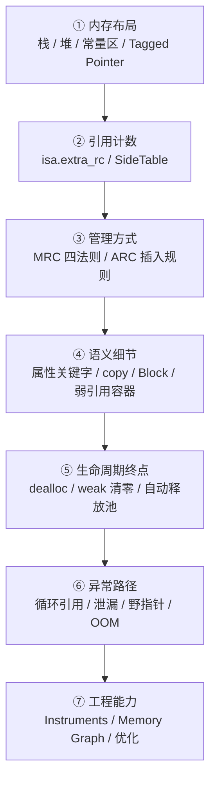

# iOS 内存管理 · Objective-C

> 本目录整理 **Objective-C** 内存管理的完整知识体系（纯 OC，不含 Swift 内容）：从进程内存布局、引用计数，到 ARC、属性语义、`copy`、Block、`weak`、`autoreleasepool`、循环引用、泄漏排查，最后落到 15 个真实工程案例。

## 文档

| 文档 | 行数 | 定位 | 适合 |
| --- | --- | --- | --- |
| [OC-内存管理-知识详解.md](OC-内存管理-知识详解.md) | 约 5500 行 | **系统详解**：原理 + 源码层细节 + 案例 + 40 道面试题 | 系统学习、深挖原理 |
| [OC-内存管理-知识点总结.md](OC-内存管理-知识点总结.md) | 约 1100 行 | **速查手册**：表格化、结论化、记忆卡 | 复习、面试前速查 |

建议读法：先看总结建立框架，再按详解逐章深入；遇到具体 bug 直接跳详解第 14 章「实战案例集」。

## 知识地图



## 详解目录

| 章 | 内容 | 关键问题 |
| --- | --- | --- |
| 0 | 先把内存管理压缩成一句话 | 一句话定义、五个核心问题 |
| 1 | 进程内存布局与对象的内存 | 栈/堆/常量区、三个 size、Tagged Pointer |
| 2 | 引用计数 | `isa.extra_rc`、`SideTable`、retain/release 快慢路径 |
| 3 | MRC 手动引用计数 | 四法则、setter 写法、`NSAutoreleasePool` |
| 4 | ARC 自动引用计数 | 插入规则、四个修饰符、`__autoreleasing` 与二级指针、方法族、RV 优化 |
| 5 | 属性关键字与内存语义 | `strong`/`weak`/`copy`/`assign`、`atomic`、`objc_setProperty` |
| 6 | copy 与深浅拷贝 | 可变/不可变、`NSCopying`、深拷贝三法 |
| 7 | Block 的内存管理 | 三种类型、捕获规则、`__block`、循环引用 |
| 8 | weak 原理与弱引用容器 | weak 表、注册/读取/销毁、`NSHashTable` |
| 9 | autorelease 与自动释放池 | 判定表、进池对比、强引用提前消失（str=nil）、Page 结构、push/pop |
| 10 | dealloc 与对象销毁 | 调用链、该做/不该做、KVO/通知/Timer |
| 11 | 循环引用 | 十大场景、破环方式、检测手段、单例 |
| 12 | 内存泄漏、关联对象与优化 | 工具链、图片降采样、mmap、Jetsam/OOM |
| 13 | Core Foundation 与 Toll-Free Bridging | 三种桥接、所有权规则 |
| 14 | 实战案例集 | 15 个真实 bug 的定位与修复 |
| 15 | 面试题、易错点、自测 | 40 道题、25 个易错点、自测清单 |

## 三条主线

**第一条：对象的一生**

```
alloc → 计数 1 → retain +1 → release -1 → 0 → dealloc → free
```

**第二条：谁持有它**

```
strong（+1） / weak（不 +1，自动置 nil） / copy（+1 副本） / assign（不 +1，野指针）
```

**第三条：为什么释放不掉**

```
Block 捕获 self → self 持有 block → 环
Timer 强引用 target → self 持有 timer → 环
delegate 写成 strong → 环
单例持有 → 永远活着
子线程无池 → 临时对象堆积
```

## 速查：三个最常被问的点

| 问题 | 答案 |
| --- | --- |
| 引用计数存在哪？ | `isa.extra_rc`（19 位），溢出才进 `SideTable` |
| `weak` 怎么实现？ | 全局 `weak_table` 存「对象地址 → 所有 weak 指针地址」，dealloc 时逐个置 nil |
| ARC 和 GC 的区别？ | ARC 是编译期插 `retain`/`release`，无停顿，但不能解决循环引用 |

## 相关目录

- [Runtime](../Runtime/)：`isa`、消息发送、方法交换
- [块(Block)](<../块(Block)/>)：Block 的底层结构
- [GCD](../GCD/)：线程与队列，和 `@autoreleasepool` 配合
