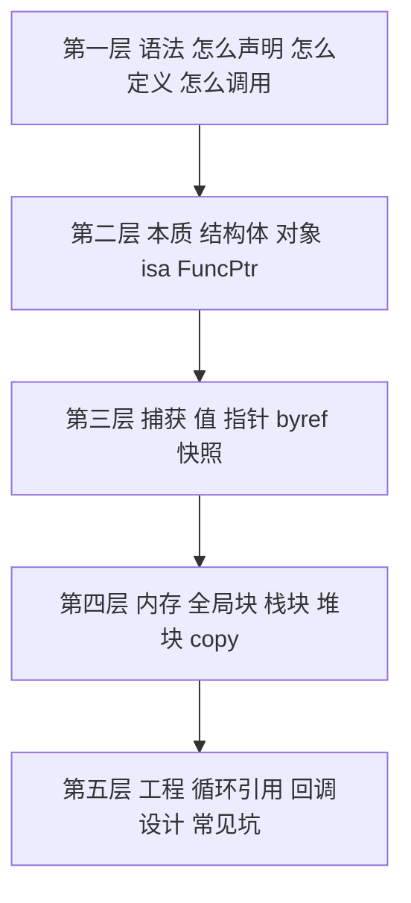
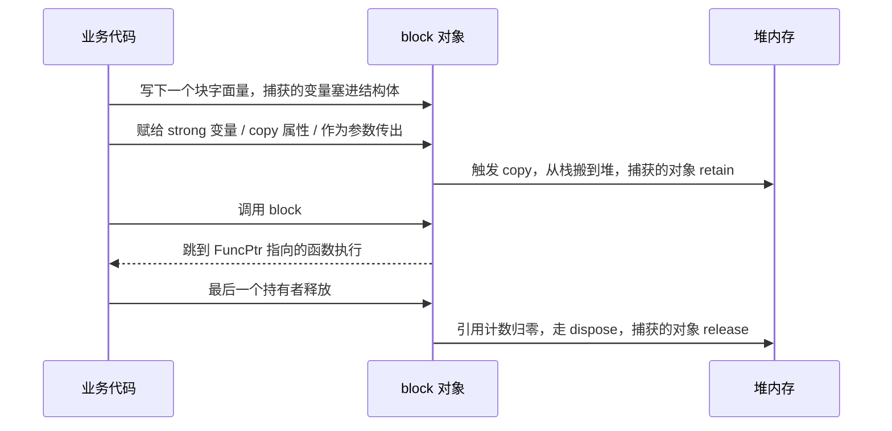
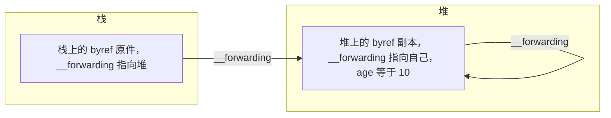
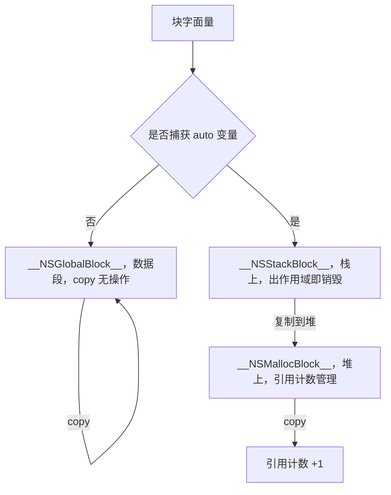
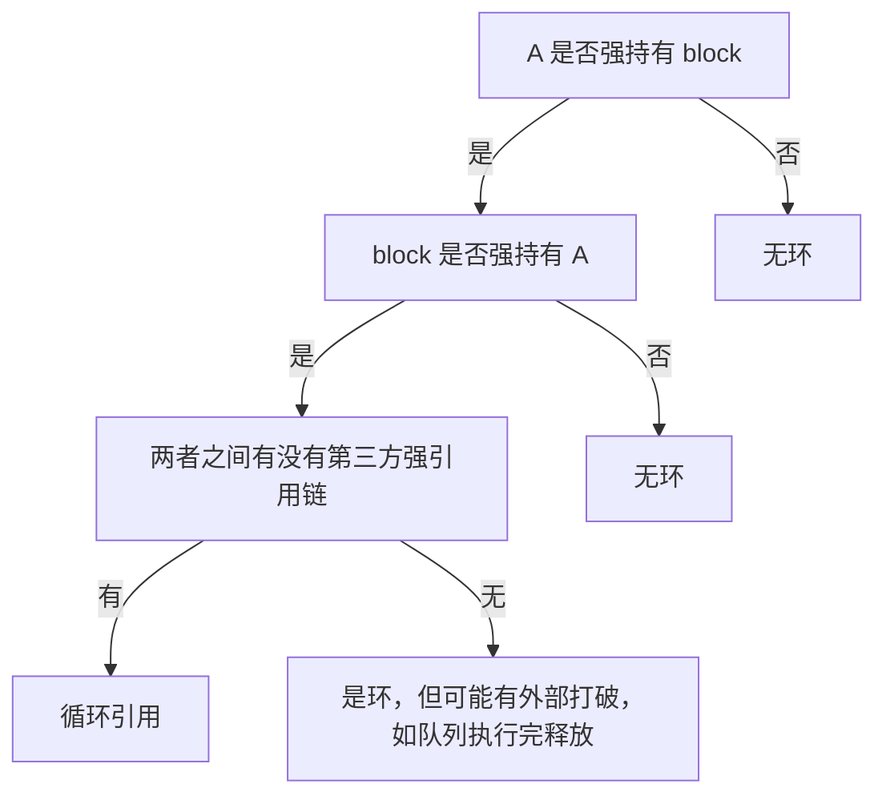

# Objective-C Block 知识详解

> 本文整合了三份材料：
>
> 1. 你原有的《块的详解01》《块的详解02》
> 2. [pro648 / Block的用法](https://github.com/pro648/tips/blob/master/sources/Block%E7%9A%84%E7%94%A8%E6%B3%95.md)
> 3. [pro648 / Block的本质](https://github.com/pro648/tips/blob/master/sources/Block%E7%9A%84%E6%9C%AC%E8%B4%A8.md)
>
> 并且对「属性用 copy 还是 strong」「捕获对象会不会 retain」「__block 到底做了什么」这几个容易写错的点做了**真机编译验证**，文末附实测代码与输出。
>
> 主线只有一条：
>
> **写出来 → 存下来 → 传出去 → 捕获了什么 → 住在哪块内存 → 怎么改外部变量 → 怎么不泄漏**

---

## 目录

- [第 0 章 先把 Block 压缩成一句话](#第-0-章-先把-block-压缩成一句话)
- [第 1 章 语法全解](#第-1-章-语法全解)
- [第 2 章 本质与内存布局](#第-2-章-本质与内存布局)
- [第 3 章 变量捕获](#第-3-章-变量捕获)
- [第 4 章 __block 详解](#第-4-章-__block-详解)
- [第 5 章 三种 Block 与 copy 行为](#第-5-章-三种-block-与-copy-行为)
- [第 6 章 循环引用](#第-6-章-循环引用)
- [第 7 章 工程实践](#第-7-章-工程实践)
- [第 8 章 坑、面试题与速查](#第-8-章-坑面试题与速查)
- [附录 实测代码与输出](#附录-实测代码与输出)

---

# 第 0 章 先把 Block 压缩成一句话

## 0.1 定义

> **Block 是「一段代码」+「这段代码用到的外部变量」被打包成的一个 Objective-C 对象。**

拆开看就三个关键词：

| 关键词 | 含义 | 对应的问题 |
| --- | --- | --- |
| 一段代码 | 大括号里的语句被编译成一个 C 函数 | 它执行什么 |
| 外部变量 | 定义时把用到的外部变量存进结构体 | 它记得什么 |
| OC 对象 | 有 `isa`，能放进数组、能当属性、能被 retain/release | 它能被谁持有 |

一句话对比：

```objc
// 普通函数：只能看参数，看不到外面的世界
int add(int a, int b) { return a + b; }

// Block：除了参数，还能"记住"定义它的那个上下文
int base = 100;
int (^addBase)(int) = ^int(int x) {
    return base + x;      // base 不在参数里，但 block 记得它
};
```

C 函数是**无状态**的，Block 是**带状态**的。这个"状态"，就是捕获。

## 0.2 Block 到底解决了什么问题

| 场景 | 没有 Block 时 | 有 Block 时 |
| --- | --- | --- |
| 网络请求完成回调 | 写 delegate + protocol + 设代理 | 一个 block 参数搞定 |
| 排序 / 遍历 | 写 C 函数指针 + `void *context` | 就地写比较逻辑 |
| 动画结束做事 | 用 `@selector` 拼字符串 | 直接写代码 |
| 把"要做的事"存起来 | 只能存对象，方法得另找地方 | 把行为本身当值传递 |
| 异步任务 | 函数指针 + 上下文结构体，很难读 | `dispatch_async(queue, ^{ ... })` |

Block 让「**行为**」第一次能像「**数据**」一样被传递、保存、组合。

## 0.3 五层知识地图



**学习顺序建议**：第一、三层必须吃透（语法 + 捕获），第四层（三种类型 + copy）是全篇的转折点，第五层（循环引用）是面试和踩坑的重灾区。

## 0.4 一个 Block 的完整生命周期



记住这条链路，后面所有现象都能解释：

- 为什么"定义时的值"和"调用时的值"不一样 → 捕获发生在**第 1 步**，不是第 4 步。
- 为什么栈 block 会崩 → 它在**第 2 步之前**就在栈上，函数一返回就没了。
- 为什么会循环引用 → 第 3 步的 retain 可能是双向的。

## 0.5 术语速查

| 术语 | 含义 | 备注 |
| --- | --- | --- |
| 块字面量 | `^{ ... }` 这段语法 | 编译后是一个结构体 |
| 捕获 capture | 把外部变量存进 block 结构体 | 分「值捕获」和「引用捕获」 |
| `auto` 变量 | 普通局部变量（默认存储类型） | 值捕获，只读 |
| `__block` | 让局部变量可被 block 修改的修饰符 | 底层是 byref 结构体 |
| `__NSGlobalBlock__` | 不捕获 auto 变量的 block | 在数据段 |
| `__NSStackBlock__` | 捕获了 auto 变量、还没 copy 的 block | 在栈上，危险 |
| `__NSMallocBlock__` | 被 copy 到堆的 block | 日常用的都是它 |
| 逃逸 escaping | block 活得比定义它的函数还久 | 必须 copy 到堆 |
| `Block_copy` | MRC 下把栈 block 复制到堆 | ARC 下等价 `objc_retainBlock` |
| retain cycle | 对象 → block → 对象 的环 | 用 `__weak` 等打破 |

> [!IMPORTANT] 本文对旧笔记的四处修正
> 1. **「block 属性必须用 copy，不能用 strong」** —— 要拆成两半：**`retain` 确实绝对不行**（编译器会警告 `-Wobjc-noncopy-retain-block-property`，且不改写成 copy）；但 **`strong` 会被 clang 自动改写成 `copy`**（实测属性编码 `T@?,C`），ARC 下安全。工程上仍统一写 `copy`。
> 2. **「捕获对象引用计数 +1」** —— 不准确。**栈上的 block 捕获对象不会 retain**；只有 block 被 copy 到堆时，才对 `__strong` 捕获的对象 +1。
> 3. **「`__block` 把变量搬到堆」** —— 更准确的说法是：`__block` 把变量包进一个 `__Block_byref_x_0` 结构体，这个结构体**跟着 block 一起**从栈搬到堆，靠 `__forwarding` 保证内外访问一致。
> 4. **「block 作为参数会被 copy 到堆」** —— 不保证。实测 `probe(^{...})` 在 callee 侧拿到的仍是 `__NSStackBlock__`；ARC 的 `copy_on_escape` 只在它认为会逃逸时才插入 `retainBlock`。

---

# 第 1 章 语法全解

> 本章解决：**Block 怎么写、怎么读、怎么写才不像天书。**

## 1.1 一条公式走天下

```text
返回值类型 (^变量名)(参数类型列表) = ^返回值类型(参数名列表) {
    // 代码
};
```

左边是**声明**（类型），右边是**定义**（值）。中间是 `=`。

拆成四段看：

```objc
void        (^blk)        (int)          = ^(int x) { NSLog(@"%d", x); };
// ①返回值   ②^名字        ③参数类型        ④^参数名 { 代码 }
```

| 部分 | 规则 | 常见错误 |
| --- | --- | --- |
| ① 返回值 | 不能省在**声明**里；在**定义**里可省 | 定义里写了 `^void(int x)` 也能编译，但啰嗦 |
| ② `^名字` | 脱字符 `^` 不能省，整体必须在括号里 | 写成 `void ^blk(int)` 是语法错误 |
| ③ 参数类型 | 无参数写 `void`，不能空着 | `void (^blk)()` 表示"参数未指定" |
| ④ 参数名 | **定义**里必须有；**声明**里可省 | 定义里省了参数名就没法用 |

## 1.2 声明

```objc
int  (^firstBlock)(NSString *param1, int param2);   // 返回 int，两个参数
void (^showName)(NSString *name);                   // 无返回，一个参数
void (^allVoid)(void);                              // 无返回，无参数
NSDate *(^whatDayIsIt)(void);                       // 返回对象
NSString *(^composeName)(NSString *, NSString *);   // 声明里参数名可省
```

三个细节：

**① 参数名在声明里可以省略。** 编译器会忽略它，写名字只是给人看的。

**② 无参数必须写 `void`。**

```objc
void (^pro)();      // ⚠️ 表示"参数未指定"，不是"没有参数"
void (^pro)(void);  // ✅ 正确写法
```

`void (^pro)()` 这种写法能通过编译，但 Xcode 9 之后会警告：

```text
This block declaration is not a prototype
```

而且它能被随便传参，运行时行为未定义：

```objc
pro();
pro(3);          // 编译能过，运行可能崩
pro(@"648");
```

Apple 自己的老 API 里有不少这种写法，属于历史包袱。自己写代码时**一律写 `(void)`**。

**③ 声明只是"画了个坑"，没有值。**

```objc
void (^blk)(void);
blk();   // 💥 崩溃：调用了未赋值的 block（本质是调用了 NULL 函数指针）
```

## 1.3 定义

```objc
^返回值类型(参数名列表) {
    // 代码
    return 值;     // void 时没有 return
};
```

```objc
^(double first, double second) {
    return first * second;
};
```

要点：

- **没有名字**，所以块字面量不能单独存在太久，通常立刻赋给变量或作为参数传出。
- **返回类型一般省略**，编译器从 `return` 推断。
- **参数名不能省**，否则函数体里没法引用。
- **结尾的分号不能省**，因为整个 block 被视为一个"值"。

## 1.4 赋值与调用

分三步写最清楚：

```objc
// 1. 声明
double (^multiply)(double, double);

// 2. 赋值
multiply = ^(double a, double b) {
    return a * b;
};

// 3. 调用（和调函数一模一样）
NSLog(@"%f", multiply(1.1, 2));   // 2.200000
```

也可以声明和赋值合并：

```objc
double (^multiply)(double, double) = ^(double a, double b) {
    return a * b;
};
```

## 1.5 typedef：项目里最常用的写法

真实项目里，block 类型几乎都会 `typedef`，否则方法签名会长到没法读。

```objc
// 定义类型
typedef void (^CompletionBlock)(NSData *data, NSError *error);

// 当变量用
CompletionBlock handler = ^(NSData *data, NSError *error) {
    NSLog(@"data: %@, error: %@", data, error);
};

// 当参数用
- (void)requestWithURL:(NSString *)url completion:(CompletionBlock)completion;

// 当属性用
@property (nonatomic, copy) CompletionBlock completion;

// 放进集合
NSMutableArray<CompletionBlock> *handlers = [NSMutableArray array];
```

命名惯例：**类型名以 `Block` 或 `Handler` 结尾**，能一眼看出这是 block。

## 1.6 作为方法参数（AFNetworking 的本质）

不 typedef 的原始写法：

```objc
- (void)requestWithURL:(NSString *)url
            completion:(void (^)(NSData *data, NSError *error))completion {
    // 异步做完后调用
    if (completion) {
        completion(data, error);
    }
}
```

调用：

```objc
[self requestWithURL:@"https://api.com"
          completion:^(NSData *data, NSError *error) {
    NSLog(@"请求完成");
}];
```

> AFN 的 `success:^(NSURLSessionDataTask *task, id responseObject){...}`、`failure:^(NSURLSessionDataTask *task, NSError *error){...}` 就是这个结构，只不过拆成了两个 block。

**方法签名怎么读**：从里往外读 —— `(void (^)(NSData *, NSError *))` 是"一个没有返回值、吃两个参数的 block"，后面接 `completion` 就是参数名。

## 1.7 作为返回值

返回 block 最容易写错，建议一律先 typedef：

```objc
typedef void (^TaskBlock)(void);

- (TaskBlock)makeTask {
    return ^{
        NSLog(@"do task");
    };
}
```

不用 typedef 时的写法（"返回值是 block"的函数声明）：

```objc
- (void (^)(void))makeTask;      // 读作：返回一个 void(^)(void)
```

这种写法能看懂就行，实际项目里别这么写。

## 1.8 作为属性

```objc
@property (nonatomic, copy) void (^completionBlock)(void);
```

为什么是 `copy`，第 5 章详细讲。这里先记住结论。

## 1.9 放进集合

因为 block 是对象，所以可以：

```objc
NSMutableArray *tasks = [NSMutableArray array];
[tasks addObject:^{ NSLog(@"task 1"); }];

void (^task)(void) = tasks.firstObject;
task();
```

这也解释了为什么 `NSArray` 的 `enumerateObjectsUsingBlock:` 能工作 —— 它接收的就是一个对象。

## 1.10 语法避坑清单

| 写法 | 问题 | 正确写法 |
| --- | --- | --- |
| `void ^blk(void)` | `^` 位置错 | `void (^blk)(void)` |
| `void (^blk)()` | 参数未指定 | `void (^blk)(void)` |
| `^{ ... }` 后面不加 `;` | 编译报错 | 赋值语句结尾要 `;` |
| 定义里写 `^(void)` 却传参 | 参数不匹配 | 参数列表要对齐 |
| 声明了没赋值就调用 | 崩溃 | 调用前判空 |
| `blk = ^{...}` 但 `blk` 是 `assign` 属性 | 野指针 | 用 `copy` |

## 1.11 一个能跑的最小例子

```objc
- (void)viewDidLoad {
    [super viewDidLoad];

    // 1. 无参无返回
    void (^hello)(void) = ^{
        NSLog(@"hello block");
    };
    hello();

    // 2. 有参有返回（返回类型省略）
    int (^add)(int, int) = ^(int a, int b) {
        return a + b;
    };
    NSLog(@"%d", add(3, 5));       // 8

    // 3. 作为参数
    [self runTask:^(NSString *name) {
        NSLog(@"传入 %@", name);
    }];
}

- (void)runTask:(void (^)(NSString *))callback {
    if (callback) {
        callback(@"pro648");
    }
}
```

---

# 第 2 章 本质与内存布局

> 本章解决：**Block 为什么是对象？它里面到底存了什么？为什么它能"记住"变量？**

## 2.1 它真的是对象

```objc
void (^blk)(void) = ^{
    NSLog(@"github.com/pro648");
};
NSLog(@"%@", [blk class]);
NSLog(@"%@", [[blk class] superclass]);
NSLog(@"%@", [[[blk class] superclass] superclass]);
```

输出（实测）：

```text
__NSGlobalBlock__
NSBlock
NSObject
(null)
```

继承链：

```text
__NSGlobalBlock__ / __NSStackBlock__ / __NSMallocBlock__
        ↓
      NSBlock
        ↓
     NSObject
```

所以：**block 是 NSObject 的孙子**。它能进数组、能当属性、能被 `retain`/`release`，都是因为这个 `isa`。

## 2.2 用 clang 把它"翻译"成 C++

命令：

```bash
xcrun -sdk iphoneos clang -arch arm64 -rewrite-objc main.m
# 带 ARC 和对象捕获时：
xcrun -sdk iphoneos clang -arch arm64 -rewrite-objc \
    -fobjc-arc -fobjc-runtime=ios-14.0.0 main.m
```

原始代码：

```objc
int age = 10;
void (^myblock)(void) = ^{
    NSLog(@"age: %d", age);
};
myblock();
```

翻译后（简化）：

```c
int age = 10;

// 定义 block
void (*myblock)(void) = ((void (*)())&__main_block_impl_0(
        (void *)__main_block_func_0,
        &__main_block_desc_0_DATA,
        age));

// 调用 block
((void (*)(__block_impl *))((__block_impl *)myblock)->FuncPtr)((__block_impl *)myblock);
```

三步看懂：

1. `__main_block_impl_0(...)` 是一个**结构体构造函数**，返回值（结构体）的地址赋给 `myblock`。
2. `age` 被当作参数**值传递**进去，存成结构体的成员。
3. 调用时先取出 `FuncPtr`，再把 block 自己当参数传回去。

## 2.3 四个关键结构体

### ① `__block_impl`：所有 block 的公共头

```c
struct __block_impl {
    void *isa;        // 指向 __NSGlobalBlock__ / __NSStackBlock__ / __NSMallocBlock__
    int   Flags;      // 标志位
    int   Reserved;   // 保留
    void *FuncPtr;    // 指向真正执行的函数
};
```

这 4 个字段就是"block 是对象"和"block 能执行"的全部秘密。

### ② `__main_block_impl_0`：这个 block 的完整结构

```c
struct __main_block_impl_0 {
    struct __block_impl impl;                  // 公共头
    struct __main_block_desc_0 *Desc;          // 描述信息
    int age;                                   // 捕获的 auto 变量（值）

    __main_block_impl_0(void *fp,
                        struct __main_block_desc_0 *desc,
                        int _age,
                        int flags = 0) : age(_age) {
        impl.isa     = &_NSConcreteStackBlock;
        impl.Flags   = flags;
        impl.FuncPtr = fp;
        Desc         = desc;
    }
};
```

**捕获一个变量，就是在结构体里加一个成员。** 这句话能解释后面所有捕获规则。

### ③ `__main_block_func_0`：真正执行的代码

```c
static void __main_block_func_0(struct __main_block_impl_0 *__cself) {
    int age = __cself->age;   // bound by copy
    NSLog(@"age: %d", age);
}
```

注意：block 内部的代码被抽成了一个**独立的 C 函数**，第一个参数固定是 `__cself`（也就是 block 自己），相当于 OC 方法里的 `self`。

这也解释了为什么 block 里能用 `self` —— `self` 只是被当成一个普通变量捕获了（见 3.8）。

### ④ `__main_block_desc_0`：描述信息

不捕获对象时：

```c
static struct __main_block_desc_0 {
    size_t reserved;
    size_t Block_size;
} __main_block_desc_0_DATA = { 0, sizeof(struct __main_block_impl_0) };
```

捕获对象时，**多出两个函数指针**：

```c
static struct __main_block_desc_0 {
    size_t reserved;
    size_t Block_size;
    void (*copy)(struct __main_block_impl_0 *, struct __main_block_impl_0 *);
    void (*dispose)(struct __main_block_impl_0 *);
} __main_block_desc_0_DATA = {
    0,
    sizeof(struct __main_block_impl_0),
    __main_block_copy_0,
    __main_block_dispose_0
};
```

| 函数 | 什么时候调用 | 干了什么 |
| --- | --- | --- |
| `copy` | block 从栈复制到堆 | 调用 `_Block_object_assign`，对捕获的对象 retain |
| `dispose` | 堆 block 被销毁 | 调用 `_Block_object_dispose`，对捕获的对象 release |

这就是"block 会持有对象"的底层实现，第 3.5 节展开。

## 2.4 内存布局图

```text
        myblock（一个指针）
             │
             ▼
    ┌─────────────────────────────┐
    │ isa      → __NSMallocBlock__│  ← 对象身份
    │ Flags                       │
    │ Reserved                    │
    │ FuncPtr  → 代码段函数       │  ← 执行入口
    ├─────────────────────────────┤
    │ Desc     → 描述结构体       │
    ├─────────────────────────────┤
    │ age      = 10               │  ← 捕获的变量（值）
    │ person   = 0x...            │  ← 捕获的对象（强引用）
    └─────────────────────────────┘
```

`__main_block_impl_0` 的第一个成员是 `__block_impl`，所以两者的地址相同。调用时那句复杂的强转：

```c
((void (*)(__block_impl *))((__block_impl *)myblock)->FuncPtr)((__block_impl *)myblock);
```

可以简化理解为：

```c
(myblock->FuncPtr)(myblock);
```

**先找到函数，再把 block 自己传进去。**

## 2.5 为什么"不捕获变量"的 block 可以放全局区

因为结构体里没有额外成员，**内容完全固定**，和普通函数没区别，没必要每次创建。所以编译器把它放在数据段，`isa` 标记为 `__NSGlobalBlock__`。

一旦捕获了 auto 变量，每个 block 实例的成员值都不同，必须"现场创建"，于是落在栈上。

## 2.6 ⚠️ clang 输出不是运行时真相

用 clang 重写出来的代码里，`impl.isa` 永远写着 `&_NSConcreteStackBlock`，但运行时打印 `[blk class]` 却可能是 `__NSGlobalBlock__` 或 `__NSMallocBlock__`。

原因：`isa` 的值是**运行时**根据 block 的实际存储位置改写的，clang 只负责生成"初始形态"。

> 结论：**clang 重写用来理解结构和捕获规则，不要用它推断 block 类型。**

## 2.7 理解底层有什么用

不是为了炫技，而是为了解释这些现象：

| 现象 | 底层原因 |
| --- | --- |
| block 能存进数组 | 有 `isa`，是对象 |
| block 内不能改 auto 变量 | 捕获的成员是只读副本 |
| 栈 block 会崩 | 结构体在栈上，函数返回即销毁 |
| block 会持有对象 | `desc->copy` 里调了 `_Block_object_assign` |
| `__block` 能改外部变量 | 捕获的是 byref 结构体指针，不是值 |
| `__block` 搬走后内外还一致 | `__forwarding` 指针重定向 |

---

# 第 3 章 变量捕获

> 本章解决：**Block 到底"记住"了哪些变量？记住的是值还是地址？为什么有的能改有的不能改？**

## 3.1 一句话总纲

> **Block 捕获的是「变量」，不是「对象」；捕获的时机是「定义时」，不是「调用时」。**

后面所有规则都是这一句的推论。

## 3.2 完整规则表（背下来）

| 变量种类 | 是否捕获 | 捕获方式 | 能否在 block 内修改 | 内部看到的是 |
| --- | --- | --- | --- | --- |
| 局部 `auto` 变量（基本类型） | ✅ | **值** | ❌ | 定义时的值（快照） |
| 局部 `auto` 变量（对象指针） | ✅ | **值**（指针值）+ 堆上 retain | ❌ 改指针；✅ 改对象内容 | 定义时指向的那个对象 |
| 局部 `static` 变量 | ✅ | **地址**（指针） | ✅ | 调用时的最新值 |
| 全局变量 | ❌ | 直接访问 | ✅ | 调用时的最新值 |
| 全局 `static` 变量 | ❌ | 直接访问 | ✅ | 调用时的最新值 |
| `__block` 局部变量 | ✅ | **byref 结构体指针** | ✅ | 永远是最新值 |
| 成员变量 `_ivar` | ✅（通过 `self`） | 值（`self` 指针） | ❌ 改 `self`；✅ 改属性 | 同一个 `self` |
| C 数组 | ❌ 不能捕获 | — | — | 编译报错 |

> [!NOTE] 为什么 `static` 局部变量能改、`auto` 局部变量不能改
> 因为 `static` 变量**永远在内存里**（数据段），block 捕获它的**地址**，地址不变，值随时可改。
> `auto` 变量出了作用域就销毁，所以只能在定义时**拷一份值**到 block 结构体里，拷进去的副本是只读的。

## 3.3 局部 auto 变量：值捕获 + 快照

```objc
int anInteger = 648;

void (^myOperation)(void) = ^{
    NSLog(@"Integer is %i", anInteger);   // ✅ 能读
};

anInteger = 64;        // 改外部的
myOperation();         // 输出：Integer is 648
```

**输出 648，不是 64。**

因为捕获发生在**第 3 行**（`^{` 那一刻），此时 `anInteger` 是 648，被拷进结构体。第 6 行改的是外面那个变量，跟结构体里的副本无关。

底层：

```c
// 定义时就把 648 传进去了
void (*myOperation)(void) = ((void (*)())&__main_block_impl_0(
        (void *)__main_block_func_0,
        &__main_block_desc_0_DATA,
        anInteger));        // ← 这里传的是值 648

anInteger = 64;             // 改的是外部变量，block 结构体里还是 648
```

### 试图修改 → 编译报错

```objc
int anInteger = 648;
void (^myOperation)(void) = ^{
    anInteger = 20;        // ❌
};
```

```text
error: variable is not assignable (missing __block type specifier)
```

为什么？因为结构体里的 `anInteger` 是一个**普通的 int 成员**，改它毫无意义（下次调用还是原来那份），所以编译器直接禁止。

## 3.4 static 局部变量：地址捕获

```objc
static int weight = 125;

void (^blk)(void) = ^{
    NSLog(@"weight: %d", weight);
};

weight = 200;
blk();      // 输出：weight: 200
```

注意：**这里输出的是 200**，不是 125。跟 auto 变量的行为完全不同。

重写后的结构体：

```c
struct __main_block_impl_0 {
    struct __block_impl impl;
    struct __main_block_desc_0* Desc;
    int age;          // auto 变量：值是 int
    int *weight;      // static 变量：值是指针！
    ...
};

// 定义时传的是 &weight
void (*myblock)(void) = ((void (*)())&__main_block_impl_0(
        (void *)__main_block_func_0,
        &__main_block_desc_0_DATA,
        age,          // 值
        &weight));    // 地址
```

函数体里：

```c
static void __main_block_func_0(struct __main_block_impl_0 *__cself) {
    int age = __cself->age;              // bound by copy
    int *weight = __cself->weight;       // bound by copy（但拷的是指针）

    NSLog(@"age: %d, weight: %d", age, (*weight));   // ← 解引用
}
```

所以能改：

```objc
static int weight = 125;
void (^blk)(void) = ^{
    weight = 300;    // ✅ 通过指针改，改的就是外面那个变量
};
blk();
NSLog(@"%d", weight);   // 300
```

## 3.5 全局变量 / 全局 static：根本不捕获

```objc
int gGlobalVar = 5;
static int sGlobalVar = 6;

void (^blk)(void) = ^{
    NSLog(@"%d %d", gGlobalVar, sGlobalVar);
    gGlobalVar = 3;         // ✅ 直接改
    sGlobalVar = 4;         // ✅ 直接改
};
```

重写后结构体里**没有这两个成员**，函数体里直接写变量名：

```c
static void __main_block_func_0(struct __main_block_impl_0 *__cself) {
    NSLog(@"%d %d", gGlobalVar, sGlobalVar);   // 直接访问全局符号
}
```

因为全局变量在数据段，**永远可访问**，不需要"记住"。

行为特点：**定义后、调用前改全局变量，调用时看到的是新值。**

```objc
void (^globalTest)(void) = ^{
    NSLog(@"gGlobalVar is: %i", gGlobalVar);
    gGlobalVar = 3;
};
gGlobalVar = 7;
globalTest();      // 输出 7（不是 5）
```

## 3.6 变量捕获总对照实验

一次跑完，最能记住：

```objc
int g = 5;

- (void)testCapture {
    auto   int a = 10;        // 局部 auto
    static int s = 20;        // 局部 static
    __block int b = 30;       // __block

    void (^blk)(void) = ^{
        NSLog(@"a=%d s=%d b=%d g=%d", a, s, b, g);
        // a = 1;   // ❌ 不能改
        s = 2;      // ✅ 能改
        b = 3;      // ✅ 能改
        g = 4;      // ✅ 能改
    };

    a = 100;
    s = 200;
    b = 300;
    g = 500;

    blk();
    NSLog(@"外部 a=%d s=%d b=%d g=%d", a, s, b, g);
}
```

输出：

```text
a=10 s=200 b=300 g=500      ← a 是快照，其它都是最新的
外部 a=100 s=2 b=3 g=4      ← 能改的三个都被 block 改了
```

对比记忆：

| 变量 | 定义时 | 调用时看到 | 原因 |
| --- | --- | --- | --- |
| `a`（auto） | 10 | **10** | 值拷贝，定义那一刻定死 |
| `s`（static） | 20 | **200** | 地址不变，读最新值 |
| `b`（`__block`） | 30 | **300** | byref 结构体，读写都走同一份内存 |
| `g`（全局） | 5 | **500** | 压根没捕获，直接读全局符号 |

## 3.7 捕获对象：捕获的是指针，不是对象

### ① 概念区分

```objc
NSString *name = @"Tom";

void (^blk)(void) = ^{
    NSLog(@"%@", name);
};
blk();
```

这里有三层东西要分清：

| 层 | 是什么 | block 怎么处理 |
| --- | --- | --- |
| 指针变量 `name` | 一个 `NSString *` 类型的变量 | 值捕获（拷指针值） |
| 指针指向的对象 | 堆上的 `@"Tom"` | 堆 block 会对它 retain |
| 对象内容 | 字符 `T` `o` `m` | 完全不复制 |

**捕获指针 ≠ 复制对象。**

### ② 改对象内容 ✅，改指针 ❌

```objc
NSMutableArray *array = [NSMutableArray arrayWithObject:@"A"];

void (^blk)(void) = ^{
    [array addObject:@"B"];        // ✅ 可以：调用对象方法，改的是对象内容
};

blk();
NSLog(@"%@", array);               // (A, B)
```

```objc
NSMutableArray *array = [NSMutableArray array];

void (^blk)(void) = ^{
    array = [NSMutableArray array];    // ❌ 编译报错：给局部指针变量重新赋值
};
```

一句话记住：

> **能改"对象"，不能改"变量"。**

`[array addObject:]` 是往 `array` 指向的那个对象里塞东西；`array = ...` 是让 `array` 这个变量指向别处。前者是"内容"，后者是"变量"。

### ③ 那想改指针怎么办？

三种办法，按推荐度排序：

```objc
// 1. __block（最标准）
__block NSMutableArray *array = [NSMutableArray array];
void (^blk)(void) = ^{
    array = [NSMutableArray arrayWithObject:@"new"];
};

// 2. static（能用但不推荐，生命周期变长）
static NSMutableArray *array2 = nil;
void (^blk2)(void) = ^{
    array2 = [NSMutableArray array];
};

// 3. 用包装对象（比如把数组塞进另一个可变容器里）
NSMutableArray *box = [NSMutableArray array];
void (^blk3)(void) = ^{
    [box removeAllObjects];
    [box addObject:[NSMutableArray array]];
};
```

### ④ 捕获对象时到底会不会 retain？

这是旧笔记里最容易被写错的一点。**分两种情况：**

| block 状态 | 捕获的 `__strong` 对象 |
| --- | --- |
| 还在**栈**上 | **不 retain**（指针只是拷了一份） |
| 被 **copy 到堆** | 通过 `desc->copy` → `_Block_object_assign` → **retain** |
| 堆 block 销毁 | 通过 `desc->dispose` → **release** |

证据是 `__main_block_desc_0` 里多出的两个函数指针：

```c
static struct __main_block_desc_0 {
    size_t reserved;
    size_t Block_size;
    void (*copy)(struct __main_block_impl_0*, struct __main_block_impl_0*);   // ← 只在捕获对象时出现
    void (*dispose)(struct __main_block_impl_0*);
} __main_block_desc_0_DATA = { 0, sizeof(...), __main_block_copy_0, __main_block_dispose_0 };
```

```c
static void __main_block_copy_0(struct __main_block_impl_0 *dst,
                                struct __main_block_impl_0 *src) {
    _Block_object_assign((void*)&dst->person,
                         (void*)src->person,
                         3 /* BLOCK_FIELD_IS_OBJECT */);      // ← 这里 retain
}

static void __main_block_dispose_0(struct __main_block_impl_0 *src) {
    _Block_object_dispose((void*)src->person,
                          3 /* BLOCK_FIELD_IS_OBJECT */);      // ← 这里 release
}
```

**只有捕获了对象类型，`desc` 里才有 `copy`/`dispose`。** 只捕获基本类型时没有这两个字段。

实测验证：

```objc
{
    Person *person = [[Person alloc] init];
    person.age = 10;
    ^{
        NSLog(@"person.age = %d", person.age);
    }();                        // ← 立即调用，block 在栈上，不 retain
}
NSLog(@"--------");
```

输出：

```text
person.age = 10
-[Person dealloc]      ← 作用域一结束就释放了
--------
```

改成赋给一个 `__strong` 变量（ARC 会 copy 到堆）：

```objc
MyBlock myblock;              // 强引用，接住 block
{
    Person *person = [[Person alloc] init];
    person.age = 10;
    myblock = ^{
        NSLog(@"person.age = %d", person.age);
    };
    myblock();
}
NSLog(@"--------");
myblock();                    // 出了作用域还能调，person 仍然活着
```

输出：

```text
person.age = 10
--------               ← person 还活着
person.age = 10
-[Person dealloc]      ← block 释放时才释放
```

**这就是"堆 block 强引用捕获对象"的直接证据。**

### ⑤ `__weak` / `__unsafe_unretained` 捕获

`_Block_object_assign` 会根据变量的所有权修饰符决定行为：

```objc
Person *__strong p1 = ...;    // 堆 block copy 时 retain
Person *__weak   p2 = ...;    // 只注册弱引用，不 retain；对象释放后自动置 nil
Person *__unsafe_unretained p3 = ...;   // 什么都不做；对象释放后变野指针
```

`__block` 变量在 **ARC** 下也同样遵循这个规则；在 **MRC** 下则**不会**对 byref 里的对象做强引用（这一点在 6.6 里会用到）。

## 3.8 ⚠️ 捕获 `self` 的隐藏细节

### ① `self` 本身就是一个局部变量

OC 方法编译成 C 函数后，默认带两个隐藏参数：

```c
void test(id self, SEL _cmd) {
    // ...
}
```

所以 `self` 跟 `int a` 一样，都是**局部 auto 变量**。block 用到 `self`，就是值捕获 `self` 这个指针。

### ② 访问成员变量 = 访问 self

```objc
@interface VC : NSObject {
    NSString *_name;
}
@end

- (void)foo {
    self.blk = ^{
        NSLog(@"%@", _name);        // 等价于 self->_name → 捕获了 self
    };
}
```

三种写法，**都会捕获 `self`**：

```objc
self.blk = ^{ NSLog(@"%@", _name); };            // 隐式 self
self.blk = ^{ NSLog(@"%@", self->_name); };      // 显式 self
self.blk = ^{ NSLog(@"%@", self.description); }; // 调方法
```

实测编译时，这三种都会收到同一条警告：

```text
warning: capturing 'self' strongly in this block is likely to lead to a retain cycle
```

> 很多人以为"只要不写 `self.` 就没事"，这是错的。**`_ivar` 也会捕获 `self`。**

## 3.9 不能捕获的东西

### ① C 数组

```objc
int arr[3] = {1, 2, 3};
void (^blk)(void) = ^{
    NSLog(@"%d", arr[0]);    // ❌
};
```

```text
error: cannot refer to declaration with an array type inside block
```

原因：数组不能"按值拷贝"进结构体，也不能整体赋值。解决办法是转成指针或用 `NSArray`：

```objc
int *p = arr;
void (^blk)(void) = ^{
    NSLog(@"%d", p[0]);      // ✅ 捕获指针（注意生命周期）
};
```

### ② 结构体可以捕获

```objc
typedef struct { int x; } P;
P p = {1};
void (^blk)(void) = ^{
    NSLog(@"%d", p.x);      // ✅ 整个结构体被按值拷进 block
};
```

结构体是按值整体拷贝，所以 `p.x` 改了不影响 block 内部。

## 3.10 本章易错点

| 易错点 | 正确认知 |
| --- | --- |
| 以为 block 捕获的是"调用时的值" | 捕获在**定义时**，之后外部再改不影响 |
| 以为 `static` 也是值捕获 | `static` 捕获的是**地址**，能看到最新值 |
| 以为全局变量也被捕获 | 全局变量**不捕获**，直接访问符号 |
| 以为捕获对象就是复制对象 | 只拷指针，堆 block 才 retain |
| 以为不写 `self.` 就不会循环引用 | `_ivar` 同样捕获 `self` |
| 以为可以捕获 C 数组 | 不能，编译报错 |

---

# 第 4 章 `__block` 详解

> 本章解决：**`__block` 到底做了什么？为什么加了它就能改？为什么它能解决循环引用？**

## 4.1 为什么需要 `__block`

因为 auto 变量是**值捕获**，拷进结构体的副本是只读的。

需求很常见：

```objc
__block int count = 0;
void (^add)(void) = ^{
    count++;          // 想改
};
add(); add();
NSLog(@"%d", count);  // 2
```

`__block` 就是为这个场景设计的。

## 4.2 使用规则

```objc
__block int count = 0;                 // ✅ 局部变量
__block NSString *name = @"Tom";       // ✅ 局部对象指针
__block NSMutableArray *arr = nil;     // ✅
```

```objc
__block static int s = 0;    // ❌ error: __block attribute not allowed, only allowed on local variables
__block int g = 0;           // ❌ 全局变量不能加（加了也没意义）
```

实测报错原文：

```text
error: __block attribute not allowed, only allowed on local variables
```

> 理由：全局/静态变量本来就能在 block 里直接改，不需要 `__block`。

## 4.3 底层：byref 结构体

```objc
__block int age = 10;
MyBlock myblock = ^{
    age = 20;
    NSLog(@"age: %d", age);
};
```

翻译后：

```c
struct __main_block_impl_0 {
    struct __block_impl impl;
    struct __main_block_desc_0* Desc;
    __Block_byref_age_0 *age;      // ← 注意：是指针，不是 int！
    ...
};
```

`age` 被包装成了：

```c
struct __Block_byref_age_0 {
    void *__isa;                        // ← 也有 isa，也是对象
    __Block_byref_age_0 *__forwarding;  // ← 关键：指向"真正的自己"
    int __flags;
    int __size;
    int age;                            // ← 真正的值
};
```

原来的 `__block int age = 10;` 变成了：

```c
__attribute__((__blocks__(byref))) __Block_byref_age_0 age = {
    (void*)0,                       // isa
    (__Block_byref_age_0 *)&age,    // __forwarding 指向自己
    0,                              // flags
    sizeof(__Block_byref_age_0),    // size
    10                              // 值
};
```

block 内部访问 `age` 变成了：

```c
static void __main_block_func_0(struct __main_block_impl_0 *__cself) {
    __Block_byref_age_0 *age = __cself->age;    // bound by ref

    (age->__forwarding->age) = 20;              // 写
    NSLog(@"age: %d", (age->__forwarding->age)); // 读
}
```

## 4.4 `__forwarding` 到底解决什么问题

这是 `__block` 最精妙的地方。

**问题**：block 从栈 copy 到堆时，byref 结构体也会被复制一份。此时：

- 栈上原来的 byref（`age_stack`）
- 堆上新复制的 byref（`age_heap`）

如果外部代码还指着栈上那个，block 内部指着堆上那个，两边就**不同步**了。

**解决**：copy 的时候，把**栈上那个的 `__forwarding` 改成指向堆上那份**。



于是**不管从哪边访问，`x->__forwarding->age` 最终都落在同一块内存**。

```text
copy 前：栈.forwarding → 栈.自己
copy 后：栈.forwarding → 堆.副本
        堆.forwarding → 堆.自己
```

> 一句话：`__forwarding` 是"永远指向当前有效的那一份"的指针。

实测验证（ARC 下）：

```objc
__block int age = 10;
Blk stackBlk = ^{ age += 1; };
Blk heapBlk  = [stackBlk copy];    // 复制到堆

heapBlk(); heapBlk();
NSLog(@"%d", age);      // 12
stackBlk();
NSLog(@"%d", age);      // 13  ← 栈上那个变量和堆 block 读写的是同一份
```

输出：

```text
copy 后连调两次 age=12
再调原变量 age=13
```

如果按"各自独立拷贝"的直觉，第二次调用栈 block 应该改的是另一份内存，但实际是连续的 13 —— 这正是 `__forwarding` 在起作用。

## 4.5 `__block` 与对象

### ① 对象指针 + `__block`

```objc
__block Person *person = [[Person alloc] init];
void (^blk)(void) = ^{
    NSLog(@"%@", person.name);
    person = nil;          // ✅ 现在可以改指针了
};
```

结构体：

```c
struct __Block_byref_person_0 {
    void *__isa;
    __Block_byref_person_0 *__forwarding;
    int __flags;
    int __size;
    void (*__Block_byref_id_object_copy)(void*, void*);      // ← 多了这两个：管理对象
    void (*__Block_byref_id_object_dispose)(void*);
    Person *__strong person;
};
```

**注意**：`__block` 修饰对象时，byref 结构体里会额外有 `copy`/`dispose` 两个函数指针，专门管理这个对象的引用计数。

### ② ARC vs MRC 的关键差异（含实测）

| 环境 | `__block Person *p`（byref 内的对象） |
| --- | --- |
| **ARC** | 跟随 `__strong`/`__weak`/`__unsafe_unretained` 修饰符，`__strong` 会 retain |
| **MRC** | **不 retain** |

实测（MRC，用 `retainCount` 看）：

```objc
Person *p = [Person new];
NSLog(@"初始 retainCount = %lu", (unsigned long)[p retainCount]);   // 1

__block Person *bp = p;
Blk b = [^{ NSLog(@"%@", bp); } copy];     // block copy 到堆

NSLog(@"copy 后 retainCount = %lu", (unsigned long)[p retainCount]); // 1 ← 没变！
```

```text
初始 retainCount = 1
copy block 后 retainCount = 1
dealloc Person
```

再做一个行为验证更直观 —— MRC 下把外部变量置 nil，堆 block 里的 `bp` 也一起变 nil：

```objc
__block Person *p = [Person new];
Blk b = [^{ NSLog(@"%@", p); } copy];
b();          // 打印对象
p = nil;      // 外部放弃
b();          // 打印 (null) ← 说明 byref 没帮我们 retain
```

```text
mrc
(null)
```

**对比 ARC**：同样的代码，`__block` 变量里的对象会被 retain，跨函数边界依然有效：

```objc
static Blk gBlk;
static void make(void) {
    __block Person *p = [Person new];
    gBlk = ^{ NSLog(@"调用时 p = %@", p); };
}
int main(void) {
    @autoreleasepool {
        make();
        gBlk();      // ✅ 仍能打印出 Person
    }
}
```

```text
make 内 p = <Person: 0x...>
=== make 返回后 ===
调用时 p = <Person: 0x...>     ← 说明 ARC 下被 retain 了
```

这个差异直接导致了两种环境下的循环引用方案不同（见 6.6）。

## 4.6 `__block` 不可替代的两个场景

### ① 在 block 内修改局部变量

```objc
__block BOOL found = NO;
[array enumerateObjectsUsingBlock:^(id obj, NSUInteger idx, BOOL *stop) {
    if ([obj isEqual:@"target"]) {
        found = YES;
        *stop = YES;
    }
}];
```

这是 `__block` 最常见的用途 —— **在回调里往外"输出"一个值**。

### ② 打破循环引用（ARC）

```objc
__block Person *person = [[Person alloc] init];
person.myblock = ^{
    NSLog(@"%@", person.name);
    person = nil;         // ← 手动断开
};
person.myblock();         // ← 必须调用
```

## 4.7 `__block` 性能代价

| 代价 | 说明 |
| --- | --- |
| 多一次堆分配 | byref 结构体要 malloc |
| 多一层指针跳转 | 每次读写都走 `__forwarding` |
| 多两个函数指针 | 修饰对象时 byref 结构体更大 |

所以：**能用值捕获就用值捕获，确实需要改再上 `__block`。**

## 4.8 本章易错点

| 易错点 | 正确认知 |
| --- | --- |
| 以为 `__block` 就是"捕获地址" | 准确说是"捕获 byref 结构体指针"，且 block 可持有它 |
| 以为 `__block` 变量还在栈上 | copy 后 byref 结构体在堆上 |
| 给全局变量加 `__block` | 编译报错，也不需要 |
| 以为 `__block` 一定会 retain 对象 | ARC 下 `__strong` 才 retain；MRC 下不 retain |
| 以为用了 `__block` 就不会循环引用 | 仍需在 block 内**置 nil** 才行 |

---

# 第 5 章 三种 Block 与 copy 行为

> 本章解决：**为什么 block 会有三种类型？什么时候会崩？`copy` 到底做了什么？属性该用 `copy` 还是 `strong`？**

## 5.1 三种类型

| 类型 | 存储位置 | 产生条件 | 生命周期 |
| --- | --- | --- | --- |
| `__NSGlobalBlock__` | 数据段（.data） | 不访问 auto 变量 | 程序结束 |
| `__NSStackBlock__` | 栈 | 访问了 auto 变量，**且未 copy** | 作用域结束即销毁 |
| `__NSMallocBlock__` | 堆 | 栈 block 调用了 `copy` | 引用计数管理 |

生成规则一句话：

```text
不捕获 auto 变量 → Global
捕获了 auto 变量   → Stack
Stack 调 copy      → Malloc
```

## 5.2 实测三种类型

```objc
// 1. 不访问 auto 变量
void (^globalBlock)(void) = ^{
    NSLog(@"global");
};
NSLog(@"%@", [globalBlock class]);      // __NSGlobalBlock__

// 2. 访问 auto 变量，且被强指针引用（ARC 自动 copy）
int age = 10;
void (^mallocBlock)(void) = ^{
    NSLog(@"%d", age);
};
NSLog(@"%@", [mallocBlock class]);      // __NSMallocBlock__

// 3. 访问 auto 变量，但没有强指针引用（直接对字面量取 class）
NSLog(@"%@", [^{
    NSLog(@"%d", age);
} class]);                              // __NSStackBlock__
```

实测输出：

```text
global=__NSGlobalBlock__  malloc=__NSMallocBlock__  stack=__NSStackBlock__
```

> [!TIP] 为什么日常几乎见不到 `__NSStackBlock__`
> 因为在 ARC 下，**只要赋给强指针、copy 属性、作为参数传出**，编译器就自动 copy 到堆。想看到栈 block，必须像上面第 3 种那样**直接对字面量取 `class`**，不让它被任何强引用接住。

继承链实测：

```text
__NSMallocBlock__ → NSBlock → NSObject → nil
__NSGlobalBlock__ → NSBlock → NSObject → nil
```

## 5.3 copy 的行为矩阵（必背）

| 原类型 | 调用 `copy` 后 | 说明 |
| --- | --- | --- |
| `__NSGlobalBlock__` | 什么都不做，**类型不变** | 没有状态需要复制 |
| `__NSStackBlock__` | 复制到堆，**变成 `__NSMallocBlock__`** | 引用计数 = 1 |
| `__NSMallocBlock__` | **引用计数 +1**，类型不变 | 相当于 retain |

验证：

```objc
int age = 10;
NSLog(@"%@", [^{ NSLog(@"%d", age); } class]);          // __NSStackBlock__
NSLog(@"%@", [[^{ NSLog(@"%d", age); } copy] class]);   // __NSMallocBlock__
```

## 5.4 为什么栈 block 会崩（MRC 视角）

先关掉 ARC：`TARGETS > Build Settings > Objective-C Automatic Reference Counting = NO`

```objc
void (^myblock)(void);

void test() {
    int age = 10;
    myblock = ^{
        NSLog(@"age: %d", age);
    };
}   // ← 函数返回，栈帧销毁，block 结构体没了

int main() {
    @autoreleasepool {
        test();
        myblock();     // 💥 访问已销毁的内存
    }
    return 0;
}
```

输出（垃圾值）：

```text
age: -272632840
```

有时候不崩，但打印乱码 —— 这比崩溃更难查。

修复：**copy 到堆**

```objc
void test() {
    int age = 10;
    myblock = [^{
        NSLog(@"age: %d", age);
    } copy];      // ✅ 复制到堆，函数返回也不销毁
}
```

输出：

```text
age: 10
```

## 5.5 ARC 什么时候自动 copy

ARC 会在以下 **3 种**情况自动把栈 block 搬到堆：

### ① 赋给强指针

```objc
MyBlock myblock = ^{ ... };    // 自动 copy
```

### ② 作为函数/方法的返回值

```objc
MyBlock test() {
    int age = 10;
    return ^{ NSLog(@"%d", age); };    // 自动 copy
}
```

### ③ 作为特定 API 的参数

- **Cocoa API 里方法名包含 `usingBlock`** 的 block 参数
- **GCD API** 的 block 参数

```objc
[arr enumerateObjectsUsingBlock:^(id obj, NSUInteger idx, BOOL *stop) {
    // 在堆上
}];

dispatch_after(dispatch_time(DISPATCH_TIME_NOW, (int64_t)(1 * NSEC_PER_SEC)),
               dispatch_get_main_queue(), ^{
    // 在堆上
});
```

### ⚠️ 例外：普通方法参数"不保证"会 copy

这是最容易讲错的一点，必须区分"语言规定"和"ARC 的逃逸分析"。

**实验设计**：callee 用 MRC 编译，这样它拿到什么就是什么，不会被 ARC 加工。

```objc
// callee.m（-fno-objc-arc）
typedef void (^Blk)(void);
void probe(Blk b) {
    printf("callee sees: %s\n", object_getClassName(b));
}
```

```objc
// caller.m（-fobjc-arc）
probe(^{ (void)age; });
```

输出：

```text
callee sees: __NSStackBlock__
```

再看 clang 生成的 IR，调用点长这样（`%3` 的 isa 被写成了 `_NSConcreteStackBlock`，且**没有** `retainBlock`）：

```llvm
store ptr @_NSConcreteStackBlock, ptr %5, align 8
...
call void @probe(ptr noundef %3)
```

**结论：把 block 当普通参数传，编译器不会替你 copy。** callee 收到的就是一个栈 block。

### 那为什么有时看起来是 Malloc？

因为 ARC 会做**逃逸分析**（`copy_on_escape`）。只要它判断"这个 block 可能活得比当前作用域久"，就插入 `objc_retainBlock`：

| 写法 | 是否插入 `retainBlock` | 实测类型 |
| --- | --- | --- |
| `[^{...} class]`（只取类型） | 否 | `__NSStackBlock__` |
| `Blk b = ^{...};`（赋给强变量） | 是 | `__NSMallocBlock__` |
| `object_getClassName(^{...})`（传给 `id` 形参） | 是 | `__NSMallocBlock__` |
| `probe(^{...})`（传给 block 形参，callee 是 MRC） | 否 | `__NSStackBlock__` |
| `probeEnter(^{...})` 且 callee 把参数存进 static | 是（callee 入口处） | `__NSMallocBlock__` |

IR 里能看到这个标记：

```llvm
%22 = call ptr @llvm.objc.retainBlock(ptr %5) #2, !clang.arc.copy_on_escape !12
```

> [!IMPORTANT] 实践结论
> 不要依赖"传参等于复制"。**如果接收方要把 block 存起来延迟调用，就必须自己负责复制**：ARC 用 `copy` 属性（或 `objc_retainBlock`），MRC 用 `[block copy]`。
> 反过来说，如果接收方只是**同步**用完就扔（比如 `enumerateObjectsUsingBlock:`），不复制也没问题。

## 5.6 属性：copy 还是 strong？

```objc
@property (nonatomic, copy)   void (^completionBlock)(void);   // ✅ 推荐
@property (nonatomic, strong) void (^completionBlock)(void);   // ⚠️ ARC 下能用
@property (nonatomic, assign) void (^completionBlock)(void);   // ❌ 危险
```

### 实测：ARC 下 strong 和 copy 都能工作

```objc
@interface Holder : NSObject
@property (nonatomic, strong) void (^strongBlock)(void);
@property (nonatomic, copy)   void (^copyBlock)(void);
@end

static void makeBlocks(Holder *h) {
    int age = 648;
    h.strongBlock = ^{ printf("strong -> %d\n", age); };
    h.copyBlock   = ^{ printf("copy   -> %d\n", age); };
    printf("inside: strong=%s copy=%s\n", ...);
}

// 函数返回后再访问
printf("after scope: strong=%s copy=%s\n", ...);
h.strongBlock();
h.copyBlock();
```

输出：

```text
inside: strong=__NSMallocBlock__ copy=__NSMallocBlock__
after scope: strong=__NSMallocBlock__ copy=__NSMallocBlock__
strong -> 648
copy   -> 648
```

**为什么 `strong` 也行？** 这里有两个机制叠加，第二条是很多资料没讲清、也最容易记错的：

1. ARC 在赋值时会插入 `objc_retainBlock`（等价于 `Block_copy`）；
2. **clang 只把 block 属性的 `strong` 改写成 `copy`，`retain` 不会改写。**

实测属性元数据（`property_getAttributes`，ARC 与 MRC 结果相同）：

```objc
@interface Holder : NSObject
@property (nonatomic, strong) void (^strongBlock)(void);
@property (nonatomic, retain) void (^retainBlock)(void);
@property (nonatomic, assign) void (^assignBlock)(void);
@property (nonatomic, strong) NSString *strongStr;   // 对照组：普通对象
@end
```

输出：

```text
strongBlock  ->  T@?,C,N,V_strongBlock          ← strong 被改写成 C（copy）
retainBlock  ->  T@?,&,N,V_retainBlock          ← retain 保持 &，不改写！
assignBlock  ->  T@?,N,V_assignBlock            ← assign 保持 N
strongStr    ->  T@"NSString",&,N,V_strongStr   ← 普通对象仍是 &
```

编译器还会专门给 `retain` 一条警告：

```text
warning: retain'ed block property does not copy the block
         - use copy attribute instead [-Wobjc-noncopy-retain-block-property]
```

setter 实际调用的函数也印证了这一点：

```llvm
; setStrongBlock:  → copy 版本
call void @objc_setProperty_nonatomic_copy(...)
; setRetainBlock:  → retain 版本（不 copy！）
call void @objc_setProperty_nonatomic(...)
; setStrongStr:    → 走 &（strong）
call void @llvm.objc.storeStrong(...)
```

> [!IMPORTANT] 所以旧笔记那句话要拆成两半看
> - **「block 属性不能用 `retain`」** —— 完全正确，而且编译器会警告。
> - **「block 属性不能用 `strong`」** —— 不准确。**`strong` 会被编译器自动改成 `copy`**，所以在 ARC 下是安全的。
>
> 但工程上仍然统一写 `copy`：语义明确、MRC 兼容、不依赖编译器改写、与系统 API 一致。

### 那为什么还是推荐 `copy`

| 理由 | 说明 |
| --- | --- |
| **`retain` 一定出问题** | 不改写成 copy，`retain` 对栈 block 无效，MRC 下直接野指针 |
| **语义更准确** | `copy` 明确表达"我要的是一个堆上的副本" |
| **可读性** | 看到 `copy` 就知道这是 block 属性，不会误认为是普通对象 |
| **团队一致性** | UIKit、Foundation、AFNetworking 的 block 属性全是 `copy` |
| **不依赖编译器行为** | 换工具链不保证还帮你改写 `strong` |

> [!WARNING] assign 是真的会崩
> 实测 `assignBlock` 的编码是 `T@?,N` —— 既没有 `C` 也没有 `&`，setter 里既不 retain 也不 copy。
> 赋进去的栈 block 一出作用域就是野指针。**永远不要用 assign 修饰 block 属性。**

### MRC 下的唯一正确写法

```objc
@property (nonatomic, copy) void (^completionBlock)(void);
```

```objc
// setter 内部
- (void)setCompletionBlock:(void (^)(void))completionBlock {
    if (_completionBlock != completionBlock) {
        [_completionBlock release];
        _completionBlock = [completionBlock copy];    // ← 必须 copy
    }
}
```

## 5.7 一张图记住 copy



## 5.8 本章易错点

| 易错点 | 正确认知 |
| --- | --- |
| 以为"赋值给变量就一定是堆 block" | 要看是否被**强指针**接住；`[^{...} class]` 就是栈 block |
| 以为 ARC 下 `strong` 属性会崩 | 不会崩，但仍推荐 `copy` |
| 以为 `retain` 也能修饰 block 属性 | 编译器**不会**把 `retain` 改写成 `copy`（实测 `T@?,&`），MRC 下野指针；`strong` 才会被改写 |
| 以为传参就自动 copy | 普通方法参数不保证，callee 要自己 copy |
| 以为 `copy` 总是新建对象 | Global 不变，Malloc 只 +1 |

---

# 第 6 章 循环引用

> 本章解决：**循环引用怎么产生、怎么破、哪些"看起来像"其实不是。**

## 6.1 环是怎么形成的

```objc
@interface MyVC : UIViewController
@property (nonatomic, copy) void (^block)(void);
@end
```

```objc
// ❌ 错误写法
self.block = ^{
    NSLog(@"%@", self);     // block 强引用 self
};
```

引用关系：


- `self` 强引用 `block`（因为属性是 `copy`/`strong`）
- `block` 强引用 `self`（因为捕获了 `__strong` 的 `self`）

两边互相持有，引用计数永远不归零 → `dealloc` 永不调用 → 泄漏。

### 实测确认

```objc
Person *p1 = [Person new]; p1.name = @"p1";
p1.myblock = ^{ NSLog(@"%@", p1.name); };
p1 = nil;
NSLog(@"p1 之后");
```

输出：

```text
p1 之后
```

**没有 `dealloc p1`** —— 泄漏了。编译器还会给警告：

```text
warning: capturing 'p1' strongly in this block is likely to lead to a retain cycle
```

## 6.2 三种解决方法

### 方案一：`__weak`（首选）

```objc
__weak typeof(self) weakSelf = self;
self.block = ^{
    NSLog(@"%@", weakSelf);
};
```

实测：

```text
weak: p2
dealloc p2
p2 之后, wp = (null)
```

`weakSelf` 不增加引用计数，`self` 能正常释放，且释放后 `weakSelf` **自动置 nil**（安全）。

### 方案二：`__unsafe_unretained`（不推荐）

```objc
__unsafe_unretained typeof(self) weakSelf = self;
```

| 对比项 | `__weak` | `__unsafe_unretained` |
| --- | --- | --- |
| 增加引用计数 | 否 | 否 |
| 对象释放后指针 | **自动置 nil** | 保持原地址（**野指针**） |
| 安全性 | 安全 | 危险 |
| 性能 | 稍慢（要维护 weak 表） | 稍快 |
| 适用 | iOS 5+，几乎全部场景 | MRC、或极端性能敏感 |

> 结论：**除非有明确理由，一律用 `__weak`。**

### 方案三：`__block` + 手动置 nil（ARC）

```objc
__block Person *p3 = [Person new];
p3.myblock = ^{
    NSLog(@"%@", p3.name);
    p3 = nil;              // ← 关键：手动断开
};
p3.myblock();              // ← 关键：必须调用
p3 = nil;
```

实测：

```text
block: p3
dealloc p3
p3 之后
```

**三个条件缺一不可：**

1. 变量用 `__block` 修饰（否则不能改指针）
2. block 内部把变量置 nil
3. block **必须被调用**（否则永远等不到置 nil）

> 缺点：如果 block 因为某些原因没被调用（比如请求失败后不再回调），依然泄漏。所以**优先用 `__weak`**。

## 6.3 为什么有时 `__weak` 之后还要 `__strong`

### 问题场景

```objc
__weak typeof(self) weakSelf = self;
self.block = ^{
    [weakSelf doStep1];
    // ← 这中间 self 可能被释放，weakSelf 变成 nil
    [weakSelf doStep2];    // 静默失败，不崩但逻辑错了
};
```

`weakSelf` 是随时可能变 nil 的。如果 block 里要多次使用，中途被释放会导致**执行了一半**。

### 标准写法：先强持有，再判空

```objc
__weak typeof(self) weakSelf = self;
self.block = ^{
    __strong typeof(weakSelf) strongSelf = weakSelf;   // ① 保活
    if (!strongSelf) return;                           // ② 判空
    [strongSelf doStep1];
    [strongSelf doStep2];                              // ③ 期间一定活着
};
```

三句话解释：

| 步骤 | 作用 |
| --- | --- |
| `__strong ... = weakSelf` | 在 block 执行期间临时持有 self，防止中途释放 |
| `if (!strongSelf) return;` | self 已经没了就直接返回，不做无用功 |
| 后续全用 `strongSelf` | 保证整个 block 执行期间对象存活 |

这是**大厂代码里最常见的模板**，背下来。

### ⚠️ 顺序不能反

```objc
// ❌ 错误：判断时活着，使用时可能已经死了
if (weakSelf) {
    [weakSelf doSomething];      // 这中间可能被释放
}

// ✅ 正确：先转 strong，再判断
__strong typeof(weakSelf) strongSelf = weakSelf;
if (!strongSelf) return;
[strongSelf doSomething];
```

## 6.4 哪些情况"看起来像"循环引用，其实不是

### ① GCD / 动画的 block 不会造成永久环

```objc
dispatch_after(dispatch_time(DISPATCH_TIME_NOW, (int64_t)(2 * NSEC_PER_SEC)),
               dispatch_get_main_queue(), ^{
    [self doSomething];       // 捕获 self，但 2 秒后 block 执行完就被释放
});
```

为什么不是环：

```text
self → (无)           ← self 不持有队列
queue → block → self  ← 队列临时持有 block
block 执行完 → 队列释放 block → self 引用计数恢复
```

**这是"临时持有"，不是"循环持有"。** 所以严格来说不用 `__weak`。

但工程上仍建议写 `__weak`，理由：

- 延迟时间可能很长（比如 30 秒），用户早就退出了页面
- 统一风格，减少 review 时的判断成本
- 防止未来改成"存进属性"时忘记改

### ② `UIView animateWithDuration:` 同理

```objc
[UIView animateWithDuration:0.3 animations:^{
    self.view.alpha = 0;
} completion:^(BOOL finished) {
    [self removeFromSuperview];
}];
```

动画结束后系统释放 block，环自动解开。**但如果动画永不结束（比如 `repeat`），就会一直持有。**

### ③ 只捕获值类型不会有环

```objc
int count = 10;
self.block = ^{
    NSLog(@"%d", count);     // 捕获 int，跟 self 没关系
};
```

`count` 是值拷贝，不存在引用关系。

### ④ 捕获的不是 self 的持有者

```objc
// self 不持有 other
OtherObject *other = ...;
self.block = ^{
    NSLog(@"%@", other);     // block 持有 other，但 other 不持有 block
};
```

只有**双向**才叫环。

## 6.5 判定循环引用的通用方法

画图，然后问三个问题：



工程上的实用检查：

1. **block 是不是属性 / 被 self 持有？** 是 → 高危
2. **block 里有没有出现 `self`、`_ivar`、`self.xxx`？** 有 → 高危
3. **有没有 `__weak` 或 `__block` + nil？** 没有 → 基本可以确定有环

## 6.6 MRC 下的方案

MRC 没有 `__weak`（iOS 5 之前），实际工程里有两套做法：

```objc
// ① __unsafe_unretained —— 不 retain，但也不置 nil，用前必须自己判空
__unsafe_unretained typeof(self) weakSelf = self;
self.block = ^{
    if (!weakSelf) return;      // 必须自己防野指针
    [weakSelf doSomething];
};

// ② __block —— MRC 下 byref 不会 retain 对象，所以它天然就是"弱引用"
__block typeof(self) weakSelf = self;
self.block = ^{
    if (!weakSelf) return;
    [weakSelf doSomething];
};
```

实测 MRC 下 byref 不 retain（`retainCount` 不变）：

```text
初始 retainCount = 1
copy block 后 retainCount = 1
```

> [!IMPORTANT] 同一段代码，ARC 下结论完全相反
> `__block Person *p` 在 **ARC** 下会被 byref 强引用（实测跨函数边界仍存活），**会成环**；
> 在 **MRC** 下不 retain，**不成环**。这是两个环境最大的行为差异之一。

### 那现在还要不要写 MRC 代码

一般不需要。但这两点仍要记住：

1. 读老代码 / 老 SDK 时，看到 `__unsafe_unretained` 就知道它是 MRC 时代留下的"weak"。
2. `retainCount` 只适合做**实验**（验证 retain/release 是否发生），**不要用于业务逻辑** —— 它受 autorelease、系统缓存影响，不可靠。

## 6.7 循环引用自测表

| 代码 | 有环？ | 原因 |
| --- | --- | --- |
| `self.block = ^{ [self foo]; };` | ✅ 有 | block 属性 ↔ self |
| `self.block = ^{ [_name foo]; };` | ✅ 有 | `_name` 隐式捕获 self |
| `[UIView animate...^{ self.view.alpha = 0; }]` | ❌ 无（临时） | 动画结束释放 |
| `dispatch_async(q, ^{ [self foo]; })` | ❌ 无（临时） | 执行完释放 |
| `self.timer = [NSTimer scheduledTimerWithTimeInterval:1 target:self ...]` | ✅ 有（但不是 block 的锅） | timer 强引用 target |
| `[array enumerateObjectsUsingBlock:^(id o, NSUInteger i, BOOL *s){ [self foo]; }]` | ❌ 无（临时） | 遍历完释放 |
| `__weak typeof(self) w = self; self.block = ^{ [w foo]; };` | ❌ 无 | weak 不增加计数 |
| `self.block = ^{ self.block = nil; };` | ✅ 有 | 仍捕获 self |

---

# 第 7 章 工程实践

> 本章解决：**真实项目里 block 该怎么写才不容易出问题。**

## 7.1 命名与 typedef 规范

```objc
// ✅ 好：类型名说清"什么时候调用"和"传什么"
typedef void (^XLNetworkCompletion)(NSData *data, NSError *error);
typedef void (^XLAlertActionHandler)(NSInteger buttonIndex);
typedef BOOL (^XLValidator)(NSString *input);

// ❌ 差：看不出用途
typedef void (^Block1)(id);
typedef void (^Callback)(id);
```

| 规范 | 说明 |
| --- | --- |
| 类型名以 `Block` / `Handler` / `Completion` 结尾 | 一眼识别 |
| 参数名写全 | `NSError *error` 比 `NSError *` 好读 |
| 可空性标注 | `NSData * _Nullable data` |
| 放在头文件顶部 | 便于其他文件复用 |

## 7.2 回调 API 的设计原则

```objc
// ✅ 推荐：block 作为最后一个参数
- (void)loadUserWithID:(NSString *)userID
            completion:(void (^)(User *user, NSError *error))completion;

// ❌ 不推荐：block 在中间
- (void)loadWithCompletion:(void (^)(id))completion userID:(NSString *)userID;

// ❌ 不推荐：一个方法多个 block 参数
- (void)request:(void (^)(void))start
        success:(void (^)(id))success
        failure:(void (^)(NSError *))failure;
```

三条原则：

1. **一个方法最多一个 block 参数**（成功/失败合并成一个 completion，用 error 区分）
2. **block 放最后一个参数**（Xcode 自动补全时体验最好）
3. **block 参数必须判空再调用**

```objc
- (void)loadUserWithID:(NSString *)userID
            completion:(void (^)(User *, NSError *))completion {
    // ...异步
    if (completion) {
        completion(user, nil);
    }
}
```

> 为什么必须判空：调用方可能传 `nil`（比如"我不关心结果"），不判空直接崩。

## 7.3 用 Block 反向传值（替代 delegate）

**场景**：A 页面 push 到 B 页面，B 页面选完东西回传给 A。

```objc
// BViewController.h
typedef void (^XLSelectionHandler)(NSString *selectedValue);

@interface BViewController : UIViewController
@property (nonatomic, copy) XLSelectionHandler selectionHandler;
@end
```

```objc
// BViewController.m —— 用户点击某一行
- (void)tableView:(UITableView *)tableView didSelectRowAtIndexPath:(NSIndexPath *)indexPath {
    NSString *value = self.dataList[indexPath.row];
    if (self.selectionHandler) {
        self.selectionHandler(value);
    }
    [self.navigationController popViewControllerAnimated:YES];
}
```

```objc
// AViewController.m —— push 时设置
- (void)pushToB {
    BViewController *b = [[BViewController alloc] init];
    __weak typeof(self) weakSelf = self;
    b.selectionHandler = ^(NSString *value) {
        __strong typeof(weakSelf) strongSelf = weakSelf;
        if (!strongSelf) return;
        [strongSelf updateWithValue:value];
    };
    [self.navigationController pushViewController:b animated:YES];
}
```

**注意这里为什么也要 `__weak`**：虽然 `b` 不持有 `self`，但 `self` 可能持有 `b`（如果是 childViewController 或属性）。而且如果 `self` 是 navigationController 栈里的，pop 后仍然要被释放 —— 保险起见统一写。

## 7.4 Block vs Delegate vs Notification

| 维度 | Block | Delegate | Notification |
| --- | --- | --- | --- |
| 耦合度 | 低（就地写逻辑） | 中（要定协议） | 最低（完全解耦） |
| 代码量 | 少 | 多（protocol + 实现） | 中 |
| 可读性 | 就近，好读 | 跳来跳去 | 最难追（谁发的？） |
| 一对多 | ❌ 一个属性只能存一个 block | ❌ 一般一个 | ✅ 天生一对多 |
| 生命周期 | 需注意循环引用 | 需注意野指针（assign） | 需注意 removeObserver |
| 适合场景 | 单次回调、链式 API | 稳定的对象关系 | 跨模块广播 |

选择建议：

- **一次性的"做完了通知我"** → Block
- **稳定的"我是你的代理，你来问我"** → Delegate
- **"广播给所有关心的人"** → Notification

## 7.5 Block 数组：批量任务

```objc
@interface TaskQueue : NSObject
@property (nonatomic, strong) NSMutableArray<void (^)(void)> *tasks;
@end

- (void)enqueue:(void (^)(void))task {
    if (task) {
        [self.tasks addObject:[task copy]];    // 显式 copy，确保堆上
    }
}

- (void)runAll {
    for (void (^task)(void) in self.tasks) {
        task();
    }
    [self.tasks removeAllObjects];
}
```

> 虽然 `NSMutableArray` 的 `addObject:` 会 retain，但**对栈 block 的 retain 无效**。所以 `[task copy]` 不能省（MRC 下必须，ARC 下建议显式写出以表意图）。

## 7.6 链式调用（Builder 模式）

Block 返回 `self` 就能链式：

```objc
@interface XLRequest : NSObject
@property (nonatomic, copy) NSString *urlString;
@property (nonatomic, copy) NSString *methodString;
@property (nonatomic, copy) NSMutableDictionary *params;

@property (nonatomic, copy) XLRequest *(^url)(NSString *);
@property (nonatomic, copy) XLRequest *(^method)(NSString *);
@property (nonatomic, copy) XLRequest *(^param)(NSString *, id);
@property (nonatomic, copy) void (^start)(void);      // 链尾也是 block，才能一直点下去
@end
```

```objc
XLRequest *req = [XLRequest new];
req.url(@"https://api.com")
   .method(@"GET")
   .param(@"id", @123)
   .start();          // 每个属性都返回 XLRequest *，所以能连点
```

实现（在 `init` 里组装，注意 `__weak` 断开环）：

```objc
- (instancetype)init {
    if (self = [super init]) {
        _params = [NSMutableDictionary dictionary];

        __weak typeof(self) ws = self;          // ← 关键：block 被 self 持有，不能强引用 self

        _url    = ^XLRequest *(NSString *v) { ws.urlString = v;       return ws; };
        _method = ^XLRequest *(NSString *v) { ws.methodString = v;    return ws; };
        _param  = ^XLRequest *(NSString *k, id v) { ws.params[k] = v; return ws; };
        _start  = ^{ NSLog(@"%@ %@ %@", ws.urlString, ws.methodString, ws.params); };
    }
    return self;
}
```

实测输出：

```text
https://api.com GET {
    id = 123;
}
```

> [!TIP] 为什么这里必须 `__weak`
> 这些 block 是 `self` 的**属性**，会被 `self` 持有；如果 block 里再强引用 `self`，立刻成环。
> 这是 Masonry / SDAutoLayout 这类链式库的通用写法 —— **"block 存在 self 上"就一定要 `__weak`**。

> [!WARNING] 一个容易踩的坑
> 如果 `start` 写成 `- (void (^)(void))start;`（方法），链尾就得写 `req.start()()` —— 多一对括号，很容易写错。
> 把它也做成 block 属性，链式写法才自然。

## 7.7 线程安全

Block 本身不保证线程安全。

```objc
// ❌ 危险：多个线程同时改 count
__block int count = 0;
dispatch_apply(1000, queue, ^(size_t i) {
    count++;                 // 数据竞争
});

// ✅ 方案 1：串行队列
dispatch_queue_t q = dispatch_queue_create("counter", DISPATCH_QUEUE_SERIAL);
__block int count = 0;
for (int i = 0; i < 1000; i++) {
    dispatch_async(q, ^{ count++; });
}

// ✅ 方案 2：加锁
__block int count = 0;
NSLock *lock = [NSLock new];
dispatch_apply(1000, queue, ^(size_t i) {
    [lock lock];
    count++;
    [lock unlock];
});

// ✅ 方案 3：原子属性 / os_unfair_lock
```

> `__block` 只保证"同一份内存可读写"，**不保证原子性**。

## 7.8 防止 block 被多次调用

有些回调只应该触发一次（比如"支付完成"）：

```objc
- (void)payWithCompletion:(void (^)(BOOL success))completion {
    __block BOOL hasCalled = NO;
    void (^safeCompletion)(BOOL) = ^(BOOL success) {
        if (hasCalled) return;
        hasCalled = YES;
        if (completion) completion(success);
    };
    // ... 多条路径都可能调用 safeCompletion
}
```

或者用 `dispatch_once`：

```objc
static dispatch_once_t onceToken;
dispatch_once(&onceToken, ^{
    if (completion) completion(YES);
});
```

## 7.9 Block 捕获大对象的内存问题

```objc
// ❌ 捕获了整个大数组，只为了用 count
NSArray *bigArray = ...;   // 10 万条
self.block = ^{
    NSLog(@"%lu", (unsigned long)bigArray.count);   // block 持有整个数组
};
```

修：**只捕获需要的最小数据**

```objc
NSUInteger count = bigArray.count;      // 先取出值
self.block = ^{
    NSLog(@"%lu", (unsigned long)count);   // 只捕获一个 NSUInteger
};
```

## 7.10 调试技巧

| 想知道 | 怎么做 |
| --- | --- |
| block 是什么类型 | `NSLog(@"%@", [blk class]);` 或 `object_getClassName(blk)` |
| 有没有循环引用 | Xcode Memory Graph（Debug Memory Graph）看是否有孤立环 |
| block 捕获了什么 | 在 block 里打个断点，看 `__cself` 的成员 |
| 是不是同一个 block | 比较指针地址 |
| 谁持有这个 block | Instruments → Allocations → 看 retain 关系 |

Memory Graph 里如果看到一个对象**没有外部引用指向它，但它自己还在**，基本就是循环引用。

## 7.11 一份可以直接抄的模板

```objc
// 1. 定义类型
typedef void (^XLTaskCompletion)(BOOL success, NSError * _Nullable error);

// 2. 声明属性
@property (nonatomic, copy) XLTaskCompletion completion;

// 3. 设置（注意 weak-strong dance）
__weak typeof(self) weakSelf = self;
self.completion = ^(BOOL success, NSError *error) {
    __strong typeof(weakSelf) strongSelf = weakSelf;
    if (!strongSelf) return;
    [strongSelf handleResult:success error:error];
};

// 4. 触发（必须判空）
if (self.completion) {
    self.completion(YES, nil);
}

// 5. 清理（可选，断开环）
self.completion = nil;
```

## 7.12 哪些结论是实测的，哪些是原则

| 结论 | 性质 | 依据 |
| --- | --- | --- |
| 继承链 `__NSXxxBlock__ → NSBlock → NSObject` | ✅ 实测 | `class_getSuperclass` 遍历 |
| 三种 block 类型可复现 | ✅ 实测 | `[^{...} class]` |
| 值捕获是快照（648 而非 64） | ✅ 实测 | 对照实验 |
| `static` 捕获地址、能改、读最新值 | ✅ 实测 | 对照实验 |
| `__forwarding` 让栈/堆同步 | ✅ 实测 | copy 后 12 → 13 |
| 栈 block 不 retain 捕获对象 | ✅ 实测 | 立即调用时 dealloc 先于 `--------` |
| 堆 block retain 捕获对象 | ✅ 实测 | 出了作用域仍能调用并访问对象 |
| `__block` 在 ARC 下 retain、MRC 下不 retain | ✅ 实测 | `retainCount` + 跨函数行为 |
| block 属性的 `strong` 改写为 `copy` | ✅ 实测 | `property_getAttributes` 得 `T@?,C` |
| 普通方法参数不保证 copy | ✅ 实测 | MRC callee 收到 `__NSStackBlock__` |
| `_ivar` 也会捕获 `self` | ✅ 实测 | 编译警告 |
| `__block` 不能修饰全局/静态 | ✅ 实测 | 编译报错 |
| C 数组不能捕获 | ✅ 实测 | 编译报错 |
| **一个方法最多一个 block 参数** | 📐 原则 | Apple 的 API 设计约定（不是硬规则） |
| **block 放最后一个参数** | 📐 原则 | 自动补全体验，非强制 |
| **block 参数必须判空** | 📐 原则 | 防御式编程 |
| **优先 `__weak` 而非 `__block` 破环** | 📐 原则 | `__block` 要求"必须被调用" |
| **不要用 `retainCount` 做业务判断** | 📐 原则 | 受 autorelease/系统缓存影响 |

> [!NOTE] 为什么要把两类分开
> 面试时混着说容易被追问倒。**实测结论**可以给代码和输出；**设计原则**要说明"这是约定，不是语言行为"。

---

# 第 8 章 坑、面试题与速查

## 8.1 常见坑总表

| # | 坑 | 现象 | 解决 |
| --- | --- | --- | --- |
| 1 | block 属性用 `assign` | 崩溃 / 野指针 | 改 `copy` |
| 2 | block 属性用 `retain` | 不 copy，MRC 下野指针；编译器警告 | 改 `copy`（`strong` 会被改写，`retain` 不会） |
| 3 | block 内直接改局部变量 | 编译报错 | 加 `__block` |
| 4 | `self` 循环引用 | 内存泄漏 | `__weak` |
| 5 | 用 `_ivar` 以为没有 self | 内存泄漏 | 同样要 `__weak` |
| 6 | `weakSelf` 中途变 nil | 逻辑执行一半 | `__strong` 保活 + 判空 |
| 7 | 先判空再转 strong | 极小概率野指针 | 先转 strong 再判空 |
| 8 | 调用未赋值的 block | 崩溃 | 调用前判空 / 初始化 |
| 9 | 捕获 C 数组 | 编译报错 | 用指针或 NSArray |
| 10 | `void (^blk)()` | 警告 + 可乱传参 | 写 `(void)` |
| 11 | 多线程改 `__block` 变量 | 数据竞争 | 加锁 / 串行队列 |
| 12 | 捕获大对象 | 内存暴涨 | 只捕获需要的值 |
| 13 | 把 block 存数组忘了 copy | MRC 崩溃 | `[task copy]` |
| 14 | 在 block 里改 `self` 的 weak 指针 | 编译报错 | 用 `__block` 或局部变量 |
| 15 | block 里强引用 self 又存进 self | 环 | weak-strong dance |
| 16 | 以为 GCD block 一定有环 | 过度使用 weak | 临时持有不是环 |
| 17 | MRC 下用 `__weak` | 编译报错 | 用 `__unsafe_unretained` |
| 18 | ARC 下 `__block` 以为不成环 | 泄漏 | ARC 下会 retain |
| 19 | block 重复调用 | 回调多次 | 加 once 标记 |
| 20 | 忘记 `;` | 编译报错 | 块字面量结尾要分号 |

## 8.2 面试题（附答案）

### Q1：Block 是什么？它和函数的区别？

**答**：Block 是封装了「代码 + 上下文」的 OC 对象，有 `isa`，可以放进集合、当属性、被 retain/release。和函数的区别：

- 函数无状态，只能靠参数和全局变量
- Block 能捕获定义时的局部变量，形成"闭包"
- Block 是对象，可以传递、存储、延迟执行
- 函数是编译期确定的符号，Block 是运行时创建的对象

### Q2：Block 有几种类型？分别在什么内存区？

**答**：三种。

| 类型 | 内存区 | 条件 |
| --- | --- | --- |
| `__NSGlobalBlock__` | 数据段 | 不捕获 auto 变量 |
| `__NSStackBlock__` | 栈 | 捕获 auto 变量、未 copy |
| `__NSMallocBlock__` | 堆 | 栈 block 被 copy |

继承链：`__NSXxxBlock__ → NSBlock → NSObject`。

### Q3：为什么 block 属性要用 copy？

**答**：

- **MRC 下**：`assign`/`retain` 都不会把栈 block 复制到堆，函数返回后野指针，**必须用 `copy`**。
- **ARC 下**：`strong` 也能工作（ARC 赋值时插入 `objc_retainBlock`），但 `copy` 语义更准确，且和 MRC 行为一致，是团队约定。

### Q4：block 捕获变量是值还是引用？

**答**：分类型。

| 变量 | 捕获方式 |
| --- | --- |
| 局部 auto | 值（快照） |
| 局部 static | 地址 |
| 全局 / 全局 static | 不捕获，直接访问 |
| `__block` 局部 | byref 结构体指针 |
| 对象 | 捕获指针，堆 block 会 retain |

### Q5：`__block` 的原理？

**答**：编译器把 `__block` 变量包装成 `__Block_byref_x_0` 结构体，成员包括 `isa`、`__forwarding`、`flags`、`size`、`x`。block 捕获的是这个结构体的**指针**。

block 从栈 copy 到堆时，byref 结构体也被复制，并**把栈上原件的 `__forwarding` 指向堆上副本**。这样无论从栈还是堆访问，`x->__forwarding->x` 都落在同一块内存。

### Q6：为什么 `__block` 能修改外部变量？

**答**：因为捕获的不是变量值，而是 byref 结构体指针。读写都通过 `ptr->__forwarding->value` 走同一份内存，所以内外同步。

### Q7：block 会不会 retain 捕获的对象？

**答**：**分状态**。

- 栈 block：**不 retain**（只是拷了指针）
- 堆 block：**retain**（copy 时经 `_Block_object_assign`）
- 堆 block 销毁：**release**（经 `_Block_object_dispose`）

如果捕获时用 `__weak`，则不 retain，只注册弱引用。

### Q8：怎么解决循环引用？各有什么问题？

**答**：

| 方案 | 原理 | 问题 |
| --- | --- | --- |
| `__weak` | 不增加引用计数，自动置 nil | 使用时可能已 nil，需判空 |
| `__weak` + `__strong` | 执行期间保活 | 代码稍长 |
| `__unsafe_unretained` | 不增加计数，不置 nil | 野指针风险 |
| `__block` + 置 nil | 手动断开 | 必须保证 block 被调用 |
| 主动置 nil 属性 | `self.block = nil` | 需要合适的时机 |

### Q9：`__weak` 和 `__unsafe_unretained` 的区别？

**答**：

- `__weak`：不 retain，对象释放后**自动置 nil**，安全，有运行时开销
- `__unsafe_unretained`：不 retain，对象释放后**指针不变**，访问即野指针，无开销

### Q10：block 作为方法参数，什么时候会 copy？

**答**：

- ARC 下，赋给强指针、作为返回值、GCD/`usingBlock` API 参数 → 自动 copy
- **普通方法参数不会自动 copy**（实测：callee 收到的可能是 `__NSStackBlock__`）
- MRC 下必须显式 `[block copy]`

### Q11：block 内部能修改 `self` 吗？

**答**：不能改 `self` 这个指针本身（它是 auto 变量）。但能改 `self` 的属性、调用 `self` 的方法。想改 `self` 指向要加 `__block`（极少这么做）。

### Q12：为什么 `void (^blk)()` 不推荐？

**答**：它表示"参数未指定"而不是"无参数"，Xcode 9+ 会警告 `This block declaration is not a prototype`，且能乱传参数导致运行时未定义行为。应写 `void (^blk)(void)`。

### Q13：Block 能捕获 C 数组吗？

**答**：不能，报错 `cannot refer to declaration with an array type inside block`。因为数组不能整体赋值/按值拷贝。解决：用指针（注意生命周期）或 `NSArray`。

### Q14：`__block` 能修饰全局变量吗？

**答**：不能。报错 `__block attribute not allowed, only allowed on local variables`。全局/静态变量本来就能直接改。

### Q15：MRC 和 ARC 下 `__block` 有何不同？

**答**：

- **ARC**：`__block` 变量如果是对象，byref 结构体按 `__strong`/`__weak` 修饰符**会 retain**，所以可能成环
- **MRC**：byref 结构体**不 retain** 对象，所以 `__block` 可以用来打破循环引用

## 8.3 一页速查

```text
┌──────────────────────────────────────────────────────────┐
│ 语法                                                     │
│   返回值 (^名字)(参数类型) = ^(参数名){ ... };            │
│   无参数写 (void)，不是 ()                                │
├──────────────────────────────────────────────────────────┤
│ 本质                                                     │
│   isa + Flags + Reserved + FuncPtr + Desc + 捕获的变量    │
│   继承：__NSXxxBlock__ → NSBlock → NSObject               │
├──────────────────────────────────────────────────────────┤
│ 捕获规则                                                 │
│   auto     → 值（快照，只读）                             │
│   static   → 地址（可改，读最新）                         │
│   全局     → 不捕获（可改，读最新）                       │
│   __block  → byref 指针（可改，内外同步）                 │
│   对象     → 指针；堆 block 才 retain                     │
│   C 数组   → 不能捕获                                     │
├──────────────────────────────────────────────────────────┤
│ 三种类型                                                 │
│   Global  数据段  不捕获 auto     copy 无操作             │
│   Stack   栈      捕获 auto       copy → Malloc          │
│   Malloc  堆      已 copy         copy → 计数 +1         │
├──────────────────────────────────────────────────────────┤
│ 循环引用                                                 │
│   __weak typeof(self) weakSelf = self;                   │
│   __strong typeof(weakSelf) strongSelf = weakSelf;       │
│   if (!strongSelf) return;                               │
├──────────────────────────────────────────────────────────┤
│ 属性                                                     │
│   @property (nonatomic, copy) void (^blk)(void);         │
└──────────────────────────────────────────────────────────┘
```

## 8.4 自测题（20 题）

1. 写一个"输入两个 int，返回和"的 block，并调用。
2. `void (^blk)()` 和 `void (^blk)(void)` 有什么区别？
3. 声明一个"接收 NSData 和 NSError，无返回值"的 block 类型，用 typedef。
4. block 的继承链是什么？
5. `__block_impl` 有哪四个字段？
6. 为什么 block 能放进 `NSArray`？
7. `void (^blk)(void) = ^{ NSLog(@"%d", a); };` 之后改 `a`，调用时打印什么？
8. 为什么 `static` 变量在 block 里能改？
9. 全局变量会被 block 捕获吗？
10. `__block` 变量被包成什么结构体？有几个成员？
11. `__forwarding` 的作用是什么？
12. block 从栈 copy 到堆时，`__block` 变量会怎样？
13. `__NSGlobalBlock__` 调用 `copy` 会怎样？
14. `__NSStackBlock__` 调用 `copy` 会怎样？
15. ARC 下哪三种情况会自动 copy？
16. ARC 下 block 属性用 `strong` 会崩吗？为什么还推荐 `copy`？
17. 循环引用怎么产生？画一下引用关系。
18. `__weak` 和 `__unsafe_unretained` 的区别？
19. 为什么 `__weak` 之后还要 `__strong`？
20. `__block` 解决循环引用需要满足哪三个条件？

<details>
<summary>参考答案（点击展开）</summary>

1. `int (^add)(int, int) = ^(int a, int b){ return a + b; }; add(1, 2);`
2. `()` 表示参数未指定（可乱传，有警告）；`(void)` 表示明确的"无参数"。
3. `typedef void (^NetCompletion)(NSData *data, NSError *error);`
4. `__NSGlobalBlock__`/`__NSStackBlock__`/`__NSMallocBlock__` → `NSBlock` → `NSObject`。
5. `isa`、`Flags`、`Reserved`、`FuncPtr`。
6. 因为 block 是 OC 对象，有 `isa`，继承自 `NSBlock` → `NSObject`。
7. 打印**改之前**的值（值捕获，定义时快照）。
8. 因为 `static` 变量存在数据段、生命周期是全程，block 捕获的是它的**地址**。
9. 不会。直接访问全局符号。
10. `__Block_byref_x_0`，成员：`__isa`、`__forwarding`、`__flags`、`__size`、`x`（修饰对象时还会多 copy/dispose）。
11. 保证 block 从栈 copy 到堆后，栈上和堆上访问的是同一份数据。
12. byref 结构体也被复制到堆，栈上原件的 `__forwarding` 改为指向堆上副本。
13. 什么都不做，类型不变（还是 Global）。
14. 复制到堆，类型变成 `__NSMallocBlock__`，引用计数为 1。
15. ① 赋给强指针 ② 作为函数返回值 ③ 作为 GCD / `usingBlock` API 的参数。
16. 不会崩（ARC 插入 `objc_retainBlock`）。仍推荐 `copy`：语义准确、MRC 兼容、团队约定。
17. `self` 强引用 block（copy 属性），block 强引用 `self`（捕获），形成环。
18. `__weak` 对象释放后自动置 nil（安全）；`__unsafe_unretained` 不置 nil（野指针）。
19. 防止 block 执行到一半 `self` 被释放，保证执行期间对象存活。
20. ① `__block` 修饰 ② block 内把变量置 nil ③ block 必须被调用。

</details>

---

# 附录 实测代码与输出

> 以下代码在 macOS + Xcode clang（arm64）下实测通过，可直接复制运行验证。
> 编译命令：`clang -fobjc-arc -fblocks -framework Foundation xxx.m -o xxx`

## A.1 三种 block 类型 + 数组存储

```objc
#import <Foundation/Foundation.h>
typedef void (^MyBlock)(void);

int main(int argc, const char *argv[]) {
    @autoreleasepool {
        void (^g)(void) = ^{ NSLog(@"global"); };
        int age = 10;
        MyBlock m = ^{ NSLog(@"age=%d", age); };

        NSLog(@"global=%@  malloc=%@  stack=%@",
              [g class], [m class], [^{ NSLog(@"%d", age); } class]);

        // 放进数组
        NSMutableArray *arr = [NSMutableArray array];
        {
            int x = 648;
            [arr addObject:^{ NSLog(@"x=%d", x); }];
        }
        MyBlock fromArr = arr[0];
        NSLog(@"array element class = %@", [fromArr class]);
        fromArr();
    }
    return 0;
}
```

输出：

```text
global=__NSGlobalBlock__  malloc=__NSMallocBlock__  stack=__NSStackBlock__
array element class = __NSMallocBlock__
x=648
```

结论：

- 三种类型都能复现
- **放进数组的 block 变成了 Malloc**，且能在作用域外正常执行 —— 说明集合持有会触发 copy

## A.2 循环引用三种方案对比

```objc
#import <Foundation/Foundation.h>
typedef void (^MyBlock)(void);

@interface Person : NSObject
@property (nonatomic, copy) NSString *name;
@property (nonatomic, copy) MyBlock myblock;
@end

@implementation Person
- (void)dealloc { NSLog(@"dealloc %@", self.name); }
@end

int main(int argc, const char *argv[]) {
    @autoreleasepool {
        NSLog(@"--- case1: 循环引用 ---");
        Person *p1 = [Person new]; p1.name = @"p1";
        p1.myblock = ^{ NSLog(@"%@", p1.name); };
        p1 = nil;
        NSLog(@"p1 之后");                 // ← 没有 dealloc p1

        NSLog(@"--- case2: weak ---");
        Person *p2 = [Person new]; p2.name = @"p2";
        __weak typeof(p2) wp = p2;
        p2.myblock = ^{ NSLog(@"weak: %@", wp.name); };
        p2.myblock();
        p2 = nil;                          // ← 有 dealloc p2
        NSLog(@"p2 之后, wp = %@", wp);

        NSLog(@"--- case3: __block 置 nil ---");
        __block Person *p3 = [Person new]; p3.name = @"p3";
        p3.myblock = ^{ NSLog(@"block: %@", p3.name); p3 = nil; };
        p3.myblock();
        p3 = nil;                          // ← 有 dealloc p3
        NSLog(@"p3 之后");
    }
    return 0;
}
```

输出：

```text
--- case1: 循环引用 ---
p1 之后
--- case2: weak ---
weak: p2
dealloc p2
p2 之后, wp = (null)
--- case3: __block 置 nil ---
block: p3
dealloc p3
p3 之后
```

结论：

- case1 **没有 dealloc** → 泄漏已确认
- case2 weak 正确释放，且 weak 指针自动变 nil
- case3 `__block` + 置 nil 也能释放

编译器同时给出警告（case1）：

```text
warning: capturing 'p1' strongly in this block is likely to lead to a retain cycle
```

## A.3 strong vs copy 属性

```objc
@interface Holder : NSObject
@property (nonatomic, strong) void (^strongBlock)(void);
@property (nonatomic, copy)   void (^copyBlock)(void);
@end

static void makeBlocks(Holder *h) {
    int age = 648;
    h.strongBlock = ^{ printf("strong -> %d\n", age); };
    h.copyBlock   = ^{ printf("copy   -> %d\n", age); };
    printf("inside: strong=%s copy=%s\n",
           object_getClassName(h.strongBlock),
           object_getClassName(h.copyBlock));
}

int main(void) {
    @autoreleasepool {
        Holder *h = [Holder new];
        makeBlocks(h);                                    // 函数内创建，返回后访问
        printf("after scope: strong=%s copy=%s\n",
               object_getClassName(h.strongBlock),
               object_getClassName(h.copyBlock));
        h.strongBlock();
        h.copyBlock();
    }
    return 0;
}
```

输出：

```text
inside: strong=__NSMallocBlock__ copy=__NSMallocBlock__
after scope: strong=__NSMallocBlock__ copy=__NSMallocBlock__
strong -> 648
copy   -> 648
```

结论：**ARC 下 `strong` 也能正确工作**（`objc_retainBlock` 会 copy）。

## A.4 普通方法参数不 copy（关键验证）

caller 用 ARC 编译，callee 用 MRC 编译 —— 这样 callee 打印出来的就是**未经 ARC 加工**的真实类型：

```objc
// callee.m（-fno-objc-arc）
typedef void (^Blk)(void);
void probe(Blk b) {
    printf("callee sees: %s\n", object_getClassName(b));
}
```

```objc
// caller.m（-fobjc-arc）
void probe(Blk b);
int main(void) {
    @autoreleasepool {
        int age = 648;
        printf("caller literal: %s\n", object_getClassName(^{ (void)age; }));
        probe(^{ (void)age; });
    }
    return 0;
}
```

输出：

```text
caller literal: __NSMallocBlock__
callee sees: __NSStackBlock__
```

对应 IR（注意 isa 是 `_NSConcreteStackBlock`，且**没有** `retainBlock`）：

```llvm
store ptr @_NSConcreteStackBlock, ptr %5, align 8
...
call void @probe(ptr noundef %3)
```

结论：

> **普通方法参数不会把栈 block copy 到堆。** callee 若要把 block 存起来延迟调用，必须自己 copy。

### 同一份代码里为什么会"看起来是 Malloc"

ARC 会做逃逸分析（IR 里的 `!clang.arc.copy_on_escape`），只要它认为这个 block 可能活得更久，就插入 `llvm.objc.retainBlock`。实测对照：

| 写法 | IR 里有 `retainBlock` | 实测 `object_getClassName` |
| --- | --- | --- |
| `[^{...} class]` | 否 | `__NSStackBlock__` |
| `Blk b = ^{...};` | 是 | `__NSMallocBlock__` |
| `object_getClassName(^{...})` | 是 | `__NSMallocBlock__` |
| `probe(^{...})`，callee 为 MRC | 否 | `__NSStackBlock__` |
| `probeEnter(^{...})`，callee 存入 static | 是（callee 内） | `__NSMallocBlock__` |

最干净的一组对照（同一函数内）：

```objc
int age = 648;
NSLog(@"A: %@", [^{ (void)age; } class]);     // __NSStackBlock__
Blk m = ^{ (void)age; };                       // 赋给强变量 → 触发 copy
NSLog(@"B: %@", [m class]);                    // __NSMallocBlock__
```

```text
A: __NSStackBlock__
B: __NSMallocBlock__
```

> 所以"写个 `^{}` 就是堆 block"是错的；**决定类型的是它被怎么接住**。

## A.5 `__forwarding` 验证

```objc
__block int age = 10;
Blk stackBlk = ^{ age += 1; };
Blk heapBlk  = [stackBlk copy];

heapBlk(); heapBlk();
printf("copy 后连调两次 age=%d\n", age);   // 12
stackBlk();
printf("再调原变量 age=%d\n", age);        // 13
```

输出：

```text
copy 后连调两次 age=12
再调原变量 age=13
```

结论：栈 block 和堆 block **读写同一份 `__block` 变量**，正是因为 `__forwarding`。

## A.6 捕获 self 的警告验证

```objc
@implementation VC
- (void)test1 { self.blk = ^{ NSLog(@"%@", _ivar); }; }         // 隐式 self
- (void)test2 { self.blk = ^{ NSLog(@"%@", self->_ivar); }; }
- (void)test3 { self.blk = ^{ NSLog(@"%@", self.description); };}
@end
```

编译警告（三条完全相同）：

```text
self.m:7:44: warning: capturing 'self' strongly in this block is likely to lead to a retain cycle
self.m:8:44: warning: capturing 'self' strongly in this block is likely to lead to a retain cycle
self.m:9:44: warning: capturing 'self' strongly in this block is likely to lead to a retain cycle
```

结论：**`_ivar` 和 `self->_ivar` 和 `self.method` 一样，都会捕获 `self`。**

## A.7 编译错误验证

```objc
// ① __block 修饰 static
__block static int s = 2;
// error: __block attribute not allowed, only allowed on local variables

// ② 捕获 C 数组
int arr[3] = {1,2,3};
void (^b)(void) = ^{ (void)arr[0]; };
// error: cannot refer to declaration with an array type inside block

// ③ 修改 auto 变量
int a = 1;
void (^c)(void) = ^{ a = 2; };
// error: variable is not assignable (missing __block type specifier)

// ④ 调用未赋值的 block（运行期崩溃，编译不报）
void (^d)(void);
d();   // EXC_BAD_ACCESS
```

## A.8 结构体捕获（可以）

```objc
typedef struct { int x; } P;
P p = {1};
void (^blk)(void) = ^{ (void)p.x; };    // ✅ 编译通过，整个结构体按值拷贝
```

## A.9 属性元数据：strong 改写成 copy，retain 不改写

```objc
#import <objc/runtime.h>

@interface Holder : NSObject
@property (nonatomic, strong) void (^strongBlock)(void);
@property (nonatomic, retain) void (^retainBlock)(void);
@property (nonatomic, assign) void (^assignBlock)(void);
@property (nonatomic, strong) NSString *strongStr;
@end
@implementation Holder
@end

int main(void) {
    unsigned int n = 0;
    objc_property_t *ps = class_copyPropertyList([Holder class], &n);
    for (unsigned int i = 0; i < n; i++) {
        printf("%-12s -> %s\n", property_getName(ps[i]), property_getAttributes(ps[i]));
    }
    free(ps);
    return 0;
}
```

输出（ARC 与 MRC 结果相同）：

```text
strongBlock  ->  T@?,C,N,V_strongBlock
retainBlock  ->  T@?,&,N,V_retainBlock
assignBlock  ->  T@?,N,V_assignBlock
strongStr    ->  T@"NSString",&,N,V_strongStr
```

| 属性 | 编码 | 说明 |
| --- | --- | --- |
| `strongBlock` | `T@?,C` | **strong 被改写成 C（copy）** |
| `retainBlock` | `T@?,&` | **retain 不改写**，仍有 `&` |
| `assignBlock` | `T@?,N` | 不改写 → 危险 |
| `strongStr`（对照） | `T@"NSString",&` | 普通对象保持 `&` |

编译 `retainBlock` 时会得到专用警告：

```text
warning: retain'ed block property does not copy the block
         - use copy attribute instead [-Wobjc-noncopy-retain-block-property]
```

对应的 setter 实现：

```llvm
; setStrongBlock: → copy 版本
call void @objc_setProperty_nonatomic_copy(...)
; setRetainBlock: → retain 版本（不 copy）
call void @objc_setProperty_nonatomic(...)
; setStrongStr:   → strong 版本
call void @llvm.objc.storeStrong(...)
```

> 结论：**编译器只会把 block 属性的 `strong` 改写成 `copy`，`retain` 不会。**
> 所以「不能用 strong」是错的，「不能用 retain」是对的。

## A.10 MRC vs ARC：`__block` 对对象的引用

### MRC：不 retain

```objc
// -fno-objc-arc
Person *p = [Person new];
NSLog(@"初始 retainCount = %lu", (unsigned long)[p retainCount]);      // 1

__block Person *bp = p;
Blk b = [^{ NSLog(@"%@", bp); } copy];       // block 复制到堆

NSLog(@"copy 后 retainCount = %lu", (unsigned long)[p retainCount]);   // 1
```

```text
初始 retainCount = 1
copy block 后 retainCount = 1
dealloc Person
```

行为验证：

```objc
__block Person *p = [Person new];
Blk b = [^{ NSLog(@"%@", p); } copy];
b();          // 打印对象
p = nil;      // 外部放弃
b();          // 打印 (null) ← byref 没 retain
```

```text
mrc
(null)
```

### ARC：会 retain

```objc
static Blk gBlk;
static void make(void) {
    __block Person *p = [Person new];
    gBlk = ^{ NSLog(@"调用时 p = %@", p); };
}
int main(void) {
    @autoreleasepool {
        make();
        gBlk();     // ✅ person 仍存活
    }
}
```

```text
make 内 p = <Person: 0x...>
=== make 返回后 ===
调用时 p = <Person: 0x...>
```

> 这就是为什么 **MRC 下 `__block` 能破环、ARC 下不能**。

---

## 参考资料

1. [pro648 / Block的用法](https://github.com/pro648/tips/blob/master/sources/Block%E7%9A%84%E7%94%A8%E6%B3%95.md)
2. [pro648 / Block的本质](https://github.com/pro648/tips/blob/master/sources/Block%E7%9A%84%E6%9C%AC%E8%B4%A8.md)
3. [Working with Blocks — Apple](https://developer.apple.com/library/content/documentation/Cocoa/Conceptual/ProgrammingWithObjectiveC/WorkingwithBlocks/WorkingwithBlocks.html)
4. [A look inside blocks: Episode 3 (Block_copy)](https://www.galloway.me.uk/2013/05/a-look-inside-blocks-episode-3-block-copy/)
5. [How blocks are implemented (and the consequences)](https://www.cocoawithlove.com/2009/10/how-blocks-are-implemented-and.html)
6. [Cocoa blocks as strong pointers vs copy](https://stackoverflow.com/questions/27152580/cocoa-blocks-as-strong-pointers-vs-copy)
7. [“This function declaration is not a prototype” warning in Xcode 9](https://stackoverflow.com/questions/44473146/this-function-declaration-is-not-a-prototype-warning-in-xcode-9)

---

> 本文与同目录的 [块的详解01](file:///Users/lose_sea/Documents/github/note/OC_learning/OC进阶/块(Block)/块的详解01.md)、[块的详解02](file:///Users/lose_sea/Documents/github/note/OC_learning/OC进阶/块(Block)/块的详解02.md) 内容重叠部分以本文为准；旧笔记保留作为原始草稿。
